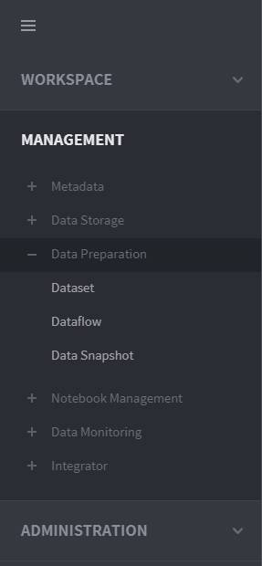
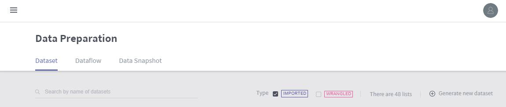

# Create a dataset

A **dataset**, which is the basic unit of data preparation, refers to an entity subject to data operations. Datasets are either **imported datasets** and **wrangled datasets**.

* **Imported Dataset:** A source data entity before the implementation of transformation rules
* **Wrangled dataset:** A data entity subject to analysis following the implementation of transformation rules

A wrangled dataset is created during the **dataflow** setting process, which defines transformation rules, while an imported dataset is created during this dataset creation procedure.

The Dataflow menu can be accessed under **MANAGEMENT** &gt; **Data Preparation** &gt; **Dataset** on the left-hand panel of the main screen.

Next, on the upper right of the **dataset** page, click the **+ Generate new dataset** button to create a new dataset.

In the dataset creation page, select the dataset type.

* **My file:** Create a dataset by opening the user’s local file or via a URI \(upcoming feature\) \(See **Create a dataset from a file** for a detailed procedure\).
* **Database:** Create a dataset using external database access information and queries \(See **Create a dataset from a database** for a detailed procedure\).
* **Staging DB:** Create a dataset from the staging DB built in Metatron \(See **Create a dataset from staging DB** for a detailed procedure\).


The Staging DB is an in-cluster database that stores data temporarily in order to facilitate data loading. Hive is generally used for it.


## Create a dataset from a file

Create a dataset by opening the user’s local file or via a URI:

1.On the data type selection page, select **My File**.

2. Select a file to be used as a data source from your local PC. You can click the **Import** button to select a file, or drag and drop the file into the box. Once a file is selected, click Next.

3. Check the grid of the uploaded file, and designate a column delimiter. Proceed if the data is successfully displayed.

4. Enter the **Name** and **Description** of the dataset, and click the **Done** button.

5. Once the dataset is created, the dataset list is displayed. You can check that the list contains the newly created dataset.

## Create a dataset from a database

Create a dataset using external database access information and queries.

To create a dataset from a database, you should first create a Data Connection. See [Create a data connection](../discovery-data-management/discovery-data-connections.md) for a detailed procedure.

After establishing the data connection, go to **MANAGEMENT** &gt; **Data Preparation** &gt; **Dataset** &gt; **+ Generate new dataset**.

1. On the data type selection page, select **Database**.

2. Select the data connection, and press the **Test** button to check that the connection is valid.

3. Select the data. You can either select a table from the connected database, or write a query yourself.

* **Table:** Select a database and a table to display the table’s data. Once the data being ingested has been displayed, confirm the data and click **Next**.
* **Query:** Write a query to import the data you want, and click **Run** to display the data in the lower section. Confirm the data and click **Next**.

4. Enter the **Name** and **Description** of the dataset, and click the **Done** button.

5. Once the dataset is created, the dataset list is displayed. You can check that the list contains the newly created dataset.

## Create a dataset from staging DB

Create a dataset from the staging DB built in Metatron.

The creation of a staging DB dataset is the same as dataset creation from a database, but does not involve the selection of a data connection.

1.On the data type selection page, select **Staging DB**.

2. Select the data. You can either select a table from the connected database, or write a query yourself.

* **Table:** Select a database and a table to display the table’s data. Once the data being ingested has been displayed, confirm the data and click **Next**.
* **Query:** Write a query to import the data you want, and click **Run** to display the data in the lower section. Confirm the data and click **Next**.

3. Enter the **Name** and **Description** of the dataset, and click the **Done** button.

4. Once the dataset is created, the dataset list is displayed. You can check that the list contains the newly created dataset.

