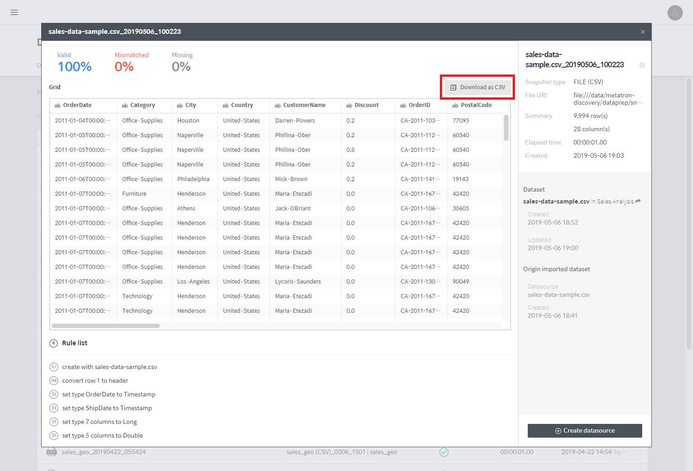

# Using Data snapshots

A **data snapshot** created through a dataflow can be used as follows:

* Check the data snapshot results
* Ingest into the Druid engine
* Download as a CSV file

## Check the data snapshot results

The status of snapshot creation can be classified as follows:

* **Success** = SUCCEEDED
* **Failed** = FAILED
* **Preparing** = INITIALIZING, RUNNING, WRITING, TABLE\_CREATING, CANCELING

You can view the details of snapshot creation through the two paths below:

1. Go to the snapshot list under **MANGEMENT** &gt; **Data Preparation** &gt; **Data Snapshot**.
2. Click the **Snapshot \(\#\)** tab on the right of the [Edit rules](../dataflow-rules.md) page in **Dataflow**

In the snapshot details page, you can view details such as data validity ratio and a grid of the created snapshot, and download the results as a CSV file.

If valid data has not been created, the snapshot details page displays an error log.

## Download as a CSV file

In the details page of a successfully created snapshot, the **Download as CSV** option is enabled.

The downloaded file is a standard CSV, with each value separated by a “comma” and each row by a “new line.”

