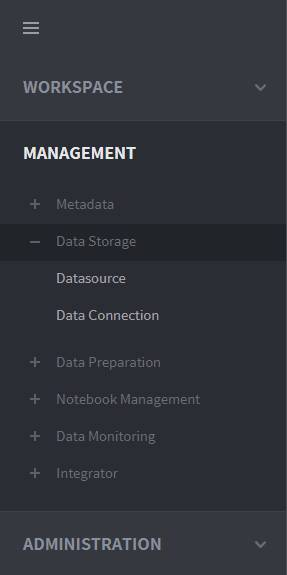
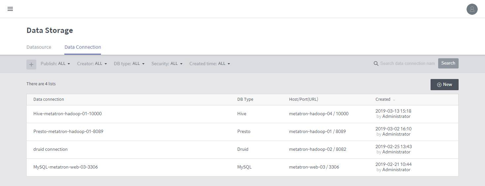

# Discovery Data Connections

BigConnect Discovery can connect to an external database directly. To connect to an external database, you must create and manage a data connection containing the access information to that database. By registering such a data connection, you don’t need to enter the access information each time you connect to the same database.

The Data Connection menu can be accessed under **MANAGEMENT** &gt; **Data Storage** &gt; **Data Connection** on the left-hand panel of the main screen.

## Data connection management home

On the Data Connection home page, you can create, edit and view database connections.

* **Publish:** Filter the data connection list by public workspace.
* **Creator:** Filter the data connection list by creator.
* **DB type:** Filter the data connection list by database type \(MySQL, PostgreSQL, Hive, or Presto\).
* **Security:** Filter the data connection list by security type \(Always connect, connect by user’s account, or connect with ID and password\).
* **Created time:** Filter the data connection list by time of creation \(Today, Last 7 days, or Between\).
* **Search:** Search the data connection list by data connection name.
* **Number of data connections:** Displays how many data connections are returned in the list.
* **New:** Click on it to create a new data connection.
* **Delete:** Hover the mouse over a data connection to display a recycle bin icon. Click the icon to delete the data connection.

## Create a data connection

On the Create data connection screen, enter the required information to create a connection.

* **DB type:** Four database types are currently supported. \(MySQL, PostgreSQL Hive, Presto\)
* **Host:** Enter the hostname to connect to the database.
* **Port:** Enter the port to connect to the database.
* **URL only:** Enter a database URL instead of a host and port.
* **User name:** Enter the username of the database.
* **Password:** Enter the password of the database.
* **Security:** Set the type of security to be applied while using the data connection.

  > * **Always connect:** Logs in using the account information the user has entered to create a new data connection.
  > * **Connect by user’s account:** Logs in using the account information registered in BigConnect Discovery.
  > * **Connect with ID and password:** Requires to enter the account information every time the data connection is used.

* **Validation check:** Checks whether the connection information entered is valid; the result is shown next to the button. The validity of the connection appears below the button.
* **Advanced settings:** You can add a custom property key and value as options.
* **Publish:** Set which workspaces have access to the data connection.

  > * **Allow all workspaces to use this data connection:** Select this check box to make the data connection available in all workspaces.
  > * **Edit:** Used to allow specific workspaces to access the data connection. This button will disappear if the data connection is set as open data.
  > * **Number of shared workspaces:** Displays how many workspaces have access to the data connection.

