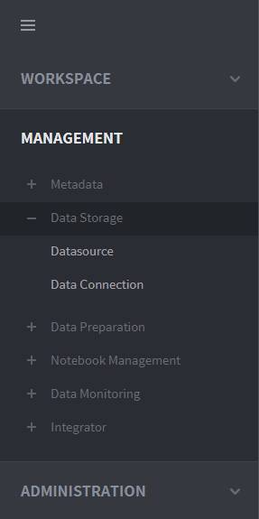
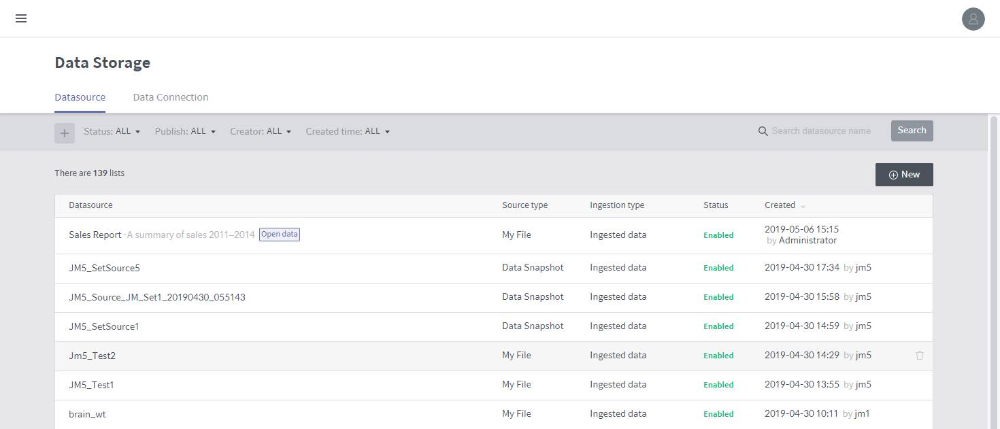
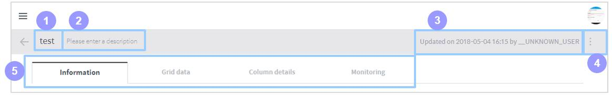
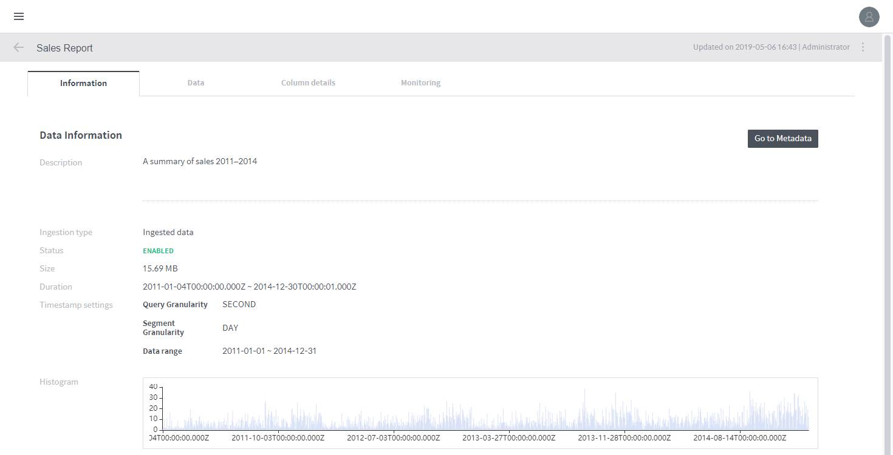
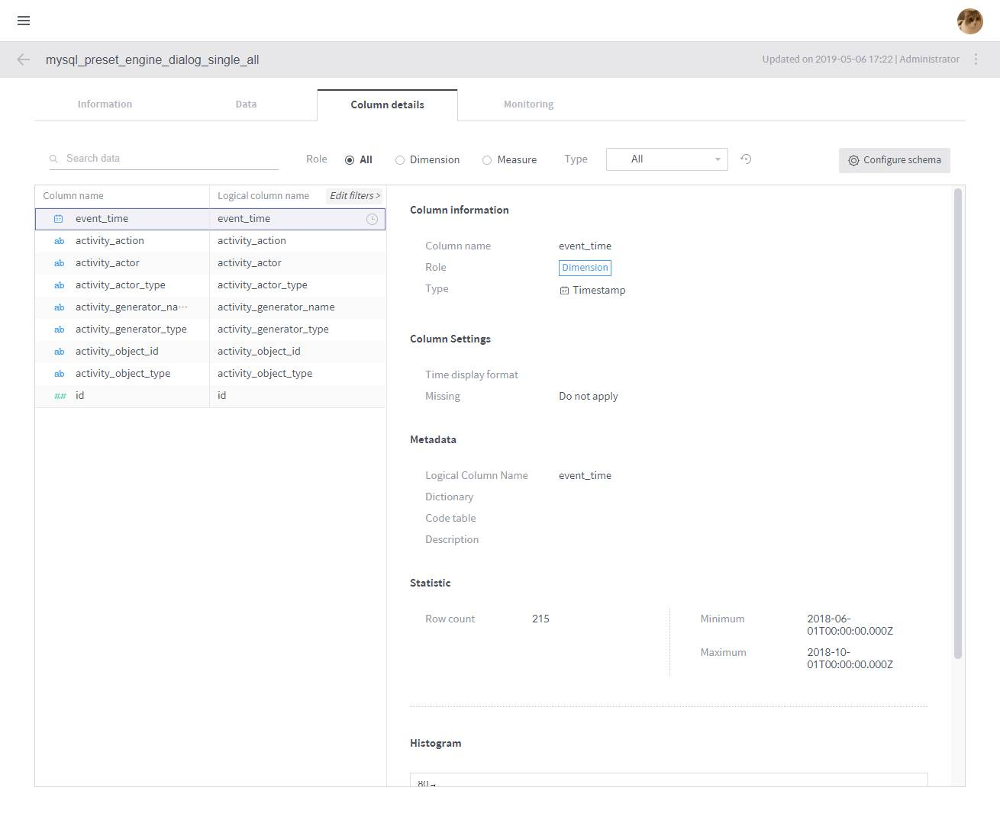

# Discovery Data Sources

In BigConnect Discovery, a “data source” refers to a Druid database table into which data is ingested. Based on these data sources, workbooks and notebooks perform data analytics and visualization.

The Data Source menu can be accessed under **MANAGEMENT** &gt; **Data Storage** &gt; **Data Source** on the left-hand panel of the main screen.

## “Dimensions” and “Measures”

The columns of a data source linked to the dashboard are categorized into **dimension** and **measure** columns as explained below. To make full use of Discovery’s data analysis and visualization features, you must understand the concepts of dimensions and measures clearly.

**Dimension column**

A column containing categorical data with the following characteristics:

> * The values in this type of column are not for aggregation but to be categorized \(e.g.: Category, Region, Organization\)
> * By each of these categories, measure values are aggregated.

**Measure columns**

A column containing quantitative data with the following characteristics:

> * The values in this type of column are subject to aggregation or contain quantitative information \(e.g.: Sales\)
> * These values are aggregated based on dimensions.

## Data source management home

On this home page, you can create, edit and view data sources.

1. **Status:** Filters the data source list by the availability of data sources stored in the data storage.

   > * **Enable:** Displays data sources that have been ingested and are available in workbooks or workbenches.
   > * **Preparing:** Displays new data sources whose ingestion is in progress.
   > * **Failed:** Displays data sources that have not been created properly.
   > * **Disabled:** Displays data sources that have been ingested but are not available because of an error in a certain Druid process.

2. **Publish:** Filter the data source list by public workspace.

   > * **Open Data:** Displays only data sources publicly available in all workspaces.
   > * **Admin Workspace:** Displays only data sources available in the administrator workspace.
   > * **Shared workspaces:** Displays only data sources available in the selected shared workspaces.

3. **Creator:** Filters the data source list by user or group that created the source data.
4. **Created time:** Determines whether the data source list is filtered by created or updated time. You can choose from among All, Today, and Last 7 days or specify a time range to display only those entries that were created/updated within the range.
5. **Search by name of data source:** Searches the data source list for the name you type in.
6. **Data source list:** Lists data sources filtered by specified criteria. Click an entry in the list to view its details.
7. **Delete:** Hover the mouse over a data source to display a trash icon. Click the icon to delete the data source.

## Data source details

Click a data source listed in the data source management home to view various attributes of that data source. The following subsections describe each area of the data source details. Note that a data source represents a Druid database table stored in BigConnect Discovery and necessarily includes a timestamp column as a time-series table.

### **Common top area**

1. **Name:** Name of the data source. Click on it if you want modify it.
2. **Description:** Description of the data source. Click on it if you want modify it.
3. **Last update:** Shows who and when last updated the data source.
4. **Delete:** Click this icon to display a menu that allows you to delete the data source.
5. **Tab selection:** Each tab displays a specific set of attributes of the data source. Depending upon the type of data source, not all of the three tabs may be displayed. For details on each tab, refer to the relevant subsection below.

### Data information area

This area displays basic information of the data source.

1. **Data type:** Type of the imported source data from which the data source has been created.
2. **Status:** Displays the availability of the data source.
3. **Size:** Displays the size of the data source.
4. **Duration:** Displays the time range of the timestamps included in the data source.
5. **Timestamp setting:** Displays the granularities defined when the data source was created.

   > * **Query Granularity:** Defines the minimum time period by which data is queried. This ensures faster returns by aggregating data per granularity interval.
   > * **Segment Granularity:** In Druid, a data source is stored into multiple segments to be processed over multiple nodes in the distributed cluster environment. This granularity setting defines the time intervals into which the data source is partitioned.
   > * **Histogram:** A graph displaying the size of the data stored within each time interval in Kbytes. This histogram is can be rendered because the Druid engine timestamps every table record.

**Publish area**

In this area, you can check and set which workspaces have access to the data source.

1. **Allow all workspaces to use this data source:** Select this check box to make the data source available in all workspaces.
2. **Edit:** Used to allow specific workspaces to access the data source. This button will disappear if the data source is set as open data.
3. **Number of shared workspaces:** Displays how many workspaces have access to the data source.

### Change data schema

The top section of the column details tab provides a user interface to filter columns by the criteria you define. Columns that meet the criteria are displayed on the left. You can also edit column settings.

Column view/settings

1. **Search data:** Searches for columns by the column name you type in.
2. **Role:** Displays all, dimension, or measure columns.
3. **Type:** Displays the columns whose data type is selected.
4. **View all:** Clears all filter settings in the Search data, Role, and Type options and returns to view all columns.
5. **Configure schema:** Click this button to prompt a window to edit the current column settings.
6. **Column list:** Lists table columns.
7. **Column information:** Displays attributes of the selected column.
8. **Column settings:** Displays the metadata of the selected column.
9. **Statistics:** Displays the row count and other statistical values of the selected column.

**Configure the schema**

Provides a user interface for editing the name and type of columns.

1. **Role:** Displays whether the column is a dimension or measure.
2. **Name:** Displays the actual name of the column.
3. **Logical name:** Allows you to edit the logical name of the column displayed in the system.
4. **Type:** Allows you to edit the logical type \(character/integer/date, etc.\) of the column.
5. **Format:** Allows you to edit the display format of the column in the case of the column being a timestamp type.
6. **Description:** Allows you to add a detailed description of the column.

## Analyze data statistics

The Monitoring tab reports the usage of the data source.

**Change of transaction**

Displays the trend of data source transactions over time.

**Changes of data size**

Displays the trend of the data source size over time.

**Query distribution \(during last one week\)**

* **Query distribution by user \(during last one week\):** Displays a pie chart of query percentages by user for the past week.
* **Query distribution by elapsed time \(during last one week\):** Displays a pie chart of query percentages by execution time for the past week.

**Query log**

Used to view a detailed history of each performed query.

1. **Date:** Set a time range to display only those queries that were last executed within this time range.
2. **Query type:** Filters the performed queries by type.
3. **Status:** Displays all, succeeded, or failed queries.
4. **Query list:** Lists queries filtered by specified criteria.
5. **Detail:** Click on it to view the query statement.

