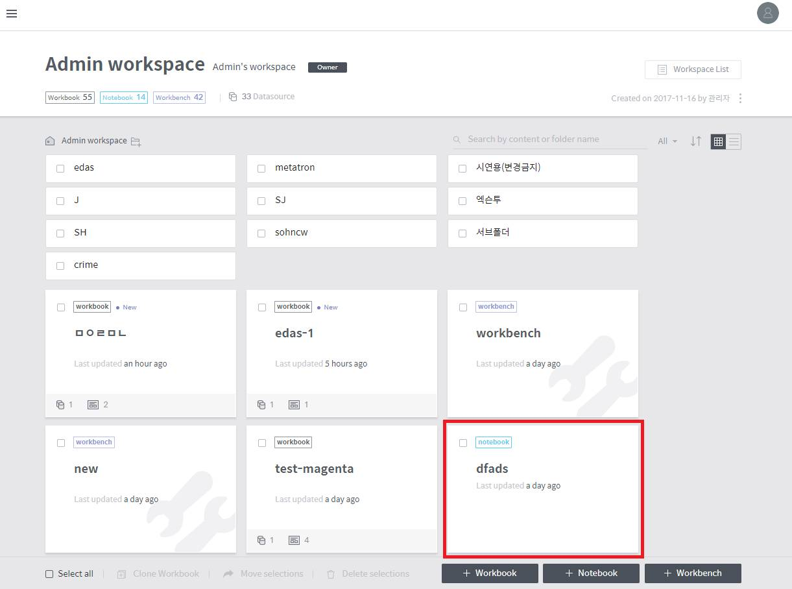

# Create a notebook

Once the notebook server has been set up, you can create a notebook. A notebook is created as follows:

1. Click the **+ Notebook** button at the bottom of the workspace. You’ll be prompted to create a notebook.

2. Select the type of data set that you wish to analyze in the notebook. You can choose between **Data source**, the unit of data used in Metatron Discovery, **Dashboard**, **Chart**, and **Not selected**. If you want to use Zeppelin, select **Not selected**

3. After selecting either **Data Source**, **Dashboard**, or **Chart**, you can see a list of data currently registered in BigConnect Discovery. Select the data to analyze and click Next.

4. Enter the information about the notebook that you want to use as an analytics tool for data. The **server type** can only be selected for a notebook server connected at the initial notebook server setup. If **Jupyter** is selected, “R” or “Python” can be selected for analysis, whereas “Spark” \(Scala\) is used when **Zeppelin** is selected.

5. Once a notebook has been created, you can find it in the workspace.

