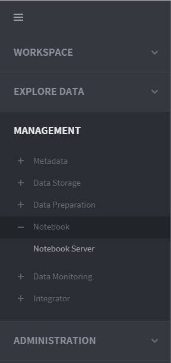

# Manage notebook servers

To enable the Notebook module, the **administrator** must connect to a “notebook server,” which refers to a server that provides an external analytics tool.

On the left-hand panel of the main screen, go to **MANAGEMENT ‣ Notebook ‣ Notebook Server** to register a new notebook server or view and edit registered notebook server.

### Notebook server list

This page shows a list of notebook servers. The notebook server list can be filtered by server name or type, and clicking on an entry in the list allows you to view and edit the selected server’s information. Also, you can delete a notebook server either by clicking its  button that appears when hovering the mouse over the server, or by clicking the Delete selections after selecting the checkboxes next to the servers you want to delete.

### Add a notebook server

Click the Add a server button in the notebook management home to pop up a window to register a notebook server as follows:

* **Type:** Select the external analytics tool installed in the notebook server to be registered. You can select either **Jupyter** or **Zeppelin**.
* **URL:** Enter the URL of the notebook server to be registered. http://and https://are supported.
* **Name:** Enter a name for the notebook server to be registered.
* **Description:** Enter a description for the notebook server to be registered.

