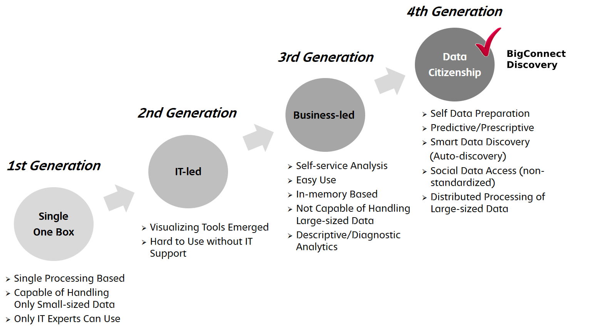
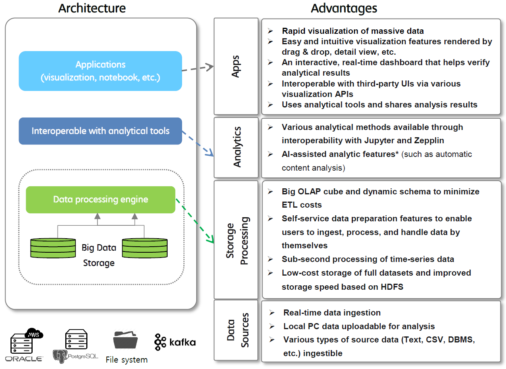

# Discovery Overview

BigConnect Discovery is a 4th-generation OLAP-based business intelligence \(BI\) solution that combines OLAP, visualization, and machine learning technologies for even non-experts to quickly and easily derive higher-level value from data.

### 4th-generation BI solution

The figure below shows BI trends from the 1st to 4th generation.

The mainstream products in the current BI market belong to the 2nd and 3rd generations, and 4th generation products are beginning to come under the spotlight. As a 4th generation BI solution, BigConnect Discovery supports self & ad-hoc data discovery and guarantees rapid response to big data.

### Built on Big OLAP

BigConnect Discovery combines data of various dimensions for large-sized fact data to produce a single big OLAP cube \(data mart\).

The use of a big OLAP cube offers the following advantages:

* Minimizes the number of data marts
  * Lower ETL cost for data mart production
  * Influence of structural change can be minimized
  * Satisfies diverse demands by saving all fact data
* Distributed architecture allows storing of large-scale data and ensures fast data processing
* With a dynamic schema approach, schema changes do not require schema redefining
* Data can be processed at the record level in real time as tables are saved with no data loss

### Architecture

BigConnect Discovery is an end-to-end solution that supports the entire process of data discovery, from preparation of large-scale data to data visualization and exploration and to advanced analytics. The figure below is a summary of Discovery’s architecture and key features.

