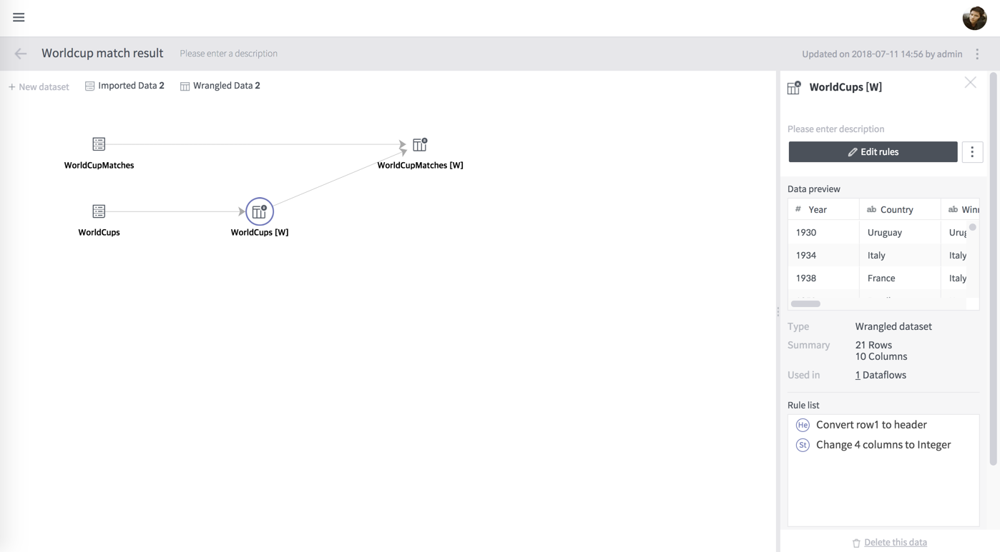
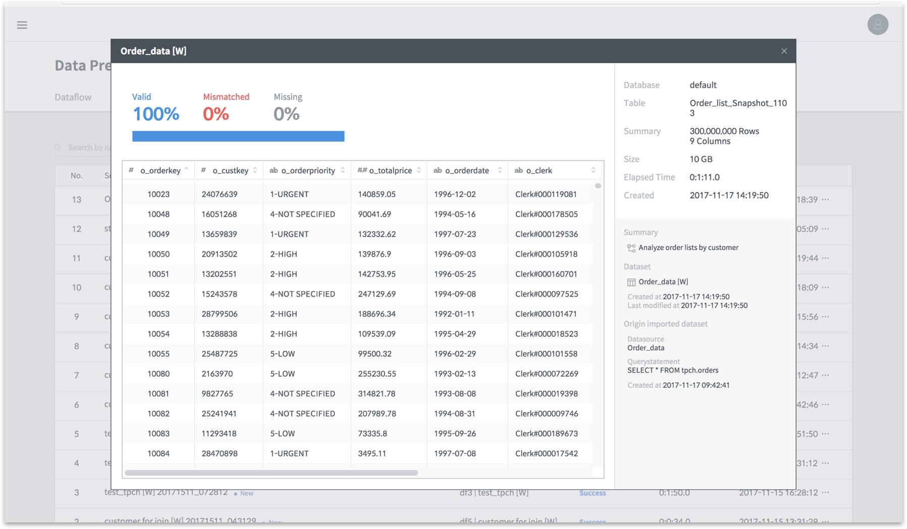
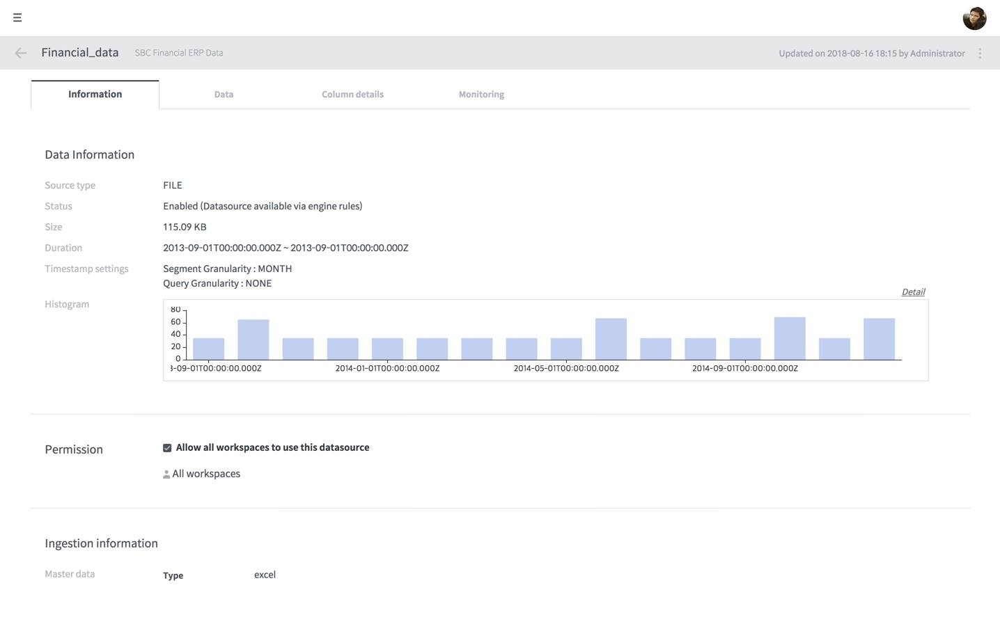
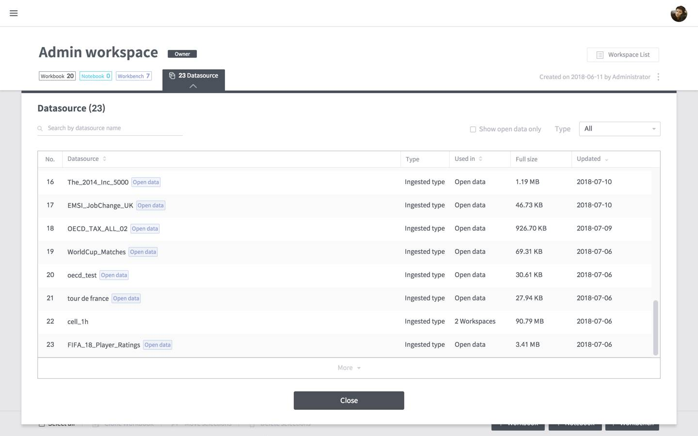
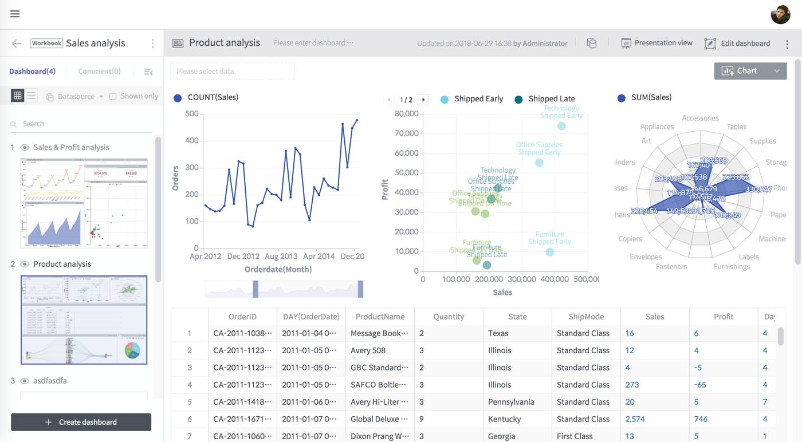
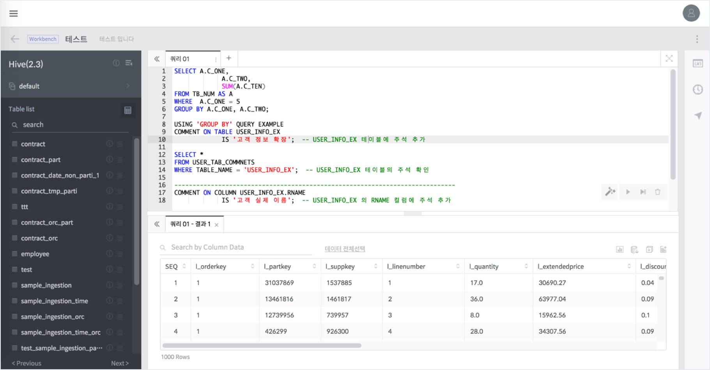
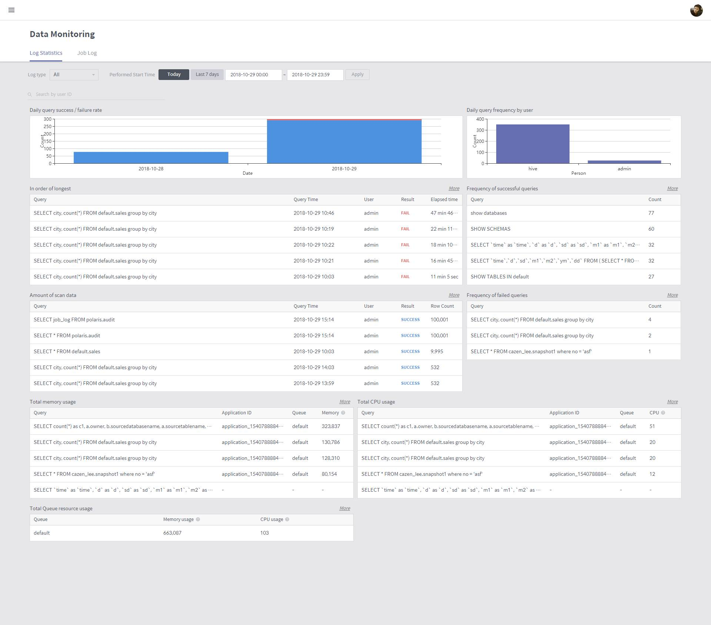

# Discovery Components

BigConnect Discovery performs analytics on its ingested data sources or other external data sources using various analytical tools and outputs analytical results in charts and reports. To utilize this system, you must understand its overall structure shown below:

### Data Preparation

Data Preparation refines data from source data to be ingested into BigConnect. See [Discovery Data Preparation](../data-preparation/) for more details.

### Data Storage

Data Storage manages data ingested into the Druid engine for analysis and visualization. See [Discovery Data Management](../discovery-data-management/) for more details.

### Data analysis and visualization

Each module below allows users to perform visualization-based exploration and analysis of stored data.

#### Workspace

Workspace provides an interface to manage its workbooks, workbenches, and notebooks used in an organization according to user access. See [Discovery Workspaces](../discovery-workspaces.md) for more details.

#### Workbook, dashboard, chart

Workbook supports working on, sharing, and making a presentation with dashboards and charts using a PowerPoint-like interface. See [Discovery Workbook](../discovery-workbooks/)s for more details.

#### Notebook

Notebooks enables advanced analytics based on machine learning by using Jupyter Notebooks. See [Discovery Notebooks](../discovery-notebooks/) for more details.

#### Workbench

The Workbench enables SQL data analytics. See [Discovery Workbench](../discovery-workbench/) for more details.

### Data Monitoring

This function monitors data use based on data query statistics and query logs. See [Discovery Data Monitoring](../discovery-data-management/discovery-data-monitoring.md) for more details.

