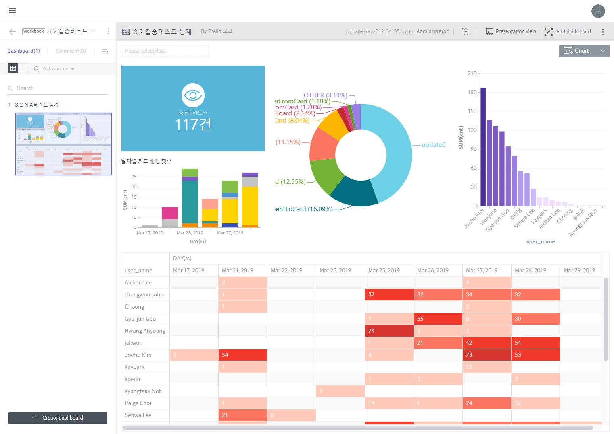

# Discovery Workbooks

Discovery Workbook is a data visualization module powered by the Druid engine. As shown in the diagram above, each **workbook** consists of multiple **dashboards**, while each dashboard consists of various **charts** showing a visualization of source data analysis.

The main features of Workbook are as follows:

> * Fast and flexible data analytics over time-series multidimensional data sources.
> * Dashboards contain a variety of visualized charts and texts to be compiled into a report for presentations.
> * Frequently used algorithms such as clustering, prediction lines, and trend lines can be implemented through a GUI \(graphical user interface\).

## Create a workbook

In BigConnect Discovery, a **workbook** functions as a standalone data analytics report. Once a workbook is created, you can store a number of **dashboard** slides in the workbook and present them in the proper order.

A workbook is created as follows:

> 1. Click the **+ Workbook** button at the bottom of the workspace to move to the workbook creation page.
>
>    > 
>
> 2. Enter a name \(required\) and description for the workbook to be created and click **Done**. If you select **Continue to create a dashboard of a new workbook**, you’ll proceed directly to the **Create Dashboard** page. This option is provided because a workbook cannot work without dashboards in it.
>
>    > 
>
> 3. After clicking the “+ Add Data Source” button in the middle of the screen, select a data source to create a dashboard. For details on how to create a dashboard, refer to **Create a dashboard**.
>
>    > 
>
> 4. You can check the new workbook in the workspace home as shown below. Click the workbook to enter it.
>
>    > 

## Dashboard

Stored in a workbook, a dashboard provides functions to analyze and visualize its connected data source as needed. Therefore, an important step to create a dashboard is connecting to a data source.

You can visualize analyses of various data sources into charts and texts; those visualizations are customizable using pivoting, chart mapping, and filtering.

