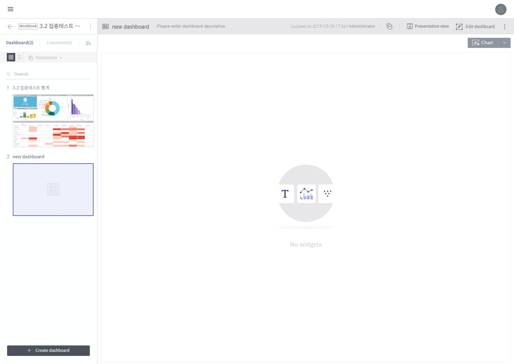

# Discovery Dashboards

## Creating a Dashboard

A dashboard is created as follows:

> 1. Click **+ Add data source** on the workbook screen.
>
>    > 
>
> 2. From the list of data sources accessible to the workspace, select the master data sources to which you want to connect the dashboard. In a subsequent step, you can select additional data sources to be joined to these master data sources selected here.
>
>    > 
>    >
>    > * **Search by data source name:** Search for a data source accessible to the workspace by name.
>    > * **Show open data only:** Displays only those designated as “open data sources.”
>    > * **Type:** Displays only those data sources that are the connection or collection type.
>    > * **Data source list:** Lists data sources filtered by specified criteria.
>    > * **Data source information:** Displays brief information of the data source selected in the list.
>
> 3. If you have selected more than one data source, you can associate them by dragging one data source to another. Associated data sources can be filtered by each other. If you do not want data source association, simply click **Done**.
>
>    > 
>
> 4. Once you drag a data source to another one, a new window will pop up to prompt you to configure the data source association. Select a column on each table as an association key by which to filter the other data source. And click **Done**.
>
>    > 
>
> 5. Once you have finished setting up associations between the master data sources, click **Done**.
>
>    > 
>
> 6. Re-configure master data source associations or add other data sources to be joined to the top data source selected above as described below:
>
>    > 
>    >
>    > Master data source association view
>    >
>    > > *  : Click on it to add a new master data source.
>    > > * **Edit association:** Click on it to edit an established data source association.
>    >
>    > Settings panel for individual master data sources \(click one of the ovals corresponding to a master data source on the diagram to open it\)
>    >
>    > > * **Data preview:** Displays the data table resulting from data source joins.
>    > > * **Manage schema:** Allows you to manage joins to the selected data source \(for a detailed procedure, refer to the next step\).
>    > > * **Unlink:** Click on it to remove the selected data source.
>    > > *  : Click on it to close the panel.
>
> 7. To join one of the master data sources to other data sources, click the corresponding oval on the diagram → click the **Manage Schema** tab on the panel at the bottom → click **+ Add a data source to join**.
>
>    > 
>
> 8. Refer to the description below to set up data joins.
>
>    > 
>    >
>    > * **Master data source:** Displays information on the master data source to which you want to join another data source.
>    > * **Datasource to join:** Select a data source to be joined to the master data source.
>    > * **Add to join keys**: A join key defines the join relationship between the master and slave data sources in each column. Select a column to be joined from each data source, and click this button to add a new join key. For this, the two columns must be of the same data type.
>    > * **Join type:** Select how to join and transform a data source. To help you understand, each join type is explained below using the following tables as an example.
>    >
>    >   > | Master data source |  |
>    >   > | :--- | :--- |
>    >   > |  |  |
>    >   > | Product name \(join key\) | Price |
>    >   > | A | $22.11 |
>    >   > | B | $9.23 |
>    >   > | C | $8.99 |
>    >   > | D | $10.10 |
>    >   >
>    >   > | Data source to be joined |  |
>    >   > | :--- | :--- |
>    >   > |  |  |
>    >   > | Product name \(join key\) | Sales |
>    >   > | B | 100 |
>    >   > | D | 200 |
>    >   > | E | 50 |
>    >   >
>    >   > * **Inner:** Imports those records of each data source whose join key column values are present also in the other data source’s join key column, joins them, and stores the joined records in the resulting table. \(Intersection between two data sources\)
>    >   >
>    >   >   > | Product name \(join key\) | Price | Sales |
>    >   >   > | :--- | :--- | :--- |
>    >   >   > | B | $9.23 | 100 |
>    >   >   > | D | $10.10 | 200 |
>    >   >
>    >   > * **Left:** Imports those records of the right data source \(data source to be joined\) whose join key column values are present also in the join key column of the left data source \(master data source to join\), joins them to the left data source records, and stores the joined records in the resulting table. Those records from the right data source whose join key column values are not present in the left data source are discarded.
>    >   >
>    >   >   > | Product name \(join key\) | Price | Sales |
>    >   >   > | :--- | :--- | :--- |
>    >   >   > | A | $22.11 | null |
>    >   >   > | B | $9.23 | 100 |
>    >   >   > | C | $8.99 | null |
>    >   >   > | D | $10.10 | 200 |
>    >   >
>    >   > * **Right:** Imports those records of the left data source \(master data source to join\) whose join key column values are present also in the join key column of the right data source \(data source to be joined\), joins them to the right data source records, and stores the joined records in the resulting table. Those records from the left data source whose join key column values are not present in the right data source are discarded.
>    >   >
>    >   >   > | Product name \(join key\) | Price | Sales |
>    >   >   > | :--- | :--- | :--- |
>    >   >   > | B | $9.23 | 100 |
>    >   >   > | D | $10.10 | 200 |
>    >   >   > | E | $null | 50 |
>    >   >
>    >   > * **Full Outer:** Imports all records from both data sources, join them, and stores the joined records in the resulting table. \(Union between two data sources\)
>    >   >
>    >   >   > | Product name \(join key\) | Price | Sales |
>    >   >   > | :--- | :--- | :--- |
>    >   >   > | A | $22.11 | null |
>    >   >   > | B | $9.23 | 100 |
>    >   >   > | C | $8.99 | null |
>    >   >   > | D | $10.10 | 200 |
>    >   >   > | E | null | 50 |
>    >
>    > * **Preview results:** Displays the data table resulting from data source joins.
>
> 9. Confirm the information on the imported data source, enter the **Name** and **Description**, and click **Done** to create a new dashboard.
>
>    > 
>
> 10. The new dashboard will be added to the workbook home. Click the dashboard to display its contents.

## Change dashboard size and layout

Click Edit Dashboard on the basic dashboard page to go to a page for editing the configuration of the dashboard. In this page, you can add a widget, edit the dashboard, set the hierarchy and change the layout.

### Dashboard widget arrangement settings

1. **Change widget location:** Drag the title of a widget to move the widget.
2. **Adjust widget width:** Move the distance between widgets to adjust their widths.
3. **Add a widget to the display area:** Drag a widget from the widget list on the right panel to the left widget display area to add the widget to the display area.
4. **Delete a widget from the display area:** Click the X button on a widget shown in the widget display area to delete the widget from the display area.

### Chart widget panel

On the chart widget panel, you can add/edit/delete a chart in the dashboard.

1. **Number of chart widgets:** Displays how many chart widgets are registered in the dashboard.
2. **Add a chart widget:** Click on it to create a new chart widget in the dashboard.
3. **Chart widget list:** Lists chart widgets registered in the dashboard. Hover the mouse over a widget to display the edit and delete icons. Drag a widget to the widget display area to display the widget in the display area.
4. **Set chart hierarchy:** Click on it to set parent/child relationships between charts in the dashboard. Selecting a data item from the parent chart filters the child chart by the selection. To set a hierarchy, drag the chart to be set as a child under the chart to be set as a parent. Once you finish setting the chart hierarchy, the chart menu is restructured accordingly.

### Text widget panel

On the text widget panel, you can add/edit/delete a text widget in the dashboard.

1. **Number of text widgets:** Displays how many text widgets are registered in the dashboard.
2. **Add a text widget:** Click on it to create a new text widget in the dashboard.
3. **Text widget list:** Lists text widgets registered in the dashboard. Hover the mouse over a widget to display the edit and delete icons. Drag a widget to the widget display area to display the widget in the display area.

### Layout panel

On the layout panel, you can adjust some settings on how to arrange widgets and display each widget in the widget display area.

* **Set board height**

  > * **Fix to screen:** Maximizes the height of the dashboard to fill the screen.
  > * **Fix to height:** Set the height of the dashboard to a specific pixel value.
  > * **Margin between widgets:** Sets the margin between widgets in the widget display area.

* **Chart title:** Sets whether to display the title of each chart and filter widget in the widget display area.
* **Legend:** Sets whether to display a legend for each chart widget in the widget display area.
* **Mini-map:** Sets whether to display a mini-map for each chart widget in the widget display area.

### Data source panel

In the data source panel, you can view and edit information on connected data sources, as well as add column filters easily. Click on a filter icon on a dimension or measure on the right-hand side to add a filter.

Please note that the filters you can apply or clear here are global filters applied to the entire dashboard, and those applied or cleared in the chart editor are all chart filters.

## Check data sources in a dashboard

Click the  button on the basic dashboard page to display a dialog box displaying information about the data source used in the dashboard. At the top-left corner, you can choose the data source that you want to view. This dialog box consists of three tabs \(Data grid, Column detail, Dashboard data information\).

### Data grid tab

Displays all values in the data source.

### Column details tab

Displays details about each column of the data source.

### Dashboard data information tab

Displays an overview of the data source.

