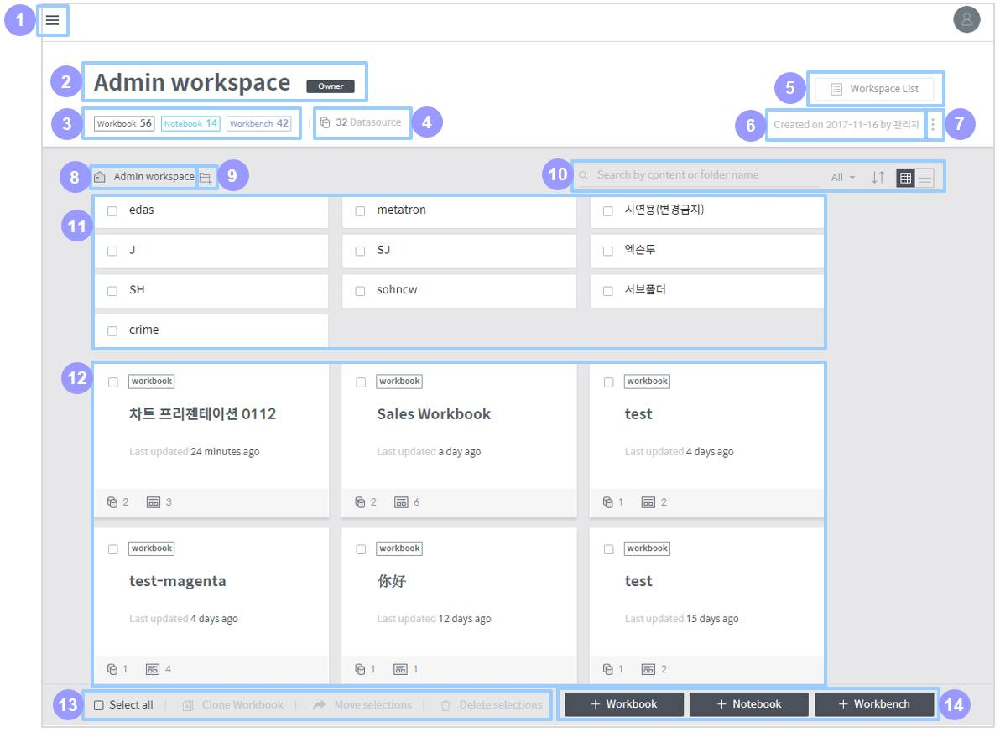

# Discovery Workspaces

## Workspace home

On the workspace home page, you can perform manage the Discovery entities \(workbooks, notebooks and workbenches\) contained in the workspace.

### Composition of the workspace home

The overall composition of the workspace home is as follows:

1. **Main menu button:** Click this button to open a panel to access another workspace.
2. **Workspace information:** Displays the name and description of the workspace. If the logged-in user owns the workspace, an Owner icon will be displayed next to the name of the workspace.
3. **Registered entities:** Displays the number of entities registered in the workspace by entity type.
4. **Data source:** Displays the number of data sources used in the workspace. Click this area to show a list of these data sources.
5. **Workspace list:** Click this button to show a list of shared workspaces. \(See Shared workspace list for how to handle it.\)
6. **Creation information:** Displays who and when created the workspace.
7. **More:** Edit the settings of the workspace.

   > * **Edit the name and description:** Edits the name and description of the workspace.
   > * **Set shared member & group:** Sets the users and groups who can access the workspace. \(See Set access permissions for a shared workspace for details.\)
   > * **Set notebook server:** Sets access information for external analytics tool servers used by the Notebook module.
   > * **Set permission schema:** Sets the access permission of each user role for the workspace. \(See Set access permissions for a shared workspace for details.\)
   > * **Change owner:** Changes the owner of the workspace.
   > * **Delete workspace:** Deletes the workspace.

8. **Path in the workspace:** Displays the current location in the workspace. Click on a parent folder listed in the path to move to that folder.
9. **Create a folder:** Click on it to create a new folder in the current location.
10. **Filter/sort the entity list:**

    > * **Search:** Searches for an entity or folder in the workspace by name.
    > * **Entity type:** Displays only your selected type of entities among workbooks, notebooks, and workbenches.
    > * **Sort:** Sorts folders and entities by their name or when they were last updated.
    > * **View type:** Select either the grid view or list view as the format of how the entities are listed in the workspace.

11. **Folder list:** Displays folders that meet search criteria in the current location. Click one to enter that folder. \(For details on individual folders, see Folder items\)
12. **Entity list:** Displays entities that meet search or sorting criteria in the current location. Click an entity to enter its home. \(For details on individual entities, see Entity items\)
13. **Select/clone/move/delete entity:** Select all entities, or clone, move or delete an entity. \(See Select/clone/move/delete folder and entity for details.\)
14. **Create an entity:** Buttons used to create a specific type of entity in the workspace. \(For details, see Create a workbook, Create a notebook, and Create a workbench, respectively.\)

### Folder items

When the mouse cursor is over a folder, it is shown as follows:

> 
>
> * **Check box:** Used to select the folder. You can clone, move or delete the selected folder.
> * **Name:** Name of the folder.
> * **Edit:** Click on it to modify the name of the folder. This button is displayed only when you hover the mouse over the folder item.
> * **Delete:** Click on it to delete the folder. This button is displayed only when you hover the mouse over the folder item.

### Entity items

When the mouse cursor is over an entity, it is shown as follows:

> 
>
> * **Check box:** Used to select the entity. You can clone, move or delete the selected entity.
> * **Entity type:** Displays the type of the entity \(workbook/notebook/workbench\).
> * **Delete:** Click on it to delete the entity. This button is displayed only when you hover the mouse over the entity item.
> * **Name:** Name of the entity.
> * **Last updated:** Displays when the entity was last updated.
> * **Number of data sources/dashboards:** This is an exclusive area for the workbook type.
>
>   > * The number next to the  icon refers to how many data sources are connected to the workbook.
>   > * The number next to the  icon refers to how many dashboards are registered in the workbook.

### Select/clone/move/delete folder and entity

You can clone, move or delete folders and entities in the workspace. Once you select a folder or entity, the clone, move, and delete buttons in the lower-left corner of the workspace home become active.

* **Select all:** Selects all items in the current folder and entity list.
* **Clone workbook:** This is exclusive for the workbook type. Click this button to clone the selected workbooks.
* **Move selections:** Moves the selected folders and entities. Workbooks can be moved to another workspace, and other types of items can be moved to another folder in the same workspace. However, it is impossible to move selections when workbooks and other types of entities are selected together.
* **Delete:** Deletes the selected folders and entities.

## Shared workspace

A shared workspace is designed for access and use by multiple users. The following subsections describe how to view and create shared workspaces, and explain “permission schema,” which sets which users or groups are allowed to access shared workspaces.

### Shared workspace list

The shared workspace list page is used to view a list of all shared workspaces accessible to the logged-in user and to move to a specific workspace. This page can be accessed via two methods:

> * Click the  button at the top-left of the Discovery screen to open the main panel, and click **Workspace list &gt;&gt;**.
> * Click **Workspace list** at the top-right of the workspace home.

The shared workspace list page is composed as follows:

1. **Number of shared workspaces:** Displays how many shared workspaces are listed.
2. **Add a shared workspace:** Click this button to move to the page to add a shared workspace. \(See Create a shared workspace for a deailed procedure\)
3. **Personal workspace:** Click this button to move to the personal workspace owned by the logged-in user.
4. **Search:** Searches the shared workspace list by the name you typed in.
5. **Favorites:** Displays only those workspaces designated as favorites.
6. **Public only:** Displays only those workspaces set as public.
7. **I’m the owner:** Displays only those workspaces for which the logged-in user is the administrator.
8. **Name ascending/descending:** Sorts the shared workspace list by name ascending/descending.
9. **Workspace list:** Lists workspaces filtered by specified criteria. Click one to move to enter that workspace.

### Create a shared workspace

A new shared workspace is created as follows:

> 1. Click the  button on the shared workspace list page to move the page to create a new shared workspace.
> 2. Enter a **Name** and **Description**, and then set up the **Permission schema** by referring to the descriptions below:
>
>    > 
>    >
>    > * **Use a preset schema:** Load the permission schema defined by the administrator.
>    > * **Use a custom schema:** Define a new permission schema. \(See Set access permissions for a shared workspace for how to define a new permission schema.\)
>
> 3. Click **Done** to finish creating a workspace.

### Set access permissions for a shared workspace

Setting the access permission for a shared workspace is conducted in the following two steps:

> * Set an access permission for each user role \(See Set permission schema\)
> * Grant a role to each user or user group \(See Set shared members & groups\)

#### Set permission schema

**View permission schema**

Click the  icon at the top-right of the shared workspace home and click **Set permission schema** to view the defined permission schema as follows:

> 

In the above example, Manager, Editor, Watcher, and Guest are defined as user roles. As shown in this example, a permission schema is a set of user roles defining different access permissions.

What each column determines is as follows:

> **Default role**
>
> When a new user or user group is added, it is assigned the default role.
>
> **Permission for each entity type \(workbook/notebook/workbench\)**
>
> > * **View:** Allows to access and view data in entities of the type.
> > * **Create:** Allows to create, edit, and delete entities of the type.
> > * **Edit any:** Allows to edit or delete entities of the type created by another user.
>
> **Workspace permission**
>
> > * Create folders: Allows to create, edit, and delete folders in the workspace.
> > * Set config.: Allows to modify the name and description of the workspace and to change the workspace permission schema.

**Change permission schema**

Click the **Change schema** button on the permission schema view page to move to a page to change the defined permission schema as follows:

> 

Click **Select Role Set** combo box on the right to display the permission schema defined by the administrator. **Custom schema** at the bottom of the list allows you to set new user roles. Select one to display the following section. \(If you select **Custom schema**, you must first define a permission for each user role. Click the  button at the right of New schema to move to the permission setting page, and set a permission for each user role by referring to View permission schema\)

> 

Here, each user role of the current permission schema is substituted with the user role defined in the new permission schema. Hover the mouse over the  icon next to the name of a user role to display the permission assigned to the user role. Click **Done** to finish setting the permission schema.

#### Set shared members & groups

Click the icon at the top-right of the shared workspace home, and click **Set shared member & group** to move to a page to set members and groups for the shared workspace as follows: On this page, each user or user group is assigned a user role defined in the permission schema. Assign user roles by referring to the following explanation, and click **Done** to finish setting workspace access permissions.

> 
>
> 1. **Select whether to assign user roles individually or in groups**
>
>    > * **Member tab:** Assign user roles to individual users.
>    > * **Group tab:** Assign user roles in groups. \(A user group can be established by administrator permission.\)
>
> 2. **User roles:** Click on it to pop up a dialog box showing the permission schema, which defines a permission for each user role.
> 3. **Member/group list:** Lists the users \(groups in the case of the group tab\) registered in Discovery. Click a user \(group\) in the list to add it to the role assignment section on the right. Click an added user \(group\) to remove it from the section on the right.
> 4. **Assign a user role:** Click this combo box to display user roles defined in the active permission schema. Select the role you want to assign to the user \(group\).

