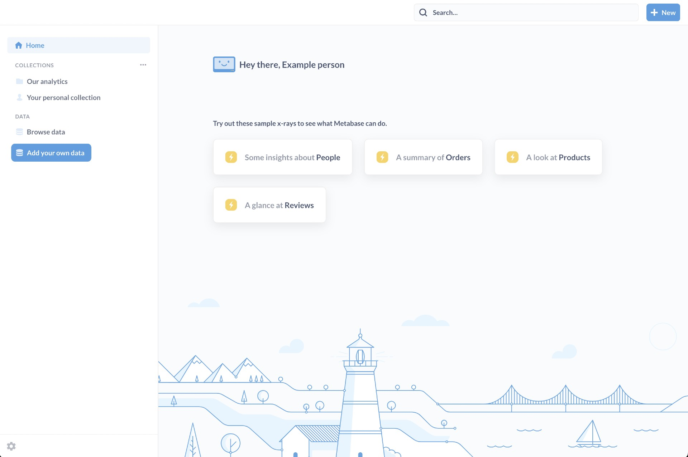

# BigConnect Answers

BigConnect Answers is a simple and powerful web self service, drag & drop analytics tool which lets anyone learn and make decisions from their company’s data—no technical knowledge required.

It's a self-service, point-and-click solution that works on all major browsers and mobile devices through a fully-responsive user interface.

### The Home Page

Fresh out of the box, BigConnect Answers will show you a few things on the home page:

* Some automatic explorations of your tables that you can look at and save as dashboard.
* A navigation sidebar that lists:
  * **Home** button to return to your Answers home page.
  * **Collections**, where you’ll store all of your questions, dashboards, and models. You have your own personal collection to store drafts and experiments that aren’t yet ready to share.
  * **Data** section, which lists all of the data sources your Answers is connected to.
  * **Settings** (the **gear** icon at the bottom of the navigation sidebar).

You can also **Bookmark** your favorite items, and they’ll appear toward the top of the navigation sidebar.

To open and close the navigation sidebar, click on the logo in the upper left.
