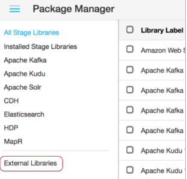

# Installing from Package Manager

You can use the Package Manager within BigConnect Pipelines to install external libraries for all stage libraries.

**Important**: For an RPM installation, you must configure BigConnect Pipelines to use an external directory before you can install external libraries from Package Manager.

1. In BigConnect Pipelines, in the top right toolbar, click the **Package Manager** icon:\

2.  In the navigation panel, click **External Libraries**:\
    \
    BigConnect Pipelines lists any currently installed external libraries.\


    <div align="left">

    <figure><figcaption></figcaption></figure>

    </div>
3. Immediately under the top right toolbar, click the **Install External Libraries** icon:
4. In the **Install External Libraries** dialog box, select the stage library that needs to access the external library.\
   \
   For example, if you are installing a JDBC driver for the JDBC Multitable Consumer origin, select the JDBC stage library. If you are installing an external Java library for the Groovy Evaluator processor, select the Groovy stage library.
5. Browse to select the external library to install and click **Open**.
6. To install the external library to the specified stage library, click **Upload**.\
   \
   BigConnect Pipelines installs the external library and displays a message offering to restart BigConnect Pipelines.
7. To install additional external libraries, click **Cancel**, then repeat steps 3 - 6 for every stage library that needs access to the external library.\
   \
   For example, say you want to use an external library with the Spark Evaluator processor, but you use two versions of the processor - each from a different stage library. To make the external library available to both processor versions, you must upload the external library to both stage libraries.
8. After installing all of the external libraries that you want, restart BigConnect Pipelines in one of the following ways:
   * If you started BigConnect Pipelines manually from the command line, click **Restart BigConnect Pipelines** in the **Install External Libraries** dialog box.
   * If you started BigConnect Pipelines as a service, you must use the command line for restart. Click **Cancel** in the **Install External Libraries** dialog box, and then run the required command for your operating system:
     *   For CentOS 6, Oracle Linux 6, Red Hat Enterprise Linux 6, or Ubuntu 14.04 LTS, use:

         ```
         service sdc restart
         ```
     *   For CentOS 7, Oracle Linux 7, Red Hat Enterprise Linux 7, or Ubuntu 16.04 LTS, use:

         ```
         systemctl restart sdc
         ```
