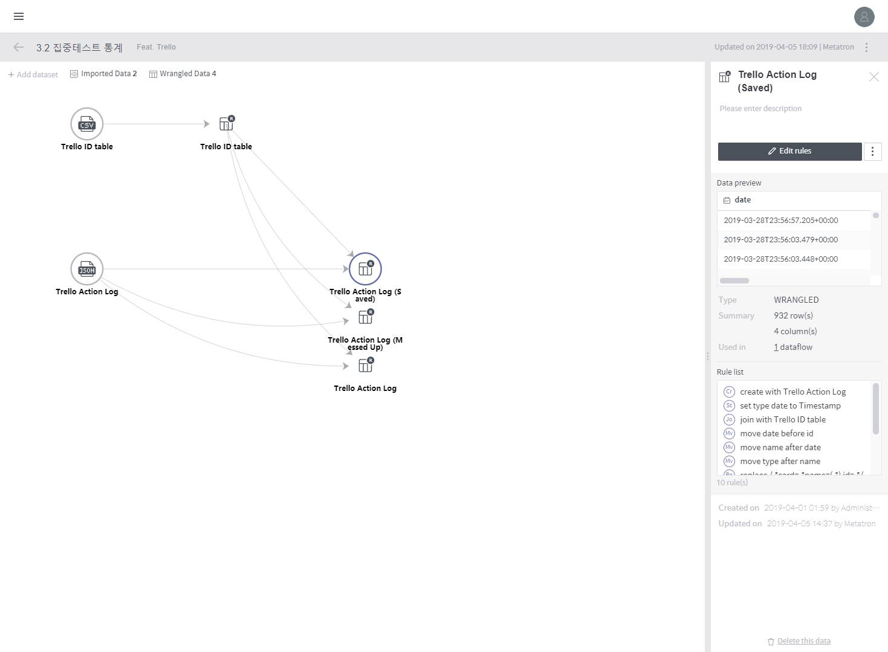
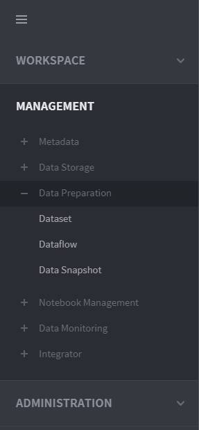
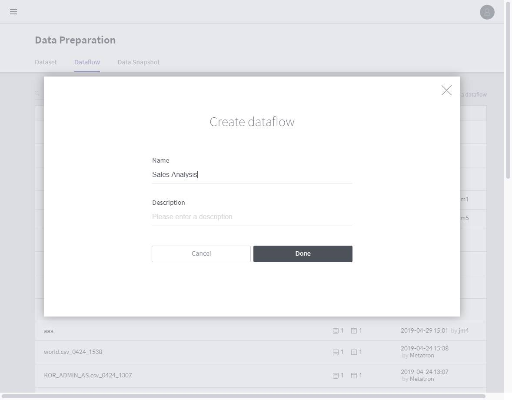
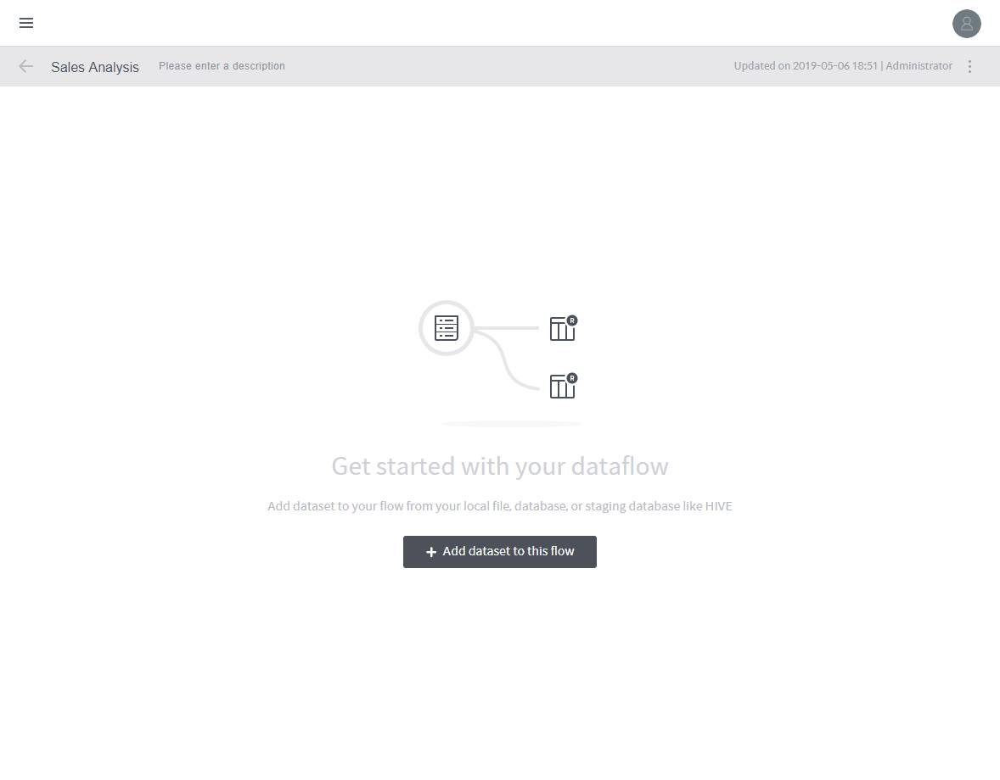
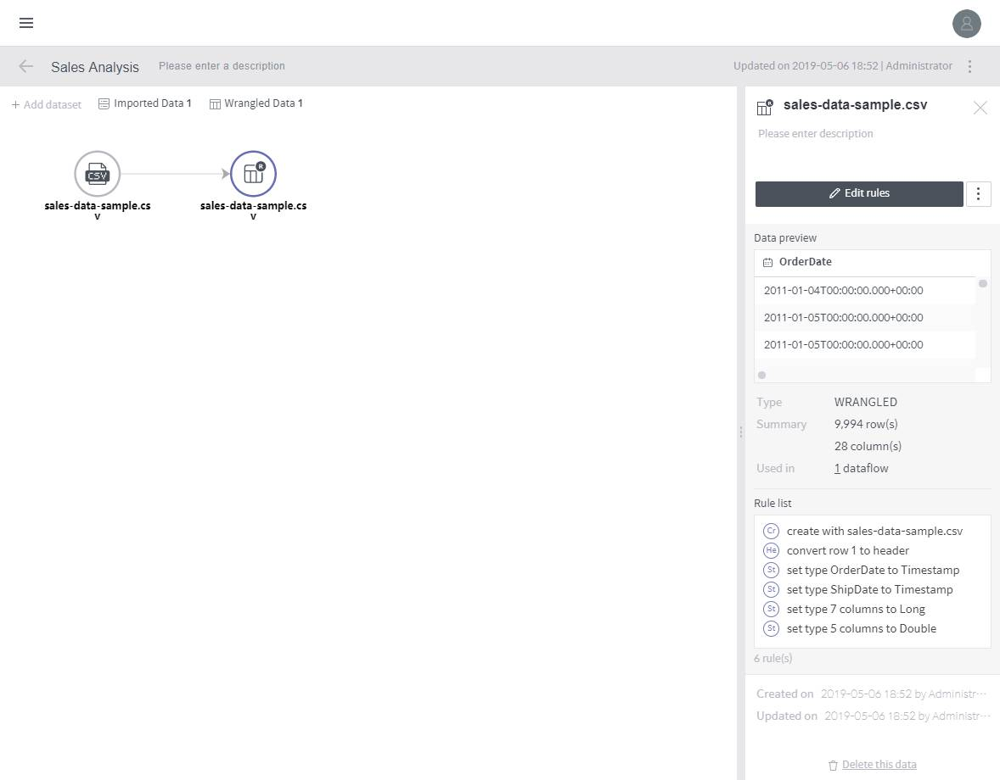
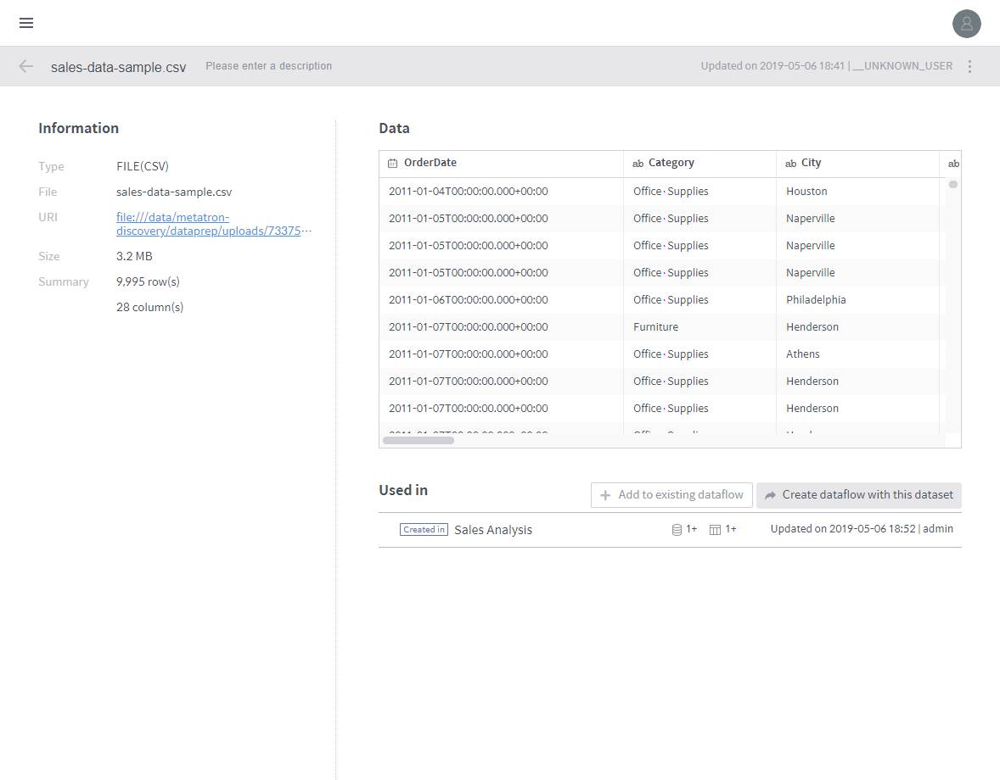

# Manage a Dataflow

A **dataflow** is the unit of processing a **dataset**. A single dataflow can be associated with multiple datasets to perform transformations. That is, a dataset must belong to a dataflow for transformation rules to be applied. It forms a relationship such as a “join” or “union” with other datasets.

As shown below, the dataflow details page shows the dependency among all datasets in a dataflow, and the transformation rules applied to each dataset.

The following subsections cover the processes involved in defining a dataflow, such as **adding a dataset**, **editing transformation rules**, and **creating a data snapshot with transformation results**.

The Dataflow menu can be accessed under **MANAGEMENT** &gt; **Data Preparation** &gt; **Dataflow** on the left-hand panel of the main screen.

## Adding a Dataset

The first step in defining a dataflow is to add a dataset. This can be conducted using the two methods described below.

## Adding a Dataset in an empty Dataflow

1 Click Add a dataflow on the upper right of the Dataflow page.

2. Enter the **Name** and **Description** for the dataflow, and click Done to create an empty dataflow.

3. Click the **Add dataset to this dataflow** button on the center of the page.

4. Select the datasets to be added.

5. When an imported dataset and its corresponding wrangled dataset are created, click the **Edit rules** button to edit rules \(see **Edit rules** for a detailed procedure\).

## Creating a Dataflow in the dataset details page

In the dataset details page, click the **Create dataflow with this dataset** button to create a dataflow, and proceed until the step before **Edit rules**.


The dataflow is named based on the name of the dataset.


