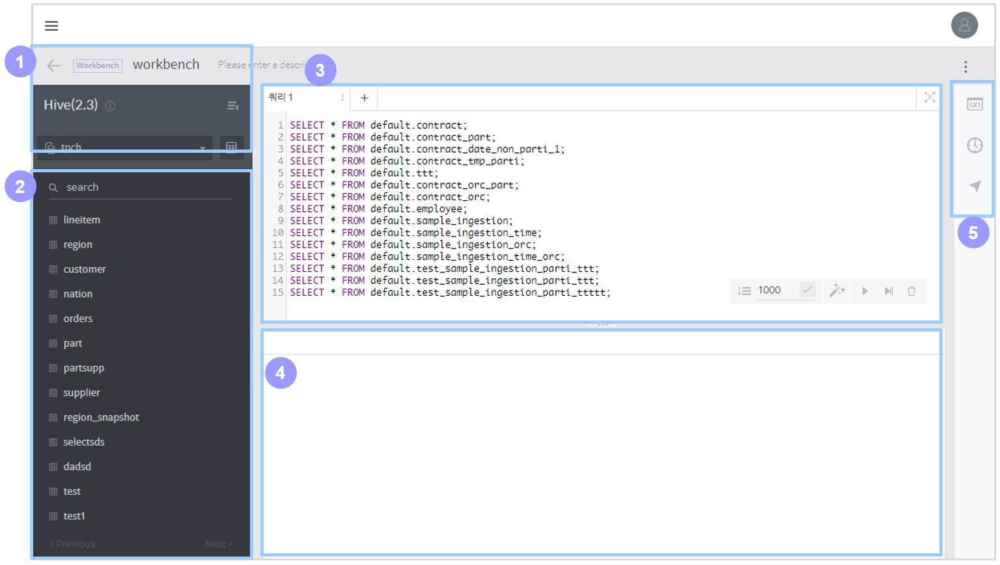

# Using a Workbench

In the workbench, you can edit and manage an SQL database easily, as well as visualize and store the results of a query on it in various forms. The workbench page consists of five sections shown below, and an additional schema browser is provided.

## Basic information section

This section displays basic information on the active workbench.

1. **Name:** Name of the workbench. Click on it to change the workbench’s name.
2. **Data connection:** Name of the data connection used by the workbench. Click the  icon to view its details.
3.  : UI button to collapse or expand the panel.

## Schema and table section

This section provides a UI to conveniently insert the name of a database, table, or column in the query editor.

1. **Database name:** Displays the name of the selected database. By default, the first database of the data connection used by the workbench is selected. Click on it to list all databases included in the data connection. Select a database in the list to replace the currently selected database.
2. **Schema browser:** A popup browser displaying the table list of the selected database, and information of all the columns and records in each table.
3. **Search table:** Searches the list of the tables registered in the selected database by the name you type in.
4. **Table name:** Select a table to automatically insert it in the query editor along with a `SELECT \* FROM {table name}` query.
5. **Column list:** Displays all columns belonging to the table and their respective data types. Click a column name to automatically insert it in the query editor.

## Query editor section

This section allows you to edit and run queries.

1.  : Navigates to tabs of previous or subsequent queries when there are too many tabs. If tabs are not many, this button will not appear.
2. **Tab:** You can run or store queries in separate tabs for more efficient management of them. Click the  button to edit the tab title or delete the tab.
3.  : Click this button to add a new tab.
4.  : Click this button to minimize the query editor or maximize it to full screen.
5. **Query lines:** Displays the numbering of the query code lines.
6. **Editor area:** Write query statements in this area. You can run either single or multiple queries. Insert `;` at the end of each query statement to run them separately. Autocomplete is supported.
7. **Execute full:** Execute all queries in the editor. \(Shortcut: Ctrl + Enter\)
8. **Execute partial:** Executes only the query statement where the cursor is located, or execute queries selected by dragging the mouse. \(Shortcut: Command + Enter\)
9. **CLEAR SQL:** Clears all query statements.
10. **SQL BEAUTIFIER:** Re-words query statements using standard query syntax.
11. **Query History:** Lists past queries executed in the query editor. If you select a query in the list, it will inserted in the query editor.
12. **Query Editor Shortcuts:** Shows a list of shortcuts available in the query editor.

## Query results section

Once a query is executed, its results are displayed in a query results tab. Query results tabs are cumulatively added, and you can selectively delete specific results tabs. Query results are displayed in a text grid, and they can be previewed in charts, stored into data sources, and exported into CSV files.

### During query execution

1. **Query result tabs:** When multiple queries are executed, a different tab is created for each query to show its result. While a query’s execution is in progress, “Loading” is displayed in its tab title.
2. **Query log:** Shows an execution log for the query. In the case of a Hive connection, a Hive job log is additionally displayed.
3. **Cancel:** Cancels the execution of the query. The time taken for cancelation may vary with the DB type.
4. **Query execution phase:** Shows the current phase of query execution. There are a total of five query execution phases.

   > * Getting connection
   > * Creating statement
   > * Executing query
   > * Getting result set
   > * Done!

5. **No. of the current query:** Shows the number of the currently executed query when multiple queries are executed.
6. **Output/Result tabs:** By clicking either tab, you can switch to the query log/result view.
7. **Query status:** Shows the query’s status from among:

   > * Running query
   > * Query execution failed..
   > * Query execution canceled..

8. **Query start time:** Displays when the query execution started.
9. **Query running time:** Displays how long it took to execute the query.

### After query execution

1. **Query result tabs:** When multiple queries are executed, a different tab is created for each query to show its result. While a query’s execution is in progress, “Loading” is displayed in its tab title.
2. **Data details:** Shows a data table resulting from executing the query. You can copy this data output to the clipboard.
3. **Output/Result tabs:** By clicking either tab, you can switch to the query log/result view.
4. **Search for column data:** Searches for a column or value in the resulting table.
5. **Chart preview:** Draws a virtual chart of the query results. This chart is only for visualization; it is not stored in the workspace. \(See [Chart](../discovery-workbooks/discovery-charts.md) for how to handle it\)
6. **Save as Data source:** Stores the query results into a data source in the workspace. A dialog box will pop up to create a data source, and the resulting table is used instead of selecting a data connection and a table. Therefore, you will be immediately prompted to set the schema definition and ingestion cycle. \(See [Create a data source](../discovery-data-management/discovery-data-sources.md) for how to handle it\)
7. **Export CSV file:** Downloads the resulting table into a local file \(CSV\).
8. **Data page navigation:** If the resulting data includes more than 1,000 rows, you can navigate the data pages using the Prev and Next buttons.
9. **Query start time:** Displays when the query execution started.
10. **Query finish time:** Displays when the query execution finished.
11. **Query running time:** Displays how long it took to execute the query.
12. **Query data rows:** Shows the number of rows of the resulting data and the current page number.

## Extra tools section

The extra tools section provides useful tools for the workbench.

### Setting up global variables

If a certain type of statement is repeatedly used with a different value for each query run, set the variable element as a “global variable” for convenient use.

* **Variable type:** You can select either a calendar or text type.
* **Add new variable:** Select the variable type you want and click “Add new variable.” A new global variable will be added in the query editor.
* **Name:** Enter a name for the variable.
* **Variable value:** For a calendar variable, select a date; for a text variable, select a text value.

### Workbench Navigation

Used to move to another workbench. Click the target workbench to move to.

* **Search for workbench:** Search for a workbench stored in the workspace.
* **Workbench list:** Displays all workbenches stored in the workspace. Click a workbench in the list to move to that workbench.

## Schema browser

Displays the table list of the selected database, and information of the columns and records in each table.

* **Column:** Shows the names and data types of all columns of the selected table.
* **Information:** Displays attributes of the selected table.
* **Data:** Displays data of the selected table. A maximum of 50 rows can be viewed.

