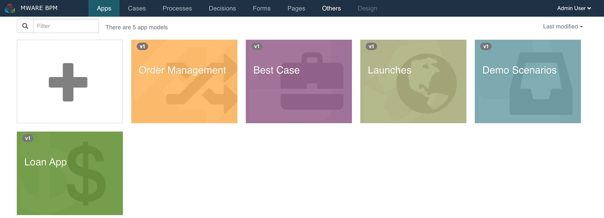
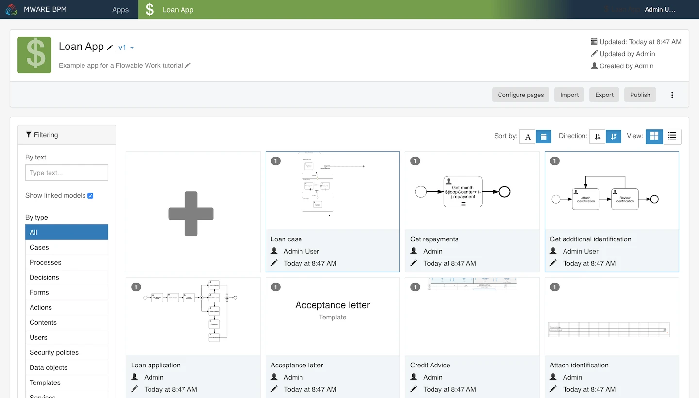

# App Editor

The App Editor is used to create a bundle of process and case models together that can be deployed and shared with users to run. Processes, cases, forms and decision tables do not **need** to be packaged in an app to be deployed, as it is possible to deploy them individually directly. An app provides a convenient packaging with additional services automatically managed for you.

### User Interface[​](https://documentation.flowable.com/latest/user/design/app-editor#user-interface) 

The App Editor allows the definition of an application bundle of processes, cases and other related models. An app, once defined, can be published (deployed) to the runtime engines and started by users.

<figure><figcaption></figcaption></figure>

A list of the existing apps is displayed, ordered by date or name, with the ability to:

* View and modify an app by clicking on its card
* Create new apps
* Import apps

Clicking the `+` card opens a dialog that allows you to choose to create a new app or import an existing app definition.

<figure><figcaption></figcaption></figure>

### Creating New Apps[​](https://documentation.flowable.com/latest/user/design/app-editor#creating-new-apps) 

Choosing the `Create a new app` option opens a dialog that prompts you to enter basic information:

* The display name of the app
* The app’s unique key
* An optional description of the app
* An optional tag for the app

By clicking `Create new app`, a new app definition is created and you are redirected to the details view of the app where you can make further configurations.

### Importing Apps[​](https://documentation.flowable.com/latest/user/design/app-editor#importing-apps) 

Choosing the `Import an app from a file` option opens a dialog that prompts you to select a file to import.

There are advanced options that define how the import, which can be selected if needed to perform extra steps in the import.

The options available are:

| Option          | Comment                                                               |
| --------------- | --------------------------------------------------------------------- |
| Renew           | Attempt to link users and groups if imported from another system.     |
| Edoras One app  | Import a legacy app format.                                           |
| Warn and Stop   | If identical model keys are found, warn the user and stop.            |
| Update existing | If identical model keys are found, continue and treat as updates.     |
| Create new keys | If identical model keys are found, continue and create as new models. |

### App Editor[​](https://documentation.flowable.com/latest/user/design/app-editor#app-editor) 

In the header area, you can see the **name**, **description**, **version**, **creator** and the **modification date** of the app definition. The models that are already included in the app are also shown. It is always possible to return to this app view by clicking the app name in the top navigation menu.

<figure><figcaption></figcaption></figure>

To add models to an app, click on the `+` card or `+ Create new` button. This opens a dialog that allows you to choose how you want to add a model to the app: by creating a new one from scratch, importing one from a file, or including a model already created.

If you choose to create a new model, or import one from file, you then are prompted to select the type of model to import or create.

If you chose to include existing models to your app, you will be shown a dialog with a list of available models. Simply click on any number of items in the list of models (a **+** icon will be added to each). These models then become part of the deployment that takes place when publishing this app.

Please be aware that it is not necessary to add models which are referenced in another model. For instance, if you wish to add a process model which contains a User Task referencing a form, you do not have to add that form to your app’s models manually. However, you do have to add the process or case model itself. In the app view you can see the linked models shown along with those you added explicitly. If the border around a model is dark blue, it means it was added explicitly, otherwise it was included by reference (linked).

If you want to remove a model from an app, from the app view on the model list you will be able to select a trash icon on any explicitly added models. Referenced (linked) models will disappear if the model that references them is removed of uses a different referenced model.

#### App Features[​](https://documentation.flowable.com/latest/user/design/app-editor#app-features) 

The App Editor allows you to define its appearance, features and allowed users. You can set the following features for an app:

* An icon that can be used to distinguish it from other apps.
* A theme that, similarly to the icon, can be used to further differentiate the app both in the BPM Designer and any other application.
* Groups of users that can access the app.
* Specific users that can access the app.

If the groups and users are left undefined, all groups and users can access the app definition when deployed. Please note that the user and group restrictions only apply to the deployed apps and do not have any effect on users of BPM Designer. A number of actions can be performed on an app. These are available as buttons or in a dropdown menu in the app header area.

| Action              | Description                                              |
| ------------------- | -------------------------------------------------------- |
| Configure pages     | Edits the name, description, and key of the model.       |
| Import              | Import an app zip file.                                  |
| Export              | Download the app as a zip file.                          |
| Publish             | Deploy the app and its models for use.                   |
| Modify properties   | Edits the name, description, key and tag of the app.     |
| Select theme        | Choose the color and icon to use for the app.            |
| Duplicate           | Creat a copy of the app and optionally all its models.   |
| Import translations | Upload a translations file.                              |
| Modify permissions  | Define restrictions for users and groups to use the app  |
| Delete              | Removes the model from the app and optionally delete it. |

It is also possible to modify the app properties by clicking on the name or description in the header area. The app theme can also be selected by clicking on the app icon in the header area.

#### Adding FlowApp Pages[​](https://documentation.flowable.com/latest/user/design/app-editor#adding-flowapp-pages) 

An app can also include Page models to provide custom dashboard and views. This kind of app is referred to as a **FlowApp**. To make a FlowApp you need to click the "Configure pages" button. This opens dialog to add Page models. A FlowApp can be navigated to directly if a FlowApp URL key is given.

Under the Pages table is a dropdown menu that allows you to select a Page model to add. Pages are added to the table in the order they are added. The order of Pages is used when displaying them, and up and down arrows allow you to reorder the Pages in the table.

### App Versions[​](https://documentation.flowable.com/latest/user/design/app-editor#app-versions) 

It is possible to change the label of a Page, so it can have a more application-specific display label. Each Page can also have a URL key that allows the individual Pages to be accessed directly by URL.

If you want to see an older version of your model, click on the version number next to the app name in the header area and choose the version you are interested in viewing. You can make a copy of an older version the current version by clicking the `Use as new version` button. You can return to the latest version by clicking on the app theme in the header area.
