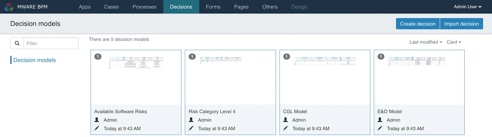
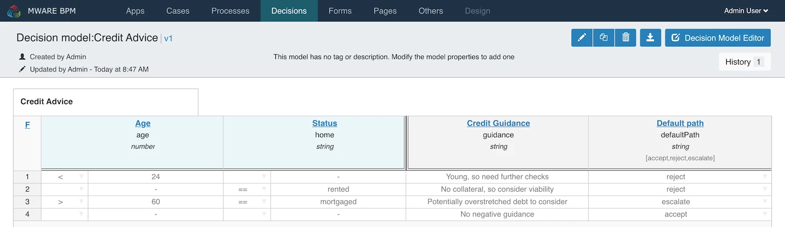
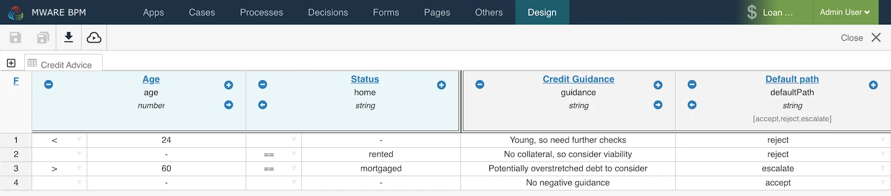
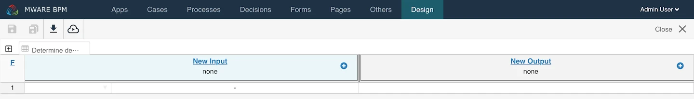
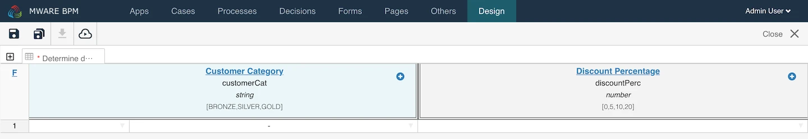
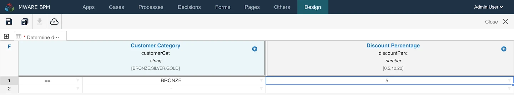
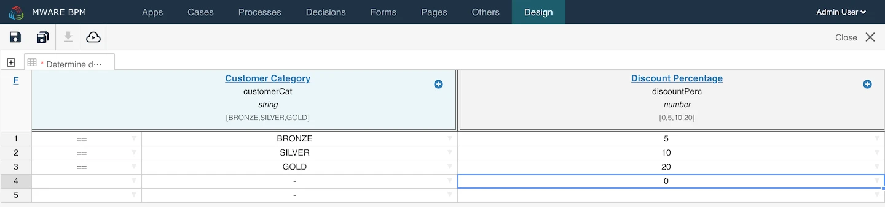

# Decision Editor

The Decision Editor is the primary means to define a set of business rules in the form of DMN Decision Tables. This form of rules looks like a spreadsheet, making it easy for business users to understand and describe their business rules. Decision Tables can be used standalone, although they are usually referenced and used within process or case models.

DMN (Decision Model and Notation) is a published standard to describe decisions and business rules. The DMN standard is complementary to the BPMN and CMMN standards and extends them by integrating specific DMN decision tasks into the process and case model.

With DMN you are able to:

* Document and comply with business rules for regulatory compliance and security audits.
* Automate manual decision making.
* Improve and simplify BPMN processes where decisions were modeled using BPMN expressions.

You can more detailed information in the [DMN standard](http://www.omg.org/spec/DMN/Current).

## User Interface 

<figure><figcaption></figcaption></figure>

The model list enables the following actions:

* View and change model details
* Edit a model

The following sections describe each feature in more detail.

## Creating a New Decision Table[​](https://documentation.flowable.com/latest/user/design/dmn-editor#creating-a-new-decision-table)

Click the button labeled `Create decision`, a dialog prompts you to enter basic information:

<figure><figcaption></figcaption></figure>

* The display name of the action.
* The action’s unique key.
* An optional description of the action.

By clicking `Create new decision model`, a new decision model is created and you are redirected to the edit view of the decision table where you can start to add rules.

## Decision Details[​](https://documentation.flowable.com/latest/user/design/dmn-editor#decision-details) 

Here, you see the **name**, **description**, **version**, **creator** and the **modification date** of the model as well as the current values of the properties that are used to define the model.

<figure><figcaption></figcaption></figure>

If you want to see an older version of your model, press on the `History` button and choose the version you are interested in viewing.

## Decision Editor[​](https://documentation.flowable.com/latest/user/design/dmn-editor#decision-editor) 

The Decision Editor interface is roughly divided into three areas:

* The **menu bar** on top, just below the navigation bar
* The **inputs** on the left side
* The **outputs** on the right side

<figure><figcaption></figcaption></figure>

The following sections describe each area in detail.

**Menu Bar**[**​**](https://documentation.flowable.com/latest/user/design/dmn-editor#menu-bar)

The menu bar offers a number of actions, some of them only affecting the currently opened model while others have a more global impact.

**Rules Area**[**​**](https://documentation.flowable.com/latest/user/design/dmn-editor#rules-area)

Each row in the Decision Table can be considered as a single rule. Each column on the left side is an input condition, each column on the right is an output value. On the far left it is possible to select the Hit Policy for the rules. This determines how the rules are executed and when to stop evaluating rules. An example of creating a Decision Table is given in the following section.

## Creating Rules[​](https://documentation.flowable.com/latest/user/design/dmn-editor#creating-rules)

The example presented is a very simple use case: determining the discount percentage based on a customer category. To start, click the `Create decision` button.

<figure><figcaption></figcaption></figure>

Provide a decision table name and a unique decision table key and select the `Create new decision model` button.

<figure><figcaption></figcaption></figure>

You are now ready to define your decision table. Let us describe what is presented within the editor.

### Hit Policy[​](https://documentation.flowable.com/latest/user/design/dmn-editor#hit-policy) 

In the top left corner, you can select a **hit policy**.

There are seven hit policies available:

**single hit**

* **F**IRST: multiple (overlapping) rules can match, with different output entries. The first hit by rule order is returned and evaluation halts.
* **U**NIQUE: no overlap is possible and all rules are disjoint. Only a single rule can be matched.
* **A**NY: there may be overlap, but all of the matching rules show equal output entries for each output so that any match is used. If the output entries are non-equal, the hit policy is incorrect and the result is empty and marked as failed. When [strict mode](https://documentation.flowable.com/latest/user/design/dmn-editor#strictMode) is disabled the last valid rule is the result. (The violation is presented as a validation message.)
* **P**RIORITY: multiple rules can match, with different output entries. This policy returns the matching rule with the highest output priority. Output priorities are specified in the ordered list of output values, in decreasing order of priority. When [strict mode](https://documentation.flowable.com/latest/user/design/dmn-editor#strictMode) is disabled and there are no output values defined the first valid rule be the result. (The violation is presented as a validation message.)

**multiple hits**

* **R**ULE ORDER: returns all hits in rule order.
* **O**UTPUT ORDER: returns all hits in decreasing output priority order. Output priorities are specified in the ordered list of output values in decreasing order of priority.
* **C**OLLECT: returns all hits in arbitrary order. An operator ('+', '<', '>', '#') can be added to apply a simple function to the outputs. If no operator is present, the result is the list of all the output entries.
  * \+ (sum): the result of the decision table is the sum of all the distinct outputs.
  * < (min): the result of the decision table is the smallest value of all the outputs.
  * \> (max): the result of the decision table is the largest value of all the outputs.
  * \# (count): the result of the decision table is the number of distinct outputs.

### Input and Output Expressions[​](https://documentation.flowable.com/latest/user/design/dmn-editor#input-and-output-expressions) 

The header of the decision table itself is divided into two sections; blue (on the left) and green (on the right). In the blue section are the **input expressions**; the green section are the **output expressions**.

Click on `New Input` and the following dialog is presented:

Within an input expression, you can define the variable that is used in the expression of the rule input entries (explained below). It is possible to define multiple input expressions by selecting `Add input` (right click the option menu or by clicking the plus icon).

Within an output expression, you can define what variable is created to form the result of a decision table execution (the output entry expression determines the value of the variable; explained below). It is possible to define multiple output expressions by selecting `Add output` (right click the option menu or by clicking the plus icon).

### Rules[​](https://documentation.flowable.com/latest/user/design/dmn-editor#rules) 

Each rule consists of one or more input entries and one or more output entries. An input entry is an expression that is evaluated against the input variable (of that 'column'). When all input entries are evaluated to be true, the rule is considered true, and the output entry is evaluated.


The DMN specification defines an expression language: (S)-FEEL. Currently, we do not support this optional part of the specification. Within Flowable DMN, we use [Java Unified Expression Language (JUEL)](http://juel.sourceforge.net/) as the expression language.


<figure><figcaption></figcaption></figure>

To enter an expression, first select the condition that is applied to the input variable from the drop down box in the first column. Next double-click on the corresponding cell and enter `BRONZE`. Combined with the variable defined in the corresponding input expression (column header), this results at runtime in the full expression _customerCat == "BRONZE"_.

<figure><figcaption></figcaption></figure>

To enter an output expression, double-click the corresponding cell. In this example, the expression `5` entered. This is actually more like an implicit assignment. The value 5 is assigned to the variable in the corresponding output entry (column) when all input entries of that rule are evaluated true.

We can then continue completing the decision table by adding more rules (by selecting `Add rule below`).

<figure><figcaption></figcaption></figure>

In our example, rule 4 has an empty input entry. The engine evaluates empty input entries as true. This means that if none of the other rules are valid, the outcome of rule 4 is the output of this decision table. In this case, variable **discountPerc** has the value **0**.

The decision table can now be saved and linked to other process and case models as needed.

