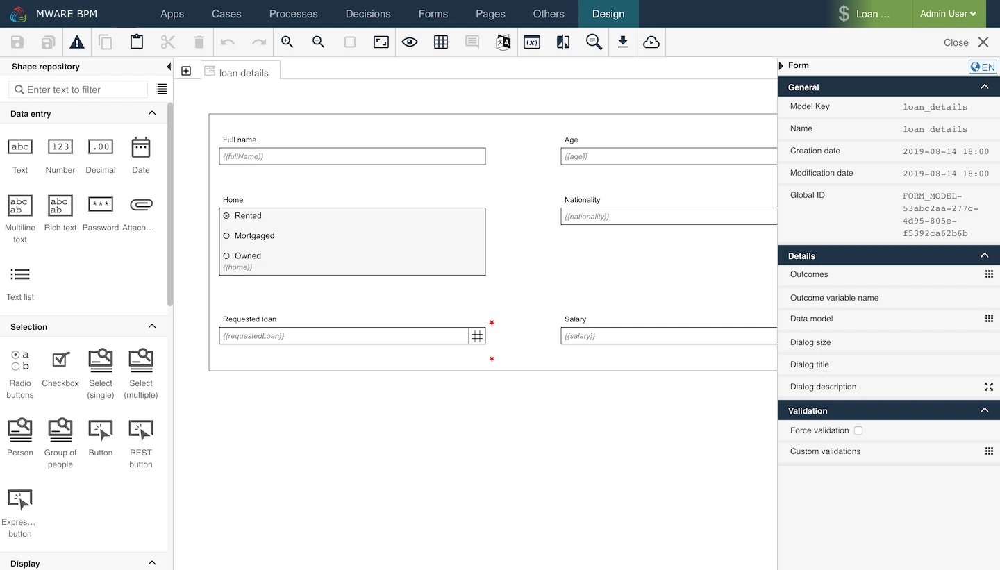

# Form Editor

The Form Editor is the primary means to construct a form using simple drag-and-drop commands. The form is used by other elements such as cases and tasks to interact with the user.

## User Interface[​](https://documentation.flowable.com/latest/user/design/form-editor#user-interface) 

The Form Editor interface is roughly divided into four areas:

* The **menu bar** on top, just below the navigation bar
* The **palette** on the left side
* The **canvas** in the middle
* The **attribute bar** on the right side

<figure><figcaption></figcaption></figure>

The following sections describe each area in detail.

**Menu Bar**[**​**](https://documentation.flowable.com/latest/user/design/form-editor#menu-bar)

The menu bar offers a number of actions, some of them only affecting the currently opened model while others have a more global impact.

**Drawing Area**[**​**](https://documentation.flowable.com/latest/user/design/form-editor#drawing-area)

A form is a graphical layout of fields that are bound to a data model to allow the data model to be displayed to the user. The fields are arranged in rows on the canvas.

<figure><figcaption></figcaption></figure>

Each row is made up of exactly twelve slots. All slots are equal in size, so the width of a slot is one-twelfth the width of the whole form. A field can occupy exactly all slots, or it can occupy only a part of the slots. It is possible to place more than one field in a row.

<figure><figcaption></figcaption></figure>

Not every slot needs to be occupied by a field. It is allowed that single slots of a row are empty. These empty slots can be at the beginning, in the middle, or at the end of a row.

<figure><figcaption></figcaption></figure>

To create your forms, you can use simple drag-and-drop commands. To do so, select an element in the palette on the left side and drag it to the drawing area. The element is then part of the form.

If you click anywhere in the canvas, you can change specific attributes in the attribute panel on the right side. If you click on an element, you can change its attributes. If you click outside of an element (in the "space between"), you can change the attributes of the form itself, for instance, the outcomes.

## Key Concepts[​](https://documentation.flowable.com/latest/user/design/form-editor#key-concepts) 

### Form Definition[​](https://documentation.flowable.com/latest/user/design/form-editor#form-definition) 

For the BPMN engine, we adhere to the BPMN specification and for the DMN engine, we use the DMN specification. For start and task forms no Oasis specification exists. Therefore, we have defined a JSON-based form definition structure that we use as an output format for the Flowable Form Editor and is used to render start and task forms in the Flowable Task application.

### Fields[​](https://documentation.flowable.com/latest/user/design/form-editor#fields) 

**Field Layout**[**​**](https://documentation.flowable.com/latest/user/design/form-editor#field-layout)

A field is made up of several parts (all but the widget part are optional):

<table><thead><tr><th width="213">Name</th><th>Description</th></tr></thead><tbody><tr><td>Widget</td><td>The widget visualizes the data model. Most widgets are interactive and let the user change the data model; however some widgets are read-only. There are widgets to manipulate strings, numbers, dates, rich text, selections, and many others. The widget is located in the center of the field; all other parts are arranged around the widget. The field configuration defines the precise positioning of the field parts.</td></tr><tr><td>Label</td><td>The label tells the user to which part of the data model the widget is bound. The label is located on the left side or top of the widget (depends on the field configuration).</td></tr><tr><td>Required indicator</td><td>The required indicator is displayed for required fields. Required means that the widget cannot be empty. The required indicator is located on the right side of the widget.</td></tr><tr><td>Description</td><td>The description gives additional information to the user. This can be formatting instructions or further description about of the App uses the entered value. The description is located on the bottom of the widget.</td></tr></tbody></table>

<figure><figcaption></figcaption></figure>

**Field Alignment**[**​**](https://documentation.flowable.com/latest/user/design/form-editor#field-alignment)

To enhance the readability of a form, the field parts of all fields are aligned among themselves: the labels are aligned, the widgets and descriptions are aligned, the required indicators are aligned.

The alignment is performed per slot. All fields that start in the same slot build a field group. Inside such a field group Flowable looks for the widest label which becomes the dominating label for that slot. All labels in the field group are then enlarged to the same width of the dominating label. This is done by adding space between the label and the widget. This ensures that all widgets and descriptions of a field group start in one line and all.

<figure><figcaption></figcaption></figure>

The only exception is with fields that have top label positions. For these fields, the label, the widget and the description all start at the beginning of the slot.

<figure><figcaption></figcaption></figure>

**Binding**[**​**](https://documentation.flowable.com/latest/user/design/form-editor#binding)

Binding is the process to connect the form fields to the data model. The binding in Flowable is always bi-directional. When the user changes the form fields, then those changes are immediately propagated to the data model. On the other side changes in the data model are immediately propagated back to the form fields.

A binding expression defines to which part of the data model the form field is connected. The binding expression has to be a writable front end expression, e.g., \{{foo\}}, \{{case.bar\}}.

There are some reserved expressions that cannot be used as they are used internally to save some work item information. The reserved front end expressions are:

* id
* definitionId
* definition
* type
* state
* creationTime
* updateTime
* currentUser

### Common Component Attributes[​](https://documentation.flowable.com/latest/user/design/form-editor#common-component-attributes) 

There are different available components in the Form Editor. The following attributes are attributes which are shared among all the components.

<table data-full-width="true"><thead><tr><th width="140.33333333333337">Group</th><th width="187">Name</th><th>Description</th></tr></thead><tbody><tr><td>General</td><td>ID</td><td>This is a unique id for the component.</td></tr><tr><td></td><td>Label</td><td>The label attribute adds a label to the component, if not empty.</td></tr><tr><td></td><td>Label position</td><td>The position of the label, you can choose between <code>Left</code> or <code>Top</code>.</td></tr><tr><td></td><td>Label tooltip</td><td>When it is defined, a question mark icon appears in the component label. When the user hovers over it, it shows this text in a tooltip.</td></tr><tr><td></td><td>Value</td><td>The binding for the component (if the component is a value component). Use an appropriate expression to bind the component to its value and thus specify where the value is saved read. For example, use <code>{{myVariableName}}</code> to store the value of the component in a variable named <code>myVariableName</code>. Use prefixes to define the scope of the value, e.g., <code>root.</code> for referencing the root case to store the value in or <code>parent.</code> to store the value in the parent work item of the current one. For instance <code>{{root.foo}}</code> stores the value in the root case using a variable named <code>foo</code>. </td></tr><tr><td></td><td>Default value</td><td>If a value is not set, the default value is used (only if the component is a value component). Use an appropriate value; e.g., a text, a number, an id or a comma-separated list.</td></tr><tr><td></td><td>Description</td><td>The description attribute additionally adds a description to the component.</td></tr><tr><td></td><td>Visible</td><td>Boolean value or expression specifies whether the component is visible or hidden. This expression might include another value in the same form, for instance, use a checkbox bound to <code>{{showAdditionalFields}}</code> and use the very same expression as the visible attribute to show or hide the component according to the checked state of the checkbox. If you want only to show the component, if the form is not used as the init-form, you can use the expression <code>{{root.id}}</code> which evaluates to <code>true</code> only, if there is a current id which is not the id in a start form.</td></tr><tr><td></td><td>Ignored</td><td>If true the component is hidden and the value is not part of the payload.</td></tr><tr><td></td><td>Enabled</td><td>A Boolean value or expression specifies whether component is enabled or disabled.</td></tr><tr><td></td><td>Placeholder</td><td>The text that appears in the component when there is no value. (only if the component is a value component)</td></tr><tr><td>Validation</td><td>Custom validations</td><td>List of additional validations to apply.</td></tr><tr><td>Documentation</td><td>Documentation</td><td>Documentation intended to explain concepts of its use for future reference.</td></tr><tr><td>Customization</td><td>Style class</td><td>Stylesheet class name. Add any style classes to be applied to the component for the desired styling and rendering.</td></tr></tbody></table>

#### DataSource Component Attributes[​](https://documentation.flowable.com/latest/user/design/form-editor#datasource-component-attributes) 

There are different available components in the Form Editor. The following attributes are attributes which are shared among all the components that have a DataSource.

<table data-full-width="true"><thead><tr><th width="173.33333333333337">Group</th><th width="201">Name</th><th>Description</th></tr></thead><tbody><tr><td>Data source</td><td>Data source</td><td>Specify the data source type: <code>Static</code> (for fixed predefined options or a variable binding), <code>REST</code> (for data coming from any REST endpoint), or <code>Master</code> (for Master Data instances coming from the MasterData REST endpoint of Flowable Work).</td></tr><tr><td></td><td>Items</td><td>If the data source type is <code>Static</code> then specify a set of predefined options or a variable binding for the selection list. The name is used as the label in the selection list, and the value is used to store the selected element.</td></tr><tr><td></td><td>Query URL</td><td>If the data source type is <code>REST</code> then specify the REST endpoint URL used to query for the full list of items.</td></tr><tr><td></td><td>Lookup URL</td><td>If the data source type is <code>REST</code> then specify the REST endpoint URL used to retrieve the item by id.</td></tr><tr><td></td><td>Path</td><td>Where to find the array of items in the REST response, e.g., 'data.users'.</td></tr><tr><td></td><td>Master data key</td><td>If the data source type is <code>Master</code> then specify the key representing the master data to load, e.g. <code>md-country</code></td></tr><tr><td></td><td>Format</td><td>This is an expression used to generate the label for each item. For example, <code>Mr. {{$item.name}} {{$item.surname}}</code>. The expression is evaluated against the current work object. The selected item is available as <code>$item</code>.</td></tr><tr><td></td><td>Storage</td><td>Specifies how the data provided by the Data Source is stored in the variable. Choose 'ID' if only the uniquely identifying field (see attribute map to) of the selected entry should be saved in the variable, choose 'Full value' if the whole object should be saved and thus making it possible to display other values of the selected element within the form as well. Pay attention as storing the full value could lead to bloating the variables with unnecessary information depending on the amount of data retrieved by the REST endpoint.</td></tr><tr><td></td><td>Map to</td><td>The attribute of an item into which the value is mapped, which uniquely identifies each item within the set of options. For a <code>Static</code> data source <code>value</code> is commonly used as the <code>map to</code> attribute and for a REST data source <code>id</code> is commonly used as the <code>map to</code> attribute.</td></tr><tr><td></td><td>Client side filter</td><td>Specifies whether the result filtering needs to be done in the frontend rather than in (or in addition to) the backend.</td></tr><tr><td></td><td>Navigation URL</td><td>The URL to navigate to for the selected item. The URL might contain expressions, most likely at least <code>{{$item.id}}</code> to include the id of the selected element in the navigation URL.</td></tr><tr><td></td><td>Target</td><td>Specifies the target for the navigation URL, use '_blank' to open the selected item in a new window or '_self' to use the same window for navigation.</td></tr></tbody></table>

#### Common Button Attributes[​](https://documentation.flowable.com/latest/user/design/form-editor#common-button-attributes) 

There are different available components in the Form Editor. The following attributes are attributes which are shared among all the components.

<table data-full-width="true"><thead><tr><th width="210.33333333333337">Group</th><th>Name</th><th>Description</th></tr></thead><tbody><tr><td>Common button</td><td>Button alignment</td><td>The alignment of the button, either 'Left' or 'Right'.</td></tr><tr><td></td><td>Icon URL</td><td>The URL of the icon to show.</td></tr><tr><td></td><td>Icon alignment</td><td>The alignment of the icon, either 'Left' or 'Right'.</td></tr><tr><td></td><td>Primary</td><td>Mark the button as primary. This has an impact on the button styling.</td></tr><tr><td></td><td>Tooltip</td><td>When the user hovers the button it will show this text in a tooltip.</td></tr></tbody></table>

### Form Outcomes[​](https://documentation.flowable.com/latest/user/design/form-editor#form-outcomes) 

Form outcomes are used to complete a user task and allow the user to indicate how the completion should be considered, for example, if a task is approved or rejected. Outcomes are typically displayed to the user to select as part of the task or form. These outcomes can be defined in the form details `outcomes` property or inside the form using an _Outcome button group_.

By default, if you do not set any outcome, the default _Complete_ outcome is used. There are two additional task actions that are usually displayed with outcomes, _Save_ and _Claim_. These actions can be configured explicitly to change the default behavior.

To achive this, set one of the following values as the outcome value:

* `__CLAIM` : Use this value to configure a claim action in a form. This action will be visible when a task has no assignment. This allows users to claim a task and assign it to themselves.
* `__SAVE` : Use this value to configure a save action in a form. This action will be visible only if the task is assigned to a user. It saves the form contents without completing the task, to allow work on it later.
* `COMPLETE` : Use this value to configure a complete action in a form. This action will be visible only if the task is assigned to a user. It completes the task.

**Defined at Form Level**[**​**](https://documentation.flowable.com/latest/user/design/form-editor#defined-at-form-level)

In the detail section of the form it is possible to set a list of outcomes that will always be rendered in the task header.

<figure><figcaption></figcaption></figure>

**Defined inside the Form**[**​**](https://documentation.flowable.com/latest/user/design/form-editor#defined-inside-the-form)

It is also possible to configure outcomes inside a form using two form components, they are the _Outcomes Button group_ and _Outcome button_.

<figure><figcaption></figcaption></figure>

The _Outcomes Button group_ has a specific `Keep in form` property to display these custom outcomes in the task header, like outcomes defined at the form level, as above.

<figure><figcaption></figcaption></figure>

## Form Components Overview[​](https://documentation.flowable.com/latest/user/design/form-editor#form-components-overview) 

Flowable Forms provides numerous pre-defined components which enables you to build rich, beautiful forms. There are four categories of components:

* **Data Entry:** These components allow users to enter data directly. A typical example is a text field or a date picker.
* **Selection:** Selection components offer a number of pre-defined options to choose from. Checkboxes, buttons and radio buttons are commonly used components in this category.
* **Display:** These components display content. Images and data tables belong in this group.
* **Container**: Container components allow you to better structure your form. Tabs, Wizards and Subforms belong in this group.

## Data Entry Components[​](https://documentation.flowable.com/latest/user/design/form-editor#data-entry-components)

### Text[​](https://documentation.flowable.com/latest/user/design/form-editor#text)

The **Text** component is the most common element on every form: a simple text field. It is intended to capture short text elements such as the name of a person. It is possible to validate and restrict the component to only accept certain values.

For longer text, consider using the Multiline text component. For numbers, there are two components: Number and Decimal.

**Appearance**

| Design                                                                            | Rendered                                                                          |
| --------------------------------------------------------------------------------- | --------------------------------------------------------------------------------- |
|  |  |

**Attributes**[**​**](https://documentation.flowable.com/latest/user/design/form-editor#attributes)

In addition to the Common component attributes this value component has the following attributes

<table data-full-width="true"><thead><tr><th width="159.33333333333337">Group</th><th width="213">Name</th><th>Description</th></tr></thead><tbody><tr><td>Validation</td><td>Required</td><td>The required flag specifies whether entering a value for the component is mandatory or not.</td></tr><tr><td></td><td>Minimum length</td><td>Specifies the minimum length of the text. By default, there is no minimum length.</td></tr><tr><td></td><td>Maximum length</td><td>Specifies the maximum length of the text. By default, there is no maximum length.</td></tr><tr><td></td><td>Validation regex</td><td>It allows you to specify a regular expression (RegEx) with which to validate the text. This enables you to create powerful validations. A regular expression essentially defines a pattern which your text must follow. There are many tutorials and validators online where you can practice regular expressions. Example: <code>ABC\d{5}</code> This RegEx would accept the value <code>ABC12345</code> and would reject <code>12345</code> or <code>EFG98765</code>. Example: <code>[1-9][0-9]{3}</code> This pattern would accept the values <code>1000</code>, <code>1002</code> or <code>9999</code> but would reject <code>0001</code> or <code>A200</code>.</td></tr><tr><td></td><td>Validation mask</td><td>With a validation mask, you can define a simple pattern of letters and numbers which the input value must follow. This is especially useful if the user has to enter something like a reference number which always follows the same pattern. See above for a full reference of the mask patterns. Example: <code>AAA-999</code> This pattern would accept the value <code>ABC-111</code> and would reject <code>999-ABC</code> or <code>AAA-99</code>. Example: <code>9999.99$</code> This pattern would accept the values <code>1001.01$</code> and <code>0000.00$</code> but would reject <code>100.99$</code>.</td></tr><tr><td>Error messages</td><td>Minimum length</td><td>Specifies the message shown if the defined minimum length is not reached.</td></tr><tr><td></td><td>Maximum length</td><td>Specifies the message shown if the defined maximum length is exceeded.</td></tr><tr><td></td><td>Validation regex</td><td>Specifies the error message shown if the value does not match the regular expression validation pattern.</td></tr><tr><td></td><td>Validation mask</td><td>Specifies the error message shown if the value does not match the validation mask pattern.</td></tr></tbody></table>

### Multiline Text[​](https://documentation.flowable.com/latest/user/design/form-editor#multiline-text) 

The **Multiline** Text component is very similar to the Text component. It is intended for longer text, e.g., the description of a defect. It expands as the text becomes longer. Naturally, this component’s validation is more limited since longer text usually does not follow a specific pattern.

For short text, you may consider using the Text component. For numbers, there are the two components: Number and Decimal.

**Appearance**

| Design                                                                            | Rendered                                                                          |
| --------------------------------------------------------------------------------- | --------------------------------------------------------------------------------- |
|  |  |

**Attributes**[**​**](https://documentation.flowable.com/latest/user/design/form-editor#attributes)

In addition to the Common component attributes this value component has the following attributes

<table data-full-width="true"><thead><tr><th width="212.33333333333337">Group</th><th width="176">Name</th><th>Description</th></tr></thead><tbody><tr><td>Details</td><td>Minimum rows</td><td>Specifies the initial number of rows of text.</td></tr><tr><td></td><td>Maximum rows</td><td>Specifies the maximum number of rows of the text before scrolling.</td></tr><tr><td>Validation</td><td>Required</td><td>The required flag specifies whether entering a value for the component is mandatory or not.</td></tr><tr><td></td><td>Minimum length</td><td>Specifies the minimum length of the text. By default, there is no minimum length.</td></tr><tr><td></td><td>Maximum length</td><td>Specifies the maximum length of the text. By default, there is no maximum length.</td></tr><tr><td>Error messages</td><td>Minimum length</td><td>Specifies the message shown if the defined minimum length is not reached.</td></tr><tr><td></td><td>Maximum length</td><td>Specifies the message shown if the defined maximum length is exceeded.</td></tr></tbody></table>

### Rich Text[​](https://documentation.flowable.com/latest/user/design/form-editor#rich-text) 

The **Rich** Text component is an input field to enter multiple lines of styled text. The content is stored in Markdown or HTML format.

**Attributes**[**​**](https://documentation.flowable.com/latest/user/design/form-editor#attributes-2)

In addition to the Common component attributes this value component has the following attributes

<table data-full-width="true"><thead><tr><th width="216.33333333333337">Group</th><th width="189">Name</th><th>Description</th></tr></thead><tbody><tr><td>General</td><td>Text format</td><td>Determines how the value will be stored: <code>HTML</code> or <code>Markdown</code>. HTML has more options, but has security implications (i.e. do not expose this to unauthorized users).</td></tr><tr><td></td><td>Minimum rows</td><td>Specifies the initial number of rows of text.</td></tr><tr><td></td><td>Use spell checker</td><td>Determines whether, or not the spell checker of the browser is used. Please note that the spell checker must be activated in the browser of the user as well.</td></tr><tr><td>Validation</td><td>Required</td><td>The required flag specifies whether entering a value for the component is mandatory or not.</td></tr><tr><td></td><td>Minimum length</td><td>Specifies the minimum length of the text. By default, there is no minimum length.</td></tr><tr><td></td><td>Maximum length</td><td>Specifies the maximum length of the text. By default, there is no maximum length.</td></tr><tr><td></td><td>Custom validations</td><td>List of additional validations to apply.</td></tr><tr><td>Error messages</td><td>Minimum length</td><td>Specifies the message shown if the defined minimum length is not reached.</td></tr><tr><td></td><td>Maximum length</td><td>Specifies the message shown if the defined maximum length is exceeded.</td></tr></tbody></table>

### Attachment[​](https://documentation.flowable.com/latest/user/design/form-editor#attachment) 

The **Attachment** component allows any type of documents (for example, images, PDF files, Microsoft Word files, etc.) to be uploaded. As the attachment is bound to a variable like every other component, the attached documents can be referenced through that variable anywhere later in the process, case or any other form.

**Attributes**[**​**](https://documentation.flowable.com/latest/user/design/form-editor#attributes-3)

In addition to the Common component attributes this value component has the following attributes

<table data-full-width="true"><thead><tr><th width="149.33333333333337">Group</th><th width="230">Name</th><th>Description</th></tr></thead><tbody><tr><td>Details</td><td>Upload URL</td><td>Specifies the URL used to upload new attachment content. Leave blank to use default pre-configured endpoints.</td></tr><tr><td></td><td>Update file URL</td><td>URL to upload a file when the user chooses to upload a new version of an existing file. Leave blank to disable this feature.</td></tr><tr><td></td><td>Delete URL</td><td>When Delete URL is provided and the user removes a file, a DELETE request will be fired to that URL. The information in the file can be used if the Delete URL contains expressions with <code>{{$item}}</code>.</td></tr><tr><td></td><td>Allow file deletion</td><td>Uploaded files can be removed when Allow file deletion is <code>true</code>, or when the file has just been uploaded and Allow file deletion is <code>newOnly</code>.</td></tr><tr><td></td><td>Drop files text</td><td>Custom text when dragging and dropping files.</td></tr><tr><td></td><td>Max. files reached text</td><td>The maximum number of attachments allowed to be uploaded, leave it blank for no limit.</td></tr><tr><td></td><td>Select files text</td><td>Specifies the message to be shown in the attachment component to tell the user to select files.</td></tr><tr><td></td><td>Has content model</td><td>When true the user will be able to select a content type for the uploaded files and to fill in additional metadata defined by the content model for the file.</td></tr><tr><td></td><td>Allowed content models</td><td>A list of IDs of content models from which the user can choose as the content type. If empty, all available content models are allowed.</td></tr><tr><td></td><td>Require content model</td><td>When true, the user will be forced to select one of the allowed content types.</td></tr><tr><td>Validation</td><td>Required</td><td>The required flag specifies whether entering a value for the component is mandatory or not.</td></tr><tr><td></td><td>Minimum attachments</td><td>The minimum number of attachments needed to be uploaded for this component.</td></tr><tr><td></td><td>Maximum attachments</td><td>The maximum number of attachments needed to be uploaded for this component.</td></tr><tr><td></td><td>Valid file extensions</td><td>Specify the valid file extensions separating them by comma (for example .doc, .pdf, .png).</td></tr><tr><td></td><td>Custom validations</td><td>List of additional validations to apply.</td></tr><tr><td>Error messages</td><td>Minimum attachments</td><td>Specifies the error message shown if the value is lower than the minimum specified in validation.</td></tr><tr><td></td><td>Maximum attachments</td><td>Specifies the error message shown if the maximum number of attachments is already reached.</td></tr></tbody></table>

### Number[​](https://documentation.flowable.com/latest/user/design/form-editor#number) 

The **Number** component allows you to capture integer values, that is whole numbers. Numbers can be both positive and negative. The maximum value for a number is `9007199254740991`. The minimum value for a number is `-9007199254740991`.

**Appearance**

| Design                                                                            | Rendered                                                                          |
| --------------------------------------------------------------------------------- | --------------------------------------------------------------------------------- |
|  |  |

**Attributes**[**​**](https://documentation.flowable.com/latest/user/design/form-editor#attributes)

In addition to the Common component attributes this value component has the following attributes

<table data-full-width="true"><thead><tr><th width="199.33333333333337">Group</th><th width="141">Name</th><th>Description</th></tr></thead><tbody><tr><td>Details</td><td>Format</td><td>Defines the format of the number with thousand and decimal separators.</td></tr><tr><td>Validation</td><td>Required</td><td>The required flag specifies whether entering a value for the component is mandatory or not.</td></tr><tr><td></td><td>Minimum</td><td>The minimum value which can be entered in the number field. Optionally, for the runtime value an expression to be evaluated dynamically can be used.</td></tr><tr><td></td><td>Maximum</td><td>The maximum value which can be entered in the number field. Optionally, for the runtime value an expression to be evaluated dynamically can be used.</td></tr><tr><td>Error messages</td><td>Minimum</td><td>Specifies the error message to display if the value is smaller than the minimum value allowed.</td></tr><tr><td></td><td>Maximum</td><td>Specifies the error message to display if the value is larger than the maximum value allowed.</td></tr></tbody></table>

### Decimal[​](https://documentation.flowable.com/latest/user/design/form-editor#decimal) 

The **Decimal** component allows you to capture decimal values. Decimals can be both, positive and negative. The smallest and largest possible values are `5e-324` and `1.7976931348623157e+308` respectively.


Since decimals are represented as 64-bit floating point values, they can represent very large numbers. However, it is very important to note that floating point arithmetic is not precise. For instance, the values `0.1 + 0.2` equates to `0.30000000000000004`.


**Appearance**

| Design                                                                            | Rendered                                                                          |
| --------------------------------------------------------------------------------- | --------------------------------------------------------------------------------- |
|  |  |

**Attributes**[**​**](https://documentation.flowable.com/latest/user/design/form-editor#attributes)

In addition to the Common component attributes this value component has the following attributes

<table data-full-width="true"><thead><tr><th width="185.33333333333337">Group</th><th width="149">Name</th><th>Description</th></tr></thead><tbody><tr><td>Details</td><td>Fraction size</td><td>Defines the maximum number of decimal characters.</td></tr><tr><td></td><td>Format</td><td>Defines the format of the number with thousand and decimal separators.</td></tr><tr><td>Validation</td><td>Required</td><td>The required flag specifies whether entering a value for the component is mandatory or not.</td></tr><tr><td></td><td>Minimum</td><td>The minimum value which can be entered in the number field. Optionally, for the runtime value an expression to be evaluated dynamically can be used.</td></tr><tr><td></td><td>Maximum</td><td>The maximum value which can be entered in the number field. Optionally, for the runtime value an expression to be evaluated dynamically can be used.</td></tr><tr><td>Error messages</td><td>Minimum</td><td>Specifies the error message to display if the value is smaller than the minimum value allowed.</td></tr><tr><td></td><td>Maximum</td><td>Specifies the error message to display if the value is larger than the maximum value allowed.</td></tr></tbody></table>

### Date[​](https://documentation.flowable.com/latest/user/design/form-editor#date) 

The **Date** component offers a convenient way to select a date and optionally a time.

**Appearance**

| Design                                                                            | Rendered                                                                          |
| --------------------------------------------------------------------------------- | --------------------------------------------------------------------------------- |
|  |  |

**Attributes**[**​**](https://documentation.flowable.com/latest/user/design/form-editor#attributes)

In addition to the Common component attributes this value component has the following attributes

<table data-full-width="true"><thead><tr><th width="181.33333333333337">Group</th><th width="214">Name</th><th>Description</th></tr></thead><tbody><tr><td>Details</td><td>Enable time</td><td>If true, allows the selection of hour and minute values.</td></tr><tr><td></td><td>Store without time</td><td>Store the date in the payload without any time or timezone information.</td></tr><tr><td></td><td>Format</td><td>The optional format for the date e.g.: 'DD.MM.YYY' → '10.01.2014' 'MMMM DD, YYYY' → 'January 10, 2014' 'dddd DD MMM, YYYY' → 'Friday 10 Jan, 2014' See <a href="http://momentjs.com/">http://momentjs.com</a> for more details.</td></tr><tr><td>Validation</td><td>Required</td><td>The required flag specifies whether entering a value for the component is mandatory or not.</td></tr><tr><td></td><td>Minimum date</td><td>Specify the earliest date for minimum date validation. You can choose between an absolute date, a relative date in relation to the current date or an expression.</td></tr><tr><td></td><td>Maximum date</td><td>Specify the latest date for maximum date validation. You can choose between an absolute date, a relative date in relation to the current date or an expression.</td></tr><tr><td>Error Messages</td><td>Minimum date</td><td>Specifies the error message displayed if the currently selected date is before the minimum date specified.</td></tr><tr><td></td><td>Maximum date</td><td>Specify the error message displayed if the currently selected date is after the maximum date specified.</td></tr></tbody></table>

### Password[​](https://documentation.flowable.com/latest/user/design/form-editor#password) 

The **Password** component is an input field for entering passwords. The input is rendered with stars '\*' instead of plain characters entered by the user.

**Appearance**

| Design                                                                            | Rendered                                                                          |
| --------------------------------------------------------------------------------- | --------------------------------------------------------------------------------- |
|  |  |

**Attributes**[**​**](https://documentation.flowable.com/latest/user/design/form-editor#attributes)

In addition to the Common component attributes this value component has the following attributes

<table data-full-width="true"><thead><tr><th width="214.33333333333337">Group</th><th width="207">Name</th><th>Description</th></tr></thead><tbody><tr><td>Validation</td><td>Required</td><td>The required flag specifies whether entering a value for the component is mandatory or not.</td></tr><tr><td></td><td>Minimum length</td><td>The minimum number of characters required for the password.</td></tr><tr><td></td><td>Maximum length</td><td>The maximum number of characters allowed for the password.</td></tr><tr><td>Error Messages</td><td>Minimum length</td><td>Specifies the message shown if the defined minimum length is not reached.</td></tr><tr><td></td><td>Maximum length</td><td>Specifies the message shown if the defined maximum length is exceeded.</td></tr></tbody></table>

## Data Selection Components[​](https://documentation.flowable.com/latest/user/design/form-editor#data-selection-components) 

### Radio Buttons[​](https://documentation.flowable.com/latest/user/design/form-editor#radio-buttons) 

The **Radio Buttons** component provides a choice between two or more options.

**Appearance**

| Design                                                                            | Rendered                                                                          |
| --------------------------------------------------------------------------------- | --------------------------------------------------------------------------------- |
|  |  |

**Attributes**[**​**](https://documentation.flowable.com/latest/user/design/form-editor#attributes)

In addition to the Common component attributes and DataSource component attributes this value component has the following attributes

<table data-full-width="true"><thead><tr><th width="140.33333333333337">Group</th><th width="172">Name</th><th>Description</th></tr></thead><tbody><tr><td>Details</td><td>Orientation</td><td>Specifies how the items are arranged: <code>Horizontal</code> or <code>Vertical</code>. The default arrangement is vertical.</td></tr><tr><td></td><td>Text option</td><td>If the attribute is not empty an additional ending option named with that string and with a writable text field are added.</td></tr></tbody></table>

### Checkbox[​](https://documentation.flowable.com/latest/user/design/form-editor#checkbox) 

A **Checkbox** indicates a choice between the two Boolean values: `true` and `false`. If the checkbox is ticked or selected, the stored value is `true`, otherwise `false`.

If the component is marked as `Required`, it must be ticked (`true`) for the form to be valid.

**Appearance**

| Design                                                                            | Rendered                                                                          |
| --------------------------------------------------------------------------------- | --------------------------------------------------------------------------------- |
|  |  |

**Attributes**[**​**](https://documentation.flowable.com/latest/user/design/form-editor#attributes)

In addition to the Common component attributes, this value component has the following attributes

<table data-full-width="true"><thead><tr><th width="150.33333333333337">Group</th><th width="128">Name</th><th>Description</th></tr></thead><tbody><tr><td>Validation</td><td>Required</td><td>The required flag specifies whether entering a value for the component is mandatory or not.</td></tr></tbody></table>

### Checkbox Group[​](https://documentation.flowable.com/latest/user/design/form-editor#checkbox-group) 

The **Checkbox Group** component provides multiple choices between a list of options.

**Appearance**

| Design                                                                            | Rendered                                                                          |
| --------------------------------------------------------------------------------- | --------------------------------------------------------------------------------- |
|  |  |

**Attributes**[**​**](https://documentation.flowable.com/latest/user/design/form-editor#attributes)

In addition to the Common component attributes and DataSource component attributes this value component has the following attributes

<table data-full-width="true"><thead><tr><th width="128.33333333333337">Group</th><th width="188">Name</th><th>Description</th></tr></thead><tbody><tr><td>Details</td><td>Orientation</td><td>Specifies how the items are arranged: <code>Horizontal</code> or <code>Vertical</code>. The default arrangement is vertical.</td></tr><tr><td></td><td>Text option</td><td>If the attribute is not empty an additional ending option named with that string and with a writable text field are added.</td></tr></tbody></table>

### Text list[​](https://documentation.flowable.com/latest/user/design/form-editor#text-list) 

The **Text list** component is an editable list of text strings which look like tags. Contrary to the multi-select component, any value can be entered by the user even if a static DataSource is modeled.

**Attributes**[**​**](https://documentation.flowable.com/latest/user/design/form-editor#attributes-11)

In addition to the Common component attributes and DataSource component attributes this value component has the following attributes

<table data-full-width="true"><thead><tr><th width="214.33333333333337">Group</th><th width="227">Name</th><th>Description</th></tr></thead><tbody><tr><td>Validation</td><td>Minimum elements</td><td>When Multi-selection is enabled, it specifies the minimum number of items to be selected.</td></tr><tr><td></td><td>Maximum elements</td><td>When Multi-selection is enabled, it specifies the maximum number of items to be selected.</td></tr><tr><td></td><td>Custom validations</td><td>List of additional validations to apply.</td></tr><tr><td></td><td>Required</td><td>The required flag specifies whether entering a value for the component is mandatory or not.</td></tr><tr><td>Error messages</td><td>Minimum items</td><td>When Multi-selection is enabled, it specifies the error message shown if the number of items selected is lower than the minimum specified in the validation.</td></tr><tr><td></td><td>Maximum items</td><td>When Multi-selection is enabled, it specifies the error message shown if the number of items selected is lower than the maximum specified in the validation.</td></tr></tbody></table>

### Select (Single)[​](https://documentation.flowable.com/latest/user/design/form-editor#select-single) 

The **Single Select** or drop-down component allows a user to select a single element from a list of choices. The component supports auto completion which is helpful when working with long lists.

**Appearance**

| Design                                                                            | Rendered                                                                          |
| --------------------------------------------------------------------------------- | --------------------------------------------------------------------------------- |
|  |  |

**Attributes**[**​**](https://documentation.flowable.com/latest/user/design/form-editor#attributes)

In addition to the Common component attributes and DataSource component attributes this value component has the following attributes

<table data-full-width="true"><thead><tr><th width="215.33333333333337">Group</th><th width="245">Name</th><th>Description</th></tr></thead><tbody><tr><td>Autocomplete</td><td>Enable autocomplete</td><td>When true, the user can filter the list by typing part of the text.</td></tr><tr><td></td><td>Input min. length</td><td>The filtering of the list starts after this number of characters are entered. The default is 1.</td></tr><tr><td>Validation</td><td>Required</td><td>The required flag specifies whether entering a value for the component is mandatory or not.</td></tr><tr><td>Error messages</td><td>Invalid selection</td><td>Specifies the error message to display if the selection is invalid.</td></tr></tbody></table>

### Select (Multiple)[​](https://documentation.flowable.com/latest/user/design/form-editor#select-multiple) 

The **Multiple Select** allows a user to select one or more elements from a list of choices. All elements are stored in a list.

The component has support for auto completion which is helpful when working with long lists.

**Appearance**

| Design                                                                            | Rendered                                                                          |
| --------------------------------------------------------------------------------- | --------------------------------------------------------------------------------- |
|  |  |

**Attributes**[**​**](https://documentation.flowable.com/latest/user/design/form-editor#attributes)

In addition to the Common component attributes and DataSource component attributes this value component has the following attributes

<table data-full-width="true"><thead><tr><th width="218.33333333333337">Group</th><th width="236">Name</th><th>Description</th></tr></thead><tbody><tr><td>Autocomplete</td><td>Enable autocomplete</td><td>When true, the user can filter the list by typing part of the text.</td></tr><tr><td></td><td>Input min. length</td><td>The filtering of the list starts after this number of characters are entered. The default is 1.</td></tr><tr><td>Validation</td><td>Minimum elements</td><td>When Multi-selection is enabled, it specifies the minimum number of items to be selected.</td></tr><tr><td></td><td>Maximum elements</td><td>When Multi-selection is enabled, it specifies the maximum number of items to be selected.</td></tr><tr><td>Error messages</td><td>Minimum elements</td><td>When Multi-selection is enabled, it specifies the error message shown if the number of items selected is lower than the minimum specified in the validation.</td></tr><tr><td></td><td>Maximum elements</td><td>When Multi-selection is enabled, it specifies the error message shown if the number of items selected is lower than the maximum specified in the validation.</td></tr><tr><td></td><td>Invalid selection</td><td>Specifies the error message to display if the selection is invalid.</td></tr></tbody></table>

### Person[​](https://documentation.flowable.com/latest/user/design/form-editor#person) 

The **Person** component is a specialized `Single Select` which allows for the selection of a user from a list. By default, the ID of the selected is stored. This component is already preconfigured with the attributes set for selecting a person.

### Group of People[​](https://documentation.flowable.com/latest/user/design/form-editor#group-of-people) 

The **Group of People** component is a specialized `Single Select` which allows for the selection of a group from a list. By default, the ID of the selected group is stored. This component is already preconfigured with the attributes set for selecting a group.

### Button[​](https://documentation.flowable.com/latest/user/design/form-editor#button) 

The **Button** component specifies a URL link for navigation. The URL is a relative or absolute value.

**Appearance**

| Design                                                                            | Rendered                                                                          |
| --------------------------------------------------------------------------------- | --------------------------------------------------------------------------------- |
|  |  |

**Attributes**[**​**](https://documentation.flowable.com/latest/user/design/form-editor#attributes)

In addition to the Common component attributes this component has the following attributes

<table data-full-width="true"><thead><tr><th width="188.33333333333337">Group</th><th width="232">Name</th><th>Description</th></tr></thead><tbody><tr><td>General</td><td>Button text</td><td>The text rendered within the button. You can also use expressions (for example, 'click here to go to {{name}}').</td></tr><tr><td>Details</td><td>Navigation URL</td><td>Specify the URL to navigate to, might be an absolute value (for example, 'http://www.m-ware.eu') or a relative URL. The link might also contain expressions (e.g., '#/work/all/process/{{myProcessId}}').</td></tr><tr><td></td><td>Context variables</td><td>Parameters added to the URL.</td></tr><tr><td>Common link</td><td>Target</td><td>The target for the button link, use '_blank' to open the link in a new window or '_self' to stay in the same window.</td></tr></tbody></table>

### REST Button[​](https://documentation.flowable.com/latest/user/design/form-editor#rest-button) 

The **REST Button** provides a way to perform a GET request on a REST endpoint. That way, data can be loaded dynamically at runtime into the form. The response is stored in the `Value` variable.

Setting a REST Button to `Auto Execute` is possible. This allows for even more dynamic integration scenarios.

**Appearance**

| Design                                                                            | Rendered                                                                          |
| --------------------------------------------------------------------------------- | --------------------------------------------------------------------------------- |
|  |  |

**Attributes**[**​**](https://documentation.flowable.com/latest/user/design/form-editor#attributes)

In addition to the Common component attributes and Common button attributes this value component has the following attributes

<table data-full-width="true"><thead><tr><th width="176.33333333333337">Group</th><th width="286">Name</th><th>Description</th></tr></thead><tbody><tr><td>General</td><td>Button text</td><td>The text rendered within the button. You can also use expressions (for example, 'click here to go to {{name}}').</td></tr><tr><td>Details</td><td>REST URL</td><td>The REST endpoint from where data is retrieved.</td></tr><tr><td></td><td>Response data path</td><td>Where to find data in a JSON response.</td></tr><tr><td></td><td>Store response attributes</td><td>Map some attributes from the response into the payload with frontend expressions. For example, attribute <code>attributeFromResponse</code> can be accessed through <code>{{$response.attributeFromResponse}}</code>.</td></tr><tr><td></td><td>Value expression</td><td>Expression that returns the value to store. <code>$response</code> keeps the value returned by the REST call. For example, <code>{{flw.round($response.returnedValue, 2)}}</code>. If the path is defined, <code>$response</code> keeps the value of the REST response in that path.</td></tr><tr><td></td><td>Refresh time</td><td>The interval (in milliseconds) to execute the button automatically. If it is not defined, it does not execute automatically.</td></tr><tr><td></td><td>Auto execute</td><td>Auto executes the button when rendered.</td></tr><tr><td></td><td>Execute always</td><td>If button should also be auto-executed when in a read-only form.</td></tr></tbody></table>

### Expression Button[​](https://documentation.flowable.com/latest/user/design/form-editor#expression-button) 

The **Expression Button** executes a Form Expression and stores the value in the `Value` variable.

**Attributes**[**​**](https://documentation.flowable.com/latest/user/design/form-editor#attributes-16)

In addition to the Common component attributes this value component has the following attributes

<table data-full-width="true"><thead><tr><th width="210.33333333333337">Group</th><th width="180">Name</th><th>Description</th></tr></thead><tbody><tr><td>General</td><td>Button text</td><td>The text rendered within the button. You can also use expressions (for example, 'click here to go to {{name}}').</td></tr><tr><td>Expression button</td><td>Expression</td><td>The expression executed to save the result into the button value.</td></tr><tr><td></td><td>Refresh time</td><td>The interval (in milliseconds) to execute the button automatically. If it is not defined it does not executed automatically.</td></tr><tr><td></td><td>Auto execute</td><td>Auto executes the button when rendered.</td></tr><tr><td></td><td>Execute always</td><td>If button should also be auto-executed when in a read-only form.</td></tr></tbody></table>

### Action Button 

The **Action Button** component is bound to an Action definition which triggers an Action bot in the backend. This can be used for triggering various operations in the backend from a form.

**Attributes**[**​**](https://documentation.flowable.com/latest/user/design/form-editor#attributes-17)

In addition to the Common component attributes and Common button attributes this value component has the following attributes

<table data-full-width="true"><thead><tr><th width="171.33333333333337">Group</th><th width="234">Name</th><th>Description</th></tr></thead><tbody><tr><td>General</td><td>Override button text</td><td>Replace the default action button text with this (leave blank to use default action name).</td></tr><tr><td>Details</td><td>Action definition key</td><td>Key of the action definition.</td></tr><tr><td></td><td>Definition Id(s)</td><td>Comma separated ids of scope definitions</td></tr><tr><td></td><td>Scope id</td><td>Id of the Scope definition</td></tr><tr><td></td><td>Scope type</td><td>Type of the Scope definition</td></tr><tr><td></td><td>Send full payload</td><td>Send the whole payload when executing the action. When the action definition has a form, that form payload is sent instead.</td></tr><tr><td></td><td>Send full scope</td><td>Send the scope of this action button when executing the action. When the action definition has a form, that form payload is sent instead.</td></tr><tr><td></td><td>Send payload map</td><td>Send a mapping of the current scope (you can use also $payload.something expressions).</td></tr><tr><td></td><td>Store full response</td><td>Store all the attributes iofn the response into the payload.</td></tr><tr><td></td><td>Store response inside scope</td><td>Store the response attributes in the current scope or in the payload root.</td></tr><tr><td></td><td>Store response attributes</td><td>Map some attributes from the response into the payload with frontend expressions. For example, attribute <code>attributeFromResponse</code> can be accessed through <code>{{$response.attributeFromResponse}}</code>.</td></tr><tr><td></td><td>Send scope id to get definition</td><td>Send the scope id to the action definition GET request (it is always sent to the execute POST request). Unchecking it may lead to less requests fired when several buttons pointing to the same action definition are rendered in the same form.</td></tr><tr><td></td><td>Navigation URL</td><td>Specify the URL to navigate to, might be an absolute value (for example, 'http://www.m-ware.eu.com') or a relative URL. The link might also contain expressions (e.g., '#/work/all/process/{{myProcessId}}').</td></tr><tr><td></td><td>Permission groups</td><td>User groups that will see this button. All the users will see it if this attribute is left empty. Note: The default permission checks defined in the action button are also applied when executing it.</td></tr><tr><td>Expression button</td><td>Refresh time</td><td>The interval (in milliseconds) to execute the button automatically. If it is not defined it does not executed automatically.</td></tr><tr><td></td><td>Auto execute</td><td>Auto executes the button when rendered.</td></tr><tr><td></td><td>Execute always</td><td>If button should also be auto-executed when in a read-only form.</td></tr></tbody></table>

### Outcome Button[​](https://documentation.flowable.com/latest/user/design/form-editor#outcome-button) 

The **Outcome Button** component fires the main form actions (save, complete...) as well as custom form outcomes.&#x20;

**Attributes**[**​**](https://documentation.flowable.com/latest/user/design/form-editor#attributes-18)

In addition to the Common component attributes and Common button attributes this value component has the following attributes

<table data-full-width="true"><thead><tr><th width="115.33333333333337">Group</th><th width="184">Name</th><th>Description</th></tr></thead><tbody><tr><td>Details</td><td>Ignore payload</td><td>Ignores the form data and any validation on it and just sends the outcome value.</td></tr><tr><td></td><td>Ignore validation</td><td>Ignores the form validation and just sends the payload and outcome value.</td></tr><tr><td></td><td>Navigation URL</td><td>Specify the URL to navigate to, might be an absolute value (for example, 'http://www.m-ware.eu.com') or a relative URL. The link might also contain expressions (e.g., '#/work/all/process/{{myProcessId}}').</td></tr></tbody></table>

## Display Components 

### Text Display[​](https://documentation.flowable.com/latest/user/design/form-editor#text-display) 

The **Text Display** component is used to display unformatted text.

If you need formatting or other advanced features, use the HTML Display component.

**Appearance**

| Design                                                                            | Rendered                                                                          |
| --------------------------------------------------------------------------------- | --------------------------------------------------------------------------------- |
|  |  |

**Attributes**[**​**](https://documentation.flowable.com/latest/user/design/form-editor#attributes)

In addition to the Common component attributes this component has the following attributes

<table data-full-width="true"><thead><tr><th width="154.33333333333337">Group</th><th width="743">Name</th><th>Description</th></tr></thead><tbody><tr><td>General</td><td>Content</td><td>The to text display.</td></tr></tbody></table>

### HTML Display[​](https://documentation.flowable.com/latest/user/design/form-editor#html-display) 

The **HTML Display** component allows for the display of complex, formatted text in HTML format.

If you do not need formatting or other advanced features, use the Text Display component.

**Appearance**

| Design                                                                            | Rendered                                                                          |
| --------------------------------------------------------------------------------- | --------------------------------------------------------------------------------- |
|  |  |

**Attributes**[**​**](https://documentation.flowable.com/latest/user/design/form-editor#attributes)

In addition to the Common component attributes this component has the following attributes

<table data-full-width="true"><thead><tr><th width="153.33333333333337">Group</th><th width="178">Name</th><th>Description</th></tr></thead><tbody><tr><td>Details</td><td>Content</td><td>The HTML formatted text to display.</td></tr><tr><td></td><td>Show border</td><td>Show a border around the component.</td></tr><tr><td></td><td>URL</td><td>URL where to get HTML content.</td></tr></tbody></table>

### List[​](https://documentation.flowable.com/latest/user/design/form-editor#list)

The **List** component displays a list of items.

**Appearance**

| Design                                                                            | Rendered                                                                          |
| --------------------------------------------------------------------------------- | --------------------------------------------------------------------------------- |
|  |  |

**Attributes**[**​**](https://documentation.flowable.com/latest/user/design/form-editor#attributes)

In addition to the Common component attributes and DataSource component attributes this component has the following attributes

<table data-full-width="true"><thead><tr><th width="131.33333333333337">Group</th><th width="209">Name</th><th>Description</th></tr></thead><tbody><tr><td>Details</td><td>Control Height</td><td>The height of the control.</td></tr><tr><td></td><td>Title</td><td>If specified, a title rendered within the list in addition to the label of the list.</td></tr><tr><td></td><td>Title navigation URL</td><td>Specifies a global navigation URL rendered within the title of the list. Use this attribute for instance if you want to navigate to an extended list or the like. Expressions can be used to build the URL, but only global ones, the 'item' is not available here.</td></tr><tr><td></td><td>Collapsible</td><td>Specifies if the list is collapsible with an arrow button.</td></tr></tbody></table>

### Image[​](https://documentation.flowable.com/latest/user/design/form-editor#image) 

The **Image** component displays an image.

**Appearance**

| Design                                                                            | Rendered                                                                          |
| --------------------------------------------------------------------------------- | --------------------------------------------------------------------------------- |
|  |  |

**Attributes**[**​**](https://documentation.flowable.com/latest/user/design/form-editor#attributes)

In addition to the Common component attributes this component has the following attributes

<table data-full-width="true"><thead><tr><th width="153.33333333333337">Group</th><th width="236">Name</th><th>Description</th></tr></thead><tbody><tr><td>Details</td><td>Source URL</td><td>The image source URL, which can also contain expressions.</td></tr><tr><td></td><td>Image max. height</td><td>Specifies the maximum height for the image in pixels (for example, 150).</td></tr><tr><td></td><td>Refresh time (seconds)</td><td>If provided, the image is refreshed after the specified number of seconds.</td></tr><tr><td></td><td>Navigation URL</td><td>If provided, the image opens the given URL when clicked.</td></tr><tr><td></td><td>Target</td><td>The target to be used for the navigation link, use '_blank' top open the navigation in a new window or '_self' to stay in the current window for the navigation.</td></tr></tbody></table>

### Link[​](https://documentation.flowable.com/latest/user/design/form-editor#link) 

The **Link** component allows you to navigate to any URL, internal or external.

**Appearance**

| Design                                                                            | Rendered                                                                          |
| --------------------------------------------------------------------------------- | --------------------------------------------------------------------------------- |
|  |  |

**Attributes**[**​**](https://documentation.flowable.com/latest/user/design/form-editor#attributes)

In addition to the Common component attributes this component has the following attributes

<table data-full-width="true"><thead><tr><th width="190.33333333333337">Group</th><th width="218">Name</th><th>Description</th></tr></thead><tbody><tr><td>Details</td><td>Link text</td><td>The text rendered as the link. You can also use expressions (for example, 'click here to navigate to {{foo}}').</td></tr><tr><td></td><td>Navigation URL</td><td>Specify the URL to navigate to, might be an absolute value (for example, 'http://www.m-ware.eu.com') or a relative URL. The link might also contain expressions (e.g., '#/work/all/process/{{myProcessId}}'). The URL to be defined should not be encoded as it is encoded automatically.</td></tr><tr><td></td><td>Context variables</td><td>Parameters to add to the URL.</td></tr><tr><td>Common link</td><td>Target</td><td>The target for the button link, use '_blank' to open the link in a new window or '_self' to stay in the same window.</td></tr></tbody></table>

### PDF Document[​](https://documentation.flowable.com/latest/user/design/form-editor#pdf-document) 

The **PDF Document** component displays the preview of a PDF file.

**Appearance**

| Design                                                                            | Rendered                                                                          |
| --------------------------------------------------------------------------------- | --------------------------------------------------------------------------------- |
|  |  |

**Attributes**[**​**](https://documentation.flowable.com/latest/user/design/form-editor#attributes)

In addition to the Common component attributes this component has the following attributes

<table data-full-width="true"><thead><tr><th width="161.33333333333337">Group</th><th width="217">Name</th><th>Description</th></tr></thead><tbody><tr><td>Details</td><td>Document source</td><td>This depends on the selected value of source type. If it is a URL, this property specifies the URL of the document to preview, but if it is an expression, this property specifies the form data source of the document or multiple documents to be previewed. If it is an array (multiple documents), the component shows a gallery that can be configured with title, file and thumbnail properties.</td></tr><tr><td></td><td>Height</td><td>The height of the PDF preview in pixels; an expression is valid.</td></tr><tr><td></td><td>Show border</td><td>If selected, the PDF preview is displayed with a border</td></tr></tbody></table>

### Document Gallery[​](https://documentation.flowable.com/latest/user/design/form-editor#document-gallery) 

The **Document Gallery** component shows a list of thumbnails linked to images.

**Attributes**[**​**](https://documentation.flowable.com/latest/user/design/form-editor#attributes-25)

In addition to the Common component attributes and DataSource component attributes this value component has the following attributes

<table data-full-width="true"><thead><tr><th width="167.33333333333337">Group</th><th width="212">Name</th><th>Description</th></tr></thead><tbody><tr><td>Details</td><td>Thumbnail</td><td>Path to thumbnails in data response, for example, '{{$item.thumbnail}}'.</td></tr><tr><td></td><td>Images</td><td>Path to images in data response, for example, '{{$item.images}}'.</td></tr><tr><td></td><td>File</td><td>Path to files in data response, for example, '{{$item.file}}'.</td></tr><tr><td></td><td>Open document</td><td>Open document flag.</td></tr></tbody></table>

### Data Table[​](https://documentation.flowable.com/latest/user/design/form-editor#data-table) 

The **Data Table** component allows you to display complex data in a tabular form.

Through the `Selection Mode`, Data Tables can also serve as input components. Selected rows are stored in a variable.

**Attributes**[**​**](https://documentation.flowable.com/latest/user/design/form-editor#attributes-26)

In addition to the Common component attributes and DataSource component attributes this value component has the following attributes

<table data-full-width="true"><thead><tr><th width="162.33333333333337">Group</th><th width="244">Name</th><th>Description</th></tr></thead><tbody><tr><td>Details</td><td>Show pagination</td><td>Enable the pagination bar and buttons.</td></tr><tr><td></td><td>Client side pagination</td><td>Enable browser-side pagination.</td></tr><tr><td></td><td>Columns</td><td>A list of objects containing column definitions.</td></tr><tr><td></td><td>Filterable</td><td>Allow filtering per column.</td></tr><tr><td></td><td>Sortable</td><td>Defines if the columns are sortable.</td></tr><tr><td></td><td>Page size</td><td>The number of rows per page.</td></tr><tr><td></td><td>Page size options</td><td>Options for the page size selector. Default is: [5,10, 20, 25, 50, 100].</td></tr><tr><td></td><td>Show total records</td><td>Enable to show the total number of records found.</td></tr><tr><td></td><td>Row URL</td><td>URL to go when clicking on a row. It can have column accessor expressions, e.g., ,{{$row.first_name}}.</td></tr><tr><td></td><td>Sort ascending</td><td>When a column is sorted in ascending mode, this string is sent to the server.</td></tr><tr><td></td><td>Sort descending</td><td>When a column is sorted in descending mode, this string is sent to the server.</td></tr><tr><td></td><td>Sort pattern</td><td>For every column used in a multi-sort, this pattern is computed. You can use '{{$sortItem.id}}', (the column ID) and '{{$sortItem.direction}}'.</td></tr><tr><td></td><td>Sort separator</td><td>In a multi-sort, one or more characters can be used to separate the items. The sort pattern is repeated for every selected column and separated by the sort separator and the result is a string that is used in the query URL with the expression '{{$sort}}'.</td></tr><tr><td></td><td>Filter pattern</td><td>For every filterable column where the user typed a value, this pattern is computed. You can use '{{$filterItem.id}}' (the column ID) and '{{$filterItem.value}}' (the text the user wrote in the filter box).</td></tr><tr><td></td><td>Filter separator</td><td>The filter pattern is repeated for every column (with a filter value) and separated by the filter separator and the result is a string that can be used in the query URL with the expression '{{$filter}}'.</td></tr><tr><td></td><td>No data message</td><td>The message shown when there is no data.</td></tr><tr><td></td><td>Conditional formatting</td><td>Each rule is an Object which should contain a condition and an optional style.</td></tr><tr><td>Data source</td><td>Show the refresh button</td><td>Display a button with the ability to reload data in the table.</td></tr></tbody></table>

### Horizontal Line[​](https://documentation.flowable.com/latest/user/design/form-editor#horizontal-line) 

The **Horizontal Line** component draws a line that can help to improve the structure of forms.

**Appearance**

| Design                                                                            | Rendered                                                                          |
| --------------------------------------------------------------------------------- | --------------------------------------------------------------------------------- |
|  |  |

**Attributes**[**​**](https://documentation.flowable.com/latest/user/design/form-editor#attributes)

This component contains only the Common component attributes

### Alert[​](https://documentation.flowable.com/latest/user/design/form-editor#alert) 

The **Alert** component can be used to display notifications or temporary messages to the user.

**Attributes**[**​**](https://documentation.flowable.com/latest/user/design/form-editor#attributes-28)

In addition to the Common component attributes this component has the following attributes

<table data-full-width="true"><thead><tr><th width="155.33333333333337">Group</th><th width="223">Name</th><th>Description</th></tr></thead><tbody><tr><td>Details</td><td>Title</td><td>The title of the alert notification.</td></tr><tr><td></td><td>Value</td><td>The message to display.</td></tr><tr><td></td><td>Severity</td><td>The severity of the alert changes the color and default icon.</td></tr><tr><td></td><td>Default icon</td><td>With this property, you can override the icon shown inside the alert component.</td></tr><tr><td></td><td>Close icon</td><td>Show or hide the icon to close the alert component.</td></tr><tr><td></td><td>Close button</td><td>Show or hide the a button to close the alert component.</td></tr><tr><td></td><td>Close button text</td><td>The text for the close button.</td></tr><tr><td></td><td>Custom icon URL</td><td>Url of a custom decoration icon.</td></tr></tbody></table>

### Chart[​](https://documentation.flowable.com/latest/user/design/form-editor#chart-flowable-work)

The **Chart** component displays graphical representations of reporting data.

**Attributes**[**​**](https://documentation.flowable.com/latest/user/design/form-editor#attributes-29)

In addition to the Common component attributes this component has the following attributes

<table data-full-width="true"><thead><tr><th width="172.33333333333337">Group</th><th width="196">Name</th><th>Description</th></tr></thead><tbody><tr><td>Details</td><td>Feature</td><td>Work feature to represent (tasks, cases, processes)</td></tr><tr><td></td><td>Filter</td><td>Filter to apply on chart elements in time interval.</td></tr><tr><td></td><td>From</td><td>Start date of the data set to represent.</td></tr><tr><td></td><td>To</td><td>End date of the data set to represent.</td></tr><tr><td></td><td>Chart type</td><td>Type of chart for the representation (bars, lines, pie).</td></tr><tr><td></td><td>Group by</td><td>X Axis. Group data by definition or by time amount.</td></tr><tr><td></td><td>Report type</td><td>Y Axis. Which attribute of the data to represent (frequency, duration).</td></tr><tr><td></td><td>Definition Id(s)</td><td>Comma separated definition ids of instances to display in the chart.</td></tr><tr><td></td><td>Definition Key(s)</td><td>Comma separated definition keys of instances to display in the chart.</td></tr><tr><td></td><td>Show Legend</td><td>Show Chart Legend.</td></tr></tbody></table>

## Container Components 

### Panel[​](https://documentation.flowable.com/latest/user/design/form-editor#panel) 

The **Panel** component is a way to structure forms. If multiple panels are placed on the same row, the whole row is as large as the tallest panel.

**Appearance**

| Design                                                                            | Rendered                                                                          |
| --------------------------------------------------------------------------------- | --------------------------------------------------------------------------------- |
|  |  |

**Attributes**[**​**](https://documentation.flowable.com/latest/user/design/form-editor#attributes)

In addition to the Common component attributes this component has the following attributes

<table data-full-width="true"><thead><tr><th width="179.33333333333337">Group</th><th width="265">Name</th><th>Description</th></tr></thead><tbody><tr><td>General</td><td>Store panel data into single variable</td><td>The binding for the component. Use an appropriate expression to bind the component to its value and specify where the value is saved/read. For example, use <code>{{myVariableName}}</code> to store the value of the component in a variable named <code>myVariableName</code>. Use prefixes to define the scope of the value, for example, <code>root.</code> for referencing the root case to store the value in or <code>parent.</code> to store the value in the parent work item of the current one. For example, <code>{{root.foo}}</code> stores the value in the root case using a variable named <code>foo</code>.</td></tr><tr><td>Details</td><td>Collapsible</td><td>If true, the panel is collapsible.</td></tr><tr><td></td><td>Collapsed</td><td>If true, the contents are initially hidden but displayed on expansion.</td></tr><tr><td></td><td>Show border</td><td>If true, show a border around the panel.</td></tr></tbody></table>

### Modal[​](https://documentation.flowable.com/latest/user/design/form-editor#modal) 

A **Modal** is used to show a panel container definition as a controlled emergent window.

**Attributes**[**​**](https://documentation.flowable.com/latest/user/design/form-editor#attributes-31)

In addition to the Common component attributes this component has the following attributes

<table data-full-width="true"><thead><tr><th width="182.33333333333337">Group</th><th width="219">Name</th><th>Description</th></tr></thead><tbody><tr><td>General</td><td>Store panel data into single variable</td><td>The binding for the component. Use an appropriate expression to bind the component to its value and specify where the value is saved/read. For example, use <code>{{myVariableName}}</code> to store the value of the component in a variable named <code>myVariableName</code>. Use prefixes to define the scope of the value, for example, <code>root.</code> for referencing the root case to store the value in or <code>parent.</code> to store the value in the parent work item of the current one. For example, <code>{{root.foo}}</code> stores the value in the root case using a variable named <code>foo</code>.</td></tr><tr><td>Details</td><td>Collapsible</td><td>If true, the panel is collapsible.</td></tr><tr><td></td><td>Collapsed</td><td>If true, the contents are initially hidden but displayed on expansion.</td></tr><tr><td></td><td>Show border</td><td>Show a border around the panel.</td></tr></tbody></table>

### Tabs[​](https://documentation.flowable.com/latest/user/design/form-editor#tabs)

**Tabs** are a way to organize complex forms. Each tab represents one section of a form.

To add a new tab, drop a "Tab/Section Panel" component into a tab container.

Tabs are moved by clicking on the `<` and `>` symbols in the Designer.

**Appearance**

| Design                                                                            | Rendered                                                                          |
| --------------------------------------------------------------------------------- | --------------------------------------------------------------------------------- |
|  |  |

**Attributes**[**​**](https://documentation.flowable.com/latest/user/design/form-editor#attributes)

In addition to the Common component attributes this component has the following attributes

<table data-full-width="true"><thead><tr><th width="157.33333333333337">Group</th><th width="188">Name</th><th>Description</th></tr></thead><tbody><tr><td></td><td>Show border</td><td>Show a border around the panel.</td></tr><tr><td>Details</td><td>Initial section</td><td>The section number that is opened initially.</td></tr><tr><td></td><td>Show border</td><td>Show a border for the component.</td></tr><tr><td></td><td>Sections order</td><td>The display order of the sections in the component.</td></tr></tbody></table>

### Accordion[​](https://documentation.flowable.com/latest/user/design/form-editor#accordion) 

The **Accordion** component is a container that allows one to **group related information** into sections. The sections are then stacked beneath each other. The individual sections can be expanded and collapsed on demand.

In order to add a new section to the accordion, simply drag a new "Tab/Section Panel" component into the accordion. The order of the sections can be controlled in the canvas.

**Appearance**

| Design                                                                            | Rendered                                                                          |
| --------------------------------------------------------------------------------- | --------------------------------------------------------------------------------- |
|  |  |

**Attributes**[**​**](https://documentation.flowable.com/latest/user/design/form-editor#attributes)

In addition to the Common component attributes this component has the following attributes

<table data-full-width="true"><thead><tr><th width="161.33333333333337">Group</th><th width="207">Name</th><th>Description</th></tr></thead><tbody><tr><td>Details</td><td>Initial section</td><td>The section number that is opened initially.</td></tr><tr><td></td><td>Show border</td><td>Show a border for the component.</td></tr><tr><td></td><td>Sections order</td><td>The display order of the sections in the component.</td></tr></tbody></table>

### Wizard[​](https://documentation.flowable.com/latest/user/design/form-editor#wizard) 

The **Wizard** component provides a structured way to enter data. Each Wizard page is typically dedicated to a specific topic.

In order to add a new page to the wizard, simply drag a new "Tab/Section Panel" component into the accordion. The order of the sections can be controlled in the canvas.

**Attributes**[**​**](https://documentation.flowable.com/latest/user/design/form-editor#attributes-34)

In addition to the Common component attributes this component has the following attributes

<table data-full-width="true"><thead><tr><th width="147.33333333333337">Group</th><th width="232">Name</th><th>Description</th></tr></thead><tbody><tr><td>Details</td><td>Show last page footer</td><td>Set visibility of the Final action button in the last step.</td></tr><tr><td></td><td>Next enabled</td><td>Enable the btn:[Next] action button.</td></tr><tr><td></td><td>Next visible</td><td>Set the visibility of the btn:[Next] action button.</td></tr><tr><td></td><td>Previous enabled</td><td>Enable the btn:[Previous] action button.</td></tr><tr><td></td><td>Previous visible</td><td>Set the visibility of the btn:[Previous] action button.</td></tr><tr><td></td><td>Initial page</td><td>Number of the page that is initially opened.</td></tr><tr><td></td><td>Show border</td><td>Show a border for the component.</td></tr><tr><td></td><td>Tabs order</td><td>The display order of the tabs in the component.</td></tr><tr><td></td><td>Previous button text</td><td>The text used in the btn:[Previous] button.</td></tr><tr><td></td><td>Complete button text</td><td>The text used in the btn:[Complete] button.</td></tr><tr><td></td><td>Next button text</td><td>The text used in the btn:[Next] button</td></tr><tr><td></td><td>Start button text</td><td>The text used in the btn:[Start] button.</td></tr></tbody></table>

### Tab/Section Panel[​](https://documentation.flowable.com/latest/user/design/form-editor#tabsection-panel) 

**Tab/Section Panels** are a way to organize tabs, wizards and accordions forms.

**Attributes**[**​**](https://documentation.flowable.com/latest/user/design/form-editor#attributes-35)

In addition to the Common component attributes this component has the following attributes

<table data-full-width="true"><thead><tr><th width="164.33333333333337">Group</th><th width="303">Name</th><th>Description</th></tr></thead><tbody><tr><td>Validation</td><td>Server validation URL</td><td>When the user clicks on Next button from this page a request will be done to this URL. If the server validation fails the wizard will not advance to the next page and an error is shown.</td></tr><tr><td></td><td>Server validation result path</td><td>If the validation server returns a json, this attribute points to the path of the validation result in that json. For example, <code>data.validationResult</code>.</td></tr><tr><td></td><td>Result message</td><td>If the validation server returns a json, this attribute points to the path of the validation failure message in that json. For example, <code>data.errorMessage</code>.</td></tr><tr><td></td><td>Server validation method</td><td>When it is POST it will fire the validation request using POST method instead of GET.</td></tr></tbody></table>

### Button Group[​](https://documentation.flowable.com/latest/user/design/form-editor#button-group) 

**Button Groups** are a container which allows for the grouping of buttons. Buttons in a group are all the same size and can be aligned.

To add a new button to the group, simply drag them into the button group on the canvas.

**Attributes**[**​**](https://documentation.flowable.com/latest/user/design/form-editor#attributes-36)

In addition to the Common component attributes this component has the following attributes

<table data-full-width="true"><thead><tr><th width="169.33333333333337">Group</th><th width="193">Name</th><th>Description</th></tr></thead><tbody><tr><td>General</td><td>Button align</td><td>Align the button, either left, right or center.</td></tr></tbody></table>

### Outcome button Group[​](https://documentation.flowable.com/latest/user/design/form-editor#outcome-button-group) 

**Outcome Button Groups** are used to hold buttons which will need to be rendered in the main form action bar. To add a new button to the group, simply drag it into the button group on the canvas.

This special button group can also be kept where modeled if attribute `Keep in form` is checked.&#x20;

**Attributes**[**​**](https://documentation.flowable.com/latest/user/design/form-editor#attributes-37)

In addition to the Common component attributes this component has the following attributes

<table data-full-width="true"><thead><tr><th width="175.33333333333337">Group</th><th width="180">Name</th><th>Description</th></tr></thead><tbody><tr><td>General</td><td>Button align</td><td>Align the button, either left, right or center.</td></tr><tr><td>Details</td><td>Keep in form</td><td>Enable this attribute to prevent this outcome button group to be rendered in the header, and rather render it where modeled in the form.</td></tr></tbody></table>

### Subform[​](https://documentation.flowable.com/latest/user/design/form-editor#subform)

**Subforms** allow for the creation of a form within a form. That way, form definitions can be re-used which allows you to encapsulate complexity and helps reduce duplication.

By activating the "Multiple elements" option, subforms can store complex lists.

**Appearance**

| Design                                                                            | Rendered                                                                          |
| --------------------------------------------------------------------------------- | --------------------------------------------------------------------------------- |
|  |  |

**Attributes**[**​**](https://documentation.flowable.com/latest/user/design/form-editor#attributes)

In addition to the Common component attributes this component has the following attributes

<table data-full-width="true"><thead><tr><th width="165.33333333333337">Group</th><th width="252">Name</th><th>Description</th></tr></thead><tbody><tr><td>General</td><td>Store subform data in single variable</td><td>The binding for the component. Use an appropriate expression to bind the component to its value and specify where the value is saved/read. For example, use <code>{{myVariableName}}</code> to store the value of the component in a variable named <code>myVariableName</code>. Use prefixes to define the scope of the value, for example, <code>root.</code> for referencing the root case to store the value in or <code>parent.</code> to store the value in the parent work item of the current one. For example, <code>{{root.foo}}</code> stores the value in the root case using a variable named <code>foo</code>. </td></tr><tr><td>Details</td><td>Form reference</td><td>The referenced form used as a subform. You can either select a form reference directly (static) or even use an expression in order to dynamically specify the subform used at runtime.</td></tr><tr><td></td><td>Show border</td><td>If true, the subform renders a border around the list of elements in it.</td></tr><tr><td></td><td>Multiple elements</td><td>If multiple elements are set to 'true', the subform can hold more than one entry and the variable the subform is bound to contain a list of maps holding the data shown in the subforms. Set multiple elements to 'false', if there should only be one subform shown and the variable the subform is bound to hold a map rather than a list of maps.</td></tr><tr><td></td><td>Minimum elements</td><td>If provided, the minimum number of elements in the subform that must be added. Either provide a fixed number of an expression to specify the minimum number of elements in the subform or leave it blank, if there is no limitation.</td></tr><tr><td></td><td>Maximum elements</td><td>If provided, it limits the addition of elements to the specified value. Either provide a fixed number of an expression to specify the maximum number of elements in the subform or leave it blank, if there is no limitation.</td></tr><tr><td></td><td>Show add button</td><td>When multiple entries is true, it shows or hides the btn:[Add] button.</td></tr><tr><td></td><td>Show remove button</td><td>When multiple entries is true, it shows or hides the btn:[Delete] button.</td></tr><tr><td></td><td>Add button text</td><td>The text of the button which adds new elements.</td></tr><tr><td></td><td>Collapsible</td><td>If true, the subform is collapsed or expanded by clicking on an arrow.</td></tr><tr><td></td><td>Collapsed</td><td>If true, the subform is collapsed.</td></tr><tr><td>Error messages</td><td>Minimum elements</td><td>Specifies the message to be displayed if the minimum number of elements in the subform is not reached.</td></tr><tr><td></td><td>Maximum elements</td><td>Specifies the message to be displayed if the maximum number of elements in the subform is not reached.</td></tr></tbody></table>

### IFrame[​](https://documentation.flowable.com/latest/user/design/form-editor#iframe) 

The **IFrame** component allows the display of a web page inside a form.

**Attributes**[**​**](https://documentation.flowable.com/latest/user/design/form-editor#attributes-39)

In addition to the Common component attributes this component has the following attributes

<table data-full-width="true"><thead><tr><th width="147.33333333333337">Group</th><th width="193">Name</th><th>Description</th></tr></thead><tbody><tr><td>Details</td><td>Source URL</td><td>The URL of the source to be displayed in the iFrame. Expression can define the URL value. This is an example for embedding a Google map '<a href="https://www.google.com/maps/embed/v1/place?key=%7B%7BmyGoogleAPIKey%7D%7D&#x26;q=%7B%7BmyLocation%7D%7D%27">https://www.google.com/maps/embed/v1/place?key={{myGoogleAPIKey}}&#x26;q={{myLocation}}'</a>.</td></tr><tr><td></td><td>Height</td><td>The height of the iFrame is specified in pixels and can be an expression.</td></tr><tr><td></td><td>Show border</td><td>If selected, the iFrame is displayed with a border.</td></tr><tr><td></td><td>Scrolling type</td><td>Decides how to attach a scrolling bar to the iFrame. Scrolling type 'Auto' means the scrolling bar appears just if the content of the iframe is taller than its height. Scrolling type 'Yes' means the scrolling bar always appears. Scrolling type 'No' means the scrolling bar never appears, so part of the iFrame can be potentially hidden.</td></tr></tbody></table>

### Translating the Form[​](https://documentation.flowable.com/latest/user/design/form-editor#translating-the-form) 

In the top right of Flowable Design, you will see the language selector. By default it is set to EN, but if you click it you can add the language you want. In this case French:

<figure><figcaption></figcaption></figure>

With this selected you can now see options in each element to fill in the French information:

<figure><figcaption></figcaption></figure>

This also applies to sub-panels in the form:

<figure><figcaption></figcaption></figure>

For the radio buttons, you need to click the values panel and then you will see the French option:

<figure><figcaption></figcaption></figure>

## Form Expressions 

In BPM Forms there are many dynamic elements. To facilitate working with them, Form Expressions were introduced to perform important tasks with a simple yet powerful expression language. A simple Form Expression consists of two curly braces and an enclosed variable, e.g., `{{your_expressions}}`. However, it is also possible to construct more complex Form Expressions for specific use cases. That way, modelers can concentrate on modeling instead of coding.

While there are many places where Form Expressions are used, easily the most important one is for **binding** variables. Many form components require you to set a `value`, often referred to as binding. Using a Form Expression, it is possible to define what value a form component displays and where it saves its value. For instance, a text field which saves its value to the variable `firstName` would look like this: `{{firstName}}`. If that same variable were used in another form, where `firstName` was already set, it would display the value.

Another common use case for Form Expressions is in so-called **Runtime Conditions**. These conditions allow you to change certain aspects of a component dynamically. For instance, it is possible to make a text field required if the variable `age` is greater than 18 with the following expression: `{{age > 18}}`. This expression is set into the "Required" field of the component.

Components which are only used for formatting can also benefit from the fact that JavaScript functions can also be applied to values in Form Expressions. For instance, if you want to return the lower-case version of a string, simply add `toLowerCase()` at the end of your value: `{{clientName.toLowerCase()}}`. It would even be possible to chain several JavaScript functions. The following expression implements turns the name of a person into an email address, albeit in a very rudimentary way: `{{txt1.replace(' ', '.').toLowerCase() + '@' + 'flowable.com'}}`.

There are many online references that can be consulted, for instance, the [Mozilla Developer Network](https://developer.mozilla.org/en-US/docs/Web/JavaScript/Reference). For instance, the documentation about [Numbers](https://developer.mozilla.org/en-US/docs/Web/JavaScript/Reference/Global\_Objects/Number) describes not only important principles but also lists many useful functions that can be used.

### Common Form Expressions and Use Cases[​](https://documentation.flowable.com/latest/user/design/form-editor#common-form-expressions-and-use-cases) 

The following table shows some examples to achieve some of the most common tasks.

<table data-full-width="true"><thead><tr><th>Description</th><th>Expression</th></tr></thead><tbody><tr><td><code>product</code> is equal to <code>selectedProduct</code></td><td><code>{{product == selectedProduct}}</code></td></tr><tr><td><code>amount</code> is equal to 0 and it is made sure that <code>amount</code> is a number</td><td><code>{{amount === 0}}</code></td></tr><tr><td><code>product</code> is equal to the string <code>'abc'</code></td><td><code>{{product == 'abc'}}</code></td></tr><tr><td><code>product</code> is not equal to <code>'abc'</code></td><td><code>{{product != 'abc'}}</code></td></tr><tr><td><code>amount</code> is less than 1000</td><td><code>{{amount &#x3C; 1000}}</code></td></tr><tr><td><code>amount</code> is less or equal to 1000</td><td><code>{{amount &#x3C;= 1000}}</code></td></tr><tr><td><code>amount</code> is greater than 1000</td><td><code>{{amount > 1000}}</code></td></tr><tr><td><code>amount</code> is greater or equal to 1000</td><td><code>{{amount >= 1000}}</code></td></tr><tr><td><code>product</code> has a value (exists)</td><td><code>{{product}}</code></td></tr><tr><td><code>product</code> was defined</td><td><code>{{product != undefined}}</code></td></tr><tr><td><code>product</code> has no value or is false or is "falsy"</td><td><code>{{!product}}</code></td></tr><tr><td>Boolean value <code>isGoldClient</code> is <code>true</code></td><td><code>{{isGoldClient}}</code> or <code>{{isGoldClient = true}}</code></td></tr><tr><td>Boolean value <code>isGoldClient</code> is <code>false</code></td><td><code>{{!isGoldClient}}</code> or <code>{{isGoldClient == false}</code>}</td></tr><tr><td>Logical And (is <code>true</code> if all variables evaluate to <code>true</code>)</td><td><code>{{isGoldClient &#x26;&#x26; income > 7000}}</code></td></tr><tr><td>Logical Or (is <code>true</code> if one of the variables evaluate to <code>true</code>)</td><td><code>{{isGoldClient || income > 12000}}</code></td></tr><tr><td>Check if a complex JSON variable <code>client</code> contains a variable <code>clientId</code></td><td><code>{{client.hasOwnProperty('clientId')}}</code></td></tr><tr><td>Get the number of elements in the array <code>suppliers</code></td><td><code>{{suppliers.length}}</code></td></tr><tr><td>Get the index (position) of <code>clientId</code> in the <code>clients</code></td><td><code>{{clients.indexOf(clientId)}}</code></td></tr><tr><td>Convert a string to lowercase letters</td><td><code>{{textField.toLowerCase()}}</code></td></tr><tr><td>Replace <code>Hi</code> in the String with <code>Hello</code></td><td><code>{{textField.replace('Hi', 'Hello')}}</code></td></tr><tr><td>Check if the value of the variable <code>greeting</code> contains the letters "hello".</td><td><code>{{greeting.includes('hello')}}</code></td></tr></tbody></table>

### True and False[​](https://documentation.flowable.com/latest/user/design/form-editor#truthiness-and-falsiness) 

Unlike Java and other languages, JavaScript knows the concept of "truthy" and "falsy". This differs from the strict definition where a value is only true if it evaluates to a `true` boolean value as it is the case with Back End Expressions.

A value in Form Expressions evaluates to `true` if:

* If a value is the Boolean value `true`
* If a value is a string, e.g., `'Product A'`
* If a value contains an object, e.g., a date, a case etc.
* If a value is a number (positive or negative, with or without fraction)
* If a value is `{}` or `[]`
* If a value is `Infinity` or `-Infinity`

A value in Form Expression evaluates to `false` if:

* If a value is the Boolean value `false`
* If a value is `null`
* If a value is `undefined`
* If a value is `0`
* If a value is an empty string, i.e., `''` or `""`.
