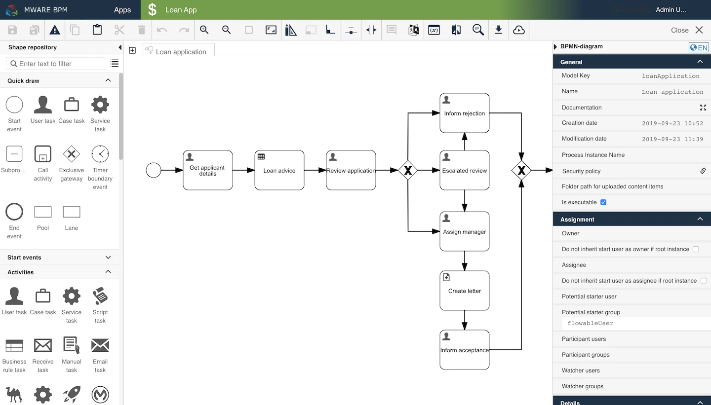
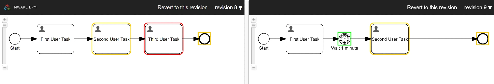

# Process Editor

The Process Editor is the primary means to create BPMN diagrams. It allows you to visually model them using simple drag-and-drop commands.

## User Interface[​](https://documentation.flowable.com/latest/user/design/bpmn-editor#user-interface) <a href="#user-interface" id="user-interface"></a>

The Process Editor user interface is roughly divided into four areas:

* The **menu bar** on top, just below the navigation bar.
* The **palette** on the left side.
* The **canvas** in the middle.
* The **attribute bar** on the right side.

<figure><figcaption></figcaption></figure>

Each area is described in detail in the following sections.

**Menu Bar**[**​**](https://documentation.flowable.com/latest/user/design/bpmn-editor#menu-bar)

The menu bar offers a number of actions, some of them only affecting the currently opened model while others have a more global impact.

<figure><figcaption></figcaption></figure>

<table><thead><tr><th width="193">Group</th><th width="105">Icon</th><th>Description</th></tr></thead><tbody><tr><td>Save</td><td></td><td>Saves the currently opened model / Saves all opened models.</td></tr><tr><td>Validate</td><td></td><td>Validates the currently opened model.</td></tr><tr><td>Edit</td><td></td><td>Copy/Paste/Cut/Delete the selected element.</td></tr><tr><td>Protocol</td><td></td><td>Undoes/Redoes the previous action.</td></tr><tr><td>Zoom</td><td></td><td>Zoom-in, Zoom-out, Reset, Fit</td></tr><tr><td>Layout</td><td></td><td>Aligns all selected elements in relation to the first selected element.</td></tr><tr><td></td><td></td><td>Sets the size of all selected elements to the size of the first selected element.</td></tr><tr><td></td><td></td><td>Resets connectors according to their default settings.</td></tr><tr><td></td><td></td><td>Allows to delete dockers from connectors with a left click.</td></tr><tr><td></td><td></td><td>Activates spacer tool.</td></tr><tr><td>Documentation</td><td></td><td>Shows all comments made on elements.</td></tr><tr><td></td><td></td><td>Switches the language of the model.</td></tr><tr><td>Model</td><td></td><td>Opens the Data Model Viewer</td></tr><tr><td></td><td></td><td>Opens the Revision Editor</td></tr><tr><td></td><td></td><td>Searches for an attribute value within the currently opened model</td></tr><tr><td>Export</td><td></td><td>Exports the currently opened model, only possible if the model was saved</td></tr><tr><td>Publish</td><td></td><td>Publish an app</td></tr></tbody></table>

**Drawing Area**[**​**](https://documentation.flowable.com/latest/user/design/bpmn-editor#drawing-area)

To create your BPMN diagrams, you can use simple drag-and-drop commands. To do so, select an element in the palette on the left side and drag it to the drawing area. The element then becomes part of your model.

If you click anywhere in the drawing area, you can change certain attributes in the attribute panel on the right side. If you click on an element, you can change its attributes. If you click outside of an element (in the "space between"), you can change the attributes of the model itself, for instance the author, the version etc.

If you click on an element, a small popup appears on the top-right side. Here, you gain access to a number of often used elements which are directly linked to the currently selected element.

For instance, when you want to connect two tasks to another one, drag the hover over the **Edge Drag** symbol and drag it to another task. If you want to create a new User Task connected to the current task, do the same with the **User Task** symbol.

**Revisions**[**​**](https://documentation.flowable.com/latest/user/design/bpmn-editor#revisions)

The revision functionality of Flowable Design allows you to compare different versions of a model in a visual way. It also offers a way to revert a model to an earlier version of the model.

To compare revisions of your currently opened model, click thebutton where you are presented with the following screen:

<figure><figcaption></figcaption></figure>

On either side you find one version/revision of the model. The change revisions for the comparison select the required version in the drop down to the right side of each version’s header pane.

New elements are surrounded by a green border, changed elements by a yellow border and deleted elements by a red border. If you hover over an element where you have changed any attribute value, the changes are displayed. Hovering over a new or a deleted element shows all the attributes of that element.

<figure><figcaption></figcaption></figure>

If you wish you to revert to an earlier version of your model, you can do so by pressing the button labeled `Revert to this version`.

**Publishing Apps**[**​**](https://documentation.flowable.com/latest/user/design/bpmn-editor#publishing-apps)

When you are ready to publish your models, you can press the button. This action opens a dialog where you can select the app which you wish to publish.&#x20;

<figure><figcaption></figcaption></figure>

Once you press the `Publish` button, the application is published. Please note that this is independent of the currently opened model. You still have to add all models you wish to deploy with the app in the app editor.

## What is BPMN?[​](https://documentation.flowable.com/latest/user/design/bpmn-editor#what-is-bpmn) <a href="#what-is-bpmn" id="what-is-bpmn"></a>

The Business Process Model and Notation (BPMN) is a standard notation and formal [specification](http://www.omg.org/spec/BPMN/Current) of the [Object Management Group](https://www.omg.org/) for representing processes. It can be used to document processes in a concise way similar to a flowchart. BPMN is targeted at participants and other stakeholders in a business process to gain understanding through an easy-to-understand visual representation of steps. It provides a standard, common language for all stakeholders, whether technical or non-technical: business analysts, process participants, managers and technical developers, as well as external teams and consultants. Ideally, it bridges the gap between process intention and implementation by providing sufficient detail and clarity into the sequence of business activities.

In addition, BPMN in its current version was designed with automatic execution in mind. This means that a business process can be stored as a file and can then be used to automatize business processes using a so called BPMN engine such as Flowable.

**Purpose of BPMN**[**​**](https://documentation.flowable.com/latest/user/design/bpmn-editor#purpose-of-bpmn)

BPMN is targeted at participants and other stakeholders in a business process to gain understanding through an easy-to-understand visual representation of the steps.

BPMN improves efficiency to gain competitive advantage.

**BPMN Elements**[**​**](https://documentation.flowable.com/latest/user/design/bpmn-editor#bpmn-elements)

The elements used for BPMN can be grouped into the following four categories:

* Flow objects: events, activities, gateways
* Connecting objects: sequence flows, message flows, associations
* Swimlanes: pool or lane
* Artifacts: data object, group, annotation

All elements in BPMN have an **ID** and a **name**. While the ID must be unique, the name can be freely chosen. By default, both attributes are determined by the type of the element. The name of an element is its label and serves as a description of what the element does. In the case of activities, it should show what the activity does. The name of an event, on the other hand, should describe which event triggers the event.

It is possible to internationalize the name of elements. To do so, click on the language label above the attribute panel which should look like this: 

If you selected more than one language, each label can be translated into the other languages as well. The translation is entered into the "General" section of an element’s attribute.

## Processes[​](https://documentation.flowable.com/latest/user/design/bpmn-editor#processes) <a href="#processes" id="processes"></a>

The Process editor’s purpose is to model BPMN processes. Just like the elements which make up a process, the process itself has a number of attributes which can be set.

The following table gives an overview of all process attributes.

**Process Attributes**\


<table data-full-width="true"><thead><tr><th width="152.33333333333331">Group</th><th width="201">Attribute</th><th>Description</th></tr></thead><tbody><tr><td>General</td><td>Model Key</td><td>The unique identifier of the process.</td></tr><tr><td></td><td>Name</td><td>The name of the process.</td></tr><tr><td></td><td>Documentation</td><td>A description and additional information about the process.</td></tr><tr><td></td><td>Creation date</td><td>The date and time the process was originally created (read-only).</td></tr><tr><td></td><td>Modification date</td><td>The date and time the process model was last modified (read-only).</td></tr><tr><td></td><td>Security policy</td><td>The security policy associated with the process.</td></tr><tr><td></td><td>Folder path for uploaded content items</td><td>The folder path where uploaded content items for this process are uploaded.</td></tr><tr><td></td><td>Is executable</td><td>Determines whether or not the process is executable or not. Non-executable processes serve documentation purposes only and cannot be started.</td></tr><tr><td>Assignment</td><td>Owner</td><td>An owner for instances created for this process definition.</td></tr><tr><td></td><td>Assignee</td><td>An assignee for instances created for this process definition.</td></tr><tr><td></td><td>Potential starter user</td><td>A single user who can potentially start the process.</td></tr><tr><td></td><td>Potential starter group</td><td>A group whose users can potentially start the process.</td></tr><tr><td></td><td>Participant users</td><td>Users that can participate in the process.</td></tr><tr><td></td><td>Participant groups</td><td>Groups of users who can participate in the process.</td></tr><tr><td></td><td>Watcher users</td><td>Users that have watcher access in the process.</td></tr><tr><td></td><td>Watcher groups</td><td>Groups of users who have watcher access in the process.</td></tr><tr><td>Details</td><td>Category</td><td>Category (target namespace) of the process model. This allows for the grouping of models.</td></tr><tr><td></td><td>History level</td><td>How much historical information is stored for the process: None, Instance, Task, Activity, Audit or Full.</td></tr><tr><td></td><td>Execution listeners</td><td><p>Active execution listeners of the process. This lets you react to the following events:</p><ul><li>Start: Occurs when the process instance is started.</li><li>End: Occurs when the process instance is completed.</li></ul></td></tr><tr><td></td><td>Data objects</td><td>Definition of data objects, a kind of meta information, available in the process.</td></tr><tr><td></td><td>Event listeners</td><td>Event listeners of this process which can react to many different events.</td></tr><tr><td></td><td>Signal definitions</td><td>Definition of all signals used in this process.</td></tr><tr><td></td><td>Message definitions</td><td>Definition of all messages used in this process.</td></tr><tr><td></td><td>Eager fetching</td><td>Enables eager execution fetching of the process definition.</td></tr><tr><td></td><td>Initiator</td><td>The variable that holds the user that is used as the default user who initiates the process.</td></tr><tr><td></td><td>Version</td><td>The current version of the process.</td></tr><tr><td></td><td>Author</td><td>The author of the process (for documentation purposes).</td></tr><tr><td>Visual</td><td>Shape label expression</td><td>Replaces the label of all activities with the provided expression. For instance, <code>${id}</code> would display the ID of elements as the label in the model.</td></tr><tr><td></td><td>Font size</td><td>Determines the font size of all labels.</td></tr><tr><td></td><td>Font weight</td><td>Determines whether or not labels are displayed in bold.</td></tr><tr><td></td><td>Font style</td><td>Determines whether or not the labels are displayed in italic.</td></tr><tr><td></td><td>Font color</td><td>Determines the font color of all labels.</td></tr></tbody></table>

### Subprocesses[​](https://documentation.flowable.com/latest/user/design/bpmn-editor#subprocesses) <a href="#subprocesses" id="subprocesses"></a>

A Sub-Process is a BPMN activity where the details have been completely defined inside a parent process (that’s why it’s often called an embedded Sub-Process).

**Sub-Processes have two major use cases:**[**​**](https://documentation.flowable.com/latest/user/design/bpmn-editor#sub-processes-have-two-major-use-cases)

* Sub-Processes allow hierarchical modeling. Flowable Design allows Sub-Processes to be collapsed, hiding all the details of the Sub-Process, resulting in a high-level, end-to-end overview of the business process.
* A Sub-Process creates a new scope for events. Events that are thrown during execution of the Sub-Process can be caught by a boundary event on the boundary of the Sub-Process, creating a scope for that event limited to the Sub-Process.

**Using a Sub-Process does have some constraints:**

* A Sub-Process can only have one 'none start event', no other start event types are allowed. A Sub-Process must have at least one 'end event'. Please note that the BPMN 2.0 specification allows the omission of the start and end events in a Sub-Process, but the current Flowable implementation does not support this.
* Sequence flows cannot cross Sub-Process boundaries.

**Using a "Collapsed subprocess" over a “Call activity”?**

BPMN 2.0 makes a distinction between a regular sub-process, often also called embedded sub-process, and the call activity, which looks very similar. From a conceptual point of view, both will call a sub-process when the process execution arrives at the activity.

The difference is that the call activity references a process that is external to the process definition, whereas the sub-process is embedded within the original process definition. The main use case for the call activity is to have a reusable process definition that can be called from multiple other process definitions.

When the process execution arrives at the call activity, a new execution is created that is a sub-execution of the execution that arrived at the call activity. This sub-execution is then used to execute the sub-process, potentially creating parallel child executions, as within a regular process. The super-execution waits until the sub-process has completely ended, and continues with the original process afterwards.

**What is the difference between a "Subprocess" and an "Ad-hoc subprocess"?**

In BPMN, an ad-hoc subprocess is one which has no sequence: the order in which the constituent tasks are performed is unknown or unspecified.

An ad-hoc sub process by default can execute multiple enabled activities at the same time. This is defined with the ordering attribute in the BPMN XML definition. This means that if you have a Adhoc subprocess with 2 tasks in it, you could execute Task 2, while also having Task 1 active at the same time.

## Activities[​](https://documentation.flowable.com/latest/user/design/bpmn-editor#activities) <a href="#activities" id="activities"></a>

Activities are the elements that actually **do** something in a process. There are three types of activities:

* **Task**: The smallest unit of work in a process, for instance the prompt to fill out a form or a call to an external web service.
* **Call Activity**: Executes another, previously defined process which is useful when a model becomes too large or when the same sequence of steps is required in different locations.
* **Sub-process:** Allows to model a process within a process which is useful when working with loops, transactions and compensation.

## Tasks[​](https://documentation.flowable.com/latest/user/design/bpmn-editor#tasks) <a href="#tasks" id="tasks"></a>

Tasks are the most common type of activity. In essence, tasks are the elements that **do** something in a process.&#x20;

### User Tasks <a href="#user-tasks" id="user-tasks"></a>

<figure><figcaption></figcaption></figure>

> A User Task is a typical “workflow” Task where a human performer performs the Task with the assistance of a software application and is scheduled through a task list manager of some sort.
>
> — BPMN 2.0.2 Standard, 10.3.3, User Task

In MWARE BPM, _User Tasks_ are the primary way to interact with humans within a process. Once the execution reaches such a task, a user is required to fill in a **form** of some sort.

Through forms, it is possible to **create and update variables** which can be used in other tasks or can be used to control the flow of a process.

Each task can be **assigned** to one or more people as well as **shared** with any number of groups. In addition, a task can optionally have a **due date**.

**Example**[**​**](https://documentation.flowable.com/latest/user/design/bpmn-editor#example)

The following example shows how a process where a user is required to fill a form. The information gathered is used to create an invoice.


A simple corresponding form could look like this:


**Attributes**

<table data-full-width="true"><thead><tr><th width="144.33333333333331">Group</th><th width="173">Attribute</th><th>Description</th></tr></thead><tbody><tr><td>General</td><td>ID</td><td>The unique identifier of the element within the process model.</td></tr><tr><td></td><td>Name</td><td>The name of the element. This is the name displayed in the diagram.</td></tr><tr><td></td><td>Security policy</td><td>The security policy associated with this element.</td></tr><tr><td></td><td>Documentation</td><td>A description and additional information about this element.</td></tr><tr><td>Assignment</td><td>Owner</td><td>The <em>Owner</em> attribute describes who owns the task. The owner can have specific task permissions defined in the security policy.</td></tr><tr><td></td><td>Assignee</td><td>Defines the assignee of a task. The assignee is the person who is responsible for the completion of a task. By default, the assignee is set to <code>$INITIATOR</code> which is a special variable that is set to the user who started the process. It is possible to set the assignee <strong>directly</strong> or through an <strong>expression</strong>. In both cases, the expected value is the <strong>User ID</strong> of the assignee.</td></tr><tr><td></td><td>Candidate users</td><td>Defines a list of users that can become assignee by <strong>claiming</strong> the task. It is possible to set the candidate users <strong>directly</strong> or through an <strong>expression</strong>. In both cases, a <strong>list of user IDs</strong> is expected.</td></tr><tr><td></td><td>Candidate groups</td><td>Defines one or more groups that can become assignee by <strong>claiming</strong> the task. You can either directly select a group or use an <strong>expression</strong>. It is possible to set the candidate groups <strong>directly</strong> or through an <strong>expression</strong>. In both cases, a <strong>list of group IDs</strong> is expected.</td></tr><tr><td></td><td>Participant users</td><td>The selected users to add as participant identity links to the task.</td></tr><tr><td></td><td>Participant groups</td><td>The selected groups to add as participant identity links to the task.</td></tr><tr><td></td><td>Watcher users</td><td>The selected users to add as watcher identity links to the task.</td></tr><tr><td></td><td>Watcher groups</td><td>The selected groups to add as watcher identity links to the task.</td></tr><tr><td>Details</td><td>Form reference</td><td>The <strong>form</strong> associated with the User Task. Once a user opens the task, he or she is presented with the referenced form. It is possible to create a new form, reference an existing one or delete the current reference.</td></tr><tr><td></td><td>Validate form fields (server-side)</td><td>If the form is submitted and validate form fields expression evaluates to true, form fields are validated on the back send according to the form model restrictions.</td></tr><tr><td></td><td>Form properties</td><td><em>Deprecated</em>: Sets the form properties. Only relevant if you work with a legacy version of Flowable Tasks.</td></tr><tr><td></td><td>Task listener</td><td><p>Sets Task Listeners for this task. This lets you react to the following events:</p><ul><li><strong>Create</strong>: Occurs when the task has been created and all task properties are set.</li><li><strong>Assignment</strong>: Occurs when the task is assigned to somebody. Please note that the Assignment event is fired before the Create event.</li><li><strong>Complete</strong>: Occurs when the task is completed and just before the task is deleted from the runtime data.</li><li><strong>Delete</strong>: Occurs just before the task is going to be deleted or completed.</li></ul></td></tr><tr><td></td><td>Expose as action to object</td><td>Allows you to expose the activation action to objects other than the process, such as a user or conversation.</td></tr><tr><td></td><td>Asynchronous</td><td><p>Sets the User Task as "asynchronous" which introduces a wait state once the execution reaches the task.</p><p><strong>Important</strong></p><p>In most cases, there should not be a reason to use this attribute in a User Task.</p></td></tr><tr><td></td><td>Expose as an action message</td><td>Allows you to expose the activation action as a message to a conversation.</td></tr><tr><td></td><td>Folder path for uploaded content items</td><td>The folder path where uploaded content items for this task are uploaded.</td></tr><tr><td></td><td>Execution listeners</td><td><p>Active Execution Listeners of the activity. This lets you react to the following events:</p><ul><li><strong>Start</strong>: Occurs when the activity is started.</li><li><strong>End</strong>: Occurs when the activity is completed.</li></ul></td></tr><tr><td></td><td>Priority</td><td>An integer number denoting the priority of the task.</td></tr><tr><td></td><td>Due date</td><td><p>The due date of the task. <strong>No due date</strong> is the default and there are three different options to set a due date:</p><ul><li>Relative: Add or subtract a number of days, months or years relative to the current date.</li><li>Absolute: Set an absolute date.</li><li>Expressions: Use an expression to dynamically calculate a date.</li></ul></td></tr><tr><td></td><td>Skip expression</td><td><p>Defines an expression which is evaluated before executing the task. If it evaluates to <code>true</code>, the task is skipped.</p><p><strong>Important</strong></p><p>Skip expressions are only be evaluated if there is a process variable <code>_ACTIVITI_SKIP_EXPRESSION_ENABLED</code> with the boolean value <code>true</code>.</p></td></tr><tr><td></td><td>Is for compensation</td><td>Determines whether the activity can serve as a compensation for another activity.</td></tr><tr><td>Multi instance</td><td>Multi instance type</td><td><p>Determines if multiple instances of this activity are created. There are three choices:</p><ul><li><code>None</code> (default, only one instance is created).</li><li><code>MI parallel</code> (activities are created in parallel. This is a good practice for User Tasks).</li><li><code>MI sequential</code> (activities are created sequentially. This is a good practice for Service Tasks).</li></ul><p>Once a type other than <code>None</code> is chosen, the following options appear:</p><ul><li>Collection: The number of instances is determined by the elements of a collection. For each element in the collection, a new instance is created.</li><li>Element variable: The variable under which each element is available to the newly created instance.</li><li>Element index variable: The variable under which the current number of iterations is stored.</li><li>Completion condition: An expression which, if it evaluated to <code>true</code>, stops the creation of new instances.</li><li>Cardinality: An expression or numeric value (integer) which determines how many instances are created.</li></ul></td></tr><tr><td>Visual</td><td>Font weight</td><td>The font weight of the element in the diagram.</td></tr><tr><td></td><td>Font size</td><td>The font size of the element in the diagram.</td></tr><tr><td></td><td>Font color</td><td>The font color of the element in the diagram.</td></tr><tr><td></td><td>Font style</td><td>The font style of the element in the diagram.</td></tr><tr><td></td><td>Background color</td><td>The background color of the element in the diagram.</td></tr><tr><td></td><td>Border color</td><td>The border color of the element in the diagram.</td></tr></tbody></table>

### Case Task <a href="#case-task" id="case-task"></a>

<figure><figcaption></figcaption></figure>

In MWARE BPM, Case Tasks are used to create new case instances. As soon as the task is activated, a new case instance is created.

Case tasks are completed once the newly created case is completed unless the `Blocking` attribute is set to `false`.

**Attributes**[**​**](https://documentation.flowable.com/latest/user/design/bpmn-editor#attributes-1)

<table data-full-width="true"><thead><tr><th width="155.33333333333337">Group</th><th width="237">Attribute</th><th>Description</th></tr></thead><tbody><tr><td>General</td><td>ID</td><td>The unique identifier of the element within the process model.</td></tr><tr><td></td><td>Name</td><td>The name of the element. This is the name displayed in the diagram.</td></tr><tr><td></td><td>Documentation</td><td>A description and additional information about this element.</td></tr><tr><td>Details</td><td>Case name</td><td>An optional run-time expression for the name of the newly started case instance. If left empty, defaults to the value of the 'Name' attribute.</td></tr><tr><td></td><td>Case reference</td><td>The Case model reference referring to the CMMN Case that is to start as this Case task moves to state ACTIVE.</td></tr><tr><td></td><td>In same deployment</td><td>Set it to true if the referenced case should be referenced from within the same app deployment. Set it to false to always use the newest case definition.</td></tr><tr><td></td><td>In</td><td>An optional input parameter map. Allows passing variables into the newly created case.</td></tr><tr><td></td><td>Out</td><td>An optional output parameter map. Allows storing variables of the case back to the parent when the case completes.</td></tr><tr><td></td><td>Execution listeners</td><td><p>Active Execution Listeners of the activity. This lets you react to the following events:</p><ul><li><strong>Start</strong>: Occurs when the activity is started.</li><li><strong>End</strong>: Occurs when the activity is completed.</li></ul></td></tr><tr><td></td><td>Fallback to default tenant</td><td>Indicates the case is created with the default tenant if it is not available on the current tenant. This is only relevant if the application is running in a multi-tenant setup.</td></tr><tr><td></td><td>Business key</td><td>An expression that resolves to a business key for the child case instance.</td></tr><tr><td></td><td>Inherit business key</td><td>Inherit the business key from the parent process.</td></tr><tr><td></td><td>Asynchronous</td><td>When enabled, the activity is started as an asynchronous job. The process state is persisted before this element is executed. Then the process execution is resumed asynchronously. This can be used when the execution of an activity takes a long time to return the user interface. However, if an error occurs before the following wait state, there is no direct user feedback.</td></tr><tr><td></td><td>Skip expression</td><td><p>Defines an expression which is evaluated before executing the task. If it evaluates to <code>true</code>, the task is skipped.</p><p><strong>Important</strong></p><p>Skip expressions are only be evaluated if there is a process variable <code>_ACTIVITI_SKIP_EXPRESSION_ENABLED</code> with the boolean value <code>true</code>.</p></td></tr><tr><td></td><td>Is for compensation</td><td>Determines whether the activity can serve as a compensation for another activity.</td></tr><tr><td>Multi instance</td><td>Multi instance type</td><td><p>Determines if multiple instances of this activity are created. There are three choices:</p><ul><li><code>None</code> (default, only one instance is created).</li><li><code>MI parallel</code> (activities are created in parallel. This is a good practice for User Tasks).</li><li><code>MI sequential</code> (activities are created sequentially. This is a good practice for Service Tasks).</li></ul><p>Once a type other than <code>None</code> is chosen, the following options appear:</p><ul><li>Collection: The number of instances is determined by the elements of a collection. For each element in the collection, a new instance is created.</li><li>Element variable: The variable under which each element is available to the newly created instance.</li><li>Element index variable: The variable under which the current number of iterations is stored.</li><li>Completion condition: An expression which, if it evaluated to <code>true</code>, stops the creation of new instances.</li><li>Cardinality: An expression or numeric value (integer) which determines how many instances are created.</li></ul></td></tr><tr><td>Visual</td><td>Font weight</td><td>The font weight of the element in the diagram.</td></tr><tr><td></td><td>Font size</td><td>The font size of the element in the diagram.</td></tr><tr><td></td><td>Font color</td><td>The font color of the element in the diagram.</td></tr><tr><td></td><td>Font style</td><td>The font style of the element in the diagram.</td></tr><tr><td></td><td>Background color</td><td>The background color of the element in the diagram.</td></tr><tr><td></td><td>Border color</td><td>The border color of the element in the diagram.</td></tr></tbody></table>

### Service Task <a href="#service-task" id="service-task"></a>

<figure><figcaption></figcaption></figure>

> A Service Task is a Task that uses some sort of service, which could be a Web service or an automated application.
>
> — BPMN 2.0.2 Standard, 10.3.3, Service Task

In MWARE BPM, Service Tasks are used to perform some form of "technical" task. Whenever you want to perform calculations, trigger some action within your application’s back end or integrate with another system, it often involves Service Tasks. Most custom tasks such as the Email task or the HTTP Task are specialized versions of Service Tasks. This is possible thanks to the extensible nature of the BPMN standard which allows us to create our own tasks based on an existing type.

It is possible to configure Service Tasks in four ways:

* Use a Value Expression.
* Specifying a class that implements `JavaDelegate` or `ActivityBehavior`.
* Evaluating an expression that resolves to a delegation object.
* Invoking a method expression.

In many cases you want to store the result of an operation carried out by a Service Task in a variable. The resulting variable name is specified in the **Result variable** attribute.

**Example**[**​**](https://documentation.flowable.com/latest/user/design/bpmn-editor#example-1)

The following example shows a very simple process where a user enters some information about a client. The following service task then takes that information and creates a new client in the company’s operational systems.

<figure><figcaption></figcaption></figure>

**Attributes**[**​**](https://documentation.flowable.com/latest/user/design/bpmn-editor#attributes-2)

<table data-full-width="true"><thead><tr><th width="148.33333333333337">Group</th><th width="264">Attribute</th><th>Description</th></tr></thead><tbody><tr><td>General</td><td>ID</td><td>The unique identifier of the element within the process model.</td></tr><tr><td></td><td>Name</td><td>The name of the element. This is the name displayed in the diagram.</td></tr><tr><td></td><td>Documentation</td><td>A description and additional information about this element.</td></tr><tr><td>Details</td><td>Execution listeners</td><td><p>Active Execution Listeners of the activity. This lets you react to the following events:</p><ul><li><strong>Start</strong>: Occurs when the activity is started.</li><li><strong>End</strong>: Occurs when the activity is completed.</li></ul></td></tr><tr><td></td><td>Expression</td><td>An expression which is resolved once the task is executed. The expression can either be a value expression such as <code>${firstName}</code> or it can resolve a named object (e.g., a Spring Bean) and interact with it. For instance, in the above example, a possible expression could be<code>${clientService.createNewClient(firstName, lastName, email)}</code>.</td></tr><tr><td></td><td>Delegate expression</td><td>An expression which resolved to a named object (e.g., a Spring Bean) which either implements the class <code>JavaDelegate</code> or <code>ActivityBehavior</code>.</td></tr><tr><td></td><td>Result variable</td><td>The name of the variable in which the result of the Service Task’s execution is stored. If no result variable is indicated, the result is discarded.</td></tr><tr><td></td><td>Use local scope</td><td>Indicates whether to store the result variable as a local variable.</td></tr><tr><td></td><td>Class</td><td>The fully qualified name of a class which either implements the class <code>JavaDelegate</code> or <code>ActivityBehavior</code>.</td></tr><tr><td></td><td>Asynchronous</td><td>When enabled, the activity is started as an asynchronous job. The process state is persisted before this element is executed. Then the process execution is resumed asynchronously. This can be used when the execution of an activity takes a long time to return the user interface. However, if an error occurs before the following wait state, there is no direct user feedback.</td></tr><tr><td></td><td>Class Fields</td><td>Class fields make it possible to inject field values into your delegated class. You can either inject a fixed string value or an expression. See the section 'Field Injection' of the Flowable documentation for more information.</td></tr><tr><td></td><td>Triggerable</td><td>Sets the Service Tasks to be triggerable. This makes it possible that an external trigger determines when to continue the execution of the process once the Service Task was executed. For instance, in the above example, such an external trigger could be the activation of the new client.</td></tr><tr><td></td><td>Skip expression</td><td><p>Defines an expression which is evaluated before executing the task. If it evaluates to <code>true</code>, the task is skipped.</p><p><strong>Important</strong></p><p>Skip expressions are only be evaluated if there is a process variable <code>_ACTIVITI_SKIP_EXPRESSION_ENABLED</code> with the boolean value <code>true</code>.</p></td></tr><tr><td></td><td>Is for compensation</td><td>Determines whether the activity can serve as a compensation for another activity.</td></tr><tr><td>Multi instance</td><td>Multi instance type</td><td><p>Determines if multiple instances of this activity are created. There are three choices:</p><ul><li><code>None</code> (default, only one instance is created).</li><li><code>MI parallel</code> (activities are created in parallel. This is a good practice for User Tasks).</li><li><code>MI sequential</code> (activities are created sequentially. This is a good practice for Service Tasks).</li></ul><p>Once a type other than <code>None</code> is chosen, the following options appear:</p><ul><li>Collection: The number of instances is determined by the elements of a collection. For each element in the collection, a new instance is created.</li><li>Element variable: The variable under which each element is available to the newly created instance.</li><li>Element index variable: The variable under which the current number of iterations is stored.</li><li>Completion condition: An expression which, if it evaluated to <code>true</code>, stops the creation of new instances.</li><li>Cardinality: An expression or numeric value (integer) which determines how many instances are created.</li></ul></td></tr><tr><td>Visual</td><td>Font weight</td><td>The font weight of the element in the diagram.</td></tr><tr><td></td><td>Font size</td><td>The font size of the element in the diagram.</td></tr><tr><td></td><td>Font color</td><td>The font color of the element in the diagram.</td></tr><tr><td></td><td>Font style</td><td>The font style of the element in the diagram.</td></tr><tr><td></td><td>Background color</td><td>The background color of the element in the diagram.</td></tr><tr><td></td><td>Border color</td><td>The border color of the element in the diagram.</td></tr></tbody></table>

### Script Task <a href="#script-task" id="script-task"></a>

<figure><figcaption></figcaption></figure>

> A Script Task is executed by a business process engine. The modeler or implementer defines a script in a language that the engine can interpret. When the Task is ready to start, the engine will execute the script. When the script is completed, the Task will also be completed.
>
> — BPMN 2.0.2 Standard, 10.3.3, Script Task

In MWARE BPM, Script Tasks are used to execute scripts in a JSR-223 compatible scripting language, for instance **JavaScript** or **Groovy**.

Scripts Tasks are mainly used to perform simple calculations or operations. For more complex use cases, you should consider writing a Java Service and calling it via a Service Task.

**Example**[**​**](https://documentation.flowable.com/latest/user/design/bpmn-editor#example-2)

In the following example, a user is prompted to enter the first and last name. A script generates an email address and stores it in the variable "email":

<figure><figcaption></figcaption></figure>

The following script shows a very simple example script that could be used to achieve this task:

```
var firstName = execution.getVariable("firstName").toLowerCase();
var lastName = execution.getVariable("lastName").toLowerCase();
var email = firstName + "." + lastName + "@yourCompany.com";
execution.setVariable("email", email);
```

**Attributes**[**​**](https://documentation.flowable.com/latest/user/design/bpmn-editor#attributes-3)

<table data-full-width="true"><thead><tr><th width="161.33333333333337">Group</th><th width="197">Attribute</th><th>Description</th></tr></thead><tbody><tr><td>General</td><td>ID</td><td>The unique identifier of the element within the process model.</td></tr><tr><td></td><td>Name</td><td>The name of the element. This is the name displayed in the diagram.</td></tr><tr><td></td><td>Documentation</td><td>A description and additional information about this element.</td></tr><tr><td>Details</td><td>Asynchronous</td><td>When enabled, the activity is started as an asynchronous job. The process state is persisted before this element is executed. Then the process execution is resumed asynchronously. This can be used when the execution of an activity takes a long time to return the user interface. However, if an error occurs before the following wait state, there is no direct user feedback.</td></tr><tr><td></td><td>Auto store variables</td><td>Automatically stores any variable defined in the script on the execution. Please note that some languages such as JavaScript do not support this feature.</td></tr><tr><td></td><td>Script</td><td>Script that is executed when the task is executed.</td></tr><tr><td></td><td>Script format</td><td>Defines the script format. The script format must be provided if a script is provided. By default, <code>Groovy</code> and <code>JavaScript</code> are provided.</td></tr><tr><td></td><td>Execution listeners</td><td><p>Active Execution Listeners of the activity. This lets you react to the following events:</p><ul><li><strong>Start</strong>: Occurs when the activity is started.</li><li><strong>End</strong>: Occurs when the activity is completed.</li></ul></td></tr><tr><td></td><td>Skip expression</td><td><p>Defines an expression which is evaluated before executing the task. If it evaluates to <code>true</code>, the task is skipped.</p><p><strong>Important</strong></p><p>Skip expressions are only be evaluated if there is a process variable <code>_ACTIVITI_SKIP_EXPRESSION_ENABLED</code> with the boolean value <code>true</code>.</p></td></tr><tr><td></td><td>Is for compensation</td><td>Determines whether the activity can serve as a compensation for another activity.</td></tr><tr><td>Multi instance</td><td>Multi instance type</td><td><p>Determines if multiple instances of this activity are created. There are three choices:</p><ul><li><code>None</code> (default, only one instance is created).</li><li><code>MI parallel</code> (activities are created in parallel. This is a good practice for User Tasks).</li><li><code>MI sequential</code> (activities are created sequentially. This is a good practice for Service Tasks).</li></ul><p>Once a type other than <code>None</code> is chosen, the following options appear:</p><ul><li>Collection: The number of instances is determined by the elements of a collection. For each element in the collection, a new instance is created.</li><li>Element variable: The variable under which each element is available to the newly created instance.</li><li>Element index variable: The variable under which the current number of iterations is stored.</li><li>Completion condition: An expression which, if it evaluated to <code>true</code>, stops the creation of new instances.</li><li>Cardinality: An expression or numeric value (integer) which determines how many instances are created.</li></ul></td></tr><tr><td>Visual</td><td>Font weight</td><td>The font weight of the element in the diagram.</td></tr><tr><td></td><td>Font size</td><td>The font size of the element in the diagram.</td></tr><tr><td></td><td>Font color</td><td>The font color of the element in the diagram.</td></tr><tr><td></td><td>Font style</td><td>The font style of the element in the diagram.</td></tr><tr><td></td><td>Background color</td><td>The background color of the element in the diagram.</td></tr><tr><td></td><td>Border color</td><td>The border color of the element in the diagram.</td></tr></tbody></table>

### Business Rule Task <a href="#business-rule-task" id="business-rule-task"></a>

<figure><figcaption></figcaption></figure>

> A Business Rule Task provides a mechanism for the Process to provide input to a Business Rules Engine and to get the output of calculations that the Business Rules Engine might provide. The InputOutputSpecification of the Task will allow the Process to send data to and receive data from the Business Rules Engine.
>
> — BPMN 2.0.2 Standard, 10.3.3, Business Rule Task

In MWARE BPM, Business Rule Tasks are used to interact with external rule engines such as [Drools](https://www.drools.org/). By default, Drools Expert is used to evaluate the rules.

Do not confuse this task with the Decision Task which is used to execute DMN decision tables.

**Example**[**​**](https://documentation.flowable.com/latest/user/design/bpmn-editor#example-3)

The example below shows the use of Business Rule task in analyzing the result of a survey. The business rule engine is used to analyzing the data collected from the survey. The analyzed data is summarized by a service task and then mailed to the main office.

<figure><figcaption></figcaption></figure>

**Attributes**[**​**](https://documentation.flowable.com/latest/user/design/bpmn-editor#attributes-4)

<table data-full-width="true"><thead><tr><th width="168.33333333333337">Group</th><th width="204">Attribute</th><th>Description</th></tr></thead><tbody><tr><td>General</td><td>ID</td><td>The unique identifier of the element within the process model.</td></tr><tr><td></td><td>Name</td><td>The name of the element. This is the name displayed in the diagram.</td></tr><tr><td></td><td>Documentation</td><td>A description and additional information about this element.</td></tr><tr><td>Details</td><td>Rules</td><td>The rules to execute.</td></tr><tr><td></td><td>Class</td><td><p>The fully qualified name of a class which either implements the class <code>JavaDelegate</code> or <code>ActivityBehavior</code>.</p><p><strong>Tip</strong></p><p>If you want to change the behavior of the rule evaluation or if you want to plug in another Rule engine, do so with this attribute.</p></td></tr><tr><td></td><td>Execution listeners</td><td><p>Active Execution Listeners of the activity. This lets you react to the following events:</p><ul><li><strong>Start</strong>: Occurs when the activity is started.</li><li><strong>End</strong>: Occurs when the activity is completed.</li></ul></td></tr><tr><td></td><td>Asynchronous</td><td>When enabled, the activity is started as an asynchronous job. The process state is persisted before this element is executed. Then the process execution is resumed asynchronously. This can be used when the execution of an activity takes a long time to return the user interface. However, if an error occurs before the following wait state, there is no direct user feedback.</td></tr><tr><td></td><td>Result variable</td><td>The variable into which the result of the rule evaluation is stored.</td></tr><tr><td></td><td>Variables input</td><td>The variables that serve as inputs for the rule evaluation.</td></tr><tr><td></td><td>Exclude</td><td>Determines whether the business rules are excluded while executing.</td></tr><tr><td></td><td>Skip expression</td><td><p>Defines an expression which is evaluated before executing the task. If it evaluates to <code>true</code>, the task is skipped.</p><p><strong>Important</strong></p><p>Skip expressions are only be evaluated if there is a process variable <code>_ACTIVITI_SKIP_EXPRESSION_ENABLED</code> with the boolean value <code>true</code>.</p></td></tr><tr><td></td><td>Is for compensation</td><td>Determines whether the activity can serve as a compensation for another activity.</td></tr><tr><td>Multi instance</td><td>Multi instance type</td><td><p>Determines if multiple instances of this activity are created. There are three choices:</p><ul><li><code>None</code> (default, only one instance is created).</li><li><code>MI parallel</code> (activities are created in parallel. This is a good practice for User Tasks).</li><li><code>MI sequential</code> (activities are created sequentially. This is a good practice for Service Tasks).</li></ul><p>Once a type other than <code>None</code> is chosen, the following options appear:</p><ul><li>Collection: The number of instances is determined by the elements of a collection. For each element in the collection, a new instance is created.</li><li>Element variable: The variable under which each element is available to the newly created instance.</li><li>Element index variable: The variable under which the current number of iterations is stored.</li><li>Completion condition: An expression which, if it evaluated to <code>true</code>, stops the creation of new instances.</li><li>Cardinality: An expression or numeric value (integer) which determines how many instances are created.</li></ul></td></tr><tr><td>Visual</td><td>Font weight</td><td>The font weight of the element in the diagram.</td></tr><tr><td></td><td>Font size</td><td>The font size of the element in the diagram.</td></tr><tr><td></td><td>Font color</td><td>The font color of the element in the diagram.</td></tr><tr><td></td><td>Font style</td><td>The font style of the element in the diagram.</td></tr><tr><td></td><td>Background color</td><td>The background color of the element in the diagram.</td></tr><tr><td></td><td>Border color</td><td>The border color of the element in the diagram.</td></tr></tbody></table>

### Receive Task <a href="#receive-task" id="receive-task"></a>

<figure><figcaption></figcaption></figure>

> A Receive Task is a simple Task that is designed to wait for a Message to arrive from an external Participant (relative to the Process). Once the Message has been received, the Task is completed.
>
> — BPMN 2.0.2 Standard, 10.3.3, Receive Ta

In MWARE BPM, Receive Tasks are used if you want to stop the execution flow until an external source sends a trigger to continue.

This can be useful if an external system needs a long time to process data and you want to wait until the processing is done.

A similar result can be achieved if the flag `Triggerable` in a Service Task is activated.

**Example**[**​**](https://documentation.flowable.com/latest/user/design/bpmn-editor#example-4)

The following example shows a process where a user enters the name and address of a client. The information is then sent to an ERP system. Since the communication between the Java back end of our application and the external system is asynchronously, we do not know when the processing is done. For that reason, the ERP system has to acknowledge that the client was created, for instance by calling a REST endpoint defined in the application which triggers the continuation of the process.

<figure><figcaption></figcaption></figure>

**Attributes**[**​**](https://documentation.flowable.com/latest/user/design/bpmn-editor#attributes-5)

<table data-full-width="true"><thead><tr><th width="158.33333333333337">Group</th><th width="233">Attribute</th><th>Description</th></tr></thead><tbody><tr><td>General</td><td>ID</td><td>The unique identifier of the element within the process model.</td></tr><tr><td></td><td>Name</td><td>The name of the element. This is the name displayed in the diagram.</td></tr><tr><td></td><td>Documentation</td><td>A description and additional information about this element.</td></tr><tr><td>Details</td><td>Asynchronous</td><td>When enabled, the activity is started as an asynchronous job. The process state is persisted before this element is executed. Then the process execution is resumed asynchronously. This can be used when the execution of an activity takes a long time to return the user interface. However, if an error occurs before the following wait state, there is no direct user feedback.</td></tr><tr><td></td><td>Execution listeners</td><td><p>Active Execution Listeners of the activity. This lets you react to the following events:</p><ul><li><strong>Start</strong>: Occurs when the activity is started.</li><li><strong>End</strong>: Occurs when the activity is completed.</li></ul></td></tr><tr><td></td><td>Skip expression</td><td><p>Defines an expression which is evaluated before executing the task. If it evaluates to <code>true</code>, the task is skipped.</p><p><strong>Important</strong></p><p>Skip expressions are only be evaluated if there is a process variable <code>_ACTIVITI_SKIP_EXPRESSION_ENABLED</code> with the boolean value <code>true</code>.</p></td></tr><tr><td></td><td>Is for compensation</td><td>Determines whether the activity can serve as a compensation for another activity.</td></tr><tr><td>Multi instance</td><td>Multi instance type</td><td><p>Determines if multiple instances of this activity are created. There are three choices:</p><ul><li><code>None</code> (default, only one instance is created).</li><li><code>MI parallel</code> (activities are created in parallel. This is a good practice for User Tasks).</li><li><code>MI sequential</code> (activities are created sequentially. This is a good practice for Service Tasks).</li></ul><p>Once a type other than <code>None</code> is chosen, the following options appear:</p><ul><li>Collection: The number of instances is determined by the elements of a collection. For each element in the collection, a new instance is created.</li><li>Element variable: The variable under which each element is available to the newly created instance.</li><li>Element index variable: The variable under which the current number of iterations is stored.</li><li>Completion condition: An expression which, if it evaluated to <code>true</code>, stops the creation of new instances.</li><li>Cardinality: An expression or numeric value (integer) which determines how many instances are created.</li></ul></td></tr><tr><td>Visual</td><td>Font weight</td><td>The font weight of the element in the diagram.</td></tr><tr><td></td><td>Font size</td><td>The font size of the element in the diagram.</td></tr><tr><td></td><td>Font color</td><td>The font color of the element in the diagram.</td></tr><tr><td></td><td>Font style</td><td>The font style of the element in the diagram.</td></tr><tr><td></td><td>Background color</td><td>The background color of the element in the diagram.</td></tr><tr><td></td><td>Border color</td><td>The border color of the element in the diagram.</td></tr></tbody></table>

### Manual Task <a href="#manual-task" id="manual-task"></a>

<figure><figcaption></figcaption></figure>

> A Manual Task is a Task that is expected to be performed without the aid of any business process execution engine or any application. An example of this could be a telephone technician installing a telephone at a customer location.
>
> — BPMN 2.0.2 Standard, 10.3.3, Manual Task

In MWARE BPM, Manual Tasks have no execution semantics. They are usually used for documentation purposes only. However, it is possible to place execution listeners on them as with any other activity.

**Example**[**​**](https://documentation.flowable.com/latest/user/design/bpmn-editor#example-5)

The following example shows how a Manual Task which is non-executable (Collect Cash) is used to clarify a model.

<figure><figcaption></figcaption></figure>

**Attributes**[**​**](https://documentation.flowable.com/latest/user/design/bpmn-editor#attributes-6)

<table data-full-width="true"><thead><tr><th width="177.33333333333337">Group</th><th width="216">Attribute</th><th>Description</th></tr></thead><tbody><tr><td>General</td><td>ID</td><td>The unique identifier of the element within the process model.</td></tr><tr><td></td><td>Name</td><td>The name of the element. This is the name displayed in the diagram.</td></tr><tr><td></td><td>Documentation</td><td>A description and additional information about this element.</td></tr><tr><td>Details</td><td>Asynchronous</td><td>When enabled, the activity is started as an asynchronous job. The process state is persisted before this element is executed. Then the process execution is resumed asynchronously. This can be used when the execution of an activity takes a long time to return the user interface. However, if an error occurs before the following wait state, there is no direct user feedback.</td></tr><tr><td></td><td>Execution listeners</td><td><p>Active Execution Listeners of the activity. This lets you react to the following events:</p><ul><li><strong>Start</strong>: Occurs when the activity is started.</li><li><strong>End</strong>: Occurs when the activity is completed.</li></ul></td></tr><tr><td></td><td>Skip expression</td><td><p>Defines an expression which is evaluated before executing the task. If it evaluates to <code>true</code>, the task is skipped.</p><p><strong>Important</strong></p><p>Skip expressions are only be evaluated if there is a process variable <code>_ACTIVITI_SKIP_EXPRESSION_ENABLED</code> with the boolean value <code>true</code>.</p></td></tr><tr><td></td><td>Is for compensation</td><td>Determines whether the activity can serve as a compensation for another activity.</td></tr><tr><td>Multi instance</td><td>Multi instance type</td><td><p>Determines if multiple instances of this activity are created. There are three choices:</p><ul><li><code>None</code> (default, only one instance is created).</li><li><code>MI parallel</code> (activities are created in parallel. This is a good practice for User Tasks).</li><li><code>MI sequential</code> (activities are created sequentially. This is a good practice for Service Tasks).</li></ul><p>Once a type other than <code>None</code> is chosen, the following options appear:</p><ul><li>Collection: The number of instances is determined by the elements of a collection. For each element in the collection, a new instance is created.</li><li>Element variable: The variable under which each element is available to the newly created instance.</li><li>Element index variable: The variable under which the current number of iterations is stored.</li><li>Completion condition: An expression which, if it evaluated to <code>true</code>, stops the creation of new instances.</li><li>Cardinality: An expression or numeric value (integer) which determines how many instances are created.</li></ul></td></tr><tr><td>Visual</td><td>Font weight</td><td>The font weight of the element in the diagram.</td></tr><tr><td></td><td>Font size</td><td>The font size of the element in the diagram.</td></tr><tr><td></td><td>Font color</td><td>The font color of the element in the diagram.</td></tr><tr><td></td><td>Font style</td><td>The font style of the element in the diagram.</td></tr><tr><td></td><td>Background color</td><td>The background color of the element in the diagram.</td></tr><tr><td></td><td>Border color</td><td>The border color of the element in the diagram.</td></tr></tbody></table>

### Email Task[​](https://documentation.flowable.com/latest/user/design/bpmn-editor#email-task) <a href="#email-task" id="email-task"></a>

<figure><figcaption></figcaption></figure>

In MWARE BPM, Email Tasks are used to send out emails. Flowable does not come with a mail server, so it is necessary to set up an email server via configuration.

**Attributes**[**​**](https://documentation.flowable.com/latest/user/design/bpmn-editor#attributes-7)

<table data-full-width="true"><thead><tr><th width="156.33333333333337">Group</th><th width="191">Attribute</th><th>Description</th></tr></thead><tbody><tr><td>General</td><td>ID</td><td>The unique identifier of the element within the process model.</td></tr><tr><td></td><td>Name</td><td>The name of the element. This is the name displayed in the diagram.</td></tr><tr><td></td><td>Documentation</td><td>A description and additional information about this element.</td></tr><tr><td>Details</td><td>Email properties</td><td><p>Allows you to set all properties of this email task:</p><ul><li><strong>Subject</strong>: The subject of the email.</li><li><strong>From</strong>: The sender email address. If not provided, the default configured "from address" is used.</li><li><strong>To</strong>: The recipients of the email. Multiple recipients can be defined in a comma-separated list.</li><li><strong>Cc</strong>: The CC (Carbon Copy) recipients of the email. Multiple recipients can be defined in a comma-separated list.</li><li><strong>Bcc</strong>: The BCC (Blind Carbon Copy) recipients of the email. Multiple recipients can be defined in a comma-separated list.</li><li><strong>HTML</strong>: Content of the email in the HTML format. This allows for the creation of rich formatting and the usage of images.</li><li><strong>Text</strong>: Text of the email in clear text. If HTML is not supported on the receiver’s end, the text version of the email is displayed.</li><li><strong>Charset</strong>: Character set to be used in the email.</li></ul></td></tr><tr><td></td><td>Asynchronous</td><td>When enabled, the activity is started as an asynchronous job. The process state is persisted before this element is executed. Then the process execution is resumed asynchronously. This can be used when the execution of an activity takes a long time to return the user interface. However, if an error occurs before the following wait state, there is no direct user feedback.</td></tr><tr><td></td><td>Execution listeners</td><td><p>Active Execution Listeners of the activity. This lets you react to the following events:</p><ul><li><strong>Start</strong>: Occurs when the activity is started.</li><li><strong>End</strong>: Occurs when the activity is completed.</li></ul></td></tr><tr><td></td><td>Skip expression</td><td><p>Defines an expression which is evaluated before executing the task. If it evaluates to <code>true</code>, the task is skipped.</p><p><strong>Important</strong></p><p>Skip expressions are only be evaluated if there is a process variable <code>_ACTIVITI_SKIP_EXPRESSION_ENABLED</code> with the boolean value <code>true</code>.</p></td></tr><tr><td></td><td>Is for compensation</td><td>Determines whether the activity can serve as a compensation for another activity.</td></tr><tr><td>Multi instance</td><td>Multi instance type</td><td><p>Determines if multiple instances of this activity are created. There are three choices:</p><ul><li><code>None</code> (default, only one instance is created).</li><li><code>MI parallel</code> (activities are created in parallel. This is a good practice forUser Tasks).</li><li><code>MI sequential</code> (activities are created sequentially. This is a good practice forService Tasks).</li></ul><p>Once a type other than <code>None</code> is chosen, the following options appear:</p><ul><li>Collection: The number of instances is determined by the elements of a collection. For each element in the collection, a new instance is created.</li><li>Element variable: The variable under which each element is available to the newly created instance.</li><li>Element index variable: The variable under which the current number of iterations is stored.</li><li>Completion condition: An expression which, if it evaluated to <code>true</code>, stops the creation of new instances.</li><li>Cardinality: An expression or numeric value (integer) which determines how many instances are created.</li></ul></td></tr><tr><td>Visual</td><td>Font weight</td><td>The font weight of the element in the diagram.</td></tr><tr><td></td><td>Font size</td><td>The font size of the element in the diagram.</td></tr><tr><td></td><td>Font color</td><td>The font color of the element in the diagram.</td></tr><tr><td></td><td>Font style</td><td>The font style of the element in the diagram.</td></tr><tr><td></td><td>Background color</td><td>The background color of the element in the diagram.</td></tr><tr><td></td><td>Border color</td><td>The border color of the element in the diagram.</td></tr></tbody></table>

### Camel Task <a href="#camel-task" id="camel-task"></a>

<figure><figcaption></figcaption></figure>

The Camel task allows you to send messages to and receive messages from Apache Camel, and thereby enhances the integration features of MWARE BPM. Please note that you must include the BPM Camel module in your project to use the Camel task functionality.

**Attributes**[**​**](https://documentation.flowable.com/latest/user/design/bpmn-editor#attributes-8)

<table data-full-width="true"><thead><tr><th width="168.33333333333337">Group</th><th width="234">Attribute</th><th>Description</th></tr></thead><tbody><tr><td>General</td><td>ID</td><td>The unique identifier of the element within the process model.</td></tr><tr><td></td><td>Name</td><td>The name of the element. This is the name displayed in the diagram.</td></tr><tr><td></td><td>Documentation</td><td>A description and additional information about this element.</td></tr><tr><td>Details</td><td>Camel context</td><td>Camel context used for camel task definition.</td></tr><tr><td></td><td>Camel behavior class</td><td>Class to override the default Camel behavior class.</td></tr><tr><td></td><td>Asynchronous</td><td>When enabled, the activity is started as an asynchronous job. The process state is persisted before this element is executed. Then the process execution is resumed asynchronously. This can be used when the execution of an activity takes a long time to return the user interface. However, if an error occurs before the following wait state, there is no direct user feedback.</td></tr><tr><td></td><td>Execution listeners</td><td><p>Active Execution Listeners of the activity. This lets you react to the following events:</p><ul><li><strong>Start</strong>: Occurs when the activity is started.</li><li><strong>End</strong>: Occurs when the activity is completed.</li></ul></td></tr><tr><td></td><td>Skip expression</td><td><p>Defines an expression which is evaluated before executing the task. If it evaluates to <code>true</code>, the task is skipped.</p><p><strong>Important</strong></p><p>Skip expressions are only be evaluated if there is a process variable <code>_ACTIVITI_SKIP_EXPRESSION_ENABLED</code> with the boolean value <code>true</code>.</p></td></tr><tr><td></td><td>Is for compensation</td><td>Determines whether the activity can serve as a compensation for another activity.</td></tr><tr><td>Multi instance</td><td>Multi instance type</td><td><p>Determines if multiple instances of this activity are created. There are three choices:</p><ul><li><code>None</code> (default, only one instance is created).</li><li><code>MI parallel</code> (activities are created in parallel. This is a good practice forUser Tasks).</li><li><code>MI sequential</code> (activities are created sequentially. This is a good practice forService Tasks).</li></ul><p>Once a type other than <code>None</code> is chosen, the following options appear:</p><ul><li>Collection: The number of instances is determined by the elements of a collection. For each element in the collection, a new instance is created.</li><li>Element variable: The variable under which each element is available to the newly created instance.</li><li>Element index variable: The variable under which the current number of iterations is stored.</li><li>Completion condition: An expression which, if it evaluated to <code>true</code>, stops the creation of new instances.</li><li>Cardinality: An expression or numeric value (integer) which determines how many instances are created.</li></ul></td></tr><tr><td>Visual</td><td>Font weight</td><td>The font weight of the element in the diagram.</td></tr><tr><td></td><td>Font size</td><td>The font size of the element in the diagram.</td></tr><tr><td></td><td>Font color</td><td>The font color of the element in the diagram.</td></tr><tr><td></td><td>Font style</td><td>The font style of the element in the diagram.</td></tr><tr><td></td><td>Background color</td><td>The background color of the element in the diagram.</td></tr><tr><td></td><td>Border color</td><td>The border color of the element in the diagram.</td></tr></tbody></table>

### Shell Task[​](https://documentation.flowable.com/latest/user/design/bpmn-editor#shell-task) <a href="#shell-task" id="shell-task"></a>

The Shell task allows you to run shell scripts and commands.

**Attributes**[**​**](https://documentation.flowable.com/latest/user/design/bpmn-editor#attributes-9)

<table data-full-width="true"><thead><tr><th width="161.33333333333337">Group</th><th width="235">Attribute</th><th>Description</th></tr></thead><tbody><tr><td>General</td><td>ID</td><td>The unique identifier of the element within the process model.</td></tr><tr><td></td><td>Name</td><td>The name of the element. This is the name displayed in the diagram.</td></tr><tr><td></td><td>Documentation</td><td>A description and additional information about this element.</td></tr><tr><td>Details</td><td>Command</td><td>Shell command to execute.</td></tr><tr><td></td><td>Arguments</td><td>Arguments to be passed to the shell command.</td></tr><tr><td></td><td>Directory</td><td>Default directory of shell process.</td></tr><tr><td></td><td>Output variable</td><td>Name of variable to contain the output.</td></tr><tr><td></td><td>Clean environment</td><td>Indicates whether the shell process inherits the current environment.</td></tr><tr><td></td><td>Wait</td><td>Wait, if necessary, until the shell process has terminated.</td></tr><tr><td></td><td>Redirect error</td><td>Indicates whether the standard error is combined with the standard output.</td></tr><tr><td></td><td>Error code variable</td><td>Name of variable to contain the output.</td></tr><tr><td></td><td>Asynchronous</td><td>When enabled, the activity is started as an asynchronous job. The process state is persisted before this element is executed. Then the process execution is resumed asynchronously. This can be used when the execution of an activity takes a long time to return the user interface. However, if an error occurs before the following wait state, there is no direct user feedback.</td></tr><tr><td></td><td>Execution listeners</td><td><p>Active Execution Listeners of the activity. This lets you react to the following events:</p><ul><li><strong>Start</strong>: Occurs when the activity is started.</li><li><strong>End</strong>: Occurs when the activity is completed.</li></ul></td></tr><tr><td></td><td>Skip expression</td><td><p>Defines an expression which is evaluated before executing the task. If it evaluates to <code>true</code>, the task is skipped.</p><p><strong>Important</strong></p><p>Skip expressions are only be evaluated if there is a process variable <code>_ACTIVITI_SKIP_EXPRESSION_ENABLED</code> with the boolean value <code>true</code>.</p></td></tr><tr><td></td><td>Is for compensation</td><td>Determines whether the activity can serve as a compensation for another activity.</td></tr><tr><td>Multi instance</td><td>Multi instance type</td><td><p>Determines if multiple instances of this activity are created. There are three choices:</p><ul><li><code>None</code> (default, only one instance is created).</li><li><code>MI parallel</code> (activities are created in parallel. This is a good practice forUser Tasks).</li><li><code>MI sequential</code> (activities are created sequentially. This is a good practice forService Tasks).</li></ul><p>Once a type other than <code>None</code> is chosen, the following options appear:</p><ul><li>Collection: The number of instances is determined by the elements of a collection. For each element in the collection, a new instance is created.</li><li>Element variable: The variable under which each element is available to the newly created instance.</li><li>Element index variable: The variable under which the current number of iterations is stored.</li><li>Completion condition: An expression which, if it evaluated to <code>true</code>, stops the creation of new instances.</li><li>Cardinality: An expression or numeric value (integer) which determines how many instances are created.</li></ul></td></tr><tr><td>Visual</td><td>Font weight</td><td>The font weight of the element in the diagram.</td></tr><tr><td></td><td>Font size</td><td>The font size of the element in the diagram.</td></tr><tr><td></td><td>Font color</td><td>The font color of the element in the diagram.</td></tr><tr><td></td><td>Font style</td><td>The font style of the element in the diagram.</td></tr><tr><td></td><td>Background color</td><td>The background color of the element in the diagram.</td></tr><tr><td></td><td>Border color</td><td>The border color of the element in the diagram.</td></tr></tbody></table>

### HTTP Task <a href="#http-task" id="http-task"></a>

<figure><figcaption></figcaption></figure>

The HTTP Task allows to submit and store the result of a HTTP call.

**Attributes**[**​**](https://documentation.flowable.com/latest/user/design/bpmn-editor#attributes-10)

<table data-full-width="true"><thead><tr><th width="154.33333333333337">Group</th><th width="278">Attribute</th><th>Description</th></tr></thead><tbody><tr><td>General</td><td>ID</td><td>The unique identifier of the element within the process model.</td></tr><tr><td></td><td>Name</td><td>The name of the element. This is the name displayed in the diagram.</td></tr><tr><td></td><td>Documentation</td><td>A description and additional information about this element.</td></tr><tr><td>Details</td><td>Request method</td><td>Request method to be used in the HTTP call: <code>GET</code>, <code>POST</code>, <code>PUT</code> or <code>DELETE</code>.</td></tr><tr><td></td><td>Request headers</td><td>Line-separated HTTP request headers.</td></tr><tr><td></td><td>Request URL</td><td>Request URL of the HTTP call. Can contain expressions, e.g., <code>http://your-system.example.com/your-endpoint/${someVariable}</code>.</td></tr><tr><td></td><td>Request body</td><td>Request body to be sent, e.g., a JSON file. You can use expressions, e.g., <code>{'clientId': ${clientId}, 'name': ${name}}</code>.</td></tr><tr><td></td><td>Request body encoding</td><td>Encoding of the request body.</td></tr><tr><td></td><td>Request timeout</td><td>Request timeout in milliseconds.</td></tr><tr><td></td><td>Disallow redirects</td><td>Determines whether HTTP redirects can be redirected.</td></tr><tr><td></td><td>Fail status codes</td><td>List of Http response status codes to fail the request and throw a FlowableException. Code ranges can be set with a wildcard <code>X</code>: Examples: <code>400</code>, <code>404</code>, <code>5XX</code>.</td></tr><tr><td></td><td>Handle status codes</td><td>List of status codes for which the task throws BpmnError which can be caught by a boundary error event. Code ranges can be set with a wildcard <code>X</code>: Examples: <code>400</code>, <code>404</code>, <code>5XX</code>. Status codes in <code>handleStatusCodes</code> override those in <code>failStatusCodes</code> when they are both set.</td></tr><tr><td></td><td>Ignore exception</td><td>Determines whether exceptions are ignored and stored in the variable indicated in the response variable.</td></tr><tr><td></td><td>Response variable name</td><td>The variable name in which the HTTP response is stored.</td></tr><tr><td></td><td>Save request variables</td><td>Determines whether all request variables are stored. By default, only response related variables are stored as variables.</td></tr><tr><td></td><td>Save response details</td><td>Determines whether response variables including HTTP status, headers etc. are stored. By default, only the response body is stored as a variable.</td></tr><tr><td></td><td>Result variable prefix</td><td>A prefix that is put in front of the variable name of the result variables for easier grouping. The following variables are affected: <code>responseProtocol</code>, <code>responseReason</code>, <code>responseStatusCode</code>, <code>responseHeaders</code>, <code>responseBody</code>, <code>errorMessage</code>.</td></tr><tr><td></td><td>Save response as JSON</td><td>Determines whether the response variable is stored as a JSON variable instead of a String.</td></tr><tr><td></td><td>Save response as a transient variable</td><td>Determines whether the response variables should be stored as transient.</td></tr><tr><td></td><td>Asynchronous</td><td>When enabled, the activity is started as an asynchronous job. The process state is persisted before this element is executed. Then the process execution is resumed asynchronously. This can be used when the execution of an activity takes a long time to return the user interface. However, if an error occurs before the following wait state, there is no direct user feedback.</td></tr><tr><td></td><td>Execution listeners</td><td><p>Active Execution Listeners of the activity. This lets you react to the following events:</p><ul><li><strong>Start</strong>: Occurs when the activity is started.</li><li><strong>End</strong>: Occurs when the activity is completed.</li></ul></td></tr><tr><td></td><td>Skip expression</td><td><p>Defines an expression which is evaluated before executing the task. If it evaluates to <code>true</code>, the task is skipped.</p><p><strong>Important</strong></p><p>Skip expressions are only be evaluated if there is a process variable <code>_ACTIVITI_SKIP_EXPRESSION_ENABLED</code> with the boolean value <code>true</code>.</p></td></tr><tr><td></td><td>Is for compensation</td><td>Determines whether the activity can serve as a compensation for another activity.</td></tr><tr><td>Multi instance</td><td>Multi instance type</td><td><p>Determines if multiple instances of this activity are created. There are three choices:</p><ul><li><code>None</code> (default, only one instance is created).</li><li><code>MI parallel</code> (activities are created in parallel. This is a good practice forUser Tasks).</li><li><code>MI sequential</code> (activities are created sequentially. This is a good practice forService Tasks).</li></ul><p>Once a type other than <code>None</code> is chosen, the following options appear:</p><ul><li>Collection: The number of instances is determined by the elements of a collection. For each element in the collection, a new instance is created.</li><li>Element variable: The variable under which each element is available to the newly created instance.</li><li>Element index variable: The variable under which the current number of iterations is stored.</li><li>Completion condition: An expression which, if it evaluated to <code>true</code>, stops the creation of new instances.</li><li>Cardinality: An expression or numeric value (integer) which determines how many instances are created.</li></ul></td></tr><tr><td>Visual</td><td>Font weight</td><td>The font weight of the element in the diagram.</td></tr><tr><td></td><td>Font size</td><td>The font size of the element in the diagram.</td></tr><tr><td></td><td>Font color</td><td>The font color of the element in the diagram.</td></tr><tr><td></td><td>Font style</td><td>The font style of the element in the diagram.</td></tr><tr><td></td><td>Background color</td><td>The background color of the element in the diagram.</td></tr><tr><td></td><td>Border color</td><td>The border color of the element in the diagram.</td></tr></tbody></table>

### Mule Task <a href="#mule-task" id="mule-task"></a>

<figure><figcaption></figcaption></figure>

The Mule task allows you to send messages to and receive messages from a Mule ESB, and thereby enhances the integration features of MWARE BPM.

**Attributes**[**​**](https://documentation.flowable.com/latest/user/design/bpmn-editor#attributes-11)

<table data-full-width="true"><thead><tr><th width="175.33333333333337">Group</th><th width="234">Attribute</th><th>Description</th></tr></thead><tbody><tr><td>General</td><td>ID</td><td>The unique identifier of the element within the process model.</td></tr><tr><td></td><td>Name</td><td>The name of the element. This is the name displayed in the diagram.</td></tr><tr><td></td><td>Documentation</td><td>A description and additional information about this element.</td></tr><tr><td>Details</td><td>Result variable</td><td>The name of the variable which contains the result of the invocation.</td></tr><tr><td></td><td>Endpoint URL</td><td>End point URL for mule server configuration.</td></tr><tr><td></td><td>Payload expression</td><td>An expression that is the message’s payload.</td></tr><tr><td></td><td>Language</td><td>The language you want to use to evaluate the payload expression field.</td></tr><tr><td></td><td>Asynchronous</td><td>When enabled, the activity is started as an asynchronous job. The process state is persisted before this element is executed. Then the process execution is resumed asynchronously. This can be used when the execution of an activity takes a long time to return the user interface. However, if an error occurs before the following wait state, there is no direct user feedback.</td></tr><tr><td></td><td>Execution listeners</td><td><p>Active Execution Listeners of the activity. This lets you react to the following events:</p><ul><li><strong>Start</strong>: Occurs when the activity is started.</li><li><strong>End</strong>: Occurs when the activity is completed.</li></ul></td></tr><tr><td></td><td>Skip expression</td><td><p>Defines an expression which is evaluated before executing the task. If it evaluates to <code>true</code>, the task is skipped.</p><p><strong>Important</strong></p><p>Skip expressions are only be evaluated if there is a process variable <code>_ACTIVITI_SKIP_EXPRESSION_ENABLED</code> with the boolean value <code>true</code>.</p></td></tr><tr><td></td><td>Is for compensation</td><td>Determines whether the activity can serve as a compensation for another activity.</td></tr><tr><td>Multi instance</td><td>Multi instance type</td><td><p>Determines if multiple instances of this activity are created. There are three choices:</p><ul><li><code>None</code> (default, only one instance is created).</li><li><code>MI parallel</code> (activities are created in parallel. This is a good practice forUser Tasks).</li><li><code>MI sequential</code> (activities are created sequentially. This is a good practice forService Tasks).</li></ul><p>Once a type other than <code>None</code> is chosen, the following options appear:</p><ul><li>Collection: The number of instances is determined by the elements of a collection. For each element in the collection, a new instance is created.</li><li>Element variable: The variable under which each element is available to the newly created instance.</li><li>Element index variable: The variable under which the current number of iterations is stored.</li><li>Completion condition: An expression which, if it evaluated to <code>true</code>, stops the creation of new instances.</li><li>Cardinality: An expression or numeric value (integer) which determines how many instances are created.</li></ul></td></tr><tr><td>Visual</td><td>Font weight</td><td>The font weight of the element in the diagram.</td></tr><tr><td></td><td>Font size</td><td>The font size of the element in the diagram.</td></tr><tr><td></td><td>Font color</td><td>The font color of the element in the diagram.</td></tr><tr><td></td><td>Font style</td><td>The font style of the element in the diagram.</td></tr><tr><td></td><td>Background color</td><td>The background color of the element in the diagram.</td></tr><tr><td></td><td>Border color</td><td>The border color of the element in the diagram.</td></tr></tbody></table>

### Decision Task <a href="#decision-task" id="decision-task"></a>

<figure><figcaption></figcaption></figure>

Decision Tasks are used to execute Business Rules encoded in DMN tables. You only have to indicate a **Decision Table Reference**; the mapping of the variable is configured in the Decision Table. See _Decision Table Editor_ for details on creating a Decision Table.

Each **input** in the Decision Table is mapped to a variable which must be available in the process. The same is true for the **output columns** which do not necessarily have to exist.

Once the task is executed, the inputs are checked according to the **Hit Policy** defined in the table. If at least one rule matches, the values of the output columns are stored in the variables indicated in the table.

**Example**[**​**](https://documentation.flowable.com/latest/user/design/bpmn-editor#example-6)

In the following example, a Decision Task is used to determine the credit rating of a potential client.

<figure><figcaption></figcaption></figure>

**Attributes**[**​**](https://documentation.flowable.com/latest/user/design/bpmn-editor#attributes-12)

<table data-full-width="true"><thead><tr><th width="179.33333333333337">Group</th><th width="296">Attribute</th><th>Description</th></tr></thead><tbody><tr><td>General</td><td>ID</td><td>The unique identifier of the element within the process model.</td></tr><tr><td></td><td>Name</td><td>The name of the element. This is the name displayed in the diagram.</td></tr><tr><td></td><td>Documentation</td><td>A description and additional information about this element.</td></tr><tr><td>Details</td><td>Decision table reference</td><td>Reference to the DMN table to be executed.</td></tr><tr><td></td><td>Throw error if no rules were hit</td><td>Determines whether an error should be thrown if no rules of the decision table were hit and consequently no result was found.</td></tr><tr><td></td><td>Fallback to default tenant</td><td>Indicates that the Decision task is created with the default tenant if it is not available on the current tenant. This is only relevant if the application is running in a multi-tenant setup.</td></tr><tr><td></td><td>Asynchronous</td><td>When enabled, the activity is started as an asynchronous job. The process state is persisted before this element is executed. Then the process execution is resumed asynchronously. This can be used when the execution of an activity takes a long time to return the user interface. However, if an error occurs before the following wait state, there is no direct user feedback.</td></tr><tr><td></td><td>Execution listeners</td><td><p>Active Execution Listeners of the activity. This lets you react to the following events:</p><ul><li><strong>Start</strong>: Occurs when the activity is started.</li><li><strong>End</strong>: Occurs when the activity is completed.</li></ul></td></tr><tr><td></td><td>Skip expression</td><td><p>Defines an expression which is evaluated before executing the task. If it evaluates to <code>true</code>, the task is skipped.</p><p><strong>Important</strong></p><p>Skip expressions are only be evaluated if there is a process variable <code>_ACTIVITI_SKIP_EXPRESSION_ENABLED</code> with the boolean value <code>true</code>.</p></td></tr><tr><td></td><td>Is for compensation</td><td>Determines whether the activity can serve as a compensation for another activity.</td></tr><tr><td>Multi instance</td><td>Multi instance type</td><td><p>Determines if multiple instances of this activity are created. There are three choices:</p><ul><li><code>None</code> (default, only one instance is created).</li><li><code>MI parallel</code> (activities are created in parallel. This is a good practice forUser Tasks).</li><li><code>MI sequential</code> (activities are created sequentially. This is a good practice forService Tasks).</li></ul><p>Once a type other than <code>None</code> is chosen, the following options appear:</p><ul><li>Collection: The number of instances is determined by the elements of a collection. For each element in the collection, a new instance is created.</li><li>Element variable: The variable under which each element is available to the newly created instance.</li><li>Element index variable: The variable under which the current number of iterations is stored.</li><li>Completion condition: An expression which, if it evaluated to <code>true</code>, stops the creation of new instances.</li><li>Cardinality: An expression or numeric value (integer) which determines how many instances are created.</li></ul></td></tr><tr><td>Visual</td><td>Font weight</td><td>The font weight of the element in the diagram.</td></tr><tr><td></td><td>Font size</td><td>The font size of the element in the diagram.</td></tr><tr><td></td><td>Font color</td><td>The font color of the element in the diagram.</td></tr><tr><td></td><td>Font style</td><td>The font style of the element in the diagram.</td></tr><tr><td></td><td>Background color</td><td>The background color of the element in the diagram.</td></tr><tr><td></td><td>Border color</td><td>The border color of the element in the diagram.</td></tr></tbody></table>

### Initialize Variables[​](https://documentation.flowable.com/latest/user/design/bpmn-editor#initialize-variables) <a href="#initialize-variables" id="initialize-variables"></a>

This is a service task for initializing variables in the process or case context. Expressions are used to define the target work item to set a variable for, or to set the variable value.

<figure><figcaption></figcaption></figure>

**Attributes**[**​**](https://documentation.flowable.com/latest/user/design/bpmn-editor#attributes-13)

<table data-full-width="true"><thead><tr><th width="160.33333333333337">Group</th><th width="206">Attribute</th><th>Description</th></tr></thead><tbody><tr><td>General</td><td>ID</td><td>The unique identifier of the element within the process model.</td></tr><tr><td></td><td>Name</td><td>The name of the element. This is the name displayed in the diagram.</td></tr><tr><td></td><td>Documentation</td><td>A description and additional information about this element.</td></tr><tr><td>Details</td><td>Triggerable</td><td>Sets the service task to be triggerable. That means that the task is executed but only moves forward in the flow once a certain trigger is executed. This is, for instance, useful when working with long-running operations that rely on an outside source to complete. Triggerable tasks must be a delegate implementing the TriggerableActivityBehavior interface.</td></tr><tr><td></td><td>Class fields</td><td>Class fields make it possible to inject field values into your delegated class. You can either inject a fixed string value or an expression. See the section 'Field Injection' of the Flowable documentation for more information.</td></tr><tr><td></td><td>Init variables</td><td>Specify all variables to be set using this service task. Specify the target object for each of the variables (even with an expression), specify the name of the variable to set and finally the variable value itself to be set (can also be an expression).</td></tr><tr><td></td><td>Overwrite if existing</td><td>If set to true, variables that exist are overwritten, if set to false, only non-existent variable values are set, and existing ones are not changed.</td></tr><tr><td></td><td>Execution listeners</td><td><p>Active Execution Listeners of the activity. This lets you react to the following events:</p><ul><li><strong>Start</strong>: Occurs when the activity is started.</li><li><strong>End</strong>: Occurs when the activity is completed.</li></ul></td></tr><tr><td></td><td>Asynchronous</td><td>When enabled, the activity is started as an asynchronous job. The process state is persisted before this element is executed. Then the process execution is resumed asynchronously. This can be used when the execution of an activity takes a long time to return the user interface. However, if an error occurs before the following wait state, there is no direct user feedback.</td></tr><tr><td></td><td>Skip expression</td><td><p>Defines an expression which is evaluated before executing the task. If it evaluates to <code>true</code>, the task is skipped.</p><p><strong>Important</strong></p><p>Skip expressions are only be evaluated if there is a process variable <code>_ACTIVITI_SKIP_EXPRESSION_ENABLED</code> with the boolean value <code>true</code>.</p></td></tr><tr><td></td><td>Is for compensation</td><td>Determines whether the activity can serve as a compensation for another activity.</td></tr><tr><td>Multi instance</td><td>Multi instance type</td><td><p>Determines if multiple instances of this activity are created. There are three choices:</p><ul><li><code>None</code> (default, only one instance is created).</li><li><code>MI parallel</code> (activities are created in parallel. This is a good practice forUser Tasks).</li><li><code>MI sequential</code> (activities are created sequentially. This is a good practice forService Tasks).</li></ul><p>Once a type other than <code>None</code> is chosen, the following options appear:</p><ul><li>Collection: The number of instances is determined by the elements of a collection. For each element in the collection, a new instance is created.</li><li>Element variable: The variable under which each element is available to the newly created instance.</li><li>Element index variable: The variable under which the current number of iterations is stored.</li><li>Completion condition: An expression which, if it evaluated to <code>true</code>, stops the creation of new instances.</li><li>Cardinality: An expression or numeric value (integer) which determines how many instances are created.</li></ul></td></tr><tr><td>Visual</td><td>Font weight</td><td>The font weight of the element in the diagram.</td></tr><tr><td></td><td>Font size</td><td>The font size of the element in the diagram.</td></tr><tr><td></td><td>Font color</td><td>The font color of the element in the diagram.</td></tr><tr><td></td><td>Font style</td><td>The font style of the element in the diagram.</td></tr><tr><td></td><td>Background color</td><td>The background color of the element in the diagram.</td></tr><tr><td></td><td>Border color</td><td>The border color of the element in the diagram.</td></tr></tbody></table>

### Generate Document[​](https://documentation.flowable.com/latest/user/design/bpmn-editor#generate-document) <a href="#generate-document" id="generate-document"></a>

Generate a document based on a Word template.

<figure><figcaption></figcaption></figure>

**Attributes**[**​**](https://documentation.flowable.com/latest/user/design/bpmn-editor#attributes-14)

<table data-full-width="true"><thead><tr><th width="156.33333333333337">Group</th><th width="196">Attribute</th><th>Description</th></tr></thead><tbody><tr><td>General</td><td>ID</td><td>The unique identifier of the element within the process model.</td></tr><tr><td></td><td>Name</td><td>The name of the element. This is the name displayed in the diagram.</td></tr><tr><td></td><td>Documentation</td><td>A description and additional information about this element.</td></tr><tr><td>Details</td><td>Template key</td><td>The key referencing the key of the template in the template engine.</td></tr><tr><td></td><td>Document name</td><td>The human-readable name of the generated document.</td></tr><tr><td></td><td>Document type</td><td>The type of the generated document: either a <code>word or `pdf</code> document.</td></tr><tr><td></td><td>Output variable</td><td>The variable name that stores a reference to the generated document (as a content item in the content engine).</td></tr><tr><td></td><td>Context object</td><td>The name of the context variable in template expressions such as <code>&#x3C;&#x3C;[context.value("${name}")]>></code>. By default, 'context'.</td></tr><tr><td></td><td>Execution listeners</td><td><p>Active Execution Listeners of the activity. This lets you react to the following events:</p><ul><li><strong>Start</strong>: Occurs when the activity is started.</li><li><strong>End</strong>: Occurs when the activity is completed.</li></ul></td></tr><tr><td></td><td>Asynchronous</td><td>When enabled, the activity is started as an asynchronous job. The process state is persisted before this element is executed. Then the process execution is resumed asynchronously. This can be used when the execution of an activity takes a long time to return the user interface. However, if an error occurs before the following wait state, there is no direct user feedback.</td></tr><tr><td></td><td>Skip expression</td><td><p>Defines an expression which is evaluated before executing the task. If it evaluates to <code>true</code>, the task is skipped.</p><p><strong>Important</strong></p><p>Skip expressions are only be evaluated if there is a process variable <code>_ACTIVITI_SKIP_EXPRESSION_ENABLED</code> with the boolean value <code>true</code>.</p></td></tr><tr><td></td><td>Is for compensation</td><td>Determines whether the activity can serve as a compensation for another activity.</td></tr><tr><td>Multi instance</td><td>Multi instance type</td><td><p>Determines if multiple instances of this activity are created. There are three choices:</p><ul><li><code>None</code> (default, only one instance is created).</li><li><code>MI parallel</code> (activities are created in parallel. This is a good practice forUser Tasks).</li><li><code>MI sequential</code> (activities are created sequentially. This is a good practice forService Tasks).</li></ul><p>Once a type other than <code>None</code> is chosen, the following options appear:</p><ul><li>Collection: The number of instances is determined by the elements of a collection. For each element in the collection, a new instance is created.</li><li>Element variable: The variable under which each element is available to the newly created instance.</li><li>Element index variable: The variable under which the current number of iterations is stored.</li><li>Completion condition: An expression which, if it evaluated to <code>true</code>, stops the creation of new instances.</li><li>Cardinality: An expression or numeric value (integer) which determines how many instances are created.</li></ul></td></tr><tr><td>Visual</td><td>Font weight</td><td>The font weight of the element in the diagram.</td></tr><tr><td></td><td>Font size</td><td>The font size of the element in the diagram.</td></tr><tr><td></td><td>Font color</td><td>The font color of the element in the diagram.</td></tr><tr><td></td><td>Font style</td><td>The font style of the element in the diagram.</td></tr><tr><td></td><td>Background color</td><td>The background color of the element in the diagram.</td></tr><tr><td></td><td>Border color</td><td>The border color of the element in the diagram.</td></tr></tbody></table>

### Merge Documents[​](https://documentation.flowable.com/latest/user/design/bpmn-editor#merge-documents) <a href="#merge-documents" id="merge-documents"></a>

The Merge Documents task merges multiple PDF documents into one PDF document.

<figure><figcaption></figcaption></figure>

**Attributes**[**​**](https://documentation.flowable.com/latest/user/design/bpmn-editor#attributes-15)

<table data-full-width="true"><thead><tr><th width="151.33333333333337">Group</th><th width="315">Attribute</th><th>Description</th></tr></thead><tbody><tr><td>General</td><td>ID</td><td>The unique identifier of the element within the process model.</td></tr><tr><td></td><td>Name</td><td>The name of the element. This is the name displayed in the diagram.</td></tr><tr><td></td><td>Documentation</td><td>A description and additional information about this element.</td></tr><tr><td>Details</td><td>Input PDF documents</td><td>Content Items which need to be merged together.</td></tr><tr><td></td><td>Merged document name</td><td>The human-readable name of the created PDF document.</td></tr><tr><td></td><td>Output variable</td><td>The variable name that stores a reference to the generated document (as a content item in the content engine).</td></tr><tr><td></td><td>Store output variable transiently</td><td>Flag that marks that the result of the expression will not be persisted at the end of the database transaction. Use this if you do not want to store a result after the next wait state, e.g. if you only need access to the result in the next service task.</td></tr><tr><td></td><td>Execution listeners</td><td><p>Active Execution Listeners of the activity. This lets you react to the following events:</p><ul><li><em>Start</em>: Occurs when the activity is started.</li><li><em>End</em>: Occurs when the activity is completed</li></ul></td></tr><tr><td></td><td>Asynchronous</td><td>When enabled, the activity is started as an asynchronous job. The process state is persisted before this element is executed. Then the process execution is resumed asynchronously. This can be used when the execution of an activity takes a long time to return the user interface. However, if an error occurs before the following wait state, there is no direct user feedback</td></tr><tr><td></td><td>Skip expression</td><td>Defines an expression which is evaluated before executing the task. If it evaluates to true, the task is skipped. <em>Important</em> Skip expressions are only be evaluated if there is a process variable <code>_ACTIVITI_SKIP_EXPRESSION_ENABLED</code> with the boolean value <code>true</code>.</td></tr><tr><td></td><td>Is for compensation</td><td>Determines whether the activity can serve as a compensation for another activity.</td></tr></tbody></table>

### Service Registry Task <a href="#service-registry-task" id="service-registry-task"></a>

<figure><figcaption></figcaption></figure>

The Service Registry Task is a service task using a service definition defined in the service registry engine.

**Attributes**[**​**](https://documentation.flowable.com/latest/user/design/bpmn-editor#attributes-16)

<table data-full-width="true"><thead><tr><th width="149.33333333333337">Group</th><th width="244">Attribute</th><th>Description</th></tr></thead><tbody><tr><td>General</td><td>ID</td><td>The unique identifier of the element within the process model.</td></tr><tr><td></td><td>Name</td><td>The name of the element. This is the name displayed in the diagram.</td></tr><tr><td></td><td>Documentation</td><td>A description and additional information about this element.</td></tr><tr><td>Details</td><td>Service model</td><td>The name of the service model to use from the service registry.</td></tr><tr><td></td><td>Service operation</td><td>The operation to invoked on the selected service model.</td></tr><tr><td></td><td>Execution listeners</td><td><p>Active Execution Listeners of the activity. This lets you react to the following events:</p><ul><li><strong>Start</strong>: Occurs when the activity is started.</li><li><strong>End</strong>: Occurs when the activity is completed.</li></ul></td></tr><tr><td></td><td>Asynchronous</td><td>When enabled, the activity is started as an asynchronous job. The process state is persisted before this element is executed. Then the process execution is resumed asynchronously. This can be used when the execution of an activity takes a long time to return the user interface. However, if an error occurs before the following wait state, there is no direct user feedback.</td></tr><tr><td></td><td>Save output variables as transient variable</td><td>Stores all variables created by invoking this service task as transient.</td></tr><tr><td></td><td>Output variable name</td><td>Store the result of the service invocation in a variable with this name. No output parameters are applied.</td></tr><tr><td></td><td>Skip expression</td><td><p>Defines an expression which is evaluated before executing the task. If it evaluates to <code>true</code>, the task is skipped.</p><p><strong>Important</strong></p><p>Skip expressions are only be evaluated if there is a process variable <code>_ACTIVITI_SKIP_EXPRESSION_ENABLED</code> with the boolean value <code>true</code>.</p></td></tr><tr><td></td><td>Is for compensation</td><td>Determines whether the activity can serve as a compensation for another activity.</td></tr><tr><td>Multi instance</td><td>Multi instance type</td><td><p>Determines if multiple instances of this activity are created. There are three choices:</p><ul><li><code>None</code> (default, only one instance is created).</li><li><code>MI parallel</code> (activities are created in parallel. This is a good practice forUser Tasks).</li><li><code>MI sequential</code> (activities are created sequentially. This is a good practice forService Tasks).</li></ul><p>Once a type other than <code>None</code> is chosen, the following options appear:</p><ul><li>Collection: The number of instances is determined by the elements of a collection. For each element in the collection, a new instance is created.</li><li>Element variable: The variable under which each element is available to the newly created instance.</li><li>Element index variable: The variable under which the current number of iterations is stored.</li><li>Completion condition: An expression which, if it evaluated to <code>true</code>, stops the creation of new instances.</li><li>Cardinality: An expression or numeric value (integer) which determines how many instances are created.</li></ul></td></tr><tr><td>Visual</td><td>Font weight</td><td>The font weight of the element in the diagram.</td></tr><tr><td></td><td>Font size</td><td>The font size of the element in the diagram.</td></tr><tr><td></td><td>Font color</td><td>The font color of the element in the diagram.</td></tr><tr><td></td><td>Font style</td><td>The font style of the element in the diagram.</td></tr><tr><td></td><td>Background color</td><td>The background color of the element in the diagram.</td></tr><tr><td></td><td>Border color</td><td>The border color of the element in the diagram.</td></tr></tbody></table>

### Audit Task[​](https://documentation.flowable.com/latest/user/design/bpmn-editor#audit-task) <a href="#audit-task" id="audit-task"></a>

<figure><figcaption></figcaption></figure>

The Audit Task enables adding log information to the system audit log.

**Attributes**[**​**](https://documentation.flowable.com/latest/user/design/bpmn-editor#attributes-17)

<table data-full-width="true"><thead><tr><th width="171.33333333333337">Group</th><th width="226">Attribute</th><th>Description</th></tr></thead><tbody><tr><td>General</td><td>ID</td><td>The unique identifier of the element within the process model.</td></tr><tr><td></td><td>Name</td><td>The name of the element. This is the name displayed in the diagram.</td></tr><tr><td></td><td>Documentation</td><td>A description and additional information about this element.</td></tr><tr><td>Details</td><td>Execution listeners</td><td><p>Active Execution Listeners of the activity. This lets you react to the following events:</p><ul><li><strong>Start</strong>: Occurs when the activity is started.</li><li><strong>End</strong>: Occurs when the activity is completed.</li></ul></td></tr><tr><td></td><td>Asynchronous</td><td>When enabled, the activity is started as an asynchronous job. The process state is persisted before this element is executed. Then the process execution is resumed asynchronously. This can be used when the execution of an activity takes a long time to return the user interface. However, if an error occurs before the following wait state, there is no direct user feedback.</td></tr><tr><td></td><td>Payload</td><td>The content of the audit log.</td></tr><tr><td></td><td>Creator Id</td><td>The identifier of the creator of the audit. It defaults to the currently logged in user.</td></tr><tr><td></td><td>External Id</td><td>An identifier of an external object included in the audit log.</td></tr><tr><td></td><td>Type</td><td>The audit log type.</td></tr><tr><td></td><td>Sub type</td><td>The audit log sub type.</td></tr><tr><td></td><td>Scope Id</td><td>A reference to an optional scope instance for which the audit instance was created. If all of the scope attributes are empty, the current scope is used.</td></tr><tr><td></td><td>Sub scope Id</td><td>A reference to an optional sub scope instance for which the audit instance was created. If all of the scope attributes are empty, the current sub scope is used.</td></tr><tr><td></td><td>Scope type</td><td>The optional scope type for which the audit instance was created. If all of the scope attributes are empty, the current scope type is used.</td></tr><tr><td></td><td>Scope definition ID</td><td>The scope instance definition for which the audit instance was created. If all of the scope attributes are empty, the current scope definition ID is used.</td></tr><tr><td></td><td>Skip expression</td><td><p>Defines an expression which is evaluated before executing the task. If it evaluates to <code>true</code>, the task is skipped.</p><p><strong>Important</strong></p><p>Skip expressions are only be evaluated if there is a process variable <code>_ACTIVITI_SKIP_EXPRESSION_ENABLED</code> with the boolean value <code>true</code>.</p></td></tr><tr><td></td><td>Is for compensation</td><td>Determines whether the activity can serve as a compensation for another activity.</td></tr><tr><td>Multi instance</td><td>Multi instance type</td><td><p>Determines if multiple instances of this activity are created. There are three choices:</p><ul><li><code>None</code> (default, only one instance is created).</li><li><code>MI parallel</code> (activities are created in parallel. This is a good practice forUser Tasks).</li><li><code>MI sequential</code> (activities are created sequentially. This is a good practice forService Tasks).</li></ul><p>Once a type other than <code>None</code> is chosen, the following options appear:</p><ul><li>Collection: The number of instances is determined by the elements of a collection. For each element in the collection, a new instance is created.</li><li>Element variable: The variable under which each element is available to the newly created instance.</li><li>Element index variable: The variable under which the current number of iterations is stored.</li><li>Completion condition: An expression which, if it evaluated to <code>true</code>, stops the creation of new instances.</li><li>Cardinality: An expression or numeric value (integer) which determines how many instances are created.</li></ul></td></tr><tr><td>Visual</td><td>Font weight</td><td>The font weight of the element in the diagram.</td></tr><tr><td></td><td>Font size</td><td>The font size of the element in the diagram.</td></tr><tr><td></td><td>Font color</td><td>The font color of the element in the diagram.</td></tr><tr><td></td><td>Font style</td><td>The font style of the element in the diagram.</td></tr><tr><td></td><td>Background color</td><td>The background color of the element in the diagram.</td></tr><tr><td></td><td>Border color</td><td>The border color of the element in the diagram.</td></tr></tbody></table>

### Housekeeping Task <a href="#housekeeping-task" id="housekeeping-task"></a>

<figure><figcaption></figcaption></figure>

The Housekeeping Task is a service task that can be used to perform Housekeeping runs.

### Generate Sequence Task <a href="#generate-sequence-task" id="generate-sequence-task"></a>

<figure><figcaption></figcaption></figure>

The "Generate Sequence Task" is a service task that can be used to generate sequence values.

### Call Activity <a href="#call-activity" id="call-activity"></a>

<figure><figcaption></figcaption></figure>

> A Call Activity identifies a point in the Process where a global Process or a Global Task is used. The Call Activity acts as a 'wrapper' for the invocation of a global Process or Global Task within the execution. The activation of a call Activity results in the transfer of control to the called global Process or Global Task.
>
> — BPMN 2.0.2 Standard, 10.3.6, Call Activity

BPMN 2.0 makes a distinction between a regular sub-process, often also called embedded sub-process, and the call activity, which looks very similar. From a conceptual point of view, both call a sub-process when the process execution arrives at the activity.

The difference is that the call activity references a process that is external to the process definition, whereas the sub-process is embedded within the original process definition. The main use case for the call activity is to have a reusable process definition that can be called from multiple other process definitions.

**Attributes**[**​**](https://documentation.flowable.com/latest/user/design/bpmn-editor#attributes-18)

<table data-full-width="true"><thead><tr><th width="162.33333333333337">Group</th><th width="257">Attribute</th><th>Description</th></tr></thead><tbody><tr><td>General</td><td>ID</td><td>The unique identifier of the element within the process model.</td></tr><tr><td></td><td>Name</td><td>The name of the element. This is the name displayed in the diagram.</td></tr><tr><td></td><td>Documentation</td><td>A description and additional information about this element.</td></tr><tr><td>Details</td><td>In same deployment</td><td>Set it to <code>true</code> if the referenced process should be referenced from within the same app deployment. Set it to <code>false</code> to always use the newest process definition.</td></tr><tr><td></td><td>Subprocess ref.</td><td>Reference of an existing process that is started globally when executing the activity.</td></tr><tr><td></td><td>Instance name</td><td>Name of the newly created process instance.</td></tr><tr><td></td><td>In</td><td>An optional input parameter map. Allows the mapping of parameters and variables which are then available in the newly created process.</td></tr><tr><td></td><td>Out</td><td>An optional output parameter map. Allows the mapping of parameters and variables onto the original Case Work Item as the Human task’s Work Item completes.</td></tr><tr><td></td><td>Inherit variables</td><td>Inherit parent process variables in the newly created process.</td></tr><tr><td></td><td>Business key</td><td>Business key of the newly created process instance. Can be an expression.</td></tr><tr><td></td><td>Inherit business key</td><td>Inherit the business key from the parent process.</td></tr><tr><td></td><td>Use local scope</td><td>Use local variable scope for out parameters.</td></tr><tr><td></td><td>Complete asynchronously</td><td>Executes the completion of the call activity in an exclusive asynchronous job. This is for example useful in combination with parallel multi-instance.</td></tr><tr><td></td><td>Fallback to default tenant</td><td>Indicates that the process instance is created with the default tenant if it is not available on the current tenant. if the application is running in a multi-tenant setup.</td></tr><tr><td></td><td>Is transaction</td><td>A BPMN transaction is a set of activities that logically belongs together. Transactions can be cancelled through the Cancel End Event and handled through the Cancel Intermediate Boundary Event.</td></tr><tr><td></td><td>Data objects</td><td>Defines the Data Objects of the process or subprocess. Each data object is initialized as a process variable under the defined name.</td></tr><tr><td></td><td>Transaction method</td><td>The technique that is used to undo a transaction that has been canceled.</td></tr><tr><td></td><td>Subprocess type</td><td>Subprocess type is an attribute that defines whether the sub-process details are embedded within the higher level process or refers (<code>Reference</code>) to another, re-usable process. The default is <code>Embedded</code>.</td></tr><tr><td></td><td>Execution listeners</td><td><p>Active Execution Listeners of the activity. This lets you react to the following events:</p><ul><li><strong>Start</strong>: Occurs when the activity is started.</li><li><strong>End</strong>: Occurs when the activity is completed.</li></ul></td></tr><tr><td></td><td>Asynchronous</td><td>When enabled, the activity is started as an asynchronous job. The process state is persisted before this element is executed. Then the process execution is resumed asynchronously. This can be used when the execution of an activity takes a long time to return the user interface. However, if an error occurs before the following wait state, there is no direct user feedback.</td></tr><tr><td></td><td>Is for compensation</td><td>Determines whether the activity can serve as a compensation for another activity.</td></tr><tr><td>Multi instance</td><td>Multi instance type</td><td><p>Determines if multiple instances of this activity are created. There are three choices:</p><ul><li><code>None</code> (default, only one instance is created).</li><li><code>MI parallel</code> (activities are created in parallel. This is a good practice forUser Tasks).</li><li><code>MI sequential</code> (activities are created sequentially. This is a good practice forService Tasks).</li></ul><p>Once a type other than <code>None</code> is chosen, the following options appear:</p><ul><li>Collection: The number of instances is determined by the elements of a collection. For each element in the collection, a new instance is created.</li><li>Element variable: The variable under which each element is available to the newly created instance.</li><li>Element index variable: The variable under which the current number of iterations is stored.</li><li>Completion condition: An expression which, if it evaluated to <code>true</code>, stops the creation of new instances.</li><li>Cardinality: An expression or numeric value (integer) which determines how many instances are created.</li></ul></td></tr><tr><td>Visual</td><td>Font weight</td><td>The font weight of the element in the diagram.</td></tr><tr><td></td><td>Font size</td><td>The font size of the element in the diagram.</td></tr><tr><td></td><td>Font color</td><td>The font color of the element in the diagram.</td></tr><tr><td></td><td>Font style</td><td>The font style of the element in the diagram.</td></tr><tr><td></td><td>Background color</td><td>The background color of the element in the diagram.</td></tr><tr><td></td><td>Border color</td><td>The border color of the element in the diagram.</td></tr></tbody></table>

### Sub-Process <a href="#sub-process" id="sub-process"></a>

<figure><figcaption></figcaption></figure>

> A Sub-Process is an Activity whose internal details have been modeled using Activities, Gateways, Events, and Sequence Flows. A Sub-Process is a graphical object within a Process, but it also can be “opened up” to show a lower-level Process. Sub-Processes define a contextual scope that can be used for attribute visibility, transactional scope, for the handling of exceptions, of Events, or for compensation.
>
> — BPMN 2.0.2 Standard, 10.3.5, Sub-Processes

A Sub-Process is an activity that contains other activities, gateways, events, and so on, which in itself forms a process that is part of the bigger process. A Sub-Process is completely defined inside a parent process (that is why it is often called an embedded Sub-Process).

Sub-Processes have two major use cases:

* Sub-Processes allow **hierarchical modeling**. Many modeling tools allow Sub-Processes to be collapsed, hiding all the details of the Sub-Process, resulting in a high-level, end-to-end overview of the business process.
* A Sub-Process creates a new **scope for events**. Events that are thrown during execution of the Sub-Process can be caught by a boundary event on the boundary of the Sub-Process, creating a scope for that event limited to the Sub-Process.

Using a Sub-Process does impose some constraints:

A Sub-Process can only have **one **_**none start event**_; no other start event types are allowed. A Sub-Process must **at least have one **_**end event**_. Note that the BPMN 2.0 specification allows the omission of the start and end events in a Sub-Process, but the current Flowable implementation does not support this.

**Sequence flows cannot cross Sub-Process boundaries**.

**Attributes (expanded Sub-process)**

<table data-full-width="true"><thead><tr><th width="173.33333333333337">Group</th><th width="245">Attribute</th><th>Description</th></tr></thead><tbody><tr><td>General</td><td>ID</td><td>The unique identifier of the element within the process model.</td></tr><tr><td></td><td>Name</td><td>The name of the element. This is the name displayed in the diagram.</td></tr><tr><td></td><td>Documentation</td><td>A description and additional information about this element.</td></tr><tr><td>Details</td><td>Data objects</td><td>Defines the Data Objects of the process or subprocess. Each data object is initialized as a process variable under the defined name.</td></tr><tr><td></td><td>Is transaction</td><td>A BPMN transaction is a set of activities that logically belongs together. Transactions can be cancelled through the Cancel End Event and handled through the Cancel Intermediate Boundary Event.</td></tr><tr><td></td><td>Transaction method</td><td>The technique that is used to undo a transaction that has been canceled.</td></tr><tr><td></td><td>Execution listeners</td><td><p>Active Execution Listeners of the activity. This lets you react to the following events:</p><ul><li><strong>Start</strong>: Occurs when the activity is started.</li><li><strong>End</strong>: Occurs when the activity is completed.</li></ul></td></tr><tr><td></td><td>Asynchronous</td><td>When enabled, the activity is started as an asynchronous job. The process state is persisted before this element is executed. Then the process execution is resumed asynchronously. This can be used when the execution of an activity takes a long time to return the user interface. However, if an error occurs before the following wait state, there is no direct user feedback.</td></tr><tr><td></td><td>Is for compensation</td><td>Determines whether the activity can serve as a compensation for another activity.</td></tr><tr><td>Multi instance</td><td>Multi instance type</td><td><p>Determines if multiple instances of this activity are created. There are three choices:</p><ul><li><code>None</code> (default, only one instance is created).</li><li><code>MI parallel</code> (activities are created in parallel. This is a good practice forUser Tasks).</li><li><code>MI sequential</code> (activities are created sequentially. This is a good practice forService Tasks).</li></ul><p>Once a type other than <code>None</code> is chosen, the following options appear:</p><ul><li>Collection: The number of instances is determined by the elements of a collection. For each element in the collection, a new instance is created.</li><li>Element variable: The variable under which each element is available to the newly created instance.</li><li>Element index variable: The variable under which the current number of iterations is stored.</li><li>Completion condition: An expression which, if it evaluated to <code>true</code>, stops the creation of new instances.</li><li>Cardinality: An expression or numeric value (integer) which determines how many instances are created.</li></ul></td></tr><tr><td>Visual</td><td>Font weight</td><td>The font weight of the element in the diagram.</td></tr><tr><td></td><td>Font size</td><td>The font size of the element in the diagram.</td></tr><tr><td></td><td>Font color</td><td>The font color of the element in the diagram.</td></tr><tr><td></td><td>Font style</td><td>The font style of the element in the diagram.</td></tr><tr><td></td><td>Background color</td><td>The background color of the element in the diagram.</td></tr><tr><td></td><td>Border color</td><td>The border color of the element in the diagram.</td></tr></tbody></table>

**Attributes (collapsed Sub-process)**[**​**](https://documentation.flowable.com/latest/user/design/bpmn-editor#attributes-collapsed-sub-process)

<table data-full-width="true"><thead><tr><th width="186.33333333333337">Group</th><th width="225">Attribute</th><th>Description</th></tr></thead><tbody><tr><td>General</td><td>ID</td><td>The unique identifier of the element within the process model.</td></tr><tr><td></td><td>Name</td><td>The name of the element. This is the name displayed in the diagram.</td></tr><tr><td></td><td>Documentation</td><td>A description and additional information about this element.</td></tr><tr><td>Details</td><td>Is call activity</td><td>A call activity is a wrapper for a globally defined Sub-Process that is reused in the current process.</td></tr><tr><td></td><td>Subprocess type</td><td>Subprocess type is an attribute that defines whether the sub-process details are embedded within the higher level process or refers to another, re-usable process. The default is <code>Embedded</code>.</td></tr><tr><td></td><td>Data objects</td><td>Defines the Data Objects of the process or subprocess. Each data object is initialized as a process variable under the defined name.</td></tr><tr><td></td><td>Is transaction</td><td>A BPMN transaction is a set of activities that logically belongs together. Transactions can be cancelled through the Cancel End Event and handled through the Cancel Intermediate Boundary Event.</td></tr><tr><td></td><td>Transaction method</td><td>The technique that is used to undo a transaction that has been canceled.</td></tr><tr><td></td><td>Subprocess ref.</td><td>Reference of an existing process that is started globally when executing the activity.</td></tr><tr><td></td><td>Execution listeners</td><td><p>Active Execution Listeners of the activity. This lets you react to the following events:</p><ul><li><strong>Start</strong>: Occurs when the activity is started.</li><li><strong>End</strong>: Occurs when the activity is completed.</li></ul></td></tr><tr><td></td><td>Asynchronous</td><td>When enabled, the activity is started as an asynchronous job. The process state is persisted before this element is executed. Then the process execution is resumed asynchronously. This can be used when the execution of an activity takes a long time to return the user interface. However, if an error occurs before the following wait state, there is no direct user feedback.</td></tr><tr><td></td><td>Is for compensation</td><td>Determines whether the activity can serve as a compensation for another activity.</td></tr><tr><td>Multi instance</td><td>Multi instance type</td><td><p>Determines if multiple instances of this activity are created. There are three choices:</p><ul><li><code>None</code> (default, only one instance is created).</li><li><code>MI parallel</code> (activities are created in parallel. This is a good practice forUser Tasks).</li><li><code>MI sequential</code> (activities are created sequentially. This is a good practice forService Tasks).</li></ul><p>Once a type other than <code>None</code> is chosen, the following options appear:</p><ul><li>Collection: The number of instances is determined by the elements of a collection. For each element in the collection, a new instance is created.</li><li>Element variable: The variable under which each element is available to the newly created instance.</li><li>Element index variable: The variable under which the current number of iterations is stored.</li><li>Completion condition: An expression which, if it evaluated to <code>true</code>, stops the creation of new instances.</li><li>Cardinality: An expression or numeric value (integer) which determines how many instances are created.</li></ul></td></tr><tr><td>Visual</td><td>Font weight</td><td>The font weight of the element in the diagram.</td></tr><tr><td></td><td>Font size</td><td>The font size of the element in the diagram.</td></tr><tr><td></td><td>Font color</td><td>The font color of the element in the diagram.</td></tr><tr><td></td><td>Font style</td><td>The font style of the element in the diagram.</td></tr><tr><td></td><td>Background color</td><td>The background color of the element in the diagram.</td></tr><tr><td></td><td>Border color</td><td>The border color of the element in the diagram.</td></tr></tbody></table>

## Gateways <a href="#gateways" id="gateways"></a>

> Gateways are used to control how the Process flows (how Tokens flow) through Sequence Flows as they converge and diverge within a Process. If the flow does not need to be controlled, then a Gateway is not needed. The term “gateway” implies that there is a gating mechanism that either allows or disallows passage through the Gateway; that is, as tokens arrive at a Gateway, they can be merged together on input and/or split apart on output as the Gateway mechanisms are invoked.
>
> — BPMN 2.0.2 Standard, 10.6, Gateways

<figure><figcaption></figcaption></figure>

Gateways are used to control the flow of a process. While the standard also allows branching without the use of gateways, using gateways greatly improves the understandability of a process model.

### Exclusive Gateway <a href="#exclusive-gateway" id="exclusive-gateway"></a>

<figure><figcaption></figcaption></figure>

> A diverging Exclusive Gateway (Decision) is used to create alternative paths within a Process flow. This is basically the "diversion point in the road" for a Process. For a given instance of the Process, only one of the paths can be taken.
>
> — BPMN 2.0.2 Standard, 10.6.2, Exclusive Gateway

Exclusive gateways are one of the most common sights within a process model. They are used to model decisions within a process.

To decide which route the process follows, the **conditions** on the outgoing Sequence Flows are checked. The conditions are modeled as an expression and must always evaluate to a boolean value of `true` or `false`. It is important to understand that the conditions of an exclusive gateway are **not** modeled on the gateway itself but rather on the outgoing sequence flows.

If more than one condition evaluates to `true`, the path that was defined first is chosen. This should obviously never happen. If no condition evaluates to `true`, the process is stuck.

There is the possibility to mark a Sequence Flow as **Default Flow**. If you do so, the flow follows this route if no condition matches.

**Example**[**​**](https://documentation.flowable.com/latest/user/design/bpmn-editor#example-7)

The following example shows how an Exclusive gateway is used to model a simple decision.

<figure><figcaption></figcaption></figure>

**Attributes**[**​**](https://documentation.flowable.com/latest/user/design/bpmn-editor#attributes-19)

<table data-full-width="true"><thead><tr><th width="162.33333333333337">Group</th><th width="201">Attribute</th><th>Description</th></tr></thead><tbody><tr><td>General</td><td>ID</td><td>The unique identifier of the element within the process model.</td></tr><tr><td></td><td>Name</td><td>The name of the element. This is the name displayed in the diagram.</td></tr><tr><td></td><td>Security policy</td><td>The security policy associated with this element.</td></tr><tr><td></td><td>Documentation</td><td>A description and additional information about this element.</td></tr><tr><td>Details</td><td>Asynchronous</td><td>When enabled, the activity is started as an asynchronous job. The process state is persisted before this element is executed. Then the process execution is resumed asynchronously. This can be used when the execution of an activity takes a long time to return the user interface. However, if an error occurs before the following wait state, there is no direct user feedback.</td></tr><tr><td></td><td>Flow order</td><td>The order in which the outgoing flows are evaluated and stored in the XML representation of the process. The order of the outgoing flows is managed by clicking on the btn:[up] and btn:[down] arrows icon.</td></tr><tr><td>Visual</td><td>Font weight</td><td>The font weight of the element in the diagram.</td></tr><tr><td></td><td>Font size</td><td>The font size of the element in the diagram.</td></tr><tr><td></td><td>Font color</td><td>The font color of the element in the diagram.</td></tr><tr><td></td><td>Font style</td><td>The font style of the element in the diagram.</td></tr><tr><td></td><td>Background color</td><td>The background color of the element in the diagram.</td></tr><tr><td></td><td>Border color</td><td>The border color of the element in the diagram.</td></tr></tbody></table>

### Inclusive Gateway <a href="#inclusive-gateway" id="inclusive-gateway"></a>

<figure><figcaption></figcaption></figure>

> A diverging Inclusive Gateway (Inclusive Decision) can be used to create alternative but also parallel paths within a Process flow. Unlike the Exclusive Gateway, all condition Expressions are evaluated. The true evaluation of one condition Expression does not exclude the evaluation of other condition Expressions. All Sequence Flows with a true evaluation will be traversed by a token. Since each path is considered to be independent, all combinations of the paths MAY be taken, from zero to all. However, it should be designed so that at least one path is taken.
>
> — BPMN 2.0.2 Standard, 10.6.3, Inclusive Gateway

Inclusive gateways are used to model decisions where one or more paths can be taken.

To decide which route(s) the process follows, the **conditions** on the outgoing Sequence Flows are checked. The condition is modeled as an expression and must always evaluate to a boolean value of `true` or `false`. It is important to understand that the conditions of an inclusive gateway are **not** modeled on the gateway itself but rather on the outgoing sequence flows.

Every time a condition evaluates to `true` or if a Sequence Flow has no condition, the process branches at that position. If no condition evaluates to `true` or if there is no Sequence Flow without a condition, the process is stuck.

To join inclusive branches, use another inclusive gateway. The execution only continues once all paths have been completed.

**Example**[**​**](https://documentation.flowable.com/latest/user/design/bpmn-editor#example-8)

The following example shows how an Inclusive gateway is used to model a simple decision where more than one path can be true.

<figure><figcaption></figcaption></figure>

### Parallel Gateway <a href="#parallel-gateway" id="parallel-gateway"></a>

<figure><figcaption></figcaption></figure>

> A Parallel Gateway is used to synchronize (combine) parallel flows and to create parallel flows. A Parallel Gateway creates parallel paths without checking any conditions; each outgoing Sequence Flow receives a token upon execution of this Gateway. For incoming flows, the Parallel Gateway will wait for all incoming flows before triggering the flow through its outgoing Sequence Flows.
>
> — BPMN 2.0.2 Standard, 10.6.4, Parallel Gateway

Parallel gateways are used to model situations where more than one path is executed in parallel. These gateways do not have any conditions since all paths are always executed. To join parallel branches, use another parallel gateway. The execution only continues once all paths have been completed.

**Example**[**​**](https://documentation.flowable.com/latest/user/design/bpmn-editor#example-9)

In the following example, the process immediately starts with a parallel gateway which triggers the execution of all three tasks. Once all of them are completed, the process is completed.

<figure><figcaption></figcaption></figure>

**Attributes**[**​**](https://documentation.flowable.com/latest/user/design/bpmn-editor#attributes-20)

<table data-full-width="true"><thead><tr><th width="161.33333333333337">Group</th><th width="208">Attribute</th><th>Description</th></tr></thead><tbody><tr><td>General</td><td>ID</td><td>The unique identifier of the element within the process model.</td></tr><tr><td></td><td>Name</td><td>The name of the element. This is the name displayed in the diagram.</td></tr><tr><td></td><td>Security policy</td><td>The security policy associated with this element.</td></tr><tr><td></td><td>Documentation</td><td>A description and additional information about this element.</td></tr><tr><td>Details</td><td>Asynchronous</td><td>When enabled, the activity is started as an asynchronous job. The process state is persisted before this element is executed. Then the process execution is resumed asynchronously. This can be used when the execution of an activity takes a long time to return the user interface. However, if an error occurs before the following wait state, there is no direct user feedback.</td></tr><tr><td></td><td>Flow order</td><td>The order in which the outgoing flows are evaluated and stored in the XML representation of the process. The order of the flows is managed by clicking on the btn:[up] and btn:[down] arrows icon.</td></tr><tr><td>Visual</td><td>Font weight</td><td>The font weight of the element in the diagram.</td></tr><tr><td></td><td>Font size</td><td>The font size of the element in the diagram.</td></tr><tr><td></td><td>Font color</td><td>The font color of the element in the diagram.</td></tr><tr><td></td><td>Font style</td><td>The font style of the element in the diagram.</td></tr><tr><td></td><td>Background color</td><td>The background color of the element in the diagram.</td></tr><tr><td></td><td>Border color</td><td>The border color of the element in the diagram.</td></tr></tbody></table>

### Event Based Gateway <a href="#event-based-gateway" id="event-based-gateway"></a>

<figure><figcaption></figcaption></figure>

> The Event-Based Gateway represents a branching point in the Process where the alternative paths that follow the Gateway are based on Events that occur, rather than the evaluation of Expressions using Process data (as with an Exclusive or Inclusive Gateway). A specific Event, usually the receipt of a Message, determines the path that will be taken. Basically, the decision is made by another Participant, based on data that is not visible to Process, thus, requiring the use of the Event-Based Gateway.
>
> — BPMN 2.0.2 Standard, 10.6.6, Event-Based Gateway

In MWARE BPM, Event-Based Gateways are used to model branches which are depending on the occurrence of two or more events. The process execution stops at the gateway and resumes once one of the events connected via Sequence Flow occur.

**Example**[**​**](https://documentation.flowable.com/latest/user/design/bpmn-editor#example-10)

The following example shows a process where an activation code is being sent out. The process then stops and waits until an acknowledgement message arrives or if 5 minutes elapsed.

<figure><figcaption></figcaption></figure>

## Events <a href="#events" id="events"></a>

> An Event is something that "happens" during the course of a Process. These Events affect the flow of the Process and usually have a cause or an impact and in general require or allow for a reaction. The term "event" is general enough to cover many things in a Process. The start of an Activity, the end of an Activity, the change of state of a document, a Message that arrives, etc., all could be considered Events.
>
> — BPMN 2.0.2 Standard, 10.5, Events

In MWARE BPM, events are triggers which either start, modify or complete a process. Events are represented as circles containing other symbols based on event type. There are three types of events: **Start Events**, **End Events** and **Intermediate Events**.

* **Start Events** indicate where a process starts.
* **End Events** indicate where a path of a process ends.
* **Intermediate Events** indicate that something happens between start and end of a process.

For a process model to be executable, it must always contain at least one start event and one end event. Intermediate events can be placed if required. A simple example containing all three types of incoming could be the following process:

<figure><figcaption></figcaption></figure>

The process starts with a _None Start Event_ followed by two activities. ThSignalen, the _Intermediate Timer Event_ waits for an hour. After that, a final activity is being executed and the process ends with a _None End Event_.

As you can see, the Start Event can only have an **outgoing** sequence flow. The intermediate event has both, an **incoming and and outgoing** sequence flow and the end event only has an **incoming** sequence flow.

Additionally, every event is either **throwing** or **catching**. A catching event waits for something to happen. A throwing event allows another part of your process (or a new process) to proceed or to start. Every Start Event is a catching event because it waits for something to happen. Every End Event is a throwing event.

Finally, there are **Boundary Events** which are attached to tasks, sub-process, or a call activities. They are waiting for an event to happen while that activity is active. If the event occurs, the process execution follows the outgoing sequence of that boundary event. The following process shows how a boundary event could be used:

<figure><figcaption></figcaption></figure>

The process starts with a _User Task_, prompting a user to enter some data. Attached to this task, a _Boundary Timer Event_ is starting a count down of one day, once the task has been activated. If the User Task has not been completed after a day, the execution continues to the _Mail Task_. After the Mail Task, there is an End Event. This does **not** mean that the process is completed! Instead, the task remains open until the user completes it. If you want to achieve this behavior, you must place an **interrupting** event.

Most BPMN Boundary Events can be both, **interrupting** or **non-interrupting**. Interrupting means that the activity is completed and the flow continues down the event’s sequence flow. In Flowable, the attribute `Cancel activity` determines whether or not an event is interrupting. The following example illustrates an example where an interrupting event makes sense:

<figure><figcaption></figcaption></figure>

This process is triggered by an incoming message. Then, the user has one hour to enter the activation code. If she fails to do so, the code is invalidated and the process is completed. Unlike in the example before, the circle of this event is dotted, indicating that the event is interrupting.

**List of all Supported Event Types**

<table data-full-width="true"><thead><tr><th>Name</th><th align="center">Start</th><th align="center">Intermediate Catching</th><th align="center">Intermediate Throwing</th><th>Boundary</th><th align="center">End</th></tr></thead><tbody><tr><td>None</td><td align="center"></td><td align="center"></td><td align="center"></td><td></td><td align="center"></td></tr><tr><td>Message</td><td align="center"></td><td align="center"></td><td align="center"></td><td></td><td align="center"></td></tr><tr><td>Timer</td><td align="center"></td><td align="center"></td><td align="center"></td><td></td><td align="center"></td></tr><tr><td>Error</td><td align="center"></td><td align="center"></td><td align="center"></td><td></td><td align="center"></td></tr><tr><td>Cancel</td><td align="center"></td><td align="center"></td><td align="center"></td><td></td><td align="center"></td></tr><tr><td>Compensation</td><td align="center"></td><td align="center"></td><td align="center"></td><td></td><td align="center"></td></tr><tr><td>Signal</td><td align="center"></td><td align="center"></td><td align="center"></td><td></td><td align="center"></td></tr><tr><td>Terminate</td><td align="center"></td><td align="center"></td><td align="center"></td><td></td><td align="center"></td></tr></tbody></table>


### None Events <a href="#none-events" id="none-events"></a>

<table data-full-width="false"><thead><tr><th align="center">Icon</th><th>Name</th><th>Description</th></tr></thead><tbody><tr><td align="center"></td><td>Event Start</td><td>Untyped start event is also called the None Start Event. The Start event is the most common type of event. Processes that start with such an event are created without any pre-conditions. It is common to use this event when a human starts a process through a graphical user interface.</td></tr><tr><td align="center"></td><td>Event Throwing</td><td>This event marks the occurrence of a particular business event. Process execution is not delayed. In combination with execution listeners, this type of event can, for instance, serve as points to capture KPIs or other metrics.</td></tr><tr><td align="center"></td><td>Event End</td><td>The untyped end event typically marks the typical end of a process.</td></tr></tbody></table>

### Message Event <a href="#message-event" id="message-event"></a>

<table data-full-width="false"><thead><tr><th align="center">Icon</th><th>Name</th><th>Description</th></tr></thead><tbody><tr><td align="center"></td><td>Message Start Event</td><td>A process instance is started on receipt of a message. The reception of messages must occur in the back end.</td></tr><tr><td align="center"></td><td>Message Catching Boundary Event</td><td>This event reacts on the arrival of a message.</td></tr><tr><td align="center"></td><td>Message Intermediate Boundary Event</td><td>This event reacts on the arrival of a message.</td></tr></tbody></table>

### Timer Event <a href="#timer-event" id="timer-event"></a>

<table data-full-width="false"><thead><tr><th align="center">Icon</th><th>Name</th><th>Description</th></tr></thead><tbody><tr><td align="center"></td><td>Timer Start Event</td><td>A process instance is started on cyclic timer events, at points in time, after time spans or after timeouts.</td></tr><tr><td align="center"></td><td>Timer Catching Boundary Event</td><td>Process execution is delayed until a certain point in time is reached or a particular duration is over.</td></tr><tr><td align="center"></td><td>Timer Intermediate Boundary Event</td><td>Process execution is delayed until a certain point in time is reached or a particular duration is over.</td></tr></tbody></table>

### Error Event <a href="#error-event" id="error-event"></a>

<table data-full-width="false"><thead><tr><th align="center">Icon</th><th>Name</th><th>Description</th></tr></thead><tbody><tr><td align="center"></td><td>Error Start Event" /></td><td>Catches named errors. This event is only used inside of a event sub-process.</td></tr><tr><td align="center"></td><td>Error Intermediate Boundary Event</td><td>Catches a named error, which is thrown by an inner scope (for example, a sub-process). This event must be attached to the boundary of an activity.</td></tr><tr><td align="center"></td><td>Error End Event</td><td>The process ends in an error state. As a result a named error is thrown.</td></tr></tbody></table>

### Cancel Event <a href="#cancel-event" id="cancel-event"></a>

|                                                                       Icon                                                                      | Name                               | Description                                                                                                                                                     |
| :---------------------------------------------------------------------------------------------------------------------------------------------: | ---------------------------------- | --------------------------------------------------------------------------------------------------------------------------------------------------------------- |
|  | Cancel Intermediate Boundary Event | Reacts on a transaction, which was canceled inside an inner scope (for example, a sub-process). This event needs to be attached to the boundary of an activity. |
|                    | Cancel End Event                   | Triggers the cancellation of a transaction.                                                                                                                     |

### Compensation Event <a href="#compensation-event" id="compensation-event"></a>

| Icon                                                                                                                                                        | Name                                     | Description                                                                                                                   |
| ----------------------------------------------------------------------------------------------------------------------------------------------------------- | ---------------------------------------- | ----------------------------------------------------------------------------------------------------------------------------- |
|  | Compensation Intermediate Boundary Event | Compensation handling in case of partially failed operations. This event needs to be attached to the boundary of an activity. |

### Signal Event <a href="#signal-event" id="signal-event"></a>

| Icon                                                                                                                                            | Name                               | Description                                                                                                                                                                                                                                                                         |
| ----------------------------------------------------------------------------------------------------------------------------------------------- | ---------------------------------- | ----------------------------------------------------------------------------------------------------------------------------------------------------------------------------------------------------------------------------------------------------------------------------------- |
|                                  | Signal Start Event                 | A process instance is started based on signalling across different processes. A single thrown signal can be caught multiple times by different catching signal events.                                                                                                              |
|      | Signal Catching Boundary Event     | Process execution is delayed until a particular signal is received. Signalling can happen across different processes.                                                                                                                                                               |
|  | Signal Intermediate Boundary Event | Process execution is delayed until a particular signal is received. Signalling can happen across different processes.                                                                                                                                                               |
|  | Signal Intermediate Throwing Event | The throwing signal event fires a signal. Afterwards it continues the process execution. Signals can be thrown either from the back end or using the Signal throwing intermediate event. One single thrown signal can be caught multiple times by different catching signal events. |

### Terminate Event <a href="#terminate-event" id="terminate-event"></a>

| Icon                                                                                                              | Name                | Description                                                                                                              |
| ----------------------------------------------------------------------------------------------------------------- | ------------------- | ------------------------------------------------------------------------------------------------------------------------ |
|  | Terminate End Event | Triggers the immediate termination of a process instance. All steps still executing in parallel branches are terminated. |

## Connection Objects[​](https://documentation.flowable.com/latest/user/design/bpmn-editor#connection-objects) <a href="#connection-objects" id="connection-objects"></a>

In the following sections, the different ways to connect together BPMN elements are described.

### Sequence Flows <a href="#sequence-flows" id="sequence-flows"></a>

<figure><figcaption></figcaption></figure>

> A Sequence Flow is used to show the order of Flow Elements in a Process or a Choreography. Each Sequence Flow has only one source and only one target. The source and target MUST be from the set of the following Flow Elements: Events (Start, Intermediate, and End), Activities (Task and Sub-Process; for Processes), Choreography Activities (Choreography Task and Sub-Choreography; for Choreographies), and Gateways.
>
> — BPMN 2.0.2 Standard, 8.4.13, Sequence Flow

There are a number of ways to connect elements in BPMN. However, by far the most common one within executable business processes is the **Sequence Flow**.

A sequence flow is the connector between two elements of a process. After an element is visited during process execution, all outgoing sequence flows are followed. This means that the default nature of BPMN 2.0 is to be parallel: two outgoing sequence flows create two separate, parallel paths of execution.

A sequence flow can have a condition defined on it. When a BPMN 2.0 activity is left, the default behavior is to evaluate the conditions on the outgoing sequence flow. When a condition evaluates to true, that outgoing sequence flow is selected. When multiple sequence flow are selected that way, multiple executions are generated and the process is continued in a parallel way.


The above holds for BPMN 2.0 activities (and events), but not for gateways. Gateways handle sequence flow with conditions in specific ways, depending on the gateway type.


A condition defined on a gateway must be an **expression** and must always evaluate either to the boolean value `true` or `false`.

All BPMN 2.0 tasks and gateways can have a default sequence flow. This sequence flow is only selected as the outgoing sequence flow for that activity if and only if none of the other sequence flow could be selected. Conditions on a default sequence flow are always ignored.

### Message Flows <a href="#message-flows" id="message-flows"></a>

<figure><figcaption></figcaption></figure>

> A Message Flow is used to show the flow of Messages between two Participants that are prepared to send and receive them.
>
> — BPMN 2.0.2 Standard, 9.4, Message Flow

Message Flows connect model the information flow between two entities represented as pools. Information between two pools can _only_ be exchanged via message flows. A message flow can be attached to pools, activities or message events. The order of message exchanges can be specified by combining message flows and sequence flows.


Executable business processes usually do not make use of message flows since they are not considered when executing the process. Using them only serves documentation purposes


### Association <a href="#association" id="association"></a>

<figure><figcaption></figcaption></figure>

> An Association is used to associate information and Artifacts with Flow Objects. Text and graphical non-Flow Objects can be associated with the Flow Objects and Flow. An Association is also used to show the Activity used for compensation.
>
> — BPMN 2.0.2 Standard, 8.4.1, Association

Provides a way to connect a Data Objects to any other element in a BPMN diagram. They do not have any impact on the execution of the business process.

## Pools and Lanes[​](https://documentation.flowable.com/latest/user/design/bpmn-editor#pools-and-lanes) <a href="#pools-and-lanes" id="pools-and-lanes"></a>

Processes in BPMN models are often wrapped in a so-called **pool** which is further divided into **lanes**. The following sections describe how they can be used by the Flowable process engine.

### Pool <a href="#pool" id="pool"></a>

<figure><figcaption></figcaption></figure>

> A Pool is the graphical representation of a Participant in a Collaboration. A Participant can be a specific PartnerEntity (e.g., a company) or can be a more general PartnerRole (e.g., a buyer, seller, or manufacturer). A Pool MAY or MAY NOT reference a Process. A Pool is NOT REQUIRED to contain a Process, i.e., it can be a “black box.”
>
> — BPMN 2.0.2 Standard, 9.3, Pool and Participant

A process does not necessarily need a pool to be executable. However, it can help to make the model clearer.

**Pool Attributes**

<table><thead><tr><th width="135.33333333333331">Group</th><th width="243">Attribute</th><th>Description</th></tr></thead><tbody><tr><td>Details</td><td>Is executable</td><td>Determines whether or not the process is executable. There can only ever be one executable business process per process model.</td></tr><tr><td></td><td>Process identifier</td><td>Unique identifier of the process definition.</td></tr><tr><td>More</td><td>Is multi instance participant</td><td>Defines the multiplicity of a participant.</td></tr><tr><td></td><td>Minimum</td><td>The minimum number of participants that must be involved in the collaboration.</td></tr><tr><td></td><td>Maximum</td><td>The maximum number of participants that must be involved in the collaboration.</td></tr></tbody></table>

### Lane <a href="#lane" id="lane"></a>

<figure><figcaption></figcaption></figure>

> A Lane is a sub-partition within a Process (often within a Pool) and will extend the entire length of the Process level, either vertically or horizontally.
>
> — BPMN 2.0.2 Standard, 9.3.2, Lanes

Lanes are a good way to organize responsibilities in a process. Often, a pool defines a process or an organization and the lanes represent departments. BPMN elements such as Tasks, Gateways etc. are then modeled within the pool that most matches that organizational unit. While this has no effect on most tasks, User Tasks can benefit from it.

## Artifacts <a href="#artifacts" id="artifacts"></a>

> BPMN provides modelers with the capability of showing additional information about a Process that is not directly related to the Sequence Flows or Message Flows of the Process.
>
> — BPMN 2.0.2 Standard, 8.4.1, Artifacts

Artifacts provide **additional information** that modelers add to bring a necessary level of detail to the diagram. Artifacts do not directly add any runtime behavior but serve to make the model clearer.

### Annotation <a href="#annotation" id="annotation"></a>

> Annotations are a mechanism for a modeler to provide additional information for the reader of a BPMN Diagram.
>
> — BPMN 2.0.2 Standard, 8.4.1, Text Annotations

<figure><figcaption></figcaption></figure>

### Data Object <a href="#data-object" id="data-object"></a>

> Data Object elements MUST be contained within Process or SubProcess elements. Data Object elements are visually displayed on a Process diagram. Data Object References are a way to reuse Data Objects in the same diagram. They can specify different states of the same Data Object at different points in a Process.
>
> — BPMN 2.0.2 Standard, 10.4.1, Data Objects

### Group <a href="#group" id="group"></a>

> Groups are often used to highlight certain sub clauses of a Diagram without adding additional constraints for performance, as a Sub-Process would. The highlighted (grouped) sub clause of the Diagram can be separated for reporting and analysis purposes. Groups do not affect the flow of the Process.
>
> — BPMN 2.0.2 Standard, 8.4.1, Groups


