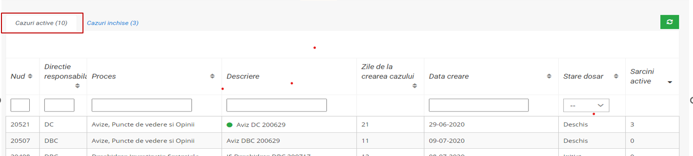
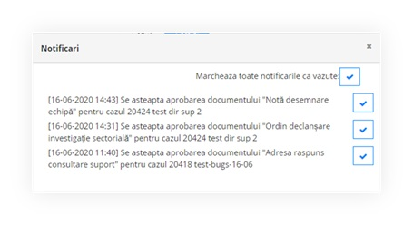

# User inferface

**Mware BPM visual component:**

* **Real-time monitoring:** Mware BPM provides a real-time overview of the status of workflows. Users can see which activities are in progress, who is responsible for them, and what the deadlines are.

<figure><figcaption></figcaption></figure>

* **Task management:** Users can access and manage their assigned tasks directly from the visual interface. This includes viewing task details, updating status, and adding comments.

<figure><figcaption></figcaption></figure>

* **Notifications and alerts:** Mware BPM can send automatic notifications and alerts to users, informing them of important events in workflows, such as new tasks, approaching deadlines, or delays.

<figure><figcaption></figcaption></figure>

* **Reporting and analysis:** Mware BPM provides reporting and analysis tools that allow users to gain insights into process performance. This information can be used to identify areas for improvement and optimize workflows.

<figure><figcaption></figcaption></figure>

* **Reporting and analysis:** Mware BPM provides reporting and analysis tools that allow users to gain insights into process performance. This information can be used to identify areas for improvement and optimize workflows.

Through its visual component, Mware BPM simplifies user interaction with workflows, increasing the efficiency and transparency of business processes.
