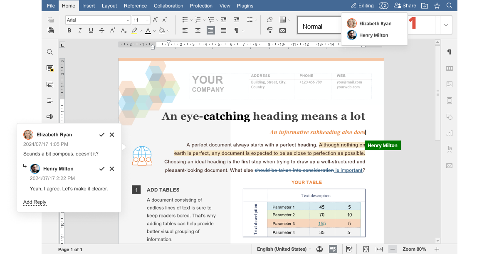
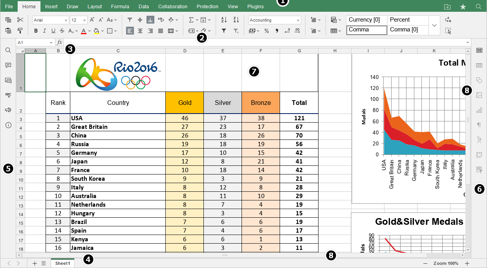
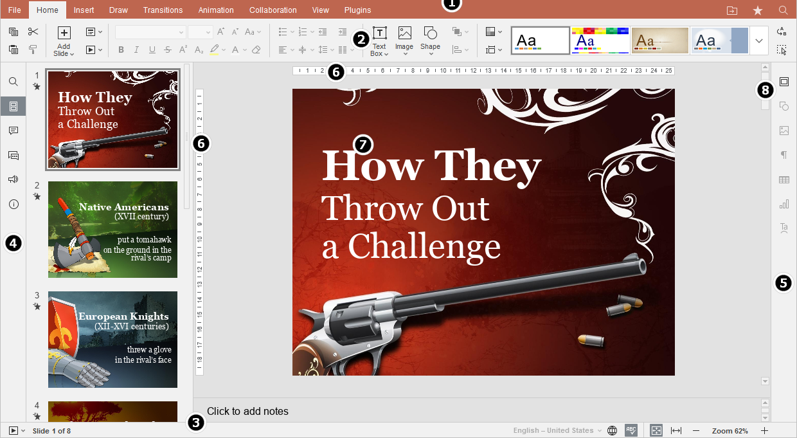

# Creating and Editing Documents with the embedded editors

You can use the portal's own office editors to create and edit text documents, spreadsheets, or presentations for storage in the Documents and Media library. When you finish your online editing session, you must check in the document to save the changes in the Documents and Media Library.

<figure><figcaption></figcaption></figure>

<figure><figcaption></figcaption></figure>

<figure><figcaption></figcaption></figure>

### Creating Files 

1. Open the _Menu_ (), click your Site’s name, and navigate to _Content & Data_ → _Documents and Media_.
2.  Click the _Add_ icon () and select the type of Office document to add to the Document Library:

    * Word™
    * Excel™
    * PowerPoint™

    When you select one of these options, a new window opens for you to enter the document’s name.

    
3.  Enter the document’s name in the _Title_ field, and click _Save_. When you click _Save_, the portal creates a temporary Documents and Media file and links it to the new Office file. Your browser then opens a new window with that Office file so you can create its content.

    
4. Use the embedded editor to create your document’s content.
5.  Save or discard your changes to the portal:

    **Check in:** Saves the Office  file to Documents and Media. The saved file’s format depends on the document type you selected in step two above.

    * Word: Microsoft Word™ (`.docx`)
    * PowerPoint: Microsoft PowerPoint™ (`.pptx`)
    * Excel: Microsoft Excel™ (`.xlsx`)

    **Cancel Checkout:** Deletes the Office file, discarding any changes.

### Editing Files 

You can use Office to edit the following types of Documents and Media files:

* Text files (`.doc`, `.docx`, `.docm`, `.dot`, `.dotx`, `.dotm`, `.html`, `.txt`, `.rtf`, `.odt`)
* Presentation files (`.ppt`, `.pptx`, `.pptm`, `.pps`, `.ppsx`, `.ppsm`, `.pot`, `.potx`, `.potm`)
* Spreadsheet files (`.xls`, `.xlsx`, `.xlsm`, `.xlt`, `.xltx`, `.xltm`, `.ods`, `.csv`, `.tsv`, `.txt`, `.tab`)

Follow these steps to edit a Documents and Media file:

1. Navigate to the file in the Documents and Media Library.
2. Click the file’s Actions icon () and select _Edit in Portal_. This automatically [checks out](https://learn.liferay.com/web/guest/w/dxp/content-authoring-and-management/documents-and-media/publishing-and-sharing/managing-document-access/managing-document-changes-with-checkout) the file, transfers its content to a new Office file, and redirects you to that file.
3. Edit the file in the embedded editor. The editing process is exactly the same as described above for creating files.
