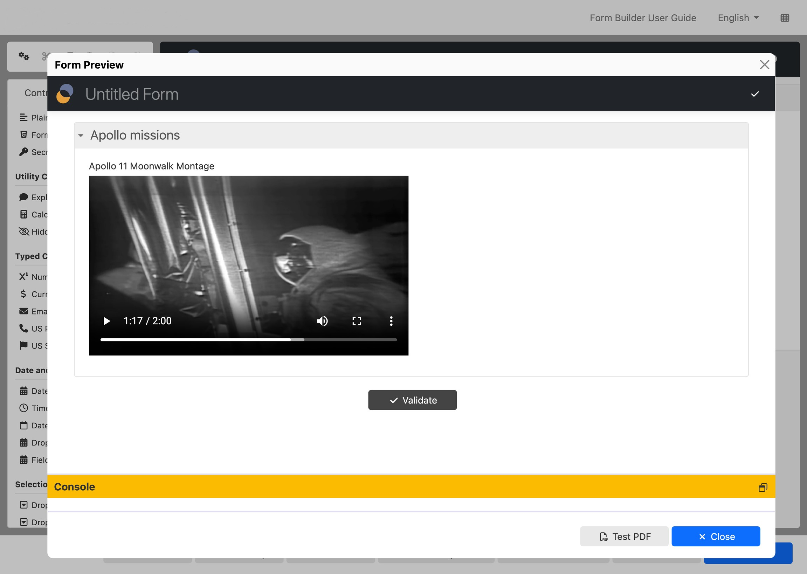

# Video

The `fr:video` component shows a video. Like fr:image, `fr:video` doesn't have an associated upload control and cannot be changed by the end-user of a form.

<figure><figcaption><p>Video component</p></figcaption></figure>

### Basic usage <a href="#basic-usage" id="basic-usage"></a>

```
<fr:video bind="my-video-bind">
    <xf:label ref="$form-resources/my-video/label"/>
</fr:video>
```

The URL of the video is stored in instance data via a single-node binding, here using `bind`.

### Form Runner usage <a href="#form-runner-usage" id="form-runner-usage"></a>

When in the Form Runner context, `fr:video` retrieves the resource while passing the `Forms-Form-Definition-Version` HTTP header when available.

### Limitations <a href="#limitations" id="limitations"></a>

In PDF output, the Video component currently doesn't show any content. Ideally, it should show a still of the video.
