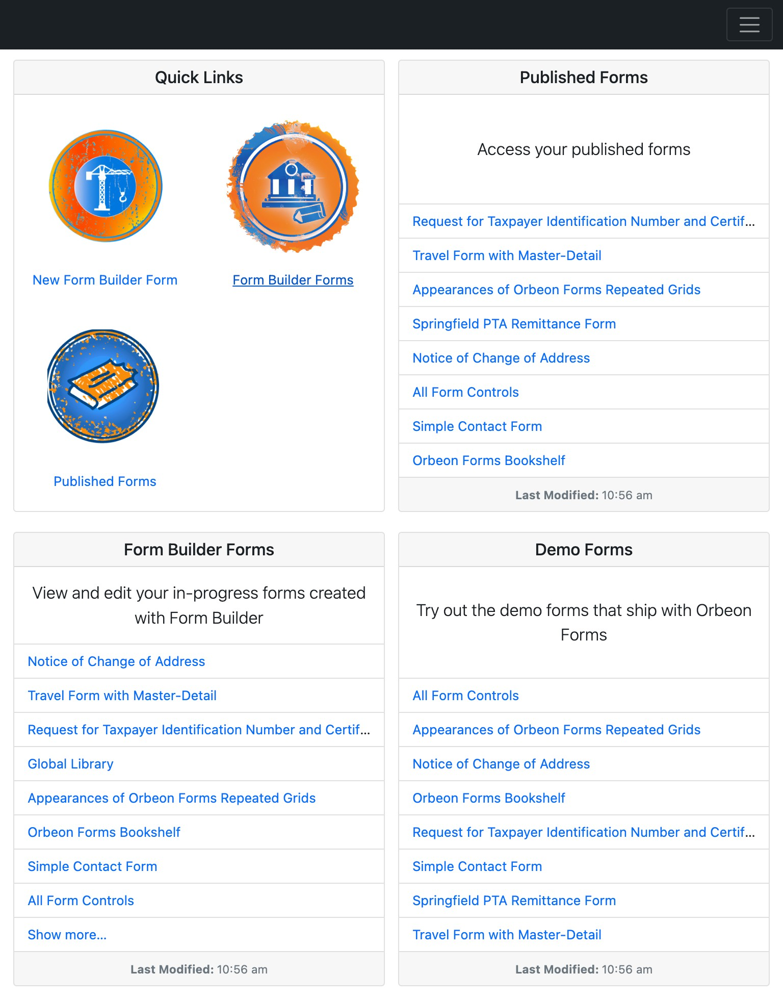
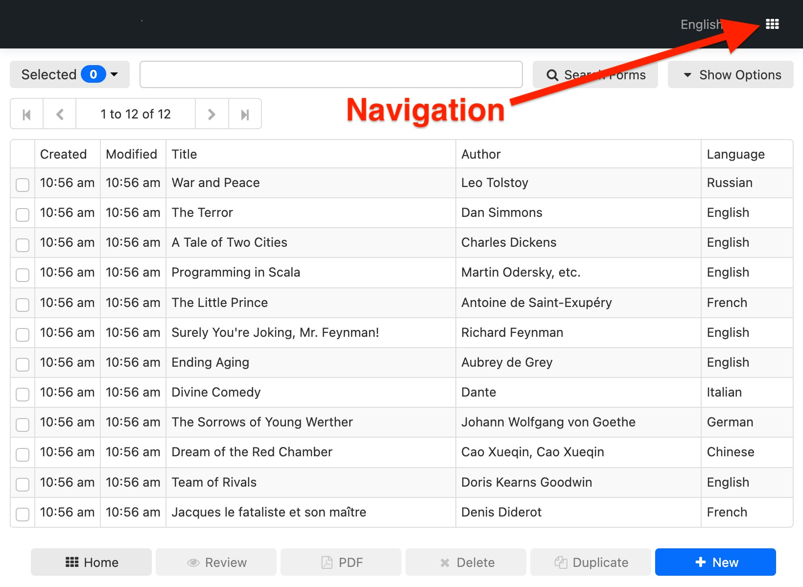

# Landing page

The Landing page is organized in cards which provides quick access to:

* Quick links, including Form Builder and the Administration page
* Your published forms
* Your in-progress Form Builder forms
* Demo forms

<figure><figcaption><p>Landing Page</p></figcaption></figure>

Some cards directly list content, including the list of published forms and the list of in-progress Form Builder forms.

You can configure whether you want to have a particular card on the Landing page. For example, you can hide the demo forms for production deployment.

All Form Runner and Form Builder navigation bars now provide a direct link to the Landing page. This can be disabled if not desired.

<figure><figcaption><p>Landing page navigation</p></figcaption></figure>

### Configuration properties <a href="#configuration-properties" id="configuration-properties"></a>

The following properties control which cards are shown on the Landing page:

```
<property
    as="xs:string"
    name="oxf.fr.landing.cards"
    value="quick-links published-forms form-builder-forms demo-forms"/>
```
