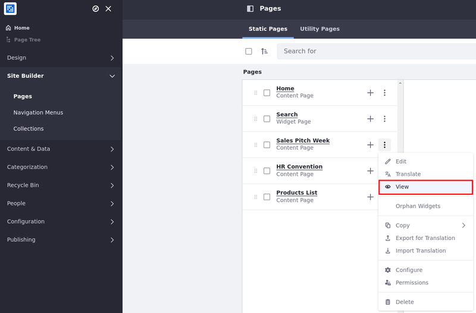

# Adding a Page to a Site

The steps below describe how to add a new page to your site and configure the general options. To learn how to configure the remaining page settings, see Configuring Individual Pages, or see Configuring Page Sets to configure options for a page set.

NOTE

Private pages are disabled for new installations. To enable them, see Enabling Private Pages for more information.

### Adding a New Page 

You can add a new page from the pages administration screen or from the page tree.

#### Adding a New Page from Pages Administration 

1. Open the _Site Menu_ (), expand _Site Builder_, and click _Pages_.
2.  Click _Add_ () and select _Page_.

    .png>)
3.  Under Page Template Sets, select a Basic or Global template.

    To start with an empty content page, select the _Blank_ master page template.

    Alternatively, select from other available templates.

    .png>)
4. In the Add Page dialog, enter a name and click _Add_.

If you created a content page, you’re redirected to the draft content page where you can begin adding fragments and widgets.

If you created a widget page, you’re redirected to the page’s configuration options.

TIP

By default, new pages are included in the navigation menu for the site. To configure this navigation menu, see Using the Navigation Menus Application.

#### Adding a New Page from the Page Tree Menu 

1. Open the _Site Menu_ () and click _Page Tree_ ().
2.  Click _Add_ () and select _Add Page_.

    .png>)
3. Follow the standard steps for creating a page, as shown in Adding a New Page.

TIP

Pages in the draft status have an asterisk (\*) next to their name in the page tree.

### Adding a Child Page 

You can add child pages from the page administration or the page tree.

#### Adding a Child Page from Pages Administration 

1. Open the _Site Menu_ (), expand _Site Builder_, and click _Pages_.
2.  Click _Add_ () for an existing page.

    .png>)
3. Follow the standard steps for creating a page, as outlined in Adding a New Page.

TIP

Using the Actions menu () next to the page, you can preview a content page draft. These options are available for pages in draft status and users with page editing permission.

#### Adding a Child Page from the Pages Tree 

1. Open the _Site Menu_ () and click _Page Tree_ ().
2.  On the desired page, click _Actions_ () and select _Add Child Page_.

    .png>)
3. Follow the standard steps for creating a page, as outlined in Adding a New Page.

### Previewing Pages 

You can preview pages you create before making them live or to identify the ones you need to work on:

1. Open the _Site Menu_ () and select _Site Builder_ → Pages.
2. Click _Actions_ () on the page you want to preview and select _View_.

TIP

If users are logged in and have permission to edit the page, and there are multiple experiences in place, they can view/preview the page based on an experience they select.

\
