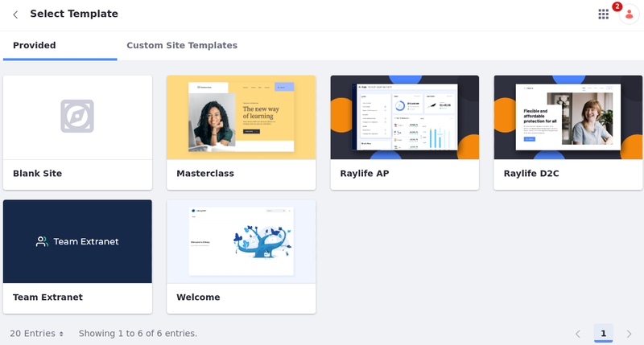

# Adding a Site

Sites are customizable spaces for building personalized digital experiences. Follow these steps to create a basic site in your portal instance:

1.  Open the _Global Menu_ (  ) and go to the _Control Panel_ tab → _Sites_.

    .png>)
2. Click _Add_ (  ).
3.  Select a _Site Template_. Choose between templates _Provided_ or _Custom Site Templates_ to create your site.

    Choose the _Blank Site_ template, to create a new site without any pages or content.

    
4.  Enter a _Name_ for the site.

    NOTE

    If Private Pages are enabled for your system, you, you can determine whether all pages inherited from a site template are private.
5. Click _Add_ to begin creating your site.

Once finished, you are redirected to your new site’s settings. You can begin configuring your site, or see Default Site Applications for a full list of applications you can use to build your site.

### Creating Organization Sites 

Liferay organizations enable distributed user management, providing a convenient way to organize and manage instance users and roles to reflect your organizational hierarchy. Once an organization is created, you can also enable a dedicated site for your organization to facilitate distributed portal administration. This feature is available for both parent and child organizations, so you can quickly create a hierarchy of sites with content created, administered, and tailored specifically to each group’s needs. See Organization Sites for more information.

NOTE

You can only use the blank template or custom templates when creating an organization site. You cannot use other default templates.

### Creating Group Sites 

Liferay user groups are lists of users that can span multiple organizations and sites. If desired, you can create dedicated sites for user groups to add pages to the personal site of each group member. See User Group Sites for more information.

\
