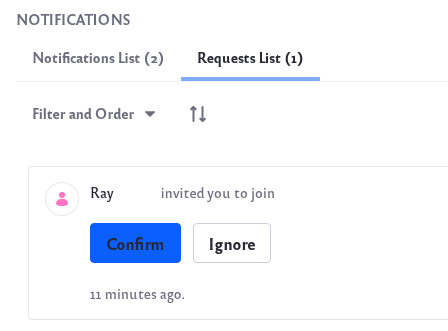

# Inviting Members to Your Site

You can use the Invite Members widget to send invitations to users to join a site.

1. When editing a page, add the widget by clicking _Add_ () at the top left of the page.
2. Find the _Invite Members_ widget under the Collaboration section and drag it to your page.
3.  On the published page, click _Invite Members_ to bring up a new form.

    .png>)
4.  Click the plus sign next to a user who should receive an invitation. Those who have already been invited but have not yet responded appear with a check mark next to their names. Users that have already accepted an invitation no longer appear on the list.

    For others not on the list, you can enter an email address under Invite by Email and click _Add Email Address_.
5.  Select a role for the user by using the drop-down menu under Invite to Role. Select between _Site Owner_, _Site Content Reviewer_, or _Site Administrator_.

    Once you’ve added all the users you want to invite and have selected their roles, click the _Send Invitations_ button to invite them. For more information on roles, see Roles and Permissions.
6.  The site invitation shows up under the Requests List tab on the user’s notifications page. The user can then choose to confirm or ignore the invitation.

    

    When users confirm an invitation, they become site members assigned with the roles you defined.
