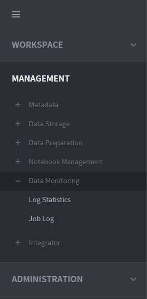
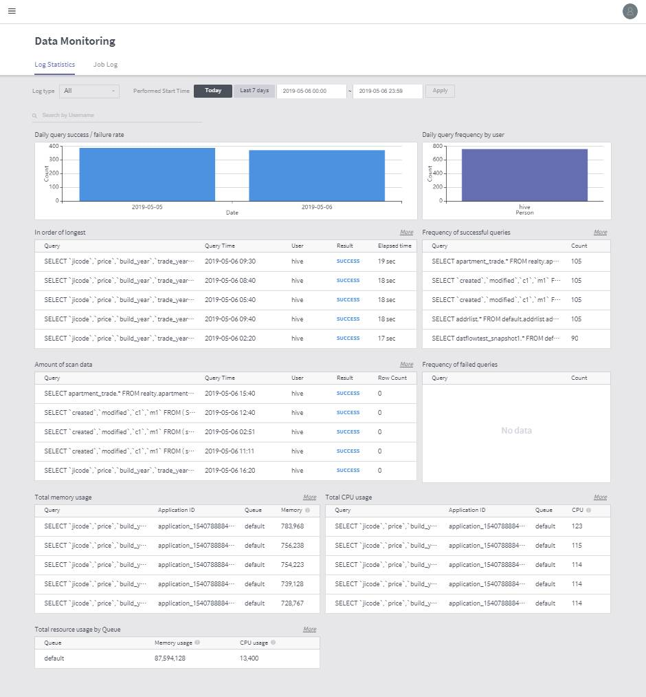
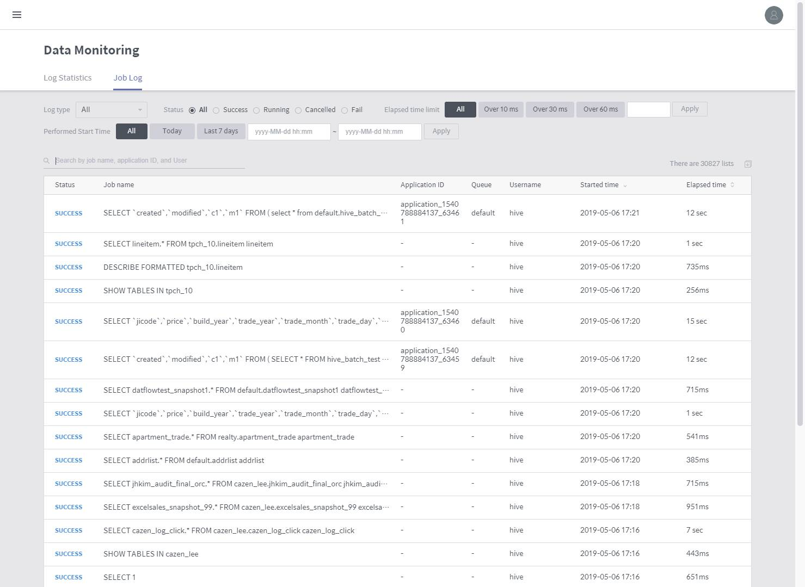
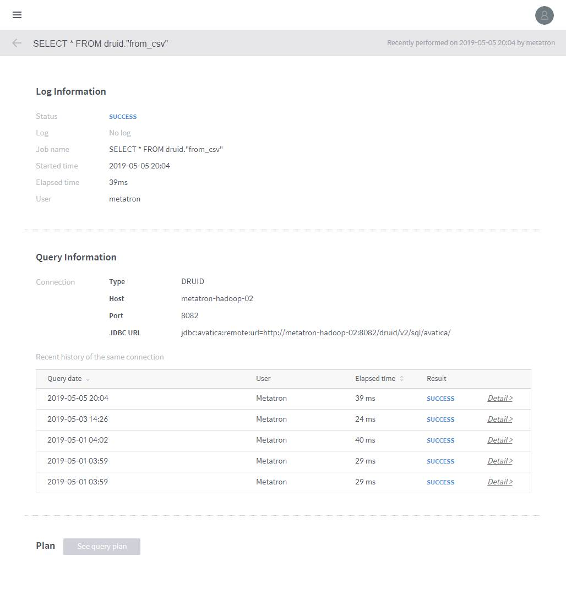

# Discovery Data Monitoring

Data monitoring supports monitoring the logs of all queries submitted by users in Discovery Workbench to the staging database \(internal Hive database\) and external databases connected to Discovery.

The Data Monitoring menu can be accessed under **MANAGEMENT** &gt; **Data Storage** &gt; **Data Monitoring** on the left-hand panel of the main screen.

## Log Statistics

This page collects and reports various statistics related to the performance of queries in BigConnect Discovery. You can view the following nine types of basic statistics.

1. **Query success/failure rate:** Displays the daily success/failure rates of queries performed in BigConnect Discovery.
2. **Query frequency by user:** Graph indicating how many queries were performed by each user. Click a bar to view the job log for the user.
3. **In order of longest:** Displays the performed queries in the order of the longest running time.
4. **Amount of scan data:** Displays the performed queries in the order of the highest amount of scanned data.
5. **Frequency of successful queries:** Displays the performed queries in the order of the highest frequency of success.
6. **Frequency of failed queries:** Displays the performed queries in the order of the highest frequency of failure.
7. **Total memory usage:** Displays the performed queries in the order of the largest memory usage in total.
8. **Total CPU usage:** Displays the performed queries in the order of the largest CPU usage in total.
9. **Resource usage by queue:** Displays the resource usage in each YARN queue in the Hadoop environment.

## Job Log

This page reports the history of all queries performed in Discovery. You can easily view previous jobs by searching the history of queries with your customized filters. The following are the filters applicable to job searching.

1. **Status:** Filters queries by whether they were successful or failed.
2. **Limited elapsed time:** Filters queries by long running time. You can set a reference time for this filtering.
3. **Performed start time:** Determines a time range by which to filter queries. This time range is based on when each query started running.
4. **Search by job or application:** Searches the query history by query statement or application ID.
5. **Number of entries:** Displays how many queries are returned in the list.
6. **Job list:** Lists queries filtered by specified criteria. Click an entry in the list to view its details.

### Query details

Click a query listed in the job log home to view details on that query. The following information can be viewed in the details page.

1. **Status:** Displays whether the query was successful or failed.
2. **Job name:** Statement used to perform the query.
3. **Start time:** Time when the query started running.
4. **Elapsed time:** Time taken to perform the query.
5. **User:** User ID who performed the query.
6. **Connection:** For a query performed in a workbench, the connection information of the database is displayed.
7. **Recent history of the same connection:** For a query performed in a workbench, the latest five queries performed in the database and their results are displayed. Click Detail to pop up a window showing the query statement.
8. **Plan:** Implements the query plan.

