# Editing Other Models

The Other model view includes a number of different models that can be used within an App to configure its behavior. These include Action, Content and User, Security policy, Data object, Template, Test, and Service models. Each of the different models can be created and edited in a similar way through forms.

### User Interface[​](https://documentation.flowable.com/latest/user/design/work-editor#user-interface) 

The different Work models can be selected to create, view and modify by selecting the appropriate filter. Currently, there are three types of Work model:

| Model Type      | Content                |
| --------------- | ---------------------- |
| Action          | Action models          |
| Content         | Content models         |
| User            | User models            |
| Security policy | Security policy models |
| Data object     | Data object models     |
| Template        | Template models        |
| Test            | Test models            |
| Service         | Service models         |

## Action Model[​](https://documentation.flowable.com/latest/user/design/work-editor#action-model)

The Action model editor shows a list of existing Action models, which can then be modified or deleted as required. By default, the list of models is displayed in the order of last modified and as a textual table of model details. It is possible to switch the view to a different sort order or as a graphical gallery of cards.

<figure>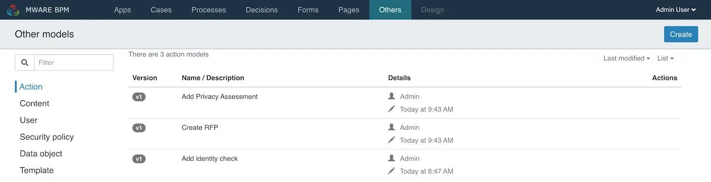<figcaption></figcaption></figure>

The model list enables the following actions:

* View and change model details
* Edit a model

The following sections describe each feature in more detail.

### Creating a New Action[​](https://documentation.flowable.com/latest/user/design/work-editor#creating-a-new-action)

Click the button labeled `Create`, a dialog prompts you to enter basic information:

* The display name of the action.
* The action’s unique key.
* An optional description of the action.

By clicking `Create new model`, a new action model is created and you are redirected to the edit view of the action where you make further configuration changes. See Action Editor for more information. Once the appropriate information is entered, click the `Close X` button.

### Action Details[​](https://documentation.flowable.com/latest/user/design/work-editor#action-details) 

There, you see the **name**, **description**, **version**, **creator** and the **modification date** of the model as well as the current values of the properties used to define the action.

<figure>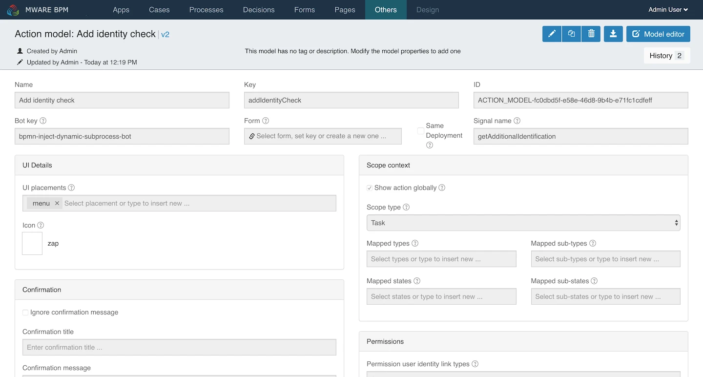<figcaption></figcaption></figure>

If you want to see an older version of your model, press on the `History` button and choose the version you are interested in.

### Action Editor[​](https://documentation.flowable.com/latest/user/design/work-editor#action-editor) 

The Action Editor is a set of properties that are used to define the action.

<figure>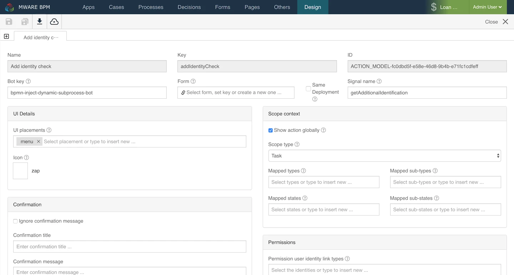<figcaption></figcaption></figure>

| Property                            | Function                                                                                                   |
| ----------------------------------- | ---------------------------------------------------------------------------------------------------------- |
| Bot key                             | The key of the service or bot invoke.                                                                      |
| Icon                                | Name of icon to use.                                                                                       |
| Scope type                          | For example, conversation, user, task, BPMN, CMMN or a custom type.                                        |
| Form                                | The form displayed when executing this action.                                                             |
| Channels                            | For example, menu, quick-actions.                                                                          |
| Confirmation message                | The message text to show on confirmation of the action.                                                    |
| Conformation title                  | The text of the title for the confirmation.                                                                |
| Confirmation message code           | The message code for internationalized text for the confirmation.                                          |
| Permission groups                   | A list of groups that can see this action.                                                                 |
| Permission user identity link types | A list of link types, for example, candidate, assignee, owner or a custom type.                            |
| Example                             | An example of the use of this action.                                                                      |
| Mapped states                       | A list of scope type states needed to see this action, for example, conversation - active, archived.       |
| Mapped sub-states                   | A list of scope type sub-states needed to see this action.                                                 |
| Mapped types                        | A list of scope type types needed to see this action, for example, conversation - direct-message, channel. |
| Mapped sub-types                    | A list of scope type sub-types needed to see this action.                                                  |
| Signal name                         | The process signal key to send when action is invoked if required.                                         |
| Priority                            | A number used for ordering when displaying a list of actions.                                              |
| Theme                               | The key of a custom theme to use.                                                                          |
| Do not show confirmation message    | Do not display any confirmation message before executing this action.                                      |
| Show action globally                | Whether the action is available in all contexts.                                                           |

## Content Model[​](https://documentation.flowable.com/latest/user/design/work-editor#content-model) 

The Content model editor shows a list of existing Content models, which can then be modified or deleted as required. By default, the list of models is displayed in the order of last modified and as a textual table of model details. It is possible to switch the view to a different sort order or as a graphical gallery of cards.

<figure>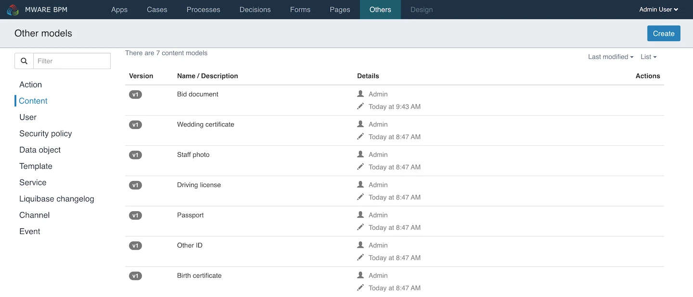<figcaption></figcaption></figure>

The model list enables the following actions:

* View and change model details
* Edit a model

The following sections describe each feature in more detail.

### Creating a New Content Model[​](https://documentation.flowable.com/latest/user/design/work-editor#creating-a-new-content-model) 

Click the button labeled `Create`, a dialog prompts you to enter basic information:

* The display name of the content model.
* The content model’s unique key.
* An optional description of the content model.

By clicking `Create new content model`, a new content model is created and you are redirected to the edit view of the content model where you make further configurations changes. See Content Model Editor for more information. Once the appropriate information is entered, use the `Save` icon and then click on `Close X`.

### Content Model Details[​](https://documentation.flowable.com/latest/user/design/work-editor#content-model-details) 

There, you see the **name**, **description**, **version**, **creator** and the **modification date** of the model as well as the current values of the properties that are used to define the action.

<figure>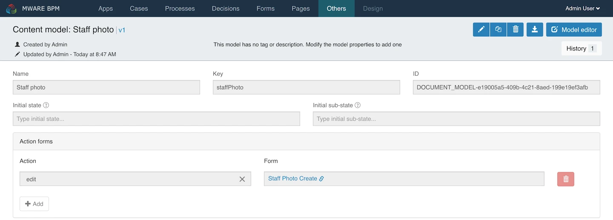<figcaption></figcaption></figure>

If you want to see an older version of your model, press on the `History` button and choose the version you are interested in viewing.

### Content Model Editor[​](https://documentation.flowable.com/latest/user/design/work-editor#content-model-editor) 

The Content Model Editor is a set of properties that are used to define the model.

<figure>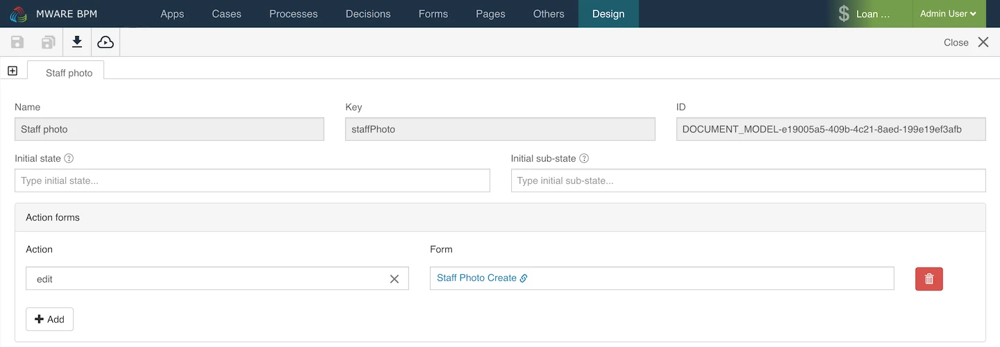<figcaption></figcaption></figure>

| Property          | Function                                                  |
| ----------------- | --------------------------------------------------------- |
| Initial state     | A custom value for its initial state.                     |
| Initial sub-state | A custom value for its initial sub-state.                 |
| Action            | The action for which the form is used, for example, edit. |
| Form              | The form selected to use.                                 |

## User Model[​](https://documentation.flowable.com/latest/user/design/work-editor#user-model) 

The User model editor shows a list of existing User models, which can then be modified or deleted as required. By default, the list of models is displayed in the order of last modified and as a textual table of model details. It is possible to switch the view to a different sort order or as a graphical gallery of cards.

<figure>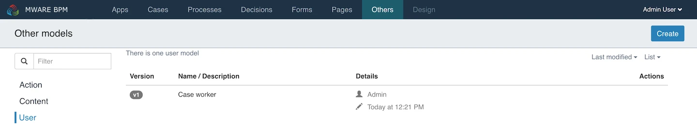<figcaption></figcaption></figure>

The model list enables the following actions:

* View and change model details
* Edit a model

The following sections describe each feature in more detail.

### Creating a New User Model[​](https://documentation.flowable.com/latest/user/design/work-editor#creating-a-new-user-model) 

Click the button labeled `Create`, a dialog appears into which you enter basic information:

* The display name of the user model.
* The user model’s unique key.
* An optional description of the user model.

By clicking `Create new model`, a new user model is created, and you are redirected to the edit view of the user model where you can make further configuration changes. See User Model Editor for more information.

### User Model Details[​](https://documentation.flowable.com/latest/user/design/work-editor#user-model-details) 

There, you see the **name**, **description**, **version**, **creator** and the **modification date** of the model as well as the current values of the properties that are used to define the action.

<figure>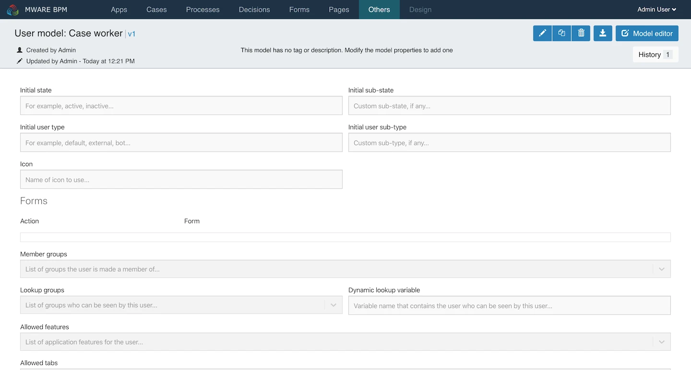<figcaption></figcaption></figure>

If you want to see an older version of your model, press on the `History` button and choose the version you are interested in viewing.

### User Model Editor[​](https://documentation.flowable.com/latest/user/design/work-editor#user-model-editor) 

The User Model Editor is a set of properties that define the model.

<figure>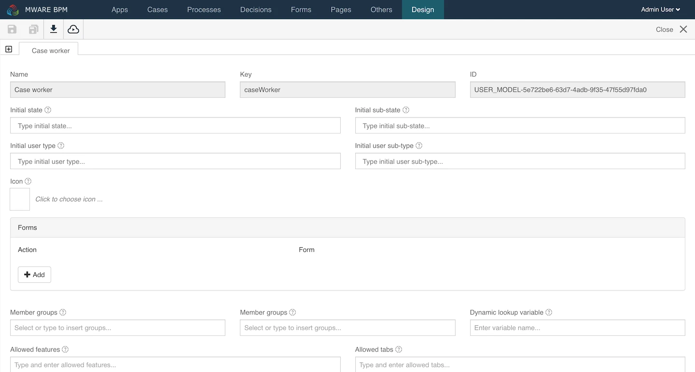<figcaption></figcaption></figure>

| Property                         | Function                                                                      |
| -------------------------------- | ----------------------------------------------------------------------------- |
| Initial state                    | A custom value for a state, if any.                                           |
| Initial sub-state                | A custom value for a sub-state, if any.                                       |
| Initial user type                | The initial type for the user, for example, default, external, bot.           |
| Initial user sub-type            | A custom sub-type, if any.                                                    |
| Icon                             | The name of the icon to use.                                                  |
| Forms Action                     | The action that uses the selected form, for example, init, view, edit.        |
| Member groups                    | A list of groups the user is made a member of.                                |
| Lookup groups                    | A list of groups that can be seen by this user.                               |
| Dynamic lookup variable          | The variable name that contains the user who can be seen by this user.        |
| Allowed features                 | A list of application features for the user.                                  |
| Action permissions Action        | The action for the selected permissions, for example, create, edit.           |
| Action permissions Permissions   | A list of groups who can see this action.                                     |
| Action handlers Action           | The action for the selected handler, for example, create.                     |
| Action handlers Key              | A process or case definition key.                                             |
| Action handlers Type             | Set to either process or case, as appropriate.                                |
| Initial values Variable          | The variable name.                                                            |
| Initial values Value             | The initial variable value.                                                   |
| REST accessible variables Name   | Either create, edit or all.                                                   |
| REST accessible variables Values | A list of names of accessible variables.                                      |
| Conversation filters             | The filters available in conversations, for example, all, internal, external. |
| Contact filters                  | The filters available in contacts, for example, all, internal, external.      |

## Test Model[​](https://documentation.flowable.com/latest/user/design/work-editor#user-model) 

The Test Model lets the developer focus on testing the business logic, rather than writing boilerplate code. The generated test code handles process instance start at any selected flow node and advances a process instance in case of wait states. Since the test code is generated, there is no need to deal with process definition keys and flow node IDs. Moreover any breaking changes (e.g. a user task becomes an external task) in the BPMN process will already be visible at design time as test compile errors.

After modeling, a developer uses the Test Model to define suitable test cases by selecting a start and an end flow node. The test model finds all possible paths through the BPMN process and each path can be added as a test case. The user has the option to manually select test cases to be added, to to add all test cases automatically.

<figure>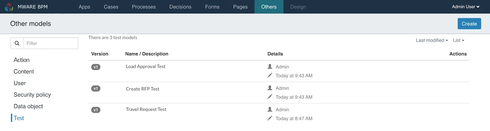<figcaption></figcaption></figure>

The model list enables the following actions:

* View and change model details
* Edit a model

The following sections describe each feature in more detail.

### Creating a new Test Model

Click the button labeled `Create`, a dialog appears into which you enter basic information:

<figure>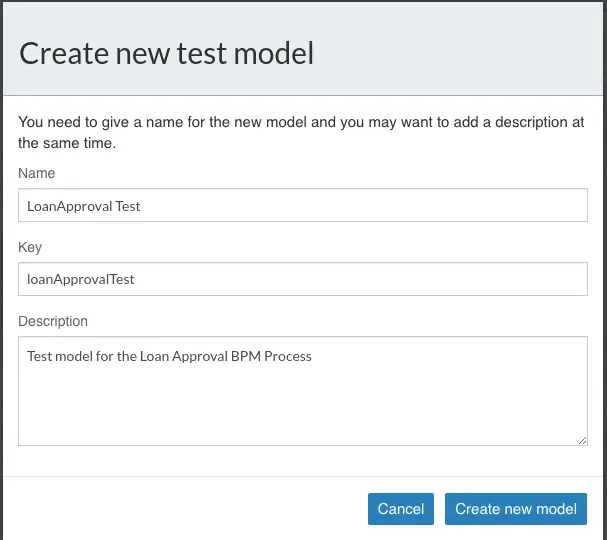<figcaption></figcaption></figure>

By clicking `Create new model`, a new test model is created, and you are redirected to the edit view of the test model where you can make further configuration changes. See Test Model Editor for more information.

* The display name of the user model.
* The user model’s unique key.
* An optional description of the user model.

### Test Model Details

There, you see the **name**, **description**, **version**, **creator** and the **modification date** of the model as well as the current values of the properties that are used to define the test.

<figure><figcaption></figcaption></figure>

### Test Model Editor 

The Test Model Editor is a set of properties that define the test model, associated test users and test datasets.

<figure><figcaption></figcaption></figure>

#### Test Cases

The BPM developer can define suitable test cases by selecting a start and an end flow node from the BPM model. Once you select a BPM model, the Start and End nodes, the test model finds all possible paths through the BPMN process and each path can be added as a test case.&#x20;


The Test Model generates the optimal (minimum) number of test cases to cover all possible paths on the BPM model, between the chosen Start and End nodes.


The user has the option to manually select test cases to be added, or add all test cases automatically:

<figure>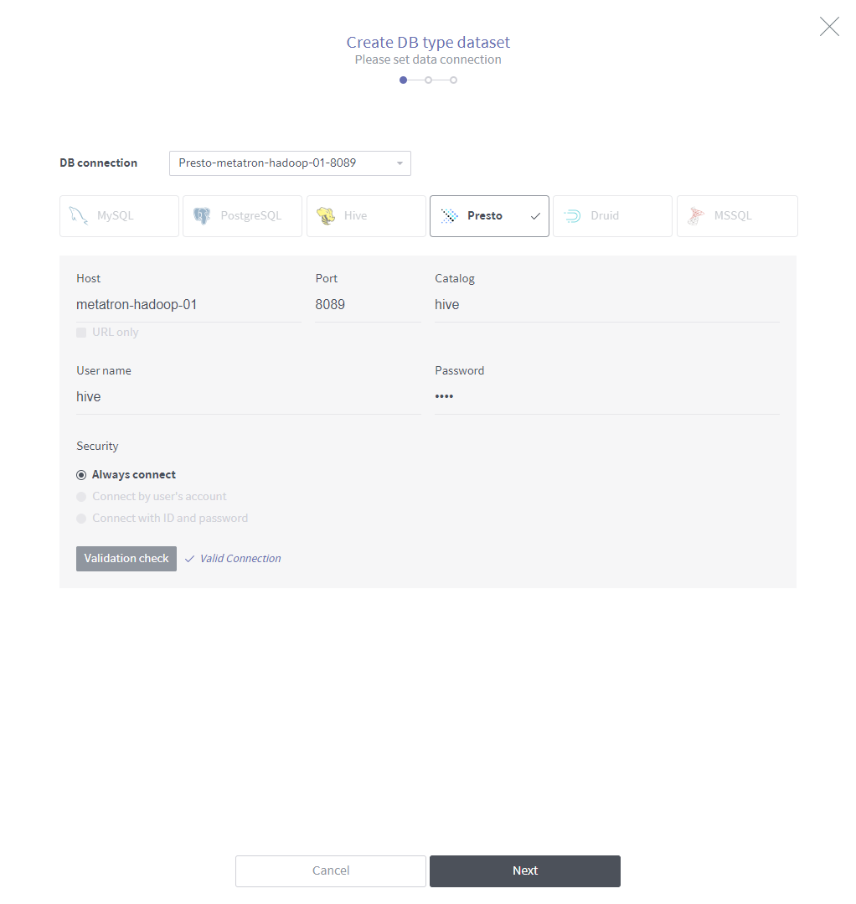<figcaption></figcaption></figure>

MWARE BPM generates test case names automatically, but optionally a test case can be named and described. Names and descriptions are reflected in the generated test code.

<figure><figcaption></figcaption></figure>

#### Test Users

Here you can configure the users that will be allocated to the generated test cases. Allocation is based on the user's role. If the users's role does not match the BPM role, the user will not be allocated to the test case (will be ignored).

#### Test Data

Test data must be provided to trigger the selected BPM Start node. The data must be in XML or JSON formats.

Multiple datasets can be provided. The test model will choose the dataset based on the Test data allocation setting (SEQUENTIAL or RANDOM).

### Test Case Generation

For each test model, MWARE BPM generates a [JUnit 4](https://junit.org/junit4/) test suite where each test cases will result in a [JUnit 4 test rule](https://github.com/junit-team/junit4/wiki/Rules). The test suite is generates as a Maven Java project that has all required dependencies to execute the test suite independently of MWARE BPM.

The generated Maven JUnit test cases can be integrated in any existing automated CI/CD tools that provide support for Java or JUnit:

* Apache JMeter
* Jenkins
* HP Loadrunner
* etc.

### Test Coverage

MWARE BPM can check your process model coverage ratio against test paths. Running typical JUnit tests now leaves **html** files in your build output. Just open one and check yourself what your test did:

<figure><figcaption></figcaption></figure>

* **Visually verify** the paths covered by individual tests **methods** and whole test **classes**
* Visually check gateway **expressions** and transaction borders (**save points**) used by your process
* Calculate and **verify** the nodes (_and_ sequence flow) **coverage** ratio reached by tests methods and classes.

