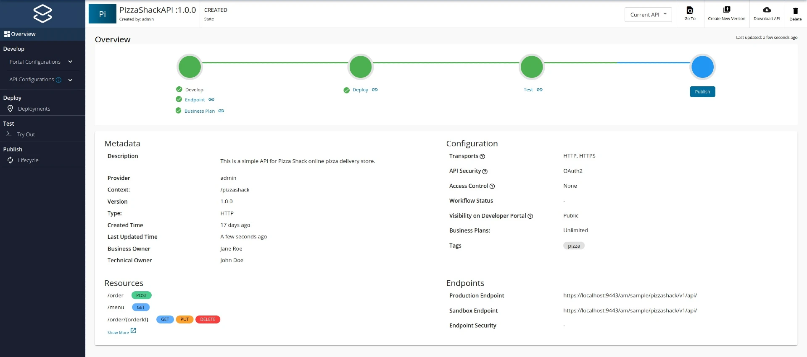

# REST APIs

**API creation** is the process of linking an existing backend API implementation to the [API Publisher](../../../get-started/architecture-and-key-components.md#api-publisher), so that you can manage and monitor the [API's lifecycle](https://apim.docs.wso2.com/en/4.2.0/design/lifecycle-management/api-lifecycle/), documentation, security, community, and subscriptions. Alternatively, you can provide the API implementation in-line in the [API Publisher](../../../get-started/architecture-and-key-components.md#api-publisher) itself.

Follow the instructions below to create a REST API using the basic flow:

1. Sign in to the WSO2 API Publisher.

`https://<hostname>:9443/publisher`

Example: `https://localhost:9443/publisher`


The **Create API** button will only appear for a user who has the `creator` role permission.


2. Select **REST API** from the options available

<figure><figcaption></figcaption></figure>

3. Click **Start from Scratch**.

<figure><figcaption></figcaption></figure>

4. Enter API details.

<table><thead><tr><th width="172">Field</th><th>Sample value</th></tr></thead><tbody><tr><td>Name</td><td>PizzaShack</td></tr><tr><td>Version</td><td>1.0.0</td></tr><tr><td>Context</td><td>
<code>/pizzashack</code>

The API context is used by the Gateway to identify the API. Therefore, the API context must be unique. This context is the API's root context when invoking the API through the Gateway.

You can define the API's version as a parameter of its context by adding the <code>{version}</code> into the context. For example, <code>{version}/pizzashack</code>. The API Manager assigns the actual version of the API to the <code>{version}</code> parameter internally. For example, <code>https://localhost:8243/1.0.0/pizzashack</code>. Note that the version appears before the context, allowing you to group your APIs based on the versions.
</td></tr><tr><td>Endpoint</td><td>
<a href="http://ws.cdyne.com/phoneverify/phoneverify.asmx">https://localhost:9443/am/sample/pizzashack/v1/api/</a>

The endpoint that you add is automatically added as the production and sandbox endpoints.
</td></tr></tbody></table>


The **Create & Publish** option will only appear when a user who has `publisher` permission adds the details for the Endpoint which is an optional field.


<figure><figcaption></figcaption></figure>

5. Click **Create** to create the API.

The overview page of the newly created API appears.

<figure><figcaption></figcaption></figure>

6. Go to **Develop**, **Portal Configurations**, and click **Basic Info**.

<figure><figcaption></figcaption></figure>

a. Configure the API design configurations.

<figure><figcaption></figcaption></figure>

b. Add a tag and press enter.

Let's add a tag named **pizza**.


Tags can be used to filter out APIs matching specific search criteria. It is a good practice to add tags that explain the functionality and purpose of the API so that subscribers can search for APIs based on the tags.


c.Optionally, select **Yes** for the **Make this the Default Version** option.

d. Click **Save**

7. Configure the runtime configurations.

a. Click **Runtime**, which is under the **API Configurations** section.

Transport Level Security defines the transport protocol on which the API is exposed.

<figure><figcaption></figcaption></figure>

b. If you wish to limit the API availability to only one transport (e.g., HTTPS), deselect the **Transport Level Security** checkbox.

Both HTTP and HTTPS transports are selected by default.

8. Configure the resources.

By default, the API will have five resources with `/*` as the URL pattern.

a. Click **Resources**, which is under the **API Configurations** section

<figure><figcaption></figcaption></figure>

b. Modify the resources as follows and click **Save** to update the resources.

i. Click delete, as shown below, to remove all the existing resources.

<figure><figcaption></figcaption></figure>

ii. Select an appropriate **HTTP Verb** from the dropdown and click **(+)** to add a new resource.

<figure><figcaption></figcaption></figure>

The newly added resource is displayed as follows.\

<figure><figcaption></figcaption></figure>

iii. Expand the created **GET** operation to add details for the **Summary and Description** and **Operation governance** sections.

i. Add a summary and description for the resource.

ii. Update the Security settings as required.

* Turn the security setting off if you want to make a certain operation of the API non-secured and accessible without passing an access token.
* To make the whole API non-secured and fully accessible without an access token, turn the security setting off in all the operations of the API.

<figure><figcaption></figcaption></figure>

iii. Add resource parameters if required using the Parameters section.

<figure><figcaption></figcaption></figure>

You can define the following parameter types based on the resource parameters that you add.

<table data-header-hidden><thead><tr><th width="208"></th><th></th></tr></thead><tbody><tr><td><strong>Parameter Type</strong></td><td><strong>Description</strong></td></tr><tr><td><code>query</code></td><td>Contains the fields added as part of the invocation URL, which contains the data to be used to call the backend service.</td></tr><tr><td><code>header</code></td><td>Contains the case-sensitive names followed by a colon (:) and then by its value that carries additional information with the request, which defines the operating parameters of the transaction.</td></tr><tr><td><code>cookie</code></td><td>Operations can also pass parameters in the Cookie header, as <code>Cookie: name=value</code>. Multiple cookie parameters are sent in the same header, separated by a semicolon and space.</td></tr><tr><td><code>body</code></td><td>An arbitrary amount of data of any type is sent with a POST message.</td></tr></tbody></table>

9. Optionally, view the API definition.

Click **API Definition**.

The OpenAPI Specification (a.k.a Swagger definition) for the PizzaShack API appears.

<figure><figcaption></figcaption></figure>

Now, you have successfully created and configured a REST API. Next, [deploy the API](https://apim.docs.wso2.com/en/4.2.0/deploy-and-publish/deploy-on-gateway/deploy-api/deploy-an-api/), [test the API](https://apim.docs.wso2.com/en/4.2.0/design/create-api/create-rest-api/test-a-rest-api/), and finally [publish the API](https://apim.docs.wso2.com/en/4.2.0/deploy-and-publish/publish-on-dev-portal/publish-an-api).
