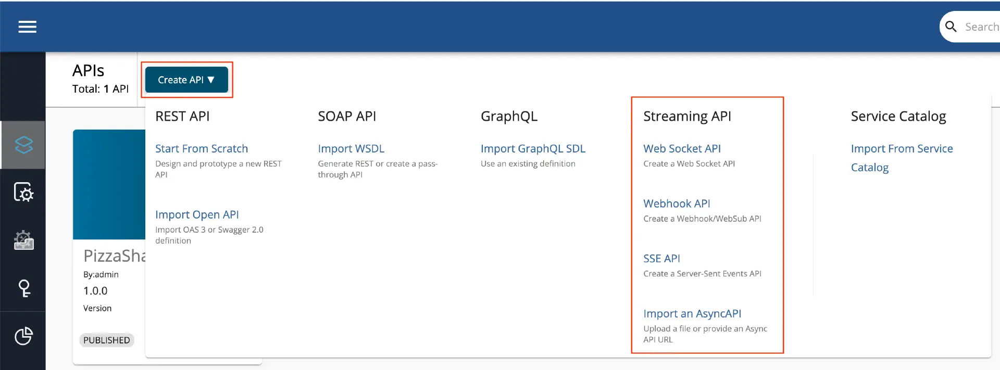

# Create a WebSocket API

## Overview 

A WebSocket API is a streaming API in WSO2 API Manager that is implemented based on the [WebSocket](https://www.w3.org/TR/websockets/) protocol specification, which is compatible with HTTP. The WebSocket protocol supports full-duplex communication over a channel that is established once. Therefore, WebSocket protocols allow a continuous two-way communication between the server and the client.

You can create a WebSocket API from scratch in WSO2 API-M and export the WebSocket APIs that are created within WSO2 API-M as AsyncAPI definitions. Alternatively, you can also import [existing AsyncAPI definitions to create SSE APIs in WSO2 API-M](https://apim.docs.wso2.com/en/latest/use-cases/streaming-usecase/create-streaming-api/create-a-streaming-api-from-an-asyncapi-definition).

This section guides you through the process of creating a WebSocket API from scratch in which you can expose a WebSocket backend via WSO2 API Manager. After the API is created, you will be able to create independent channels to connect to each topic in the API. These topics can be mapped to different channels in the backend. As a result, the user can maintain multiple channels with the API to exchange different types of events simultaneously.

## How it works 

The WebSocket server can send messages to the WebSocket client, or vice-versa, or both. This is useful in use cases based on the Event Driven Architecture (EDA), where events are sent to be consumed in an asynchronous manner and paving the way for an immediate user experience.


When you create a WebSocket Streaming API it's exposed via both `ws` and `wss` protocols. By default, the `ws` transport uses port 9099, and the `wss` transport uses port 8099.


## Example usage 

For example, chat room applications use WebSocket API so that messages can be sent in a bi-directional manner from the server to the client and vise versa.

## Basic flow 

Follow the instructions below to create a WebSocket API using the basic flow:

### Step 1 - Design a WebSocket API 

1.  Sign in to the Publisher.\

    `https://<hostname>:9443/publisher`

    \
    For testing purposes, you can use `https://localhost:9443/publisher` and `admin` as the username and password.
2. Click **Create API**, go to **Streaming API**, and Click **WebSocket API**.

<figure><figcaption></figcaption></figure>

3. Enter the API details.

<table><thead><tr><th width="151">Field</th><th>Sample value</th></tr></thead><tbody><tr><td>Name</td><td>WebSocket</td></tr><tr><td>Context</td><td>
<code>/websocket</code>

The API context is used by the Gateway to identify the API. Therefore, the API context must be unique. This context is the API's root context when invoking the API through the Gateway.

You can define the API's version as a parameter of its context by adding the <code>{version}</code> into the context. For example, <code>{version}/websocket</code>. The WSO2 API-M assigns the actual version of the API to the <code>{version}</code> parameter internally. For example, <code>ws://localhost:9099/1.0.0/websocket</code>. Note that the version appears before the context, allowing you to group your APIs based on the versions.
</td></tr><tr><td>Version</td><td>1.0.0</td></tr><tr><td>Protocol</td><td>WebSocket</td></tr><tr><td>Endpoint</td><td>
Use one of the following endpoints.
<ul><li>ws://ws.ifelse.io:80</li><li>wss://ws.ifelse.io:443</li></ul></td></tr></tbody></table>

<figure><figcaption></figcaption></figure>

4. Click **Create** to create the API.

The overview page of the newly created API appears.

<figure><figcaption></figcaption></figure>

### Step 2 - Configure the Topics 

Topics of a WebSocket API are always **Subscribe (sub) and Publish (pub)**, where the flow of events can be either from the server (backend) to the clients or from the client to the server. By default, the WebSocket API will have a topic with the name `/*`.

1. Click **Topics** under **API Configurations** and navigate to the **Topics** page.
2.  Modify the topics as follows and click **Save** to update them.

    \
    a. Optionally, click delete as shown below, to delete an existing topic.\

    <figure><figcaption></figcaption></figure>

    b. Select the **Types**, enter the **Topic Name**, and click **+** as shown below, to add a new topic.

| Topic Name | `/notifications` |
| ---------- | ---------------- |

<figure><figcaption></figcaption></figure>

The newly added topic is displayed as follows.

<figure><figcaption></figcaption></figure>

c. Optionally, provide a URL Mapping to the topic.

The provided URL Mapping will be appended to the WebSocket endpoint URL that you provided when creating the API, and the traffic via this topic will be sent to the resulting URL.

Expand **both** PUB and SUB under the created topic, provide the same URL Mapping for both and click **Save**.

| Description | Chat room notifications |
| ----------- | ----------------------- |
| URL Mapping | `/notifications`        |

<figure><figcaption></figcaption></figure>

### Step 3 - View the AsyncAPI Definition 

Click **AsyncAPI Definition** under **API Configurations**.

The AsyncAPI definition of the streaming API, which you just created, appears.

<figure><figcaption></figcaption></figure>

Now, you have successfully created and configured a Streaming API. Next, let's [Publish your API](https://apim.docs.wso2.com/en/latest/deploy-and-publish/publish-on-dev-portal/publish-an-api).

