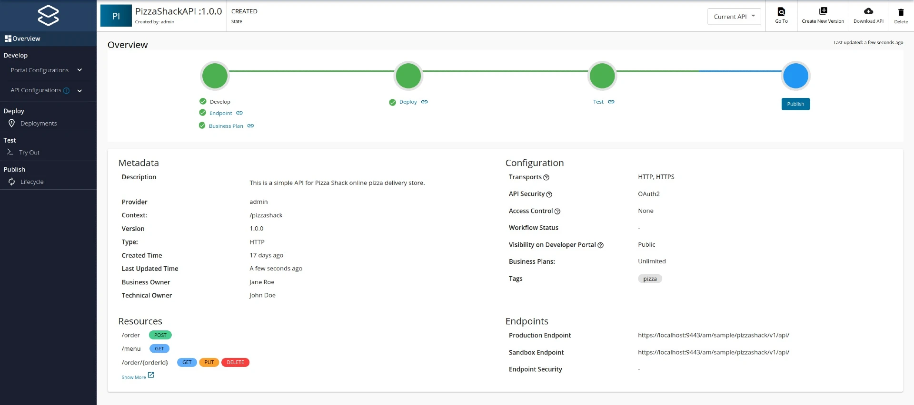
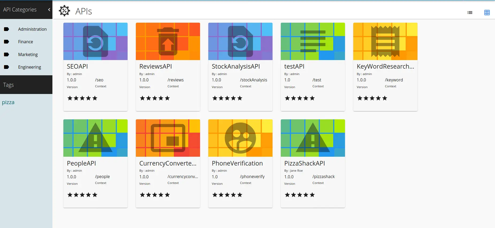
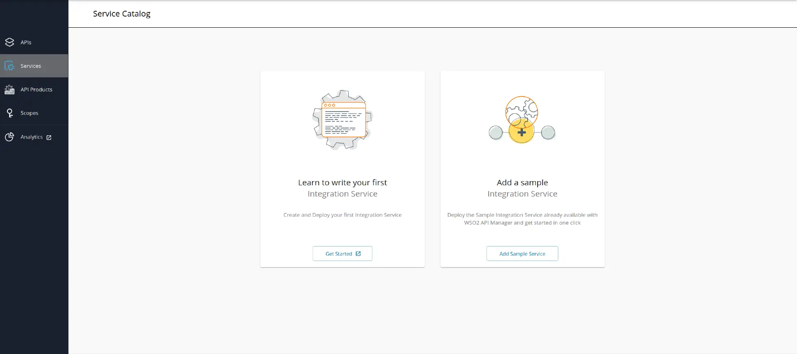
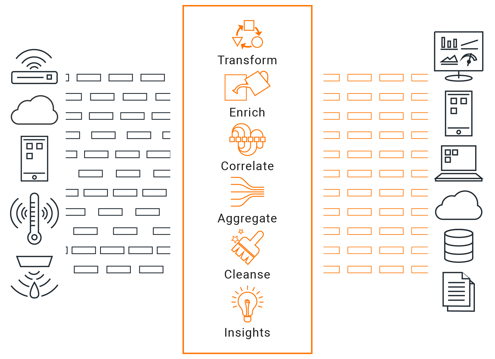
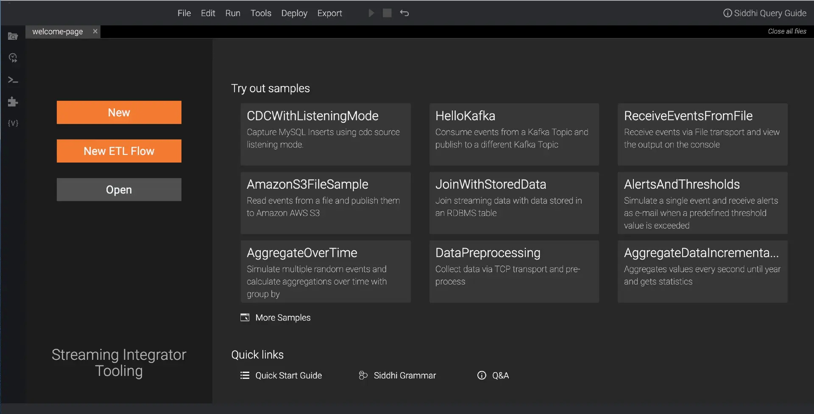

# Architecture and Key Components

The diagram below is a high-level snapshot of MWARE ESB and the various components that it comprises of.

<figure><figcaption></figcaption></figure>

The API Manager consists of an API management layer and an integration layer where the above components all fit into and mesh together to address the various use cases of the product. The API management layer contains several components, which you can use in your deployment according to your requirement. The integration layer includes either the Micro Integrator runtime (for services integration) and the Streaming Integrator runtime (for streaming requirements) or both runtimes. The pattern you use would depend on the workload of each component and the traffic that is expected for each of the components and runtimes.

## Management Plane 

The Management Plane is where API creation and API management takes place. It consists of portals (Publisher, Developer Portal, and Service Catalog) for users to create and manage APIs, implement rate limiting policies, monitor, and monetization, etc. It also provides a set of APIs to interact with external tools like API Controller. The Management Plane includes API Analytics dashboards, displaying various business insights.

### API Publisher

<figure><figcaption></figcaption></figure>

MWARE ESB’s API Publisher is a state-of-the-art GUI based tool for API development and management. The GUI is designed for API creators to develop, document, secure, test, and version APIs with ease. It’s also able to cater to more API management-related tasks such as publishing APIs, monetizing APIs, and applying rate limiting policies.

### **API Developer Portal**

<figure><figcaption></figcaption></figure>

The Developer Portal is a state-of-the-art web interface that allows API publishers to host and advertise their APIs while allowing API consumers to self-register, discover, evaluate, subscribe to, and consume APIs securely and easily.

### Service Catalog

<figure><figcaption></figcaption></figure>

MWARE ESB includes a Service Catalog where developers can register their services in a RESTful manner. Service Catalog is one of the main attributes that enable the API-first Integration in MWARE ESB. Through the Service Catalog, integration services are made discoverable to the API Management layer so that API proxies can directly be created using them.

These integration services can be created using the Integration Studio and a variety of other platforms. For an Integration Studio user, the service registration happens automatically when exporting the project as a composite application (CApp).

## Data Plane

The Data Plane is where the created API is exposed to the public consumers and acts as the proxy for API calls. This also provides additional capabilities such as enforcing security, rate limiting etc.

### API Gateway

<figure><figcaption></figcaption></figure>

The API Gateway acts as the entry point for an API request made to an API managed by WSO2 API Manager.

The API Gateway does the JWT token validation by validating the signature, issuer, expiry time, and subscription. The subscription is validated using the in-memory map. This in-memory map includes API-related information, application-related information, subscription-related information, etc., and is updated each time an artifact (API/application) is updated.

Once the token is validated, the API Gateway acts upon the API request before sending it to the backend. It first processes the message to a preconfigured format (e.g., JSON, XML, CSV etc.). It then applies security policies, rate limiting policies, collects statistics, etc., via its handlers. The mediators then act upon the API payload based on the mediation logic developed. The message is then formatted to a preconfigured format (e.g., JSON, XML, CSV, etc.) and sent to the backend. WSO2 API Gateway supports transports such as HTTP, HTTPS, etc. It is also able to scale on-demand in cloud environments and is easily pluggable in non-cloud environments.

### **Micro Integrator**

The Micro Integrator is lightweight and container friendly. This allows you to leverage the comprehensive enterprise messaging capabilities of the Micro Integrator in your decentralized, cloud-native integrations.

<figure><figcaption></figcaption></figure>

As shown above, if your organization is running on a decentralized, cloud-native, integration architecture where microservices are used for integrating the various APIs, events, and systems,  Micro Integrator can easily function as your **Integration** (micro) services and **API** (micro) services.

Micro Integrator is an event-driven, standards-based messaging engine that can work like an Enterprise Service Bus. This supports message routing, message transformations, and other types of messaging use cases. If your organization uses an API-driven, centralized, integration architecture, the Micro Integrator can be used as the central integration layer that implements the message mediation logic connecting all the systems, data, events, APIs, etc. in your integration ecosystem.

### Streaming Integrator

The Streaming Integrator component of MWARE ESB is a streaming data processing server that integrates streaming data and takes action based on streaming data. The streaming integration capabilities of MWARE ESB are delivered via this runtime. This is a cloud-native, lightweight component that understands, captures, analyzes, processes, and acts upon streaming data and events in real-time. It utilizes the SQL-like query language ‘Siddhi’ to implement the solution.

<figure><figcaption></figcaption></figure>

The Streaming Integrator allows you to integrate static data sources with streaming data sources. Thus, it enables various types of applications (e.g., files, cloud based applications, data stores, and streaming applications) to access streaming data and also exposes their output in a streaming manner. This is useful for performing ETL (Extract, Transform, Load) operations, capturing change data (i.e., CDC operations), and stream processing.

## Control Plane

The Control Plane is where the API security validation, API key generation, and rate limiting decisions are taken.

### **Key Manager**

<figure><figcaption></figcaption></figure>

The Key Manager is the identity provider for MWARE ESB and acts as the Secure Token Service (STS). WSO2 API Manager supports OAuth 2.0, Basic Auth, Mutual SSL as well as API-Key based authentication mechanisms.

In MWARE ESB, tokens are generated for an application. The Key manager provides a token API to generate access tokens. These tokens can be used by clients to invoke APIs exposed by MWARE ESB. The Key Manager also exposes a revoke token API that clients can use to revoke an access token. A client can generate an OAuth 2.0 access token by invoking the token API directly or via the Developer Portal UI. Alternatively, an API Key can be generated through the Developer Portal without calling the Key Manager. The API Key is a self-signed JWT token. When a client invokes an API with an OAuth 2.0 access token or an API Key, the Gateway validates the token by validating its signature and subscription.

The Key Manager performs scope validation as well. It could also generate JWT tokens to pass end-user attributes to the backend, if configured.

In addition to using the built-in Key Manager as the IDP, MWARE ESB also supports integrating with third-party identity providers such as Okta, Auth0, KeyCloak, etc., for OAuth 2.0 based security for APIs.

### **Traffic Manager**

<figure><figcaption></figcaption></figure>

The Traffic Manager helps users to regulate API traffic, make APIs and applications available to consumers at different service levels, and secure APIs against security attacks. The Traffic Manager features a dynamic throttling engine to process throttling policies in real-time, including rate limiting of API requests.

In addition to the above, the Traffic Manager also helps to keep the API Gateway's in-memory map, which is used for key validation, up-to-date via a JMS topic. The Traffic Manager publishes artifact (API/application) update events that are received from the API Publisher and API Developer Portal to a JMS topic. The API Gateway receives these events via the JMS topic and updates its in-memory map.

## Tooling 

There are multiple developer-friendly tools that can be used to help you work with MWARE ESB.

### **Integration Studio**

MWARE ESB and the Micro Integrator are coupled with the Integration Studio; a comprehensive graphical integration flow designer for building integrations using a simple drag-and-drop functionality.

<figure><figcaption></figcaption></figure>

The Integration Studio is your development environment for designing, developing, debugging, and testing integration solutions. As an integration developer, you can execute all the phases of the development lifecycle using this tool. When your integration solutions are production-ready, you can easily push the artifacts to your continuous integration/continuous deployment pipeline and also register them as services in the service catalog.

### **Streaming Editor**

The Streaming Editor is a developer tool that is used to develop Siddhi applications and is closely coupled with the Streaming Integrator.

<figure><figcaption></figcaption></figure>

### **apictl**

API Controller (CTL) is a command-line tool for managing MWARE ESB environments, listing APIs, API products and applications, creating API projects, importing and exporting APIs, API products and applications, generating tokens for APIs and API products for testing purposes, etc.

### **kubectl**

The API operator for Kubernetes makes APIs and microservices first-class citizen in the Kubernetes ecosystem.

