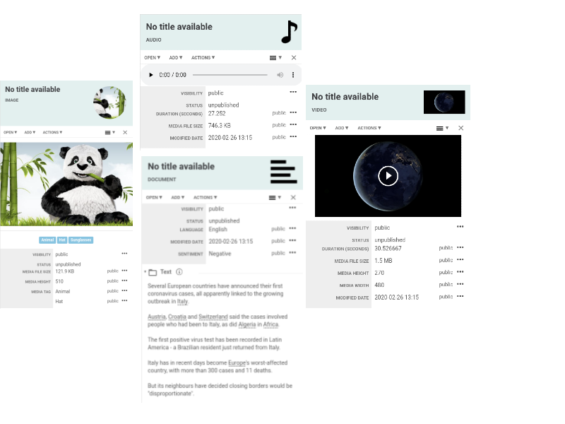

# Importing Data

There are multiple ways in which a user can bring new data into the system:

* Drag & Drop on the Graph and Map
* Import from a database using the Wizard
* Import CSV and XLS files using the Wizard
* Import from a database using Cypher
* Import from a CSV file using Cypher
* Import using the Data Collector \(for large/automated imports\)

Each type of import can be used based on the business case. If you want to load just a few objects, you can use Drag & Drop for example. If you have a CSV file you can either use the Wizard or Cypher. For more complex scenarios you can use the Data Collector.

### Drag & Drop

Login to BigConnect Explorer using the default username **admin** and password **admin.** If this is the first time you login, you will be taken to the default dashboard created for you.

Go to **Analyze** in the upper menu bar.

Click on the **Graph** card and an empty graph will be created for you:

Now, let's download all sample files from [https://github.com/bigconnect/demos/tree/master/explorer/basics](https://github.com/bigconnect/demos/tree/master/explorer/basics) and save them somewhere on your station:

* Coronavirus: Outbreak spreads in Europe from Italy.txt
* audio.mp3
* panga.jpg
* video.mp4

Once you finished downloading, return to BigConnect Explorer and drag & drop all downloaded files on the empty graph.


You can also click on the UPLOAD card and select the files using the upload dialog


A popup will be shown to ask you how you want to load the files into the system. Just leave the defaults and click **Import**

The system will load and process the files. After a short while you should see four items on your graph:

Note that BigConnect automatically detected the mime-type of each file and assigned the appropriate icons.

Click on each one of the four items on the graph and you will see the details for the selected item in the details drawer:

You will see that for each type of item \(audio, video, image and text\), the drawer will look slightly different, according to the type of the selected item:

We will look more into what these mean and how to work with them later on.

### CSV and XLS files

There are two ways to upload CSV and XLS files:

1. From the **Ingest** menu item
2. Drag & Drop a CSV/XLS file on the Graph or Map

We will continue with option 1. 

First, please download the **people.csv** sample file from the following location: [https://raw.githubusercontent.com/bigconnect/demos/master/explorer/aml/people.csv](https://raw.githubusercontent.com/bigconnect/demos/master/explorer/aml/people.csv)

It's a sample file that contains 2000 fictional persons. 

Choose **Ingest** from the top menu bar:

Click on the **Upload your files** link under the **Files** card. The following screen will be displayed:

Drag and drop the **addresses.csv** file on the gray container or click on the gray container and choose the **addresses.csv** file. The file will be displayed in the gray container:

Click **Import** to continue and preview the file.

Now we need to tell BigConnect Explorer how to map the fields from the CSV file to our schema. This process is called mapping**.** Click on the green **Map Structured Data** button.

Select the first row of the table that contains the header fields \(id, first\_name, last\_name etc.\):

The system extracted the field names from the CSV header. Now we will go through each column and tell the system how to import it:

1. Click on the ID column.

2. The system asks us how to map this column. We want to map it to a new entity that has the concept **Person**. Click on the **New Concept...**  field to browse existing concepts defined in BigConnect and choose the **Person** concept:

3. Now the system will ask on which property of the Person concept we want to map this column on:

4. Since we don't have an existing property to map on, we need to create one. Just type the **uniqueid** in the **Choose Property...** field and click on the **Create "uniqueid"** dark row.

5. A small section will be displayed asking to specify the **Data Format** for our new field: 

6. Choose **String** and click on the green **Create "uniqueid"** button:

7. Check the **Use this column as unique identifier for this entity** checkbox and then click **Save**.

8. This is the "hard" way of doing the mapping where we have control of exactly how each field is mapped. The "easy" way is to let the system auto-map all fields. We will do that for the rest of the fields.

Click on the **Automap** link:

9. Select our previously created entity Person\#1 from the **Auto-map to** dropdown and click **Save**:

10. Click on **Preview.** The system will parse all rows from the file and validate that they can be imported:

11. Finally click on **Import** button to launch the import process in the background. You can monitor the progress of all background tasks by clicking on the **Activity** icon in the top menu bar:

