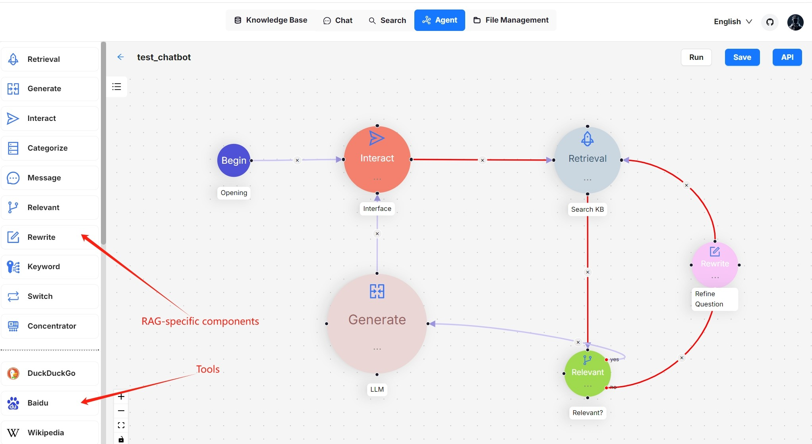
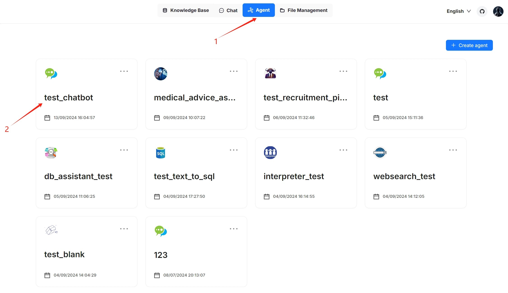

# Chatbots

Chatbot is one of the most common AI scenarios. However, effectively understanding user queries and responding appropriately remains a challenge. Surogate's general-purpose chatbot agent is our attempt to tackle this longstanding issue.

This chatbot closely resembles the chatbot introduced in [Start an AI chat](../chat/start-ai-chat.md), but with a key difference - it introduces a reflective mechanism that allows it to improve the retrieval from the target knowledge bases by rewriting the user's query.

This document provides guides on creating such a chatbot using our chatbot template.

### Create a chatbot agent from template[​](https://ragflow.io/docs/dev/general_purpose_chatbot#create-a-chatbot-agent-from-template) 

To create a general-purpose chatbot agent using our template:

1. Click the **Agent** tab in the middle top of the page to show the **Agent** page.
2. Click **+ Create agent** on the top right of the page to show the **agent template** page.
3. On the **agent template** page, hover over the card on **General-purpose chatbot** and click **Use this template**.\
   &#xNAN;_&#x59;ou are now directed to the **no-code workflow editor** page._

<figure><figcaption></figcaption></figure>

### Understand each component in the template[​](https://ragflow.io/docs/dev/general_purpose_chatbot#understand-each-component-in-the-template) 

Here’s a breakdown of each component and its role and requirements in the chatbot template:

* **Begin**
  * Function: Sets an opening greeting for users.
  * Purpose: Establishes a welcoming atmosphere and prepares the user for interaction.
* **Interact**
  * Function: Serves as the interface between human and the bot.
  * Role: Acts as the downstream component of **Begin**.
* **Retrieval**
  * Function: Retrieves information from specified knowledge base(s).
  * Requirement: Must have `knowledgebases` set up to function.
* **Relevant**
  * Function: Assesses the relevance of the retrieved information from the **Retrieval** component to the user query.
  * Process:
    * If relevant, it directs the data to the **Generate** component for final response generation.
    * Otherwise, it triggers the **Rewrite** component to refine the user query and redo the retrival process.
* **Generate**
  * Function: Prompts the LLM to generate responses based on the retrieved information.
  * Note: The prompt settings allow you to control the way in which the LLM generates responses. Be sure to review the prompts and make necessary changes.
* **Rewrite**:
  * Function: Refines a user query when no relevant information from the knowledge base is retrieved.
  * Usage: Often used in conjunction with **Relevant** and **Retrieval** to create a reflective/feedback loop.

### Configure your chatbot agent[​](https://ragflow.io/docs/dev/general_purpose_chatbot#configure-your-chatbot-agent) 

1.  Click **Begin** to set an opening greeting:\

    <figure><figcaption></figcaption></figure>
2.  Click **Retrieval** to select the right knowledge base(s) and make any necessary adjustments:\

    <figure><figcaption></figcaption></figure>
3.  Click **Generate** to configure the LLM's summarization behavior:\
    3.1. Confirm the model.\
    3.2. Review the prompt settings. If there are variables, ensure they match the correct component IDs:\

    <figure><figcaption></figcaption></figure>
4. Click **Relevant** to review or change its settings:\
   &#xNAN;_&#x59;ou may retain the current settings, but feel free to experiment with changes to understand how the agent operates._&#x20;
5. Click **Rewrite** to select a different model for query rewriting or update the maximum loop times for query rewriting:\
    

1. Update your workflow where you see necessary.
2. Click to **Save** to apply your changes.\
   &#xNAN;_&#x59;our agent appears as one of the agent cards on the **Agent** page._

### Test your chatbot agent[​](https://ragflow.io/docs/dev/general_purpose_chatbot#test-your-chatbot-agent) 

1. Find your chatbot agent on the **Agent** page:

<figure><figcaption></figcaption></figure>

2. Experiment with your questions to verify if this chatbot functions as intended:

<figure><figcaption></figcaption></figure>

