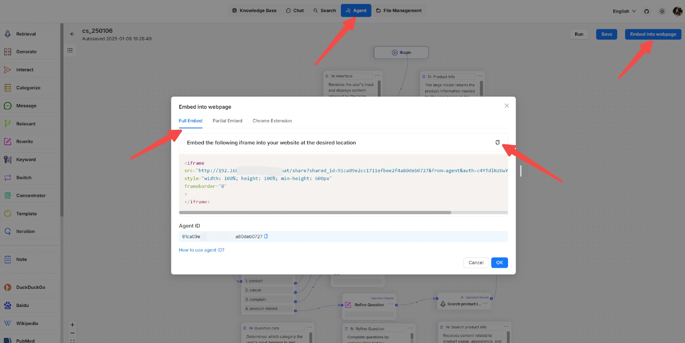

# Embed into website

You can use iframe to embed an agent into a third-party webpage.

1. Before proceeding, you must acquire an API key; otherwise, an error message would appear.
2. On the **Agent** page, click an intended agent **>** **Edit** to access its editing page.
3. Click **Embed into webpage** on the top right corner of the canvas to show the **iframe** window:

<figure><figcaption></figcaption></figure>
