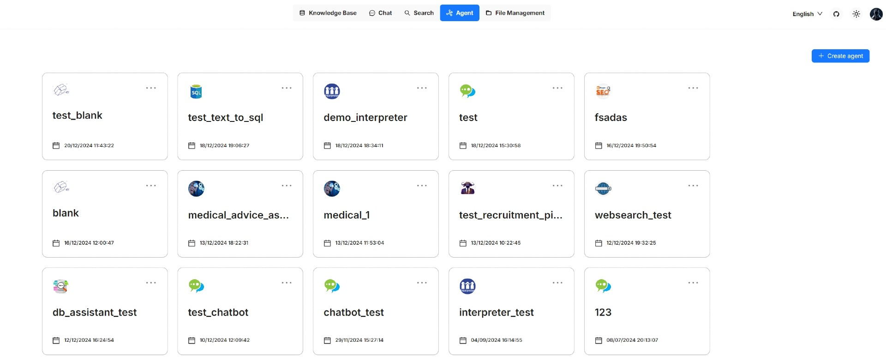
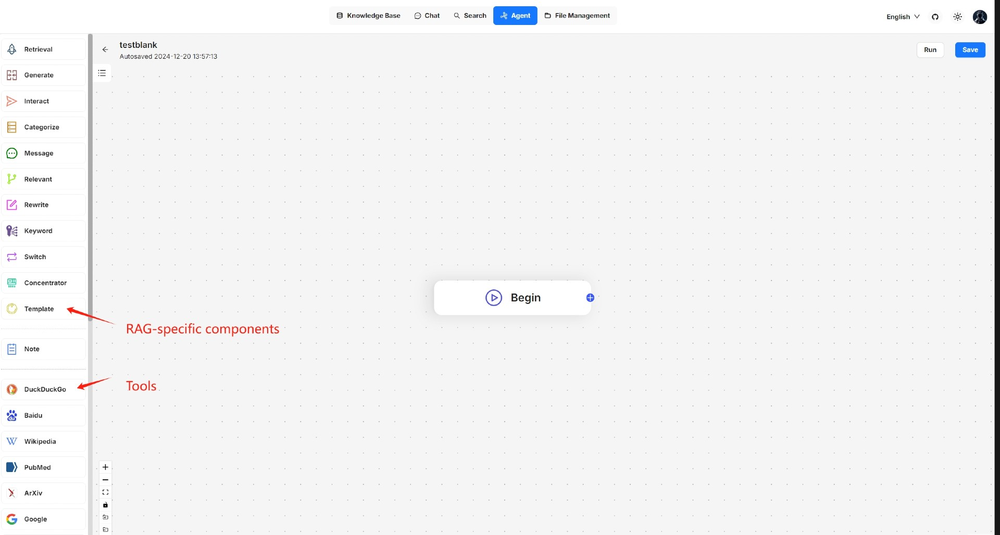

# Introduction to Agents

Agents and RAG are complementary techniques, each enhancing the other’s capabilities in business applications. Surogate v0.8.0 introduces an agent mechanism, featuring a no-code workflow editor on the front end and a comprehensive graph-based task orchestration framework on the back end. This mechanism is built on top of Surogate's existing RAG solutions and aims to orchestrate search technologies such as query intent classification, conversation leading, and query rewriting to:

* Provide higher retrievals and,
* Accommodate more complex scenarios.

### Create an agent 

Click the **Agent** tab in the middle top of the page to show the **Agent** page. As shown in the screenshot below, the cards on this page represent the created agents, which you can continue to edit.

<figure><figcaption></figcaption></figure>

We also provide templates catered to different business scenarios. You can either generate your agent from one of our agent templates or create one from scratch:

1. Click **+ Create agent** to show the **agent template** page:

<figure><figcaption></figcaption></figure>

2. To create an agent from scratch, click the **Blank** card. Alternatively, to create an agent from one of our templates, hover over the desired card, such as **General-purpose chatbot**, click **Use this template**, name your agent in the pop-up dialogue, and click **OK** to confirm.

_You are now taken to the **no-code workflow editor** page. The left panel lists the components (operators): Above the dividing line are the RAG-specific components; below the line are tools. We are still working to expand the component list._

<figure><figcaption></figcaption></figure>

1. Now you can do the following:
   * Drag and drop a desired component to your workflow,
   * Select the knowledge base to use,
   * Update settings of specific components,
   * Update LLM settings
   * Sets the input and output for a specific component, and more.
2. Click **Save** to apply changes to your agent and **Run** to test it.

### Components[​](https://ragflow.io/docs/dev/agent_introduction#components) 

Please review the flowing description of the RAG-specific components before you proceed:

| Component      | Description                                                                                                                                                                                              |
| -------------- | -------------------------------------------------------------------------------------------------------------------------------------------------------------------------------------------------------- |
| **Retrieval**  | A component that retrieves information from specified knowledge bases and returns 'Empty response' if no information is found. Ensure the correct knowledge bases are selected.                          |
| **Generate**   | A component that prompts the LLM to generate responses. You must ensure the prompt is set correctly.                                                                                                     |
| **Interact**   | A component that serves as the interface between human and the bot, receiving user inputs and displaying the agent's responses.                                                                          |
| **Categorize** | A component that uses the LLM to classify user inputs into predefined categories. Ensure you specify the name, description, and examples for each category, along with the corresponding next component. |
| **Message**    | A component that sends out a static message. If multiple messages are supplied, it randomly selects one to send. Ensure its downstream is **Interact**, the interface component.                         |
| **Rewrite**    | A component that rewrites a user query from the **Interact** component, based on the context of previous dialogues.                                                                                      |
| **Keyword**    | A component that extracts keywords from a user query, with TopN specifying the number of keywords to extract.                                                                                            |

### Basic operations[​](https://ragflow.io/docs/dev/agent_introduction#basic-operations) 

| Operation                 | Description                                                                                                                              |
| ------------------------- | ---------------------------------------------------------------------------------------------------------------------------------------- |
| Add a component           | Drag and drop the desired component from the left panel onto the canvas.                                                                 |
| Delete a component        | On the canvas, hover over the three dots (...) of the component to display the delete option, then select it to remove the component.    |
| Copy a component          | On the canvas, hover over the three dots (...) of the component to display the copy option, then select it to make a copy the component. |
| Update component settings | On the canvas, click the desired component to display the component settings.                                                            |
