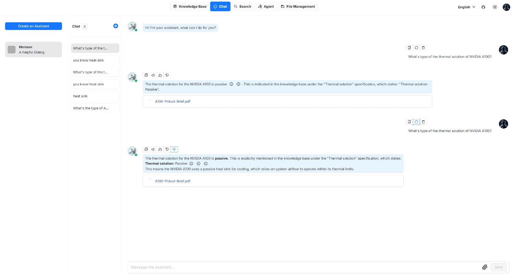
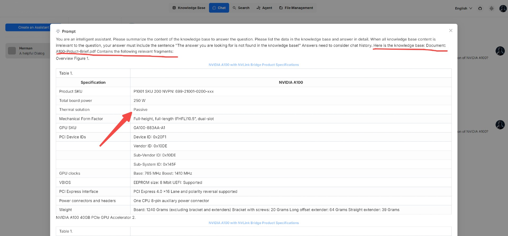
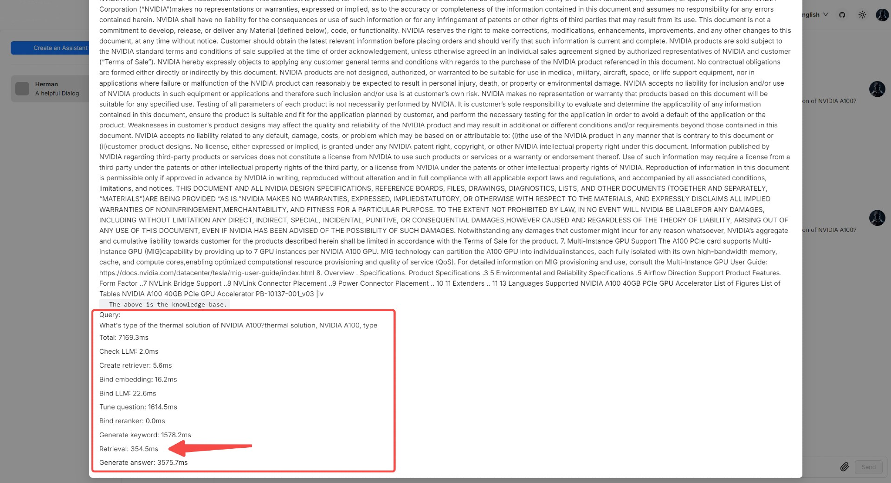
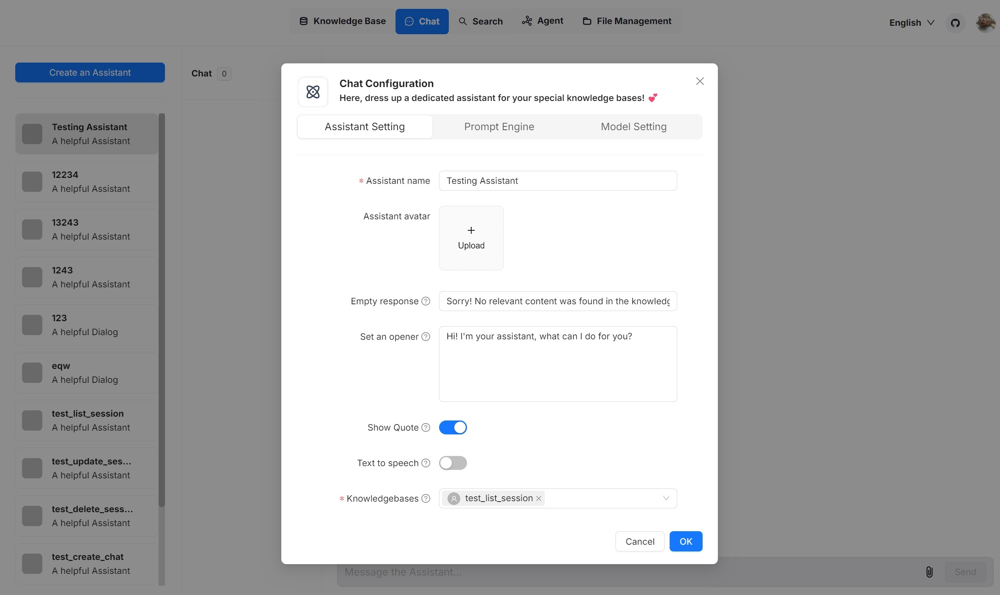
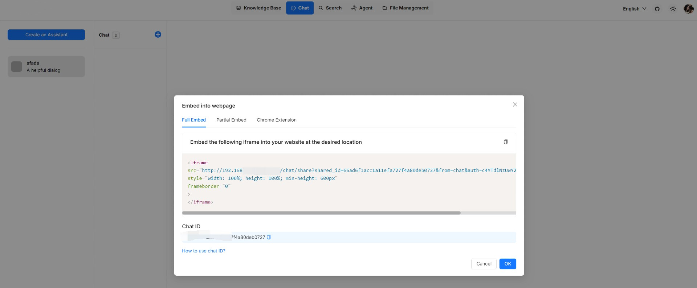

# Start AI chat

Knowledge base, hallucination-free chat, and file management are the three pillars of Surogate. Chats in Surogate are based on a particular knowledge base or multiple knowledge bases. Once you have created your knowledge base, finished file parsing, and run a [retrieval test](../datasets/run-retrieval-test.md), you can go ahead and start an AI conversation.

### Start an AI chat[​](https://ragflow.io/docs/dev/start_chat#start-an-ai-chat) 

You start an AI conversation by creating an assistant.

1.  Click the **Chat** tab in the middle top of the page **>** **Create an assistant** to show the **Chat Configuration** dialogue _of your next dialogue_.

    > Surogate offers you the flexibility of choosing a different chat model for each dialogue, while allowing you to set the default models in **System Model Settings**.
2. Update **Assistant Setting**:
   * **Assistant name** is the name of your chat assistant. Each assistant corresponds to a dialogue with a unique combination of knowledge bases, prompts, hybrid search configurations, and large model settings.
   * **Empty response**:
     * If you wish to _confine_ Surogate's answers to your knowledge bases, leave a response here. Then, when it doesn't retrieve an answer, it _uniformly_ responds with what you set here.
     * If you wish Surogate to _improvise_ when it doesn't retrieve an answer from your knowledge bases, leave it blank, which may give rise to hallucinations.
   * **Show quote**: This is a key feature of Surogate and enabled by default. Surogate does not work like a black box. Instead, it clearly shows the sources of information that its responses are based on.
   * Select the corresponding knowledge bases. You can select one or multiple knowledge bases, but ensure that they use the same embedding model, otherwise an error would occur.
3. Update **Prompt Engine**:
   * In **System**, you fill in the prompts for your LLM, you can also leave the default prompt as-is for the beginning.
   * **Similarity threshold** sets the similarity "bar" for each chunk of text. The default is 0.2. Text chunks with lower similarity scores are filtered out of the final response.
   * **Keyword similarity weight** is set to 0.7 by default. Surogate uses a hybrid score system to evaluate the relevance of different text chunks. This value sets the weight assigned to the keyword similarity component in the hybrid score.
     * If **Rerank model** is left empty, the hybrid score system uses keyword similarity and vector similarity, and the default weight assigned to the vector similarity component is 1-0.7=0.3.
     * If **Rerank model** is selected, the hybrid score system uses keyword similarity and reranker score, and the default weight assigned to the reranker score is 1-0.7=0.3.
   * **Top N** determines the _maximum_ number of chunks to feed to the LLM. In other words, even if more chunks are retrieved, only the top N chunks are provided as input.
   * **Multi-turn optimization** enhances user queries using existing context in a multi-round conversation. It is enabled by default. When enabled, it will consume additional LLM tokens and significantly increase the time to generate answers.
   * **Use knowledge graph** indicates whether to use knowledge graph(s) in the specified knowledge base(s) during retrieval for multi-hop question answering. When enabled, this would involve iterative searches across entity, relationship, and community report chunks, greatly increasing retrieval time.
   * **Reasoning** indicates whether to generate answers through reasoning processes like Deepseek-R1/OpenAI o1. Once enabled, the chat model autonomously integrates Deep Research during question answering when encountering an unknown topic. This involves the chat model dynamically searching external knowledge and generating final answers through reasoning.
   * **Rerank model** sets the reranker model to use. It is left empty by default.
     * If **Rerank model** is left empty, the hybrid score system uses keyword similarity and vector similarity, and the default weight assigned to the vector similarity component is 1-0.7=0.3.
     * If **Rerank model** is selected, the hybrid score system uses keyword similarity and reranker score, and the default weight assigned to the reranker score is 1-0.7=0.3.
   * **Variable** refers to the variables (keys) to be used in the system prompt. `{knowledge}` is a reserved variable. Click **Add** to add more variables for the system prompt.
     * If you are uncertain about the logic behind **Variable**, leave it _as-is_.
4. Update **Model Setting**:
   * In **Model**: you select the chat model. Though you have selected the default chat model in **System Model Settings**, Surogate allows you to choose an alternative chat model for your dialogue.
   * **Preset configurations** refers to the level that the LLM improvises. From **Improvise**, **Precise**, to **Balance**, each preset configuration corresponds to a unique combination of **Temperature**, **Top P**, **Presence penalty**, and **Frequency penalty**.
   * **Temperature**: Level of the prediction randomness of the LLM. The higher the value, the more creative the LLM is.
   * **Top P** is also known as "nucleus sampling". See [here](https://en.wikipedia.org/wiki/Top-p_sampling) for more information.
   * **Max Tokens**: The maximum length of the LLM's responses. Note that the responses may be curtailed if this value is set too low.
5. Now, let's start the chat:

<figure><figcaption></figcaption></figure>

6. Click the light bulb icon above the answer to view the expanded system prompt:

<figure><figcaption></figcaption></figure>

<figure><figcaption></figcaption></figure>

### Update settings of an existing chat assistant[​](https://ragflow.io/docs/dev/start_chat#update-settings-of-an-existing-chat-assistant) 

Hover over an intended chat assistant **>** **Edit** to show the chat configuration dialogue:

<figure><figcaption></figcaption></figure>

### Integrate chat capabilities into your application or webpage 

Surogate offers HTTP and Python APIs for you to integrate a chatbot into your applications. Additionally you can a widget to embed the created chat assistant into a third-party webpage:

1. Before proceeding, you must acquire an API key; otherwise, an error message would appear.
2. Hover over an intended chat assistant **>** **Edit** to show the **iframe** window:

<figure><figcaption></figcaption></figure>

3. Copy the iframe and embed it into a specific location on your webpage.
