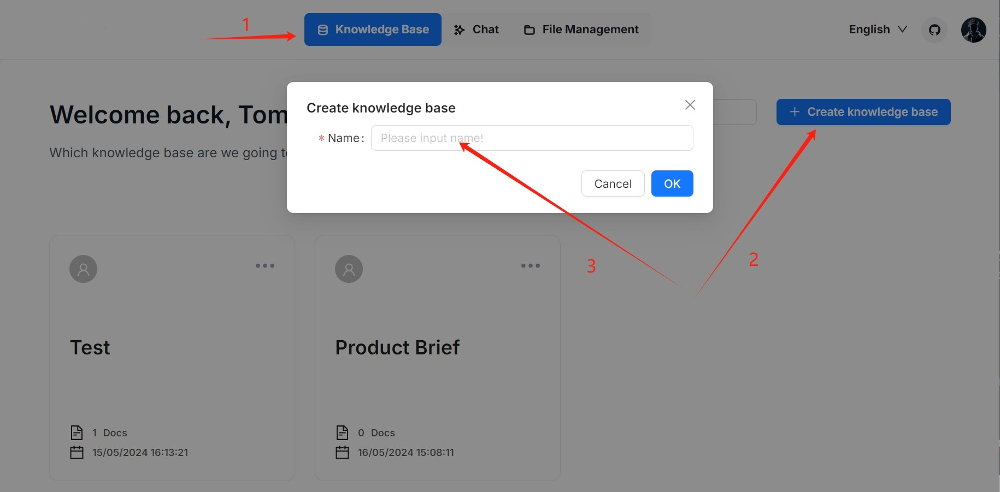
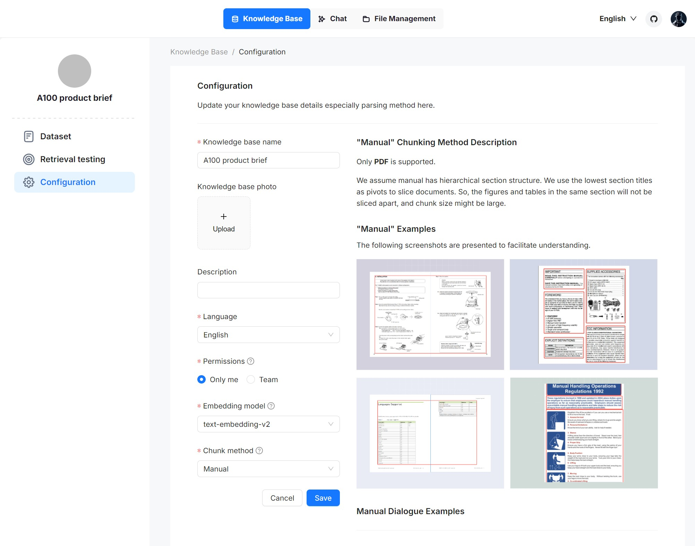
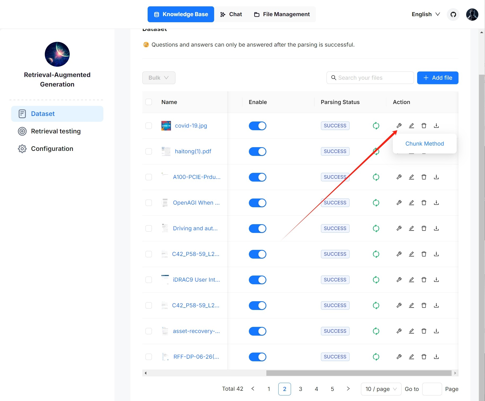
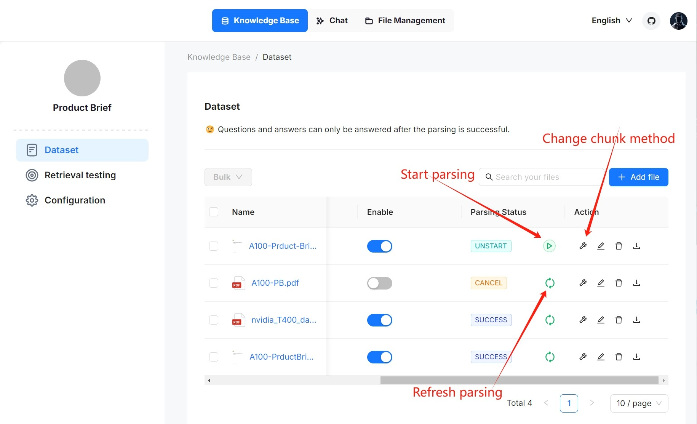
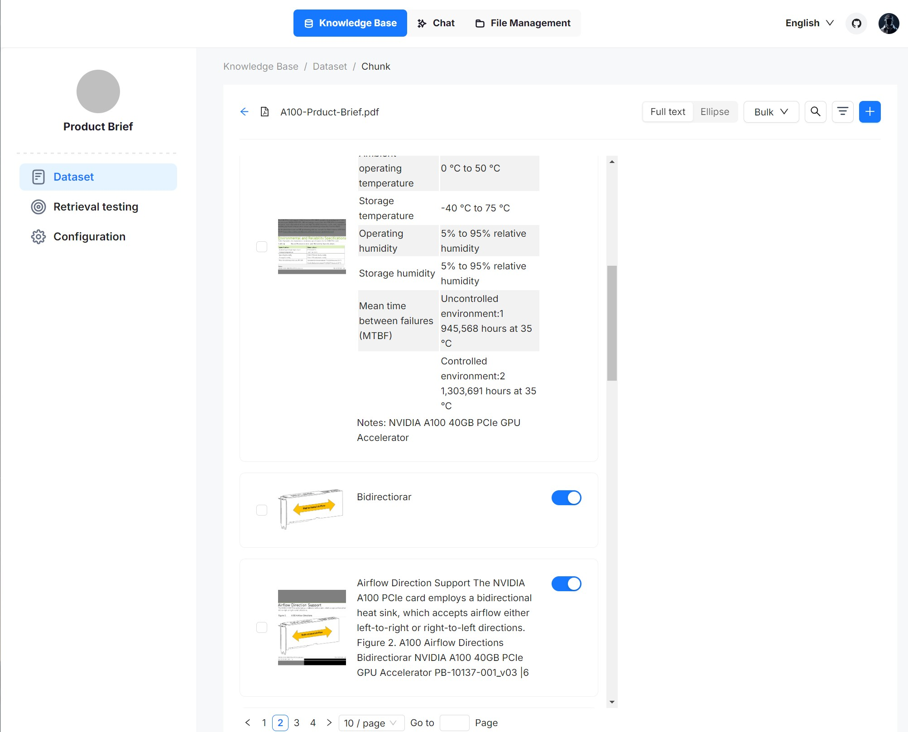
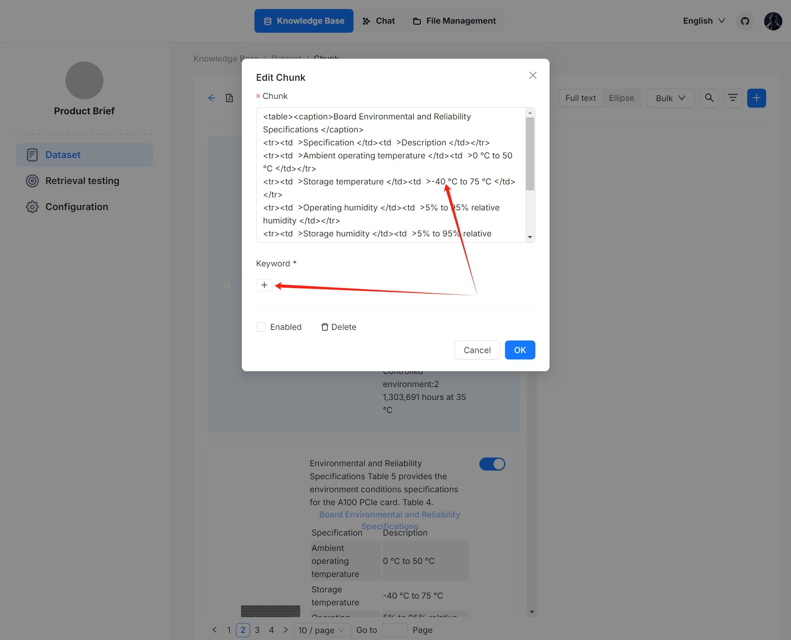
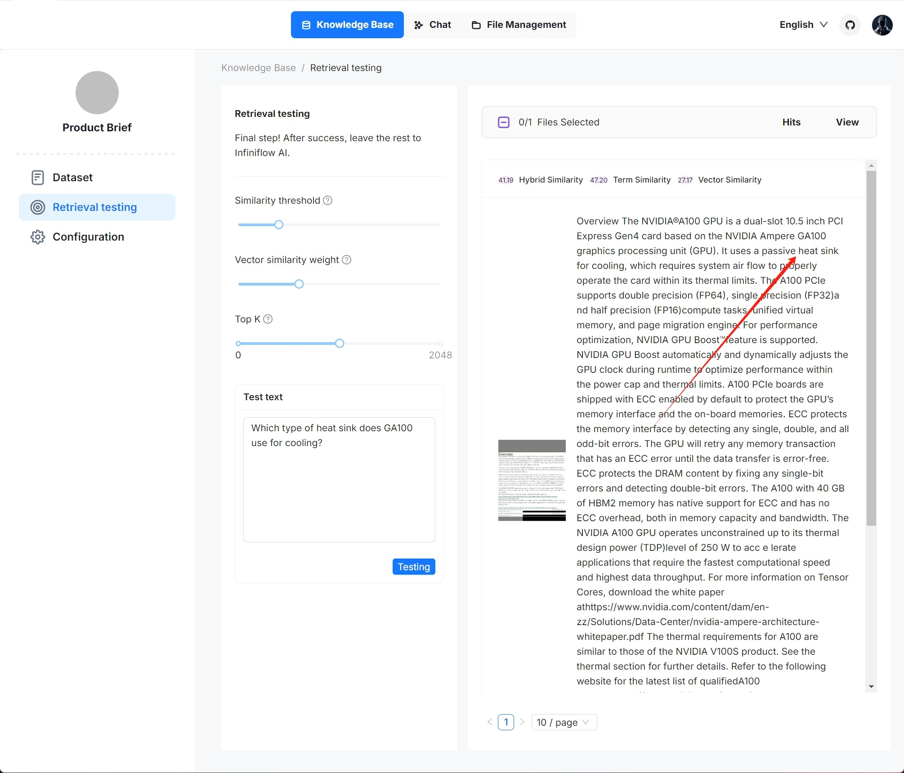

# Knowledge base

Knowledge base, hallucination-free chat, and file management are the three pillars of Surogate. Surogate's AI chats are based on knowledge bases. Each of Surogate knowledge bases serves as a knowledge source, _parsing_ files uploaded from your local machine and file references generated in **File Management** into the real 'knowledge' for future AI chats. This guide demonstrates some basic usages of the knowledge base feature, covering the following topics:

* Create a knowledge base
* Configure a knowledge base
* Search for a knowledge base
* Delete a knowledge base

### Create knowledge base[​](https://ragflow.io/docs/dev/configure_knowledge_base#create-knowledge-base) 

With multiple knowledge bases, you can build more flexible, diversified question answering. To create your first knowledge base:

<figure><figcaption></figcaption></figure>

_Each time a knowledge base is created, a folder with the same name is generated in the **root/.knowledgebase** directory._

### Configure knowledge base[​](https://ragflow.io/docs/dev/configure_knowledge_base#configure-knowledge-base-1) 

The following screenshot shows the configuration page of a knowledge base. A proper configuration of your knowledge base is crucial for future AI chats. For example, choosing the wrong embedding model or chunk method would cause unexpected semantic loss or mismatched answers in chats.

<figure><figcaption></figcaption></figure>

This section covers the following topics:

* Select chunk method
* Select embedding model
* Upload file
* Parse file
* Intervene with file parsing results
* Run retrieval testing

#### Select chunk method[​](https://ragflow.io/docs/dev/configure_knowledge_base#select-chunk-method) 

Surogate offers multiple chunking template to facilitate chunking files of different layouts and ensure semantic integrity. In **Chunk method**, you can choose the default template that suits the layouts and formats of your files. The following table shows the descriptions and the compatible file formats of each supported chunk template:

<table data-header-hidden data-full-width="true"><thead><tr><th></th><th></th><th></th></tr></thead><tbody><tr><td><strong>Template</strong></td><td>Description</td><td>File format</td></tr><tr><td>General</td><td>Files are consecutively chunked based on a preset chunk token number.</td><td>DOCX, XLSX, XLS (Excel97~2003), PPT, PDF, TXT, JPEG, JPG, PNG, TIF, GIF, CSV, JSON, EML, HTML</td></tr><tr><td>Q&#x26;A</td><td></td><td>XLSX, XLS (Excel97~2003), CSV/TXT</td></tr><tr><td>Manual</td><td></td><td>PDF</td></tr><tr><td>Table</td><td></td><td>XLSX, XLS (Excel97~2003), CSV/TXT</td></tr><tr><td>Paper</td><td></td><td>PDF</td></tr><tr><td>Book</td><td></td><td>DOCX, PDF, TXT</td></tr><tr><td>Laws</td><td></td><td>DOCX, PDF, TXT</td></tr><tr><td>Presentation</td><td></td><td>PDF, PPTX</td></tr><tr><td>Picture</td><td></td><td>JPEG, JPG, PNG, TIF, GIF</td></tr><tr><td>One</td><td>Each document is chunked in its entirety (as one).</td><td>DOCX, XLSX, XLS (Excel97~2003), PDF, TXT</td></tr><tr><td>Tag</td><td>The knowledge base functions as a tag set for the others.</td><td>XLSX, CSV/TXT</td></tr></tbody></table>

You can also change a file's chunk method on the **Datasets** page.

<figure><figcaption></figcaption></figure>

#### Select embedding model[​](https://ragflow.io/docs/dev/configure_knowledge_base#select-embedding-model) 

An embedding model converts chunks into embeddings. It cannot be changed once the knowledge base has chunks. To switch to a different embedding model, you must delete all existing chunks in the knowledge base. The obvious reason is that we _must_ ensure that files in a specific knowledge base are converted to embeddings using the _same_ embedding model (ensure that they are compared in the same embedding space).

The following embedding models can be deployed locally:

* BAAI/bge-large-zh-v1.5
* BAAI/bge-base-en-v1.5
* BAAI/bge-large-en-v1.5
* BAAI/bge-small-en-v1.5
* BAAI/bge-small-zh-v1.5
* jinaai/jina-embeddings-v2-base-en
* jinaai/jina-embeddings-v2-small-en
* nomic-ai/nomic-embed-text-v1.5
* sentence-transformers/all-MiniLM-L6-v2
* maidalun1020/bce-embedding-base\_v1

#### Upload file[​](https://ragflow.io/docs/dev/configure_knowledge_base#upload-file) 

* Surogate's **File Management** allows you to link a file to multiple knowledge bases, in which case each target knowledge base holds a reference to the file.
* In **Knowledge Base**, you are also given the option of uploading a single file or a folder of files (bulk upload) from your local machine to a knowledge base, in which case the knowledge base holds file copies.

While uploading files directly to a knowledge base seems more convenient, we _highly_ recommend uploading files to **File Management** and then linking them to the target knowledge bases. This way, you can avoid permanently deleting files uploaded to the knowledge base.

#### Parse file[​](https://ragflow.io/docs/dev/configure_knowledge_base#parse-file) 

File parsing is a crucial topic in knowledge base configuration. The meaning of file parsing in Surogate is twofold: chunking files based on file layout and building embedding and full-text (keyword) indexes on these chunks. After having selected the chunk method and embedding model, you can start parsing a file:

<figure><figcaption></figcaption></figure>

* Click the play button next to **UNSTART** to start file parsing.
* Click the red-cross icon and then refresh, if your file parsing stalls for a long time.
* As shown above, Surogate allows you to use a different chunk method for a particular file, offering flexibility beyond the default method.
* As shown above, Surogate allows you to enable or disable individual files, offering finer control over knowledge base-based AI chats.

#### Intervene in file parsing results[​](https://ragflow.io/docs/dev/configure_knowledge_base#intervene-with-file-parsing-results) 

Surogate features visibility and explainability, allowing you to view the chunking results and intervene where necessary. To do so:

1.  Click on the file that completes file parsing to view the chunking results:

    _You are taken to the **Chunk** page:_

<figure><figcaption></figcaption></figure>

2. Hover over each snapshot for a quick view of each chunk.
3. Double-click the chunked texts to add keywords or make _manual_ changes where necessary:

<figure><figcaption></figcaption></figure>


You can add keywords to a file chunk to increase its ranking for queries containing those keywords. This action increases its keyword weight and can improve its position in search list.


4. In Retrieval testing, ask a quick question in **Test text** to double-check if your configurations work:

_As you can tell from the following, Surogate responds with truthful citations._

<figure><figcaption></figcaption></figure>

#### Run retrieval testing[​](https://ragflow.io/docs/dev/configure_knowledge_base#run-retrieval-testing) 

Surogate uses multiple recall of both full-text search and vector search in its chats. Prior to setting up an AI chat, consider adjusting the following parameters to ensure that the intended information always turns up in answers:

* Similarity threshold: Chunks with similarities below the threshold will be filtered. By default, it is set to 0.2.
* Vector similarity weight: The percentage by which vector similarity contributes to the overall score. By default, it is set to 0.3.

### Delete knowledge base[​](https://ragflow.io/docs/dev/configure_knowledge_base#delete-knowledge-base) 

You are allowed to delete a knowledge base. Hover your mouse over the three dot of the intended knowledge base card and the **Delete** option appears. Once you delete a knowledge base, the associated folder under **root/.knowledge** directory is AUTOMATICALLY REMOVED. The consequence is:

* The files uploaded directly to the knowledge base are gone;
* The file references, which you created from within **File Management**, are gone, but the associated files still exist in **File Management**.

