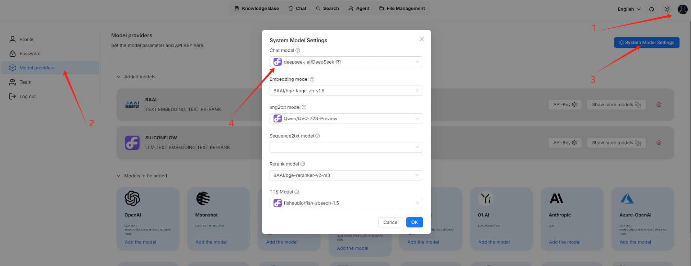

# Knowledge graph

To enhance multi-hop question-answering, Surogate adds a knowledge graph construction step between data extraction and indexing, as illustrated below. This step creates additional chunks from existing ones generated by your specified chunk method.

<figure><figcaption></figcaption></figure>

From v0.16.0 onward, Surogate supports constructing a knowledge graph on a knowledge base, allowing you to construct a _unified_ graph across multiple files within your knowledge base. When a newly uploaded file starts parsing, the generated graph will automatically update.


Constructing a knowledge graph requires significant memory, computational resources, and tokens.


### Scenarios[​](https://ragflow.io/docs/dev/construct_knowledge_graph#scenarios) 

Knowledge graphs are especially useful for multi-hop question-answering involving _nested_ logic. They outperform traditional extraction approaches when you are performing question answering on books or works with complex entities and relationships.

### Prerequisites[​](https://ragflow.io/docs/dev/construct_knowledge_graph#prerequisites) 

The system's default chat model is used to generate knowledge graph. Before proceeding, ensure that you have a chat model properly configured:

<figure><figcaption></figcaption></figure>

### Configurations[​](https://ragflow.io/docs/dev/construct_knowledge_graph#configurations) 

#### Entity types (_Required_)[​](https://ragflow.io/docs/dev/construct_knowledge_graph#entity-types-required) 

The types of the entities to extract from your knowledge base. The default types are: **organization**, **person**, **event**, and **category**. Add or remove types to suit your specific knowledge base.

#### Method[​](https://ragflow.io/docs/dev/construct_knowledge_graph#method) 

The method to use to construct knowledge graph:

* **General**: Use prompts provided by [GraphRAG](https://github.com/microsoft/graphrag) to extract entities and relationships.
* **Light**: (Default) Use prompts provided by [LightRAG](https://github.com/HKUDS/LightRAG) to extract entities and relationships. This option consumes fewer tokens, less memory, and fewer computational resources.

#### Entity resolution[​](https://ragflow.io/docs/dev/construct_knowledge_graph#entity-resolution) 

Whether to enable entity resolution. You can think of this as an entity deduplication switch. When enabled, the LLM will combine similar entities - e.g., '2025' and 'the year of 2025', or 'IT' and 'Information Technology' - to construct a more effective graph.

* (Default) Disable entity resolution.
* Enable entity resolution. This option consumes more tokens.

#### Community report generation[​](https://ragflow.io/docs/dev/construct_knowledge_graph#community-report-generation) 

In a knowledge graph, a community is a cluster of entities linked by relationships. You can have the LLM generate an abstract for each community, known as a community report. See [here](https://www.microsoft.com/en-us/research/blog/graphrag-improving-global-search-via-dynamic-community-selection/) for more information. This indicates whether to generate community reports:

* Generate community reports. This option consumes more tokens.
* (Default) Do not generate community reports.

### Procedure[​](https://ragflow.io/docs/dev/construct_knowledge_graph#procedure) 

1. On the **Configuration** page of your knowledge base, switch on **Extract knowledge graph** or adjust its settings as needed, and click **Save** to confirm your changes.
   * _The default knowledge graph configurations for your knowledge base are now set and files uploaded from this point onward will automatically use these settings during parsing._
   * _Files parsed before this update will retain their original knowledge graph settings._
2.  The knowledge graph of your knowledge base does _not_ automatically update _until_ a newly uploaded file is parsed.

    _A **Knowledge graph** entry appears under **Configuration** once a knowledge graph is created._
3. Click **Knowledge graph** to view the details of the generated graph.

### Frequently asked questions[​](https://ragflow.io/docs/dev/construct_knowledge_graph#frequently-asked-questions) 

#### Can I have different knowledge graph settings for different files in my knowledge base?[​](https://ragflow.io/docs/dev/construct_knowledge_graph#can-i-have-different-knowledge-graph-settings-for-different-files-in-my-knowledge-base) 

Yes, you can. Just one graph is generated per knowledge base. The smaller graphs of your files will be _combined_ into one big, unified graph at the end of the graph extraction process.

#### Does the knowledge graph automatically update when I remove a related file?[​](https://ragflow.io/docs/dev/construct_knowledge_graph#does-the-knowledge-graph-automatically-update-when-i-remove-a-related-file) 

Nope. The knowledge graph does _not_ automatically update _until_ a newly uploaded graph is parsed.

#### How to remove a generated knowledge graph?[​](https://ragflow.io/docs/dev/construct_knowledge_graph#how-to-remove-a-generated-knowledge-graph) 

To remove the generated knowledge graph, delete all related files in your knowledge base. Although the **Knowledge graph** entry will still be visible, the graph has actually been deleted.
