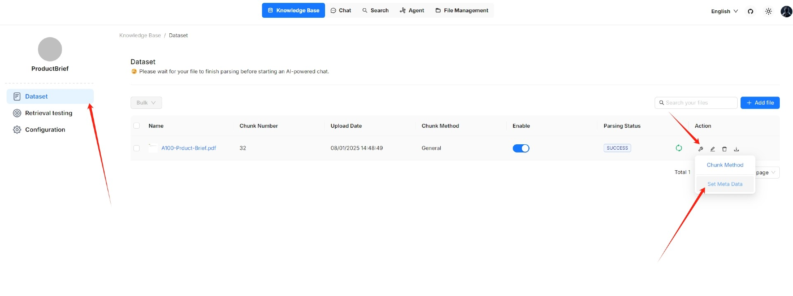

# Set metadata

On the **Dataset** page of your knowledge base, you can add metadata to any uploaded file. This approach enables you to 'tag' additional information like URL, author, date, and more to an existing file or dataset. In an AI-powered chat, such information will be sent to the LLM with the retrieved chunks for content generation.

For example, if you have a dataset of HTML files and want the LLM to cite the source URL when responding to your query, add a `"url"` parameter to each file's metadata.

<figure><figcaption></figcaption></figure>


Ensure that your metadata is in JSON format; otherwise, your updates will not be applied.


