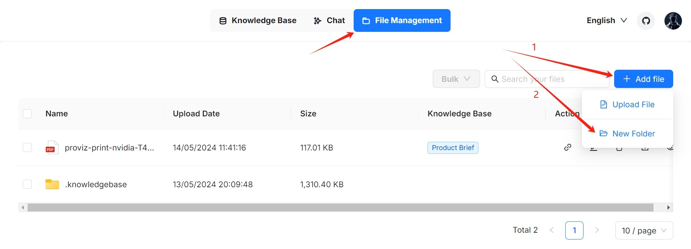
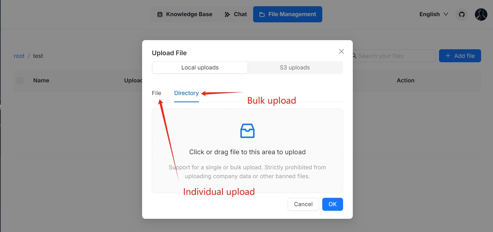
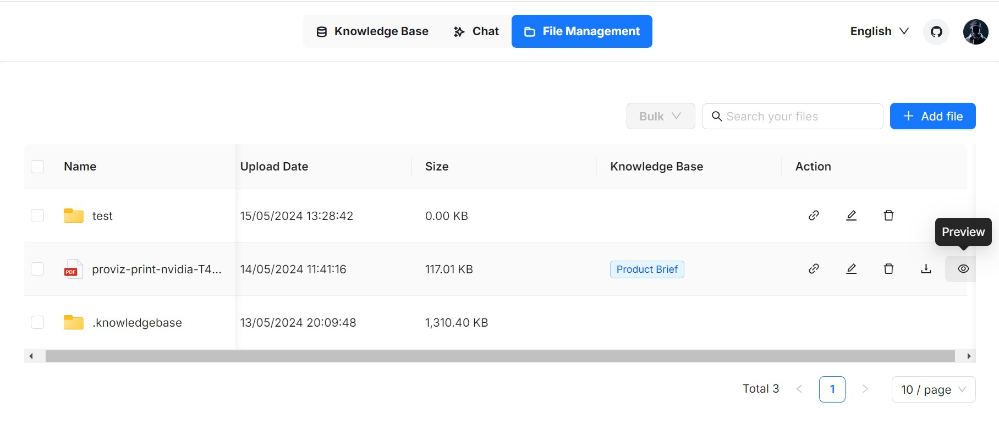
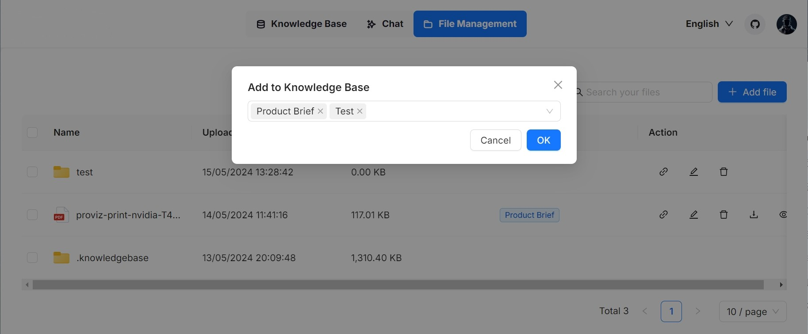

# Files

Knowledge base, hallucination-free chat, and file management are the three pillars of Surogate. Surogate's file management allows you to upload files individually or in bulk. You can then link an uploaded file to multiple target knowledge bases. This guide showcases some basic usages of the file management feature.

### Create folder[​](https://ragflow.io/docs/dev/manage_files#create-folder) 

Surogate's file management allows you to establish your file system with nested folder structures. To create a folder in the root directory of Surogate:

<figure><figcaption></figcaption></figure>

Each knowledge base in Surogate has a corresponding folder under the **root/.knowledgebase** directory. You are not allowed to create a subfolder within it.

### Upload file[​](https://ragflow.io/docs/dev/manage_files#upload-file) 

Surogate's file management supports file uploads from your local machine, allowing both individual and bulk uploads:

<figure><figcaption></figcaption></figure>

### Preview file[​](https://ragflow.io/docs/dev/manage_files#preview-file) 

Surogate's file management supports previewing files in the following formats:

* Documents (PDF, DOCS)
* Tables (XLSX)
* Pictures (JPEG, JPG, PNG, TIF, GIF)

<figure><figcaption></figcaption></figure>

### Link file to knowledge base[​](https://ragflow.io/docs/dev/manage_files#link-file-to-knowledge-bases) 

Surogate's file management allows you to _link_ an uploaded file to multiple knowledge bases, creating a file reference in each target knowledge base. Therefore, deleting a file in your file management will AUTOMATICALLY REMOVE all related file references across the knowledge bases.

<figure><figcaption></figcaption></figure>

