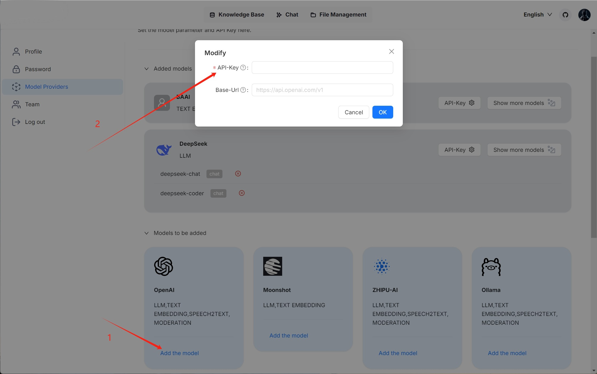
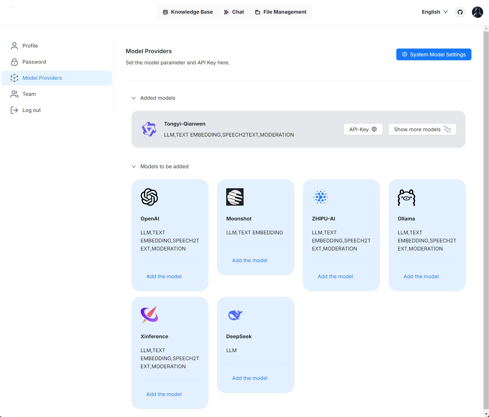

# Models

## Configure API key

An API key is required for Surogate to interact with an online AI model. This guide provides information about setting your model API key in Surogate.

### Get model API key <a href="#get-model-api-key" id="get-model-api-key"></a>

Surogate supports most mainstream LLMs. Please refer to [Supported Models](models.md#supported-models) for a complete list of supported models. You will need to apply for your model API key online. Note that most LLM providers grant newly-created accounts trial credit, which will expire in a couple of months, or a promotional amount of free quota.

### Configure model API key <a href="#configure-model-api-key-1" id="configure-model-api-key-1"></a>

You have two options for configuring your model API key:

* Configure it in **service\_conf.yaml.template** before starting Surogate.
* Configure it on the **Model providers** page after logging into Surogate.

#### Configure model API key before starting up Surogate <a href="#configure-model-api-key-before-starting-up-ragflow" id="configure-model-api-key-before-starting-up-ragflow"></a>

1. Navigate to **./docker/surogate**.
2. Find entry **user\_default\_llm**:
   * Update `factory` with your chosen LLM.
   * Update `api_key` with yours.
   * Update `base_url` if you use a proxy to connect to the remote service.
3. Reboot your system for your changes to take effect.
4. Log into Surogate.\
   &#xNAN;_&#x41;fter logging into Surogate, you will find your chosen model appears under **Added models** on the **Model providers** page._

#### Configure model API key after logging into Surogate <a href="#configure-model-api-key-after-logging-into-ragflow" id="configure-model-api-key-after-logging-into-ragflow"></a>

After logging into Surogate, you can _only_ configure API Key on the **Model providers** page:

1. Click on your logo on the top right of the page **>** **Model providers**.
2. Find your model card under **Models to be added** and click **Add the model**:

<figure><figcaption></figcaption></figure>

3. Paste your model API key.
4. Fill in your base URL if you use a proxy to connect to the remote service.
5. Click **OK** to confirm your changes.

## Local LLM

Surogate supports deploying models locally using Ollama, Xinference, IPEX-LLM, or VLLM. If you have locally deployed models to leverage or wish to enable GPU or CUDA for inference acceleration, you can bind Ollama or Xinference into Surogate and use either of them as a local "server" for interacting with your local models.

Surogate seamlessly integrates with Ollama and Xinference, without the need for further environment configurations. You can use them to deploy two types of local models in Surogate: chat models and embedding models.

### Deploy local models using Ollama <a href="#deploy-local-models-using-ollama" id="deploy-local-models-using-ollama"></a>

[Ollama](https://github.com/ollama/ollama) enables you to run open-source large language models that you deployed locally. It bundles model weights, configurations, and data into a single package, defined by a Modelfile, and optimizes setup and configurations, including GPU usage.

#### 1. Deploy ollama using docker <a href="#id-1-deploy-ollama-using-docker" id="id-1-deploy-ollama-using-docker"></a>

```
sudo docker run --name ollama -p 11434:11434 ollama/ollama
time=2024-12-02T02:20:21.360Z level=INFO source=routes.go:1248 msg="Listening on [::]:11434 (version 0.4.6)"
time=2024-12-02T02:20:21.360Z level=INFO source=common.go:49 msg="Dynamic LLM libraries" runners="[cpu cpu_avx cpu_avx2 cuda_v11 cuda_v12]"
```

Ensure ollama is listening on all IP address:

```
sudo ss -tunlp | grep 11434
tcp   LISTEN 0      4096                  0.0.0.0:11434      0.0.0.0:*    users:(("docker-proxy",pid=794507,fd=4))
tcp   LISTEN 0      4096                     [::]:11434         [::]:*    users:(("docker-proxy",pid=794513,fd=4))
```

Pull models as you need. It's recommended to start with `llama3.2` (a 3B chat model) and `bge-m3` (a 567M embedding model):

```
sudo docker exec ollama ollama pull llama3.2
pulling dde5aa3fc5ff... 100% ▕████████████████▏ 2.0 GB
success
```

#### 2. Ensure Ollama is accessible <a href="#id-2-ensure-ollama-is-accessible" id="id-2-ensure-ollama-is-accessible"></a>

If Surogate runs in Docker and Ollama runs on the same host machine, check if ollama is accessible from inside the Surogate container:

```
sudo docker exec -it surogate-server bash
root@8136b8c3e914:/surogate# curl  http://host.docker.internal:11434/
Ollama is running
```

If Surogate runs from source code and Ollama runs on the same host machine, check if ollama is accessible from Surogate host machine:

```
curl  http://localhost:11434/
Ollama is running
```

If Surogate and Ollama run on different machines, check if ollama is accessible from Surogate host machine:

```
curl http://${IP_OF_OLLAMA_MACHINE}:11434/
Ollama is running
```

#### 4. Add Ollama <a href="#id-4-add-ollama" id="id-4-add-ollama"></a>

In Surogate, click on your logo on the top right of the page **>** **Model providers** and add Ollama to Surogate:

<figure><figcaption></figcaption></figure>

#### 5. Complete basic Ollama settings <a href="#id-5-complete-basic-ollama-settings" id="id-5-complete-basic-ollama-settings"></a>

In the popup window, complete basic settings for Ollama:

1. Ensure model name and type match those been pulled at step 1, For example, (`llama3.2`, `chat`), (`bge-m3`, `embedding`).
2. Ensure that the base URL match which been determined at step 2.
3. OPTIONAL: Switch on the toggle under **Does it support Vision?** if your model includes an image-to-text model.

WARNING

Improper base URL settings will trigger the following error:

```
Max retries exceeded with url: /api/chat (Caused by NewConnectionError('<urllib3.connection.HTTPConnection object at 0xffff98b81ff0>: Failed to establish a new connection: [Errno 111] Connection refused'))
```

#### 6. Update System Model Settings[​](https://ragflow.io/docs/dev/deploy_local_llm#6-update-system-model-settings) <a href="#id-6-update-system-model-settings" id="id-6-update-system-model-settings"></a>

Click on your logo **>** **Model providers** **>** **System Model Settings** to update your model:

_You should now be able to find **llama3.2** from the dropdown list under **Chat model**, and **bge-m3** from the dropdown list under **Embedding model**._

> If your local model is an embedding model, you should find your local model under **Embedding model**.

#### 7. Update Chat Configuration[​](https://ragflow.io/docs/dev/deploy_local_llm#7-update-chat-configuration) <a href="#id-7-update-chat-configuration" id="id-7-update-chat-configuration"></a>

Update your chat model accordingly in **Chat Configuration**:

> If your local model is an embedding model, update it on the configuration page of your knowledge base.

### Deploy a local model using Xinference[​](https://ragflow.io/docs/dev/deploy_local_llm#deploy-a-local-model-using-xinference) <a href="#deploy-a-local-model-using-xinference" id="deploy-a-local-model-using-xinference"></a>

Xorbits Inference ([Xinference](https://github.com/xorbitsai/inference)) enables you to unleash the full potential of cutting-edge AI models.

note

* For information about installing Xinference Ollama, see [here](https://inference.readthedocs.io/en/latest/getting_started/).
* For a complete list of supported models, see the [Builtin Models](https://inference.readthedocs.io/en/latest/models/builtin/).

To deploy a local model, e.g., **Mistral**, using Xinference:

#### 1. Check firewall settings[​](https://ragflow.io/docs/dev/deploy_local_llm#1-check-firewall-settings) <a href="#id-1-check-firewall-settings" id="id-1-check-firewall-settings"></a>

Ensure that your host machine's firewall allows inbound connections on port 9997.

#### 2. Start an Xinference instance[​](https://ragflow.io/docs/dev/deploy_local_llm#2-start-an-xinference-instance) <a href="#id-2-start-an-xinference-instance" id="id-2-start-an-xinference-instance"></a>

```
$ xinference-local --host 0.0.0.0 --port 9997
```

#### 3. Launch your local model[​](https://ragflow.io/docs/dev/deploy_local_llm#3-launch-your-local-model) <a href="#id-3-launch-your-local-model" id="id-3-launch-your-local-model"></a>

Launch your local model (**Mistral**), ensuring that you replace `${quantization}` with your chosen quantization method:

```
$ xinference launch -u mistral --model-name mistral-v0.1 --size-in-billions 7 --model-format pytorch --quantization ${quantization}
```

#### 4. Add Xinference[​](https://ragflow.io/docs/dev/deploy_local_llm#4-add-xinference) <a href="#id-4-add-xinference" id="id-4-add-xinference"></a>

In Surogate, click on your logo on the top right of the page **>** **Model providers** and add Xinference to Surogate.

#### 5. Complete basic Xinference settings[​](https://ragflow.io/docs/dev/deploy_local_llm#5-complete-basic-xinference-settings) <a href="#id-5-complete-basic-xinference-settings" id="id-5-complete-basic-xinference-settings"></a>

Enter an accessible base URL, such as `http://<your-xinference-endpoint-domain>:9997/v1`.

> For rerank model, please use the `http://<your-xinference-endpoint-domain>:9997/v1/rerank` as the base URL.

#### 6. Update System Model Settings[​](https://ragflow.io/docs/dev/deploy_local_llm#6-update-system-model-settings-1) <a href="#id-6-update-system-model-settings-1" id="id-6-update-system-model-settings-1"></a>

Click on your logo **>** **Model providers** **>** **System Model Settings** to update your model.

_You should now be able to find **mistral** from the dropdown list under **Chat model**._

> If your local model is an embedding model, you should find your local model under **Embedding model**.

#### 7. Update Chat Configuration[​](https://ragflow.io/docs/dev/deploy_local_llm#7-update-chat-configuration-1) <a href="#id-7-update-chat-configuration-1" id="id-7-update-chat-configuration-1"></a>

Update your chat model accordingly in **Chat Configuration**:

> If your local model is an embedding model, update it on the configuration page of your knowledge base.

## Supported Models

A complete list of models supported by Surogate, which will continue to expand.

<table data-full-width="true"><thead><tr><th>Provider</th><th>Chat</th><th>Embedding</th><th>Rerank</th><th>Img2txt</th><th>Speech2txt</th><th>TTS</th></tr></thead><tbody><tr><td>Anthropic</td><td>✔️</td><td></td><td></td><td></td><td></td><td></td></tr><tr><td>Azure-OpenAI</td><td>✔️</td><td>✔️</td><td></td><td>✔️</td><td>✔️</td><td></td></tr><tr><td>BAAI</td><td></td><td>✔️</td><td>✔️</td><td></td><td></td><td></td></tr><tr><td>BaiChuan</td><td>✔️</td><td>✔️</td><td></td><td></td><td></td><td></td></tr><tr><td>BaiduYiyan</td><td>✔️</td><td>✔️</td><td>✔️</td><td>✔️</td><td></td><td></td></tr><tr><td>Bedrock</td><td>✔️</td><td>✔️</td><td></td><td></td><td></td><td></td></tr><tr><td>Cohere</td><td>✔️</td><td>✔️</td><td>✔️</td><td>✔️</td><td></td><td></td></tr><tr><td>DeepSeek</td><td>✔️</td><td></td><td></td><td></td><td></td><td></td></tr><tr><td>FastEmbed</td><td></td><td>✔️</td><td></td><td></td><td></td><td></td></tr><tr><td>Fish Audio</td><td></td><td></td><td></td><td></td><td></td><td>✔️</td></tr><tr><td>Gemini</td><td>✔️</td><td>✔️</td><td></td><td>✔️</td><td></td><td></td></tr><tr><td>Google Cloud</td><td>✔️</td><td></td><td></td><td></td><td></td><td></td></tr><tr><td>GPUStack</td><td>✔️</td><td>✔️</td><td>✔️</td><td></td><td>✔️</td><td>✔️</td></tr><tr><td>Groq</td><td>✔️</td><td></td><td></td><td></td><td></td><td></td></tr><tr><td>HuggingFace</td><td>✔️</td><td>✔️</td><td></td><td></td><td></td><td></td></tr><tr><td>Jina</td><td></td><td>✔️</td><td>✔️</td><td></td><td></td><td></td></tr><tr><td>LeptonAI</td><td>✔️</td><td></td><td></td><td></td><td></td><td></td></tr><tr><td>LocalAI</td><td>✔️</td><td>✔️</td><td></td><td>✔️</td><td></td><td></td></tr><tr><td>LM-Studio</td><td>✔️</td><td>✔️</td><td>✔️</td><td>✔️</td><td></td><td></td></tr><tr><td>MiniMax</td><td>✔️</td><td></td><td></td><td></td><td></td><td></td></tr><tr><td>Mistral</td><td>✔️</td><td>✔️</td><td></td><td></td><td></td><td></td></tr><tr><td>ModelScope</td><td>✔️</td><td></td><td></td><td></td><td></td><td></td></tr><tr><td>Moonshot</td><td>✔️</td><td></td><td></td><td>✔️</td><td></td><td></td></tr><tr><td>novita.ai</td><td>✔️</td><td></td><td></td><td></td><td></td><td></td></tr><tr><td>NVIDIA</td><td>✔️</td><td>✔️</td><td>✔️</td><td>✔️</td><td></td><td></td></tr><tr><td>Ollama</td><td>✔️</td><td>✔️</td><td></td><td>✔️</td><td></td><td></td></tr><tr><td>OpenAI</td><td>✔️</td><td>✔️</td><td></td><td>✔️</td><td>✔️</td><td>✔️</td></tr><tr><td>OpenAI-API-Compatible</td><td>✔️</td><td>✔️</td><td>✔️</td><td>✔️</td><td></td><td></td></tr><tr><td>OpenRouter</td><td>✔️</td><td></td><td></td><td>✔️</td><td></td><td></td></tr><tr><td>PerfXCloud</td><td>✔️</td><td>✔️</td><td></td><td></td><td></td><td></td></tr><tr><td>Replicate</td><td>✔️</td><td>✔️</td><td></td><td></td><td></td><td></td></tr><tr><td>PPIO</td><td>✔️</td><td></td><td></td><td></td><td></td><td></td></tr><tr><td>SILICONFLOW</td><td>✔️</td><td>✔️</td><td>✔️</td><td>✔️</td><td></td><td></td></tr><tr><td>StepFun</td><td>✔️</td><td></td><td></td><td></td><td></td><td></td></tr><tr><td>Tencent Hunyuan</td><td>✔️</td><td></td><td></td><td></td><td></td><td></td></tr><tr><td>Tencent Cloud</td><td></td><td></td><td></td><td></td><td>✔️</td><td></td></tr><tr><td>TogetherAI</td><td>✔️</td><td>✔️</td><td>✔️</td><td>✔️</td><td></td><td></td></tr><tr><td>Tongyi-Qianwen</td><td>✔️</td><td>✔️</td><td>✔️</td><td>✔️</td><td>✔️</td><td>✔️</td></tr><tr><td>Upstage</td><td>✔️</td><td>✔️</td><td></td><td></td><td></td><td></td></tr><tr><td>VLLM</td><td>✔️</td><td>✔️</td><td>✔️</td><td>✔️</td><td></td><td></td></tr><tr><td>VolcEngine</td><td>✔️</td><td></td><td></td><td></td><td></td><td></td></tr><tr><td>Voyage AI</td><td></td><td>✔️</td><td>✔️</td><td>✔️</td><td></td><td></td></tr><tr><td>Xinference</td><td>✔️</td><td>✔️</td><td>✔️</td><td>✔️</td><td>✔️</td><td>✔️</td></tr><tr><td>XunFei Spark</td><td>✔️</td><td></td><td></td><td></td><td></td><td>✔️</td></tr><tr><td>Youdao</td><td></td><td>✔️</td><td>✔️</td><td></td><td></td><td></td></tr><tr><td>ZHIPU-AI</td><td>✔️</td><td>✔️</td><td></td><td>✔️</td><td></td><td></td></tr><tr><td>01.AI</td><td>✔️</td><td></td><td></td><td></td><td></td><td></td></tr></tbody></table>



If your model is not listed here but has APIs compatible with those of OpenAI, click **OpenAI-API-Compatible** on the **Model providers** page to configure your model.


